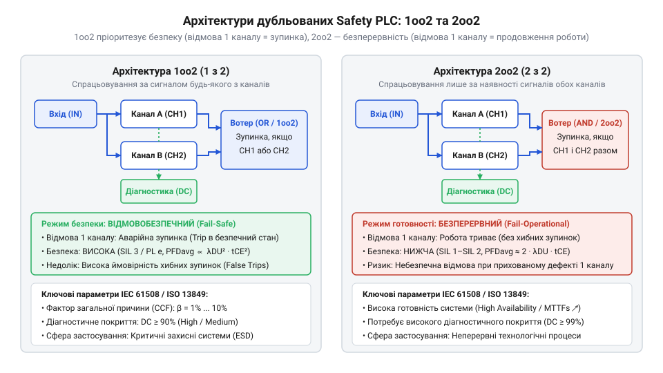
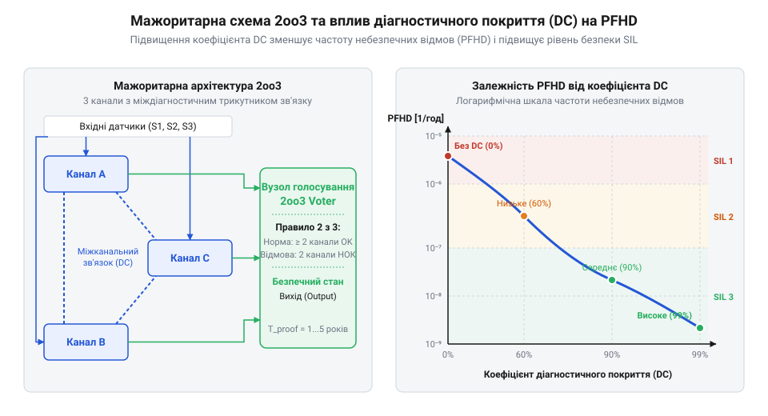

# Розрахунок показників надійності SIL, PFD та PFHD для дубльованих архітектур Safety PLC

<preknowlist>
- [Вхідні модулі дискретних входів безпеки (F-DI)](root:cat-hw-boards/fail-safe-digital-input-modules) — Принципи побудови вхідних кіл із подвійним розмиканням та діагностикою коротких замикань
</preknowlist>

## Небезпека прихованої відмови в контролері

У промислових системах автоматизації критичних процесів усі апаратні відмови обладнання поділяють на два принципово різні класи: безпечні відмови (англ. safe failures) та приховані небезпечні відмови (англ. dangerous undetected failures). Безпечна відмова виникає тоді, коли пошкодження елемента контролера переводить систему у захищений стан — наприклад, викликає хибне розмикання контактора та зупинку конвеєра. Попри фінансові збитки від простою, така подія не загрожує життю людей. Натомість прихована небезпечна відмова є найнебезпечнішим сценарієм: внутрішній елемент (тригер, вихідний ключ чи оптична розв'язка) виходить з ладу і залишається у замкненому стані, але система не видає жодної індикації про пошкодження. Під час реальної аварійної ситуації такий контролер неспроможний зняти живлення з виконавчих механізмів.

Одиночна апаратна структура `1oo1` (англ. 1-out-of-1, один із одного) складається з одного обчислювального каналу і безпосередньо вразлива до прихованих відмов. Повний баланс надійності елемента описується розкладом сумарної інтенсивності відмов `λ = λ_s + λ_d`, де частка `λ_s` (від англ. safe, безпечний) відповідає відмовам із переходом у захищений стан, а `λ_d` (від англ. dangerous, небезпечний) характеризує потенційно катастрофічні збої. Для зменшення ризику апаратну частину доповнюють автоматичною діагностикою, яка виявляє частину небезпечних відмов `λ_dd` (від англ. dangerous detected), залишаючи прихованою лише частку `λ_du` (від англ. dangerous undetected). Співвідношення між цими компонентами задається коефіцієнтом діагностичного покриття (англ. @@en|Diagnostic Coverage@@, @@en|DC@@; @@en|коефіцієнт діагностичного покриття Diagnostic Coverage DC@@), який показує частку виявлених небезпечних відмов `DC = λ_dd ÷ λ_d`. Вивід математичного виразу для інтенсивності прихованих небезпечних відмов `λ_du` виконується з підстановкою виявленої частки у підсумкову суму `λ_d = λ_dd + λ_du`:

    λ_du = λ_d - λ_dd
         = λ_d - (DC × λ_d)      [підстановка виразу λ_dd = DC × λ_d]
         = (1 - DC) × λ_d        [винесення сумарної небезпечної інтенсивності λ_d за дужки]

Отриманий вираз показує, що при відсутності діагностики (`DC = 0`) усі небезпечні відмови залишаються прихованими (`λ_du = λ_d`), тоді як високе діагностичне покриття (наприклад, `DC = 99%`) зменшує інтенсивність небезпечних прихованих відмов у сотню разів. Фізичний механізм виникнення прихованої відмови на вхідному каскаді [Вхідні модулі дискретних входів безпеки (F-DI)](root:cat-hw-boards/fail-safe-digital-input-modules) найчастіше полягає в електричному пробої вихідного фототранзистора опторозв'язки або замиканні сигнального провідника на лінію живлення 24 В. Через це явище заклинювання у високому стані (англ. stuck-at high) напруга на вході залишається високою навіть при розмиканні зовнішнього аварійного контакту. Оскільки одиничний процесорний блок не має другого каналу для порівняння, невиявлена відмова `λ_du` повністю блокує функцію безпеки до моменту проведення чергового контрольного тестування.

Для кількісної оцінки ризику катастрофічних аварій міжнародний стандарт IEC 61508 увів дві ключові імовірнісні метрики:
1. `PFD_avg` (англ. Average Probability of Dangerous Failure on Demand) — середня ймовірність небезпечної відмови за запитом. Використовується для систем низькочастотного запиту (англ. low-demand mode), де захист спрацьовує рідше одного разу на рік.
2. `PFHD` (англ. Probability of Dangerous Failure per Hour) — частота виникнення небезпечної відмови на годину. Застосовується для систем високої частоти або безперервного задіяння (англ. high-demand or continuous mode).

Отримані значення `PFD_avg` та `PFHD` є математичною основою для визначення рівнів повноти безпеки @@en|SIL@@ (англ. Safety Integrity Level) від SIL 1 до SIL 4.

Розрахункові пороги цих метрик встановлюють жорсткі межі: що вищий потрібний рівень безпеки, то меншою має бути ймовірність невиявленого збою процесорного вузла. Оскільки для одиничної структури `1oo1` досягнення показників `PFD_avg < 10⁻³` чи `PFHD < 10⁻⁷ 1/h` є фізично неможливим через обмеження надійності елементної бази, інженери змушені переходити від математичного аналізу одиничного каналу до моделювання багатокритеріальних дубльованих архітектур.

## Математика дубльованих структур 1oo2 та 2oo2

Для подолання вразливості одиночного каналу застосовують дубльовані та резервовані апаратні архітектури. Загальна інтенсивність небезпечних відмов каналу `λ_d` (грецька літера лямбда з індексом d) поділяється на діагностовану частку `λ_dd` та приховану частку `λ_du` через коефіцієнт діагностичного покриття `DC` (англ. diagnostic coverage):

```text
λ_dd
= DC × λ_d                      [інтенсивність виявлених відмов]

λ_du
= (1 - DC) × λ_d                [інтенсивність прихованих відмов]
```

Для одиночної структури `1oo1` середня ймовірність небезпечної відмови за запитом `PFD_avg` лінійно залежить від інтервалу тестування `T_1` (англ. proof test interval):

```text
PFD_avg(1oo1)
= λ_du × (T_1 / 2)              [середнє значення за інтервал T1]
```

Архітектура `1oo2` (англ. 1-out-of-2, один із двох) містить два паралельні канали, і для виконання функції безпеки достатньо спрацьовування хоча б одного з них. Система потрапляє у стан небезпечної відмови за запитом лише тоді, коли приховані відмови виникають в обох каналах одночасно. Алгебраїчний вивід середньої ймовірності відмови базується на інтегруванні миттєвої ймовірності подвійної відмови на інтервалі контрольного тестування `T_1`. Оскільки миттєва ймовірність прихованої небезпечної відмови одного каналу за час `t` становить `P(t) ≈ λ_du × t` (де `λ_du` — інтенсивність небезпечних прихованих відмов), ймовірність одночасного збою двох незалежних каналів у момент `t` дорівнює їхньому добутку `P_1oo2(t) = (λ_du × t)² = λ_du² × t²`. Геометричний зміст цього інтегрування полягає у знаходженні середньої висоти параболічної поверхні накопичення відмов у часовому квадратичному вікні `[0, T_1] × [0, T_1]`: миттєвий ризик зростає квадратично від нуля до максимального значення `(λ_du × T_1)²` наприкінці інтервалу тестування, а площа під параболою `t²` становить точнісінько `1 / 3` від площі описного прямокутника `T_1 × T_1² = T_1³`. Усереднення цієї величини за весь інтервал тестування `T_1` здійснюється інтегруванням:

```text
PFD_avg(1oo2)
= (1 / T_1) × ∫₀ᵀ¹ (λ_du² × t²) dt   [інтегрування миттєвої ймовірності відмови]
= (1 / T_1) × λ_du² × [t³ / 3]₀ᵀ¹    [обчислення первісної функції]
= (λ_du² / T_1) × (T_1³ / 3)         [підстановка меж інтегрування [0, T1]]
= (λ_du)² × (T_1² / 3)               [алгебраїчне скорочення T1]
```

Саме квадратичний множник `T_1² / 3` пояснює, чому резервування `1oo2` забезпечує набагато сильніше пригнічення ймовірності відмови порівняно з одиночною структурою `1oo1`.

```text
PFD_avg(1oo2)
= (λ_du)² × (T_1² / 3)          [квадратичне зниження ймовірності відмови]
```

Натомість структура `2oo2` (англ. 2-out-of-2, два з двох) вимагає одночасного спрацьовування обох каналів для зупинки процесу. Це повністю виключає хибні зупинки виробництва, проте подвоює ймовірність небезпечної відмови:

```text
PFD_avg(2oo2)
= 2 × λ_du × (T_1 / 2)
= λ_du × T_1                    [подвоєна ймовірність відмови порівняно з 1oo1]
```


*Порівняльні схеми потоку сигналів у структурах 1oo2 та 2oo2 та комбінаторний розподіл відмов.*

**Приклад розрахунку PFD_avg для 1oo1 та 1oo2:**
Нехай інтенсивність прихованих небезпечних відмов каналу становить `λ_du = 10⁻⁶ 1/h` (одна відмова на мільйон годин), а контрольне тестування проводиться раз на рік (`T_1 = 8760 h`):

```text
PFD_avg(1oo1)
= 10⁻⁶ × (8760 / 2)              [підстановка параметрів для 1oo1]
= 10⁻⁶ × 4380
= 4.38 × 10⁻³                    [відповідає рівню SIL 2]

PFD_avg(1oo2)
= (10⁻⁶)² × (8760² / 3)          [підстановка параметрів для 1oo2]
= 10⁻¹² × (76.74 × 10⁶ / 3)
= 2.56 × 10⁻⁵                    [відповідає рівню SIL 3]
```

Як видно з розрахунку, перехід від `1oo1` до `1oo2` зменшує ймовірність прихованої відмови на два порядки.

## Вплив спільної причини відмов і фактор β

Ідеальне квадратичне зниження імовірності відмови в архітектурі `1oo2` припускає абсолютну статистичну незалежність двох каналів. Проте у реальних промислових умовах виникають відмови спільної причини @@en|Common Cause Failures@@ (англ. common cause failures, CCF). Вплив спільних джерел живлення, електромагнітних завад, перегріву шафи шасі чи помилок у мікропрограмному забезпеченні призводить до одночасного виходу з ладу обох дубльованих каналів.

Для врахування CCF використовують модель `β`-фактора (грецька літера бета), яка визначає частку небезпечних відмов, що уражають усі канали одночасно. За стандартом @@en|IEC 61508-6@@ значення `β` розраховують на основі оцінки сумарного бала `S` за інженерними критеріями захисту: просторового розведення кіл і трас (для запобігання поширенню локальних пожеж чи механічних пошкоджень), гальванічної розв'язки та використання незалежних джерел живлення (для захисту від спільних сплесків напруги), а також різнотипних процесорів та програмного забезпечення (різнорідна різноманітність для усунення систематичних помилок). Залежність підсумкового `β`-фактора від накопиченої суми балів `S` визначається за нормативною шкалою стандарту IEC 61508-6:

| Накопичена сума балів S | Оціночне значення β-фактора | Рівень захисту від CCF |
|---|---|---|
| `S < 40` | `β = 10%` (`0.10`) | Низький (мінімальна ізоляція) |
| `40 ≤ S < 70` | `β = 5%` (`0.05`) | Середній (стандартний промисловий) |
| `70 ≤ S < 90` | `β = 2%` (`0.02`) | Високий (роздільні плати та живлення) |
| `S ≥ 90` | `β = 1%` (`0.01`) | Максимальний (повна різнорідність каналів) |

Чим більший рівень ізоляції та різнорідності каналів реалізовано, тим вищим є бал `S` і тим нижчим є значення `β`-фактора, а загальна інтенсивність небезпечних неохоплених діагностикою відмов `λ_du` розщеплюється на дві складові:

```text
λ_du_ind
= (1 - β) × λ_du                [незалежна складова відмов]

λ_du_CCF
= β × λ_du                      [спільна складова відмов]
```

З урахуванням `β`-фактора уточнена формула `PFD_avg` для структури `1oo2` набирає вигляду:

```text
PFD_avg(1oo2_CCF)
= (1 - β)² × (λ_du)² × (T_1² / 3) + β × λ_du × (T_1 / 2) [сума незалежної та спільної складових]
```

Оскільки перший доданок квадратично малий, основний внесок у небезпечну відсутність готовності робить саме спільна складова `β × λ_du × (T_1 / 2)`. При типовому значенні `β = 5%` (0.05) надійність структури `1oo2` обмежується саме фактором спільної причини.

Для компромісу між безпекою та готовністю застосовують мажоритарне голосування `2oo3` (англ. 2-out-of-3, два з трьох). У цій архітектурі три канали працюють паралельно, а рішення приймається за більшістю голосів.


*Мажоритарне голосування 2oo3 та залежність показників небезпечних відмов від коефіцієнта діагностики DC.*

Для мажоритарної структури `2oo3` формула `PFD_avg` із урахуванням `β`-фактора становить:

```text
PFD_avg(2oo3)
= (1 - β)² × (λ_du)² × T_1² + β × λ_du × (T_1 / 2) [мажоритарний розрахунок з CCF]
```

Високий коефіцієнт діагностичного покриття `DC ≥ 99%` у поєднанні з оптимізованим фактором `β ≤ 2%` дозволяє реалізувати системи класу `SIL 3` та `PL e` для найбільш відповідальних промислових об'єктів.

## Мажоритування 2oo3 та діагностичне покриття

Мажоритарна техніка `2oo3` (англ. 2-out-of-3, два з трьох) поєднує високу функціональну безпеку із безперервною готовністю системи. Для виконання аварійного вимкнення контролер вимагає збігу сигналів щонайменше двох каналів із трьох. Одиночний хибний сигнал в одному із каналів ігнорується мажоритарним елементом голосування (англ. voting element), що повністю виключає зупинку виробничої лінії через локальну заваду.

Ключовим фактором підтримання високого SIL є коефіцієнт діагностичного покриття `DC` (англ. diagnostic coverage), який визначає відношення виявлених небезпечних відмов до загальної інтенсивності небезпечних відмов `λ_d`. Завдяки апаратній перевірці [Вхідні модулі дискретних входів безпеки (F-DI)](root:cat-hw-boards/fail-safe-digital-input-modules), тактуванню тестовими імпульсами та оперативному самоконтролю процесорних ядер значення `DC` досягає 99%.

Середній час до небезпечної відмови `MTTF_d` (від англ. @@en|Mean Time to Dangerous Failure@@ — середній час до небезпечної відмови) для одного каналу розраховується через інтенсивність невиявлених відмов `λ_du`. Коефіцієнт 6 у комбінаторному доданку формули `PFHD(2oo3)` походить із підрахунку кількості впорядкованих пар каналів, здатних спричинити відмову голосування 2 з 3. З трьох незалежних каналів можна сформувати `C(3, 2) = 3` унікальні пари (канали A-B, B-C, A-C). Для кожної такої пари існує 2 послідовності виникнення відмов у часі (спочатку перший канал, потім миттєво другий, або навпаки), що дає `3 × 2 = 6` впорядкованих комбінацій. Математично це виводиться через число сполучень `C(3, 2) = 3! ÷ (2! × 1!) = 3` та кількість перестановок у парі `2! = 2`, що дає структурний добуток `3 × 2 = 6`. З урахуванням середнього часу перебування першого відмовленого каналу в небезпечному стані `T_1 / 2` за інтервал тестування `T_1`, комбінаторний коефіцієнт розраховується так:

```text
N_pairs
= C(3, 2)                      [число комбінацій вибору 2 каналів з 3]
= 3! / (2! × 1!)               [формула сполучень без повторень]
= 3                            [кількість унікальних пар каналів]

N_ordered
= N_pairs × 2                  [урахування послідовності відмови каналів в утвореній парі]
= 3 × 2
= 6                            [структурний комбінаторний множник]
```

Отриманий множник 6 відображає всі можливі шляхи подвійного виходу з ладу процесорних каналів до моменту проведення чергового тестового обслуговування.

```text
MTTF_d
= 1 / λ_du                      [обернена величина інтенсивності невиявлених відмов]
```

Для системи безперервного задіяння частота небезпечних відмов на годину `PFHD` у мажоритарній структурі `2oo3` визначається сумою незалежних комбінаторних відмов та відмов спільної причини з `β`-фактором:

```text
PFHD(2oo3)
= 6 × (1 - DC) × (λ_d)² × T_1 + β × (1 - DC) × λ_d [комбінована формула з діагностикою та CCF]
```

**Приклад розрахунку PFHD для мажоритарного вузла 2oo3:**
Нехай інтенсивність небезпечних відмов одного процесорного каналу становить `λ_d = 10⁻⁵ 1/h`, коефіцієнт діагностичного покриття `DC = 0.99` (99%), `β = 0.02` (2%), а інтервал тестування `T_1 = 8760 h`:

```text
λ_du
= (1 - 0.99) × 10⁻⁵              [підстановка DC та λ_d]
= 10⁻⁷ 1/h                      [інтенсивність невиявлених відмов]

PFHD(2oo3)
= 6 × 0.01 × (10⁻⁵)² × 8760 + 0.02 × 10⁻⁷ [підстановка у формулу PFHD]
= 6 × 0.01 × 10⁻¹⁰ × 8760 + 2 × 10⁻⁹
= 5.25 × 10⁻⁸ + 2 × 10⁻⁹
= 5.45 × 10⁻⁸ 1/h               [підсумкова частота відмов]
```

Отримане значення `PFHD = 5.45 × 10⁻⁸ 1/h` впевнено входить у нормативи класу `SIL 3` (межа від `10⁻⁸` до `10⁻⁷ 1/h`), одночасно гарантуючи захист від хибних спрацьовувань.

Таким чином, мажоритарна схема `2oo3` розв'язує фундаментальний компроміс між надійністю та готовністю: на відміну від дубльованої структури `1oo2`, яка оптимізована виключно під безпечне знеструмлення за рахунок частих хибних зупинів, та схеми `2oo2`, яка утримує виробництво ціною зниження рівня безпеки, конфігурація `2oo3` у поєднанні з високим діагностичним покриттям `DC ≥ 99%` забезпечує відмовостійкість без переривання технологічного процесу.

## Категоризація та класифікація рівнів SIL і PL

Після обчислення чисельних показників `PFD_avg` та `PFHD` розробник здійснює класифікацію системи відповідно до міжнародних стандартів IEC 61508 та ISO 13849. Граничні значення ймовірностей відмов визначають рівень повноти безпеки @@en|SIL@@ (англ. Safety Integrity Level) та рівень продуктивності @@en|PL@@ (англ. Performance Level):

1. **Режим низької частоти запитів (Low Demand, IEC 61508):**
   - `SIL 1`: `10⁻² ≤ PFD_avg < 10⁻¹`
   - `SIL 2`: `10⁻³ ≤ PFD_avg < 10⁻²`
   - `SIL 3`: `10⁻⁴ ≤ PFD_avg < 10⁻³`
   - `SIL 4`: `10⁻⁵ ≤ PFD_avg < 10⁻⁴`

2. **Безперервний режим роботи (High Demand / Continuous, IEC 61508 / ISO 13849):**
   - `SIL 1` / `PL c`: `10⁻⁶ ≤ PFHD < 10⁻⁵ 1/h`
   - `SIL 2` / `PL d`: `10⁻⁷ ≤ PFHD < 10⁻⁶ 1/h`
   - `SIL 3` / `PL e`: `10⁻⁸ ≤ PFHD < 10⁻⁷ 1/h`

Окрім чисельних імовірнісних розрахунків, стандарт вимагає дотримання архітектурних обмежень за допомогою апаратної відмовостійкості `HFT` (від англ. @@en|Hardware Fault Tolerance@@ — апаратна відмовостійкість). Величина `HFT = N` означає, що система зберігає виконання функції безпеки при одночасній відмові `N` апаратних каналів. Допустимий рівень @@en|SIL@@ визначається не лише величиною `HFT`, а й часткою безпечних відмов `SFF` (від англ. @@en|Safe Failure Fraction@@ — частка безпечних відмов) у поєднанні з типом складності компонента. Стандарт поділяє елементи на пристрої типу A (від англ. @@en|Type A Devices@@ — прості компоненти на кшталт реле й вимикачів, чиї режими відмов повністю визначені й підтверджені статистикою) та типу B (від англ. @@en|Type B Devices@@ — складні мікропроцесорні пристрої, включно з Safety PLC, де через внутрішню логіку неможливо вичерпно передбачити всі збої). Через цю потенційну невизначеність пристрої типу B вимагають значно вищих порогів `SFF` для досягнення одного й того ж рівня `SIL` за однакового значення `HFT`. Величина `SFF` обчислюється так:

```text
SFF
= (λ_s + λ_dd) / (λ_s + λ_d)    [відношення безпечних та виявлених відмов до загальної суми]
```

де `λ_s` — інтенсивність безпечних відмов, `λ_dd` — інтенсивність виявлених небезпечних відмов, а `λ_d` — загальна інтенсивність небезпечних відмов. Для складних мікропроцесорних пристроїв типу B (від англ. @@en|Type B Devices@@ — складні програмовані елементи), якими є модулі @@en|Safety PLC@@, матриця архітектурних обмежень IEC 61508-2 визначає мінімально необхідний рівень `HFT`: при `90% ≤ SFF < 99%` для досягнення `SIL 3` вимагається значення `HFT ≥ 1` (архітектури `1oo2` чи `2oo3`), тоді як для пристроїв типу A (прості електромеханічні реле) аналогічний рівень `SIL 3` досягається вже при `60% ≤ SFF < 90%` за умови `HFT = 1`.

Досягнення найвищих рівнів безпеки `SIL 3` чи `PL e` вимагає обов'язкового поєднання трьох умов:
- Структура з апаратною відмовостійкістю `HFT ≥ 1` (архітектури `1oo2` або `2oo3`);
- Високий коефіцієнт діагностики `DC ≥ 99%`;
- Обчислений показник `PFHD < 10⁻⁷ 1/h` та мінімізований фактор спільної причини `β ≤ 2%`.

Такий математичний аудит гарантує повну відповідність завадостійких промислових контролерів Safety PLC найсуворішим вимогам функціональної безпеки.
