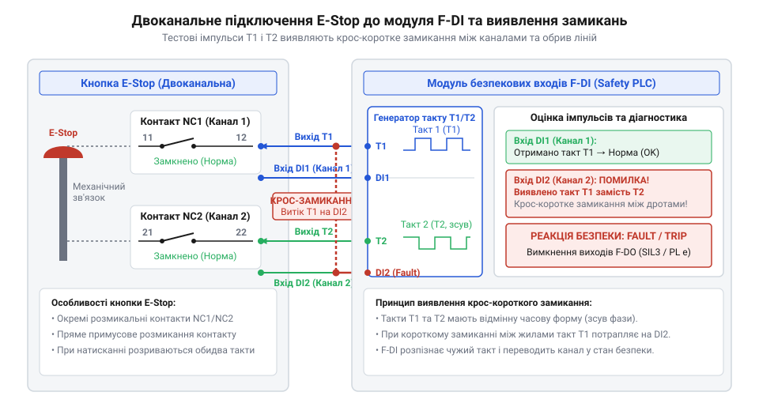
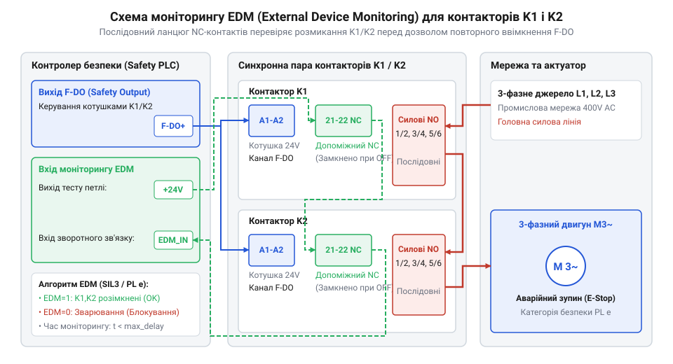
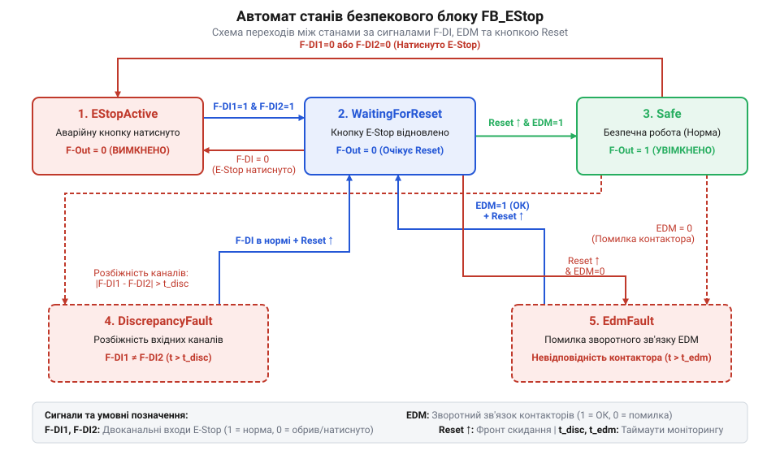

# Проєкт побудови аварійного зупину лінії на базі Safety PLC та безпекових входів F-DI/F-DO

<preknowlist>
- [Вхідні модулі дискретних входів безпеки (F-DI)](root:cat-hw-boards/fail-safe-digital-input-modules) — потрібні знання про схемотехнічне влаштування та внутрішні захисні ланцюги безпекових входів.
</preknowlist>

## Небезпека некоректного вимкнення промислової лінії

Уявіть ситуацію в пакувальному цеху: рука робота або секція конвеєра зачепила одяг працівника. Оператор тисне кнопку зупинки на панелі керування, але конвеєр продовжує рухатися, бо контакт вихідного реле звичайного контролера зварився від пускового струму двигуна, або його процесор завис у циклі логіки. Спроба довірити аварійний зупин стандартній автоматизації створює смертельну загрозу для персоналу та ризик руйнування механізмів.

Звичайний програмований логічний контролер (англ. @@en|PLC@@, від лат. @@en|logica@@ — логіка) розроблено для оптимізації технологічного процесу, а не для збереження життя. У ньому програма виконується послідовно в одному ядрі. Якщо в пам'яті через електромагнітні завади пошкодиться біт або процесор потрапить у безкінечний цикл, вихідний сигнал залишиться активним незалежно від входів. На апаратному рівні силовий контактор двигуна під час розмикання під навантаженням зазнає впливу електричної дуги. Деградація контактних груп спричиняє явище приварювання контактів (англ. @@en|contact welding@@, від англ. @@en|contact@@ — контакт та @@en|welding@@ — зварювання). В одноканальній системі приварювання контактів унеможливлює знеструмлення лінії: силове коло залишається замкненим навіть після зняття напруги з котушки.

Для усунення цих ризиків міжнародні нормативи з безпеки машин, зокрема регульовані [стандартом ISO 13849-1](root:sys-notary/iso-13849-machinery-safety-categories) та концепцією [рівнів цілісності SIL](root:sys-notary/iec-61508-sil), вимагають повного відокремлення контуру функціональної безпеки від стандартної логіки керування. Контур аварійного вимкнення (англ. @@en|Emergency Stop@@, від англ. @@en|emergency@@ — надзвичайна ситуація та @@en|stop@@ — зупинка) будують на базі сертифікованого контролера безпеки (англ. @@en|Safety PLC@@, від англ. @@en|safety@@ — безпека та лат. @@en|logica@@ — логіка). Архітектурна відмінність @@en|Safety PLC@@ полягає у використанні резервованої мультипроцесорної структури, постійному самодіагностуванні пам'яті й периферії та гарантованому переході в безпечний стан відмови (англ. @@en|Fail-Safe@@, від англ. @@en|fail@@ — відмова, збій та @@en|safe@@ — безпечний) при виявленні найменшої аномалії.

Критичним параметром є час реакції безпекового контуру від розмикання контактів кнопки аварійного зупину до знеструмлення силових ланцюгів. Якщо стандартний контролер має час циклу 20–50 мс плюс затримку обробки переривань, то @@en|Safety PLC@@ забезпечує детермінований час відгуку (зазвичай до 10–20 мс) із гарантованим відключенням виходів. Стан @@en|Fail-Safe@@ для конвеєра вимагає знеструмлення всіх рухомих актюаторів: деенергізації котушок контакторів, активації механічних гальм і зняття дозволу роботи з частотних перетворювачів. Мережеву взаємодію між контролерами безпеки реалізують через обмін даними за допомогою [протоколу PROFIsafe](root:com-protocol/profisafe-protocol), а для місцевих сигналів застосовують [модулі дискретних входів безпеки](root:cat-hw-boards/fail-safe-digital-input-modules).

## Двоканальна схемотехніка входів модулів F-DI

У разі короткого замикання сигнального проводу на джерело живлення +24 В кнопка зупинки з одним розмикальним контактом (англ. @@en|Normally Closed@@, NC) втрачає здатність розмикати коло, залишаючи лінію під напругою навіть після натискання. Для досягнення вищих категорій безпеки SIL3 та PL e застосовують двоканальне підключення кнопки аварійної зупинки з двома незалежними NC-контактами (структура @@en|1oo2@@ — один із двох, від англ. @@en|One Out of Two@@).

Однак пошкодження кабелю чи розплавлення ізоляції спричиняє перехресне замикання (англ. @@en|cross-circuit@@, від англ. @@en|cross@@ — перехресний та лат. @@en|circuitus@@ — коло, обхід) між жилами обох каналів, через що напруга другого каналу підживлює перший. Для виявлення таких замикань модуль [модулі дискретних входів безпеки](root:cat-hw-boards/fail-safe-digital-input-modules) @@en|F-DI@@ (від англ. @@en|Fail-Safe Digital Input@@) генерує на виходах тактування T1 та T2 тестові імпульси (англ. @@en|test pulses@@), зсунуті за фазою. Перший контакт кнопки @@en|Emergency Stop@@ живиться від T1 і підключається до входу Ch A, а другий живиться від T2 і підключається до входу Ch B.

У Фазі 0 вихід T1 видає +24 В, а T2 — 0 В; у Фазі 1 навпаки: T1 перебуває в 0 В, а T2 генерує +24 В. При перехресному замиканні між Ch A та Ch B імпульс із T1 потрапляє на обидва входи одночасно. Модуль @@en|F-DI@@ виявляє невідповідність очікуваній фазовій послідовності, реєструє помилку `SAFETY_FAULT_CROSS_CHANNEL` і переводить систему в стан @@en|Fail-Safe@@. Аналогічно виявляються замикання на VCC (+24V) та GND (0V).


*Принципова схема підключення двоканальної кнопки E-Stop з розмикальними контактами до модуля F-DI з тестовими імпульсами тактування.*

Під час механічного натискання грибка через фізичний люфт або знос пружини контакти розмикаються не абсолютно одночасно. Цю часову затримку називають часом розбіжності (англ. @@en|discrepancy time@@, від лат. @@en|discrepantia@@ — відмінність, розбіжність). Конфігуратор @@en|F-DI@@ задає допустимий поріг розбіжності (наприклад, 50–100 мс). Якщо один контакт розімкнувся, а інший залишається замкненим довше за таймаут, модуль @@en|F-DI@@ фіксує апаратну несправність `SAFETY_FAULT_DISCREPANCY`, після чого відновлення роботи можливе лише після усунення дефекту та квитування (Reset).

Програмування низькорівневої обробки входів @@en|F-DI@@ з перевіркою фазових імпульсів та оцінкою розбіжності реалізується у вигляді програмних блоків на C, C++ та Structured Text:

:::tabs
@tab C
:::code proj-safety-plc-emergency-stop-integration/c/include/safety_plc.h 1-125
:::code proj-safety-plc-emergency-stop-integration/c/src/safety_plc.c 1-194

@tab C++
:::code proj-safety-plc-emergency-stop-integration/cpp/SafetyTypes.hpp
:::code proj-safety-plc-emergency-stop-integration/cpp/EStopBlock.hpp
:::code proj-safety-plc-emergency-stop-integration/cpp/EStopBlock.cpp

@tab Structured Text
:::code proj-safety-plc-emergency-stop-integration/structured-text/SafetyTypes.st
:::code proj-safety-plc-emergency-stop-integration/structured-text/FB_EStop.st
:::

## Контроль контакторів через ланцюг EDM

Вимкнення силового живлення конвеєрної лінії згідно з вимогами SIL3 та PL e вимагає використання двох послідовно з'єднаних силових контакторів KM1 та KM2, якими керує модуль виходів безпеки @@en|F-DO@@ (від англ. @@en|Fail-Safe Digital Output@@). Проте якщо один із контакторів приварився під час попереднього вимкнення, залишкова безпека системи падає з двоканальної до одноканальної (1oo1), і наступний пуск стане фатальним.

Для відстеження фізичного стану силових контактів використовують ланцюг зворотного зв'язку та моніторингу зовнішніх пристроїв (англ. @@en|External Device Monitoring@@, EDM, від лат. @@en|externus@@ — зовнішній та @@en|monitor@@ — той, що застерігає). Кожен силовий контактор забезпечується додатковим розмикальним допоміжним NC-контактом, механічно жорстко пов'язаним із основними силовими NO-контактами (примусово керовані контакти згідно з EN 60947-5-1). Допоміжні NC-контакти контакторів KM1 та KM2 з'єднуються послідовно й підключаються до входу контролера безпеки. Стан цього ланцюга завжди інверсний до виходу @@en|F-DO@@: при вимкненому виході силові NO-контакти розімкнені, а допоміжні NC-контакти замкнені — вхід EDM отримує високий рівень +24 В (`true`). Коли вихід увімкнено, NO-контакти замикаються, а NC-контакти розмикаються — вхід EDM стає 0 В (`false`).


*Схема підключення безпекового виходу F-DO до подвійного силового контактора з послідовним ланцюгом зворотного зв'язку EDM на допоміжних NC-контактах.*

Якщо під час вимкнення виходу @@en|F-DO@@ один із контакторів приварився, його допоміжний NC-контакт не замкнеться, і вхід EDM залишиться `false`. Блок моніторингу EDM запускає внутрішній таймер затримки (зазвичай 100–250 мс). Якщо по закінченню цього часу стан входу EDM не відповідає очікуваному, контролер фіксує критичну помилку `SAFETY_FAULT_DO_FEEDBACK` або `EdmFaultState::ContactWelded` і блокує повторне ввімкнення лінії до заміни пошкодженого контактора та натискання кнопки скидання (Reset).

Реалізація моніторингу контакторів через ланцюг EDM та головного детермінованого циклу представлена у відповідних модулях коду на C, C++ та ST:

:::tabs
@tab C
:::code proj-safety-plc-emergency-stop-integration/c/src/safety_plc.c 195-333
:::code proj-safety-plc-emergency-stop-integration/c/main.c

@tab C++
:::code proj-safety-plc-emergency-stop-integration/cpp/EdmMonitor.hpp
:::code proj-safety-plc-emergency-stop-integration/cpp/main.cpp

@tab Structured Text
:::code proj-safety-plc-emergency-stop-integration/structured-text/FB_EDM_Monitor.st
:::code proj-safety-plc-emergency-stop-integration/structured-text/MAIN_Safety.st
:::

## Логіка аварійного зупину в Safety PLC

Спроба реалізувати алгоритм аварійного вимкнення у звичайному скані стандартного PLC створює ризик через недетерміноване оновлення виходів при збої. Щоб забезпечити рівні функціональної безпеки (від англ. @@en|Safety Integrity Level 3@@; @@en|SIL3@@) та (від англ. @@en|Performance Level e@@; @@en|PL e@@), керування контуром (від англ. @@en|Emergency Stop@@; @@en|аварійний зупин@@; @@en|E-Stop@@) довіряють (від англ. @@en|Safety PLC@@; @@en|безпековий контролер@@). Його фонове безпекове середовище виконує алгоритм у суворо детермінованій фоновій задачі із гарантованим часом реакції (типово менше 10–20 мс). Логічна частина розробляється на базі сертифікованого функціонального блоку `FB_EStop`, що реалізує скінченний детермінований автомат станів (від англ. @@en|state machine@@; @@en|автомат станів@@).

Автомат станів гарантує, що при пошкодженні ліній чи натисканні грибка аварійного вимкнення система миттєво переходить у (від англ. @@en|Fail-Safe@@; @@en|відмовостійкий безпечний стан@@), повністю знеструмлюючи виходи безпеки (від англ. @@en|F-DO@@; @@en|дискретні виходи безпеки@@). Стан `STATE_SAFE` (або `SafetyState::Safe`) відповідає нормальній роботі: обидва розмикальні контакти кнопки замкнені, фазовий відгук `T1`/`T2` збігається, а силові контактори підтвердили включення через ланцюг (від англ. @@en|External Device Monitoring@@; @@en|моніторинг зовнішнього пристрою@@; @@en|EDM@@). При натисканні кнопки контакти розмикаються, і блок переходить у стан `STATE_ESTOP_ACTIVE`, негайно вимикаючи керування High-Side та Low-Side ключами.

Критичною вимогою стандарту EN ISO 13849-1 є заборона автоматичного відновлення руху лінії після того, як оператор витягне натиснуту кнопку E-Stop назад. Блок безпеки переходить у проміжний стан `STATE_WAITING_FOR_RESET` (або `SafetyState::WaitingForReset`). У стані STATE_WAITING_FOR_RESET (або SafetyState::WaitingForReset) силові виходи F-DO залишаються знеструмленими, а система очікує свідомого підтвердження через операцію (від англ. @@en|Manual Reset@@; @@en|ручне скидання@@). Програмна логіка вимагає виявлення наростаючого фронту (від англ. @@en|rising edge@@; @@en|наростаючий фронт@@) від фізичної кнопки скидання (детектора `R_TRIG` в ST або аналізу змінних у C/C++). Якщо кнопку `Reset` заклинило у замкненому стані або закоротили на +24 V, повторне ввімкнення блокується (англ. @@en|anti-tiedown logic@@).

Окрім обробки штатного вимкнення, функціональний блок реалізує моніторинг часової розбіжності між двома каналами (від англ. @@en|discrepancy time@@; @@en|час розбіжності@@). При зносі контактної групи кнопки один із контактів NC може розімкнутися раніше. Якщо час між спрацьовуванням двох каналів перевищує уставку `tDiscrepancyTime` (типово 50–100 мс), логіка фіксує апаратну несправність `STATE_DISCREPANCY_FAULT`. Очищення цієї помилки має найвищий пріоритет: система ігнорує кнопку `Reset` доти, доки обидва вхідні канали [вхідних модулів безпеки F-DI](root:cat-hw-boards/fail-safe-digital-input-modules) не будуть фізично приведені до замкненого стану.


*Показано графік станів автомата E-Stop та алгоритм підтвердження ручного скидання.*

:::tabs
:::code proj-safety-plc-emergency-stop-integration/c/src/safety_plc.c 144-193
:::code proj-safety-plc-emergency-stop-integration/cpp/EStopBlock.cpp 54-124
:::code proj-safety-plc-emergency-stop-integration/structured-text/FB_EStop.st 57-126
:::

На вихідному рівні логіка F-DO формує двоканальне вимкнення: верхнє плече @@en|High-Side@@ відключає силове живлення +24 V, а нижнє плече @@en|Low-Side@@ розмикає зв'язок із силовим мінусом GND. При виявленні будь-якої одиничної несправності функція `safety_plc_force_failsafe` переводить контролер у стан Fail-Safe, гарантуючи нульовий енергетичний стан приводів конвеєра. Для складних розподілених ліній передача сигналів зупину між кількома @@en|Safety PLC@@ здійснюється через спецпротоколи, такі як [безпекового протоколу PROFIsafe](root:com-protocol/profisafe-protocol-overview) або [протоколу CIP Safety](root:com-protocol/cip-safety-protocol-overview).

## Пусконалагодження та валідація контуру E-Stop

Написати програму та зібрати шафу безпеки недостатньо для введення в експлуатацію. При замиканні проводів у лотку чи зварюванні контактів реле система зовні здається справною, але під час аварії не зможе знеструмити конвеєр. Для підтвердження відповідності рівням @@en|SIL3@@ та @@en|PL e@@ за стандартом ISO 13849-2 виконують валідацію методом штучного впровадження несправностей (від англ. @@en|fault injection@@, від лат. *injicere* — впроваджувати; @@en|впровадження несправностей@@).

Валідація починається з перевірки апаратної діагностики входів @@en|F-DI@@ та виходів @@en|F-DO@@:
- **Коротке замикання на VCC (+24V)**: При подачі +24 V на вхід під час паузи імпульсу `T1` (0 V) контролер фіксує спотворення маски `history_a` (`0b11` замість `0b01`), виставляє `SAFETY_FAULT_SHORT_VCC` та знеструмлює виходи @@en|F-DO@@. Спроба виконати `Reset` під час активного замикання відхиляється;
- **Перехресне коротке замикання (Cross-fault)**: Перемичка між каналами A (`T1`) та B (`T2`) викликає високий рівень на обох клемах при такті на `T1`. Логіка @@en|Safety PLC@@ реагує виявленням `SAFETY_FAULT_CROSS_CHANNEL` за один цикл;
- **Таймаут розбіжності каналів (Discrepancy Timeout)**: При розмиканні одного контакту кнопки таймер `max_discrepancy_ms` (50 мс) блокує виходи з кодом `SAFETY_FAULT_DISCREPANCY` і вимагає усунення розбіжності перед скиданням;
- **Приварювання контактів контактора (EDM Fault)**: Імітується заклинювання реле `KM1`: при знеструмленому @@en|F-DO@@ NC-контакт не замкнувся (`i_bContactor_NC` залишається у `FALSE`). Монітор `FB_EDM_Monitor` після таймауту `tFeedbackTimeout` (250 мс) фіксує `EDM_FAULT_CONTACT_WELDED` та блокує пуск.


*Показано часові інтервали виявлення апаратних помилок та переходу виходів F-DO в безпечний стан.*

:::tabs
:::code proj-safety-plc-emergency-stop-integration/c/main.c 76-160
:::code proj-safety-plc-emergency-stop-integration/cpp/main.cpp 122-200
:::code proj-safety-plc-emergency-stop-integration/structured-text/MAIN_Safety.st 30-50
:::

Важливим етапом є вимірювання повного часу реакції системи на аварію (від англ. @@en|reaction time@@, від лат. *reactio* — протидія; @@en|час реакції системи@@). Загальний час зупину конвеєра `T_total` обчислюється як сума затримок усіх ланок ланцюга безпеки:

```text
T_total = T_DI_filter + T_PLC_cycle + T_DO_off + T_contactor_drop
```

де `T_DI_filter` — час фільтрації входів @@en|F-DI@@ (3–5 мс); `T_PLC_cycle` — цикл безпекової задачі @@en|Safety PLC@@ (10 мс); `T_DO_off` — затримка виходів @@en|F-DO@@ (менше 1 мс); `T_contactor_drop` — час відпадання контактів реле (15–30 мс). Сумарний час 30–50 мс мусить відповідати розрахованій за [процедурою оцінки ризиків](root:sys-notary/industrial-safety-risk-assessment) вимозі безпечної відстані.

Фінальним кроком є формування чек-листа валідації для сертифікаційного аудиту ISO 13849-2:
- **Перевірка 1 (Двоканальність)**: Розрив будь-якого одного проводу вимикає @@en|F-DO@@;
- **Перевірка 2 (Тестові імпульси)**: Замикання входу на +24 V або сусідній канал визначається за час менше 20 мс;
- **Перевірка 3 (Ручне скидання)**: Подача постійного `Reset` при натиснутому @@en|E-Stop@@ не призводить до автозапуску після відпускання грибка;
- **Перевірка 4 (Моніторинг EDM)**: При розімкненому NC-контакті запуск блокується із видачею сигналізації аварії `q_bFaultLamp`.
