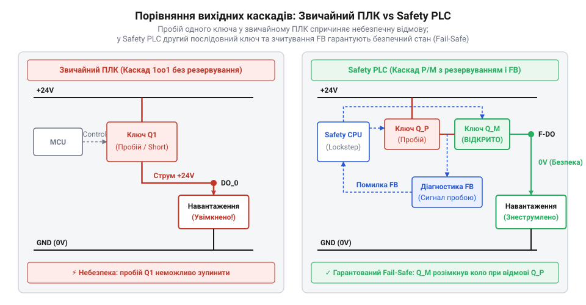
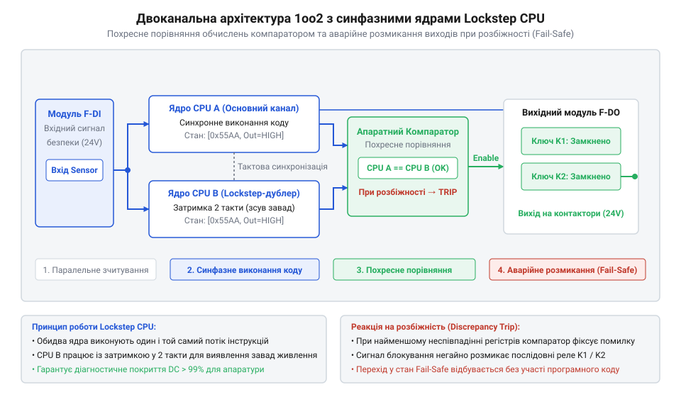
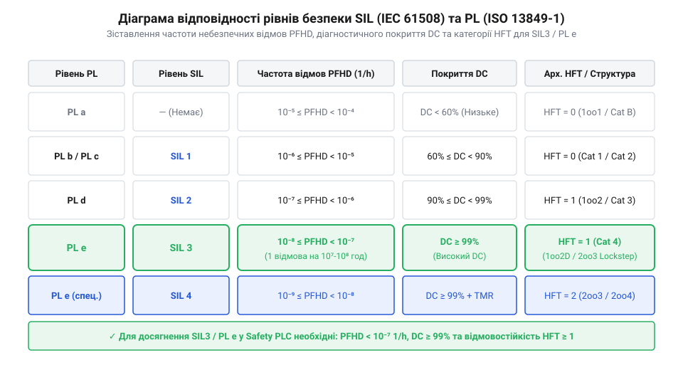
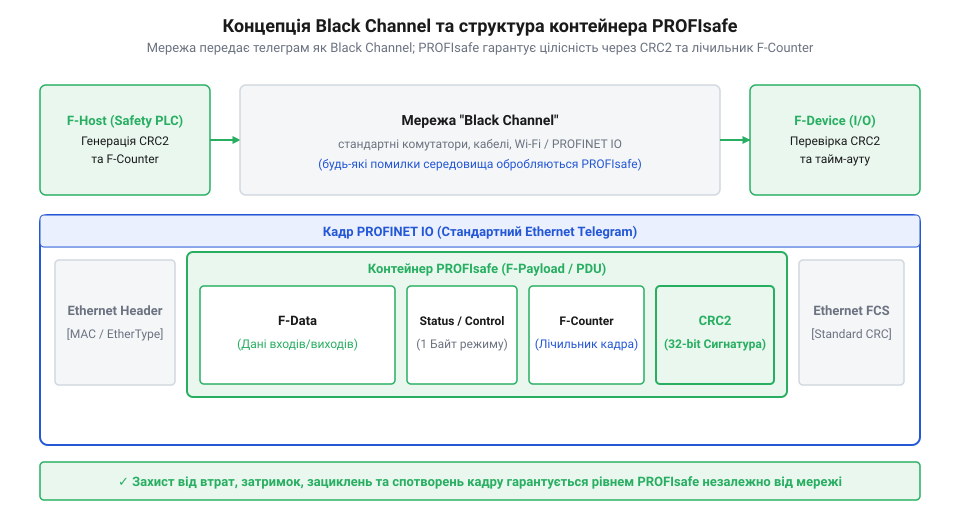
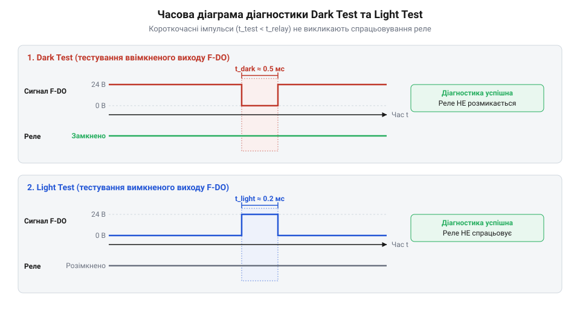

# Програмований логічний контролер безпеки

<preknowlist>
- [Вхідні модулі дискретних входів безпеки (F-DI)](root:cat-hw-boards/fail-safe-digital-input-modules) — Принципи підключення двоканальних датчиків безпеки, імпульсне тестування ліній та виявлення коротких замикань на входах.
</preknowlist>

## Небезпека відмов звичайних контролерів у промисловості

У промислових системах автоматизації керування важкими механізмами — такими як гідравлічні штампувальні преси, роботизовані осередки чи клапани скидання високого тиску — спирається на програмовані логічні контролери (від англ. @@en|PLC@@, *Programmable Logic Controller* — програмований логічний контролер; @@en|ПЛК@@). У стандартному виконанні розробка таких пристроїв орієнтована на забезпечення безперервності технологічного процесу та продуктивності. Проте апаратна структура звичайного ПЛК містить приховані вразливості, які у разі відмови напівпровідникових компонентів призводять до катастрофічних наслідків для життя операторів та цілісності обладнання.

Головна проблема стандартного ПЛК полягає у наявності єдиного каналу оброблення даних та спрощеній схемотехніці вихідних каскадів. Силовий дискретний вихід класичного контролера зазвичай будується на одному транзисторі (англ. *Metal-Oxide-Semiconductor Field-Effect Transistor*, @@en|MOSFET-транзистор@@) або вихідному реле. У разі виникнення електричного пробою, теплового перевантаження чи короткого замикання (англ. *short circuit*, від лат. *brevis* — короткий, @@en|коротке замикання@@) P-N перехід транзистора спекається у стан постійної провідності. У цей момент вихідний сигнал залишається у замкненому стані HIGH незалежно від того, які команди надсилає процесорне ядро.

Фізична природа комутованого струму суттєво впливає на швидкість зносу та деструкцію контактних груп. При перериванні змінного струму (англ. *alternating current*, від англ. *alternating* — змінний та *current* — струм; @@en|змінний струм AC@@) синусоїдальна амплітуда природно проходить через нульове значення кожні 10 мілісекунд (при частоті 50 Гц), що сприяє швидкому самогасінню виниклої плазми. Натомість у колах постійного струму (англ. *direct current*, від англ. *direct* — постійний; @@en|постійний струм DC@@), які є стандартом живлення промислових датчиків і котушок на 24 В, нульова точка відсутня. При розмиканні індуктивного DC-навантаження утворюється стійка електрична дуга (англ. *electric arc*, від лат. *arcus* — дуга; @@en|електрична дуга@@), яка підтримує високу температуру розплавлення металу протягом усього часу руху контакту. Тривале горіння дуги викликає переношення металу між електродами, утворення кратерів і призводить до приварювання контактної групи (англ. *contact welding*, від англ. *contact* — контакт та *welding* — зварювання; @@en|приварювання контактної групи@@), утримуючи вихідний ланцюг у небезпечно замкненому стані. Для запобігання зварюванню та прискореного розриву дуги в апаратних рішеннях застосовують дугогасні камери (англ. *arc chute*, від англ. *arc* — дуга та фр. *chute* — падіння або жолоб; @@en|дугогасна камера@@), які розтягують і охолоджують плазмовий шнур шляхом його поділу на серію ізольованих металевих пластин. Паралельно з контактним зазором підключають RC-снаббери (англ. *RC snubber*, від позначень *R* — опір, *C* — ємність та англ. *snub* — гасити; @@en|RC-снаббер@@), які поглинають високочастотний сплеск індуктивної енергії в момент розмикання, перенаправляючи струм екстраструму вимикання в конденсатор і обмежуючи швидкість наростання напруги dU/dt нижче порогу іонізації повітряного проміжку.

Аналогічна критична відмова характерна і для виходів на базі електромеханічних реле (англ. *electromechanical relay*, від грец. *ēlektron* — янтар, *mēchanē* — пристрій, та фр. *relais* — перепряжка, @@en|електромеханічні реле@@). При комутації високоіндуктивних навантажень, таких як котушки потужних контакторів чи електромагнітні клапани, в момент розмикання виникає високовольтний дуговий розряд. Електрична дуга викликає локальне розплавлення металу контактних подушечок і призводить до приварювання контактної групи (англ. *contact welding*, від англ. *contact* — контакт та *welding* — зварювання, @@en|приварювання контактної групи@@). Коли процесорне ядро знімає напругу з котушки реле, механічна пружина не здатна відірвати зварені контакти. Навіть на початкових стадіях зносу теплова деформація матеріалу створює суттєві часові затримки розмикання (від нормованих `10–15 мс` до сотень мілісекунд), через що кола аварійного вимкнення не встигають знеструмити обладнання у критичний віконний інтервал.


*Порівняльна схема силового виходу стандартного ПЛК із загрозою пробою одного ключа та відмовостійкої структури Safety PLC із двома послідовними транзисторами й каналом зворотного зчитування.*

Подібний небезпечний сценарій виникає і при програмних чи системних збоях. Якщо обчислювальне ядро звичайного ПЛК зависає через електростатичний розряд, збій кеш-пам'яті чи зациклення коду, периферійний модуль виходів утримує останній записаний стан регістру (від англ. @@en|latch-up@@ — фіксація стану). Навіть якщо оператор натискає фізичну кнопку аварійного зупину (від англ. @@en|Emergency Stop@@ — аварійне вимкнення; @@en|E-Stop@@), завислий процесор або пробитий вихідний транзистор продовжують живити котушку контактора преса. В результаті виконавчий механізм здійснює неконтрольований рух без можливості зупинки.

Звичайні контролери не здатні самостійно розпізнати подібні апаратні пошкодження, оскільки позбавлені внутрішніх схем діагностичного зчитування та дубльованих елементів вимкнення. Як описується в [історії розвитку контролерів безпеки](root:cat-hw-boards/safety-plc/hist-safety-plc-evolution.md), усвідомлення небезпеки таких відмов змусило промисловість висунути вимоги до створення спеціалізованого класу пристроїв — контролерів безпеки (від англ. @@en|Safety PLC@@, від англ. *safety* — безпека; @@en|Safety PLC@@), апаратна будова яких виключає збереження небезпечного стану при будь-якому поодинокому пошкодженні.

## Принципи апаратного резервування та гарантованого знеструмлення

Усунення загрози неконтрольованого руху вимагає побудови апаратури за принципом безумовного аварійного вимкнення. Спеціалізований @@en|Safety PLC@@ гарантує, що при будь-якій внутрішній або зовнішній відмові пристрій автоматично переходить у знеструмлений аварійний безпечний стан (англ. *fail-safe state*, від англ. *fail* — відмова та *safe* — безпечний; @@en|Fail-Safe State@@). Для реалізації цієї вимоги схемотехніка контролера повністю усуває єдині точки відмови (англ. *single point of failure*, від англ. *single* — єдиний та *failure* — відмова; @@en|єдина точка відмови@@) шляхом глибокого апаратного резервування та синхронного контролю.

Основу обчислювального ядра @@en|Safety PLC@@ становить двоканальна структурована архітектура 1oo2 (від англ. @@en|1oo2@@, *1 out of 2* — один із двох) або триканальна 2oo3 (від англ. @@en|2oo3@@, *2 out of 3* — два з трьох). У двоканальній системі застосовуються два автономних процесорних ядра, які функціонують за принципом синфазного кроку (англ. *lockstep*, від англ. *lock* — фіксувати та *step* — крок; @@en|ядра Lockstep CPU@@). Обидва ядра паралельно виконують одну й ту саму програму користувача та обробляють однакові вхідні дані, що надходять через [Вхідні модулі дискретних входів безпеки (F-DI)](root:cat-hw-boards/fail-safe-digital-input-modules).


*Двоканальна архітектура 1oo2 із синхронними ядрами Lockstep, компаратором похресного порівняння та дубльованим силовим розмиканням.*

Кожен такт виконання інструкцій супроводжується похресним порівнянням внутрішніх регістрів і адресних шин двох ядер за допомогою апаратного компаратора. Якщо у разі спотворення пам'яті або відмови одного з ядер виникає найменша розбіжність даних хоча б на один біт, компаратор миттєво знімає сигнал дозволу роботи та блокує вихідні каскади. Докладно специфіку гальванічної розв'язки та живлення таких вузлів висвітлено у [специфікації апаратної розпіновки Safety PLC](root:cat-hw-boards/safety-plc/api-safety-plc-hardware-architecture-and-pinout.md).

Для захисту від спільних електромагнітних завад синхронні процесорні типи часто працюють зі штучним часовим зсувом у два такти — за принципом зсунутого кроку (англ. *staggered lockstep*, від англ. *stagger* — зсувати по фазі; @@en|зсунутий синфазний крок@@). Через таку затримку вихідні дані ядра A випереджають ядро B, тому апаратний компаратор шин використовує внутрішній FIFO-буфер (англ. *delay buffer*, від англ. *delay* — затримка та *buffer* — буфер; @@en|буфер затримки інструкцій@@) для вирівнювання тактових імпульсів перед побітовим порівнянням. Покроковий механізм порівняння базується на формуванні контрольних сигнатур виконання. На кожному такті `t` апаратний кодер ядра A згортає шину адрес, даних та керуючих сигналів поточного мікрокоду у 32-бітну сигнатуру CRC (від англ. @@en|Cyclic Redundancy Check@@; від лат. *cyclus* — коло та *redundantia* — надлишковість; @@en|сигнатура CRC@@) `S_A(t)` та проштовхує її у двокаскадний FIFO-буфер. Через два такти (у момент `t + 2`), коли ядро B завершує виконання тієї ж інструкції та генерує свою сигнатуру `S_B(t + 2)`, з вершини FIFO-буфера зчитується затримана сигнатура `S_A(t)`. Апаратний компаратор виконує побітове порівняння двох сигнатур за допомогою логічної операції XOR:

```
ΔS = S_A(t) ⊕ S_B(t + 2)
= 0x3F8A01B4 ⊕ 0x3F8A01B4      [побітове XOR-порівняння сигнатур двох ядер]
= 0x00000000                   [нульовий результат свідчить про повний збіг виконання]
```

Нульове значення `ΔS` підтверджує абсолютну тотожність виконаних інструкцій. Якщо внаслідок імпульсної завади стан одного з ядер викривляється, значення `ΔS ≠ 0` або небажаний фазовий зсув клоку (англ. *phase offset*, від англ. *phase* — фаза та *offset* — зсув; @@en|фазовий зсув клоку@@) виходить за межі глибини буфера затримки, компаратор фіксує втрату синхронізації каналів та негайно блокує видачу сигналів на [модулі дискретних виходів безпеки](root:cat-hw-boards/fail-safe-digital-output-modules).

Принцип гарантованого знеструмлення поширюється і на силовий вихідний каскад, який будують [модулі дискретних виходів безпеки (F-DO)](root:cat-hw-boards/fail-safe-digital-output-modules). Замість одного транзистора у вихідний ланцюг послідовно вмикають два незалежні ключі: перший транзистор верхнього плеча (High-Side) керується ядром A, а другий транзистор нижнього плеча (Low-Side) — ядром B. Якщо транзистор верхнього плеча пробивається або спекається, ядро B здатне самостійно розірвати ланцюг живлення навантаження через транзистор нижнього плеча. Крім того, мікроконтролер постійно виконує тестове короткочасне привідкривання та закривання ключів без реального відпускання контактора, що дозволяє апаратно перевіряти цілісність напівпровідників у динаміці.

Такий підхід забезпечує високий рівень надійності системи та унеможливлює видачу помилкового активного сигналу. Математичне обґрунтування зменшення ймовірності небезпечних відмов наведено у [розрахунку показників надійності SIL](root:cat-hw-boards/safety-plc/math-safety-plc-reliability-and-sil-calc.md), а приклад практичного впровадження розглянуто в [проєкті аварійного зупину лінії](root:cat-hw-boards/safety-plc/proj-safety-plc-emergency-stop-integration.md). Для організації розподілених систем керування з передачею даних по мережі використовуються механізми, розкриті у [довіднику безпекових протоколів](root:cat-hw-boards/safety-plc/api-profisafe-and-safe-bus-protocols-ref.md).

Альтернативним рішенням для об'єктів з підвищеними вимогами до безперервності технологічного процесу є триканальна архітектура @@en|2oo3@@. У цій схемі обробка даних виконується трьома паралельними процесорними каналами, виходи яких подаються на апаратний кворумний логічний вузол — мажоритарний арбітр (англ. *majority voter*, від англ. *majority* — більшість та *voter* — той, хто голосує; @@en|мажоритарний арбітр@@). Якщо в одному з трьох каналів виникає апаратний збій чи спотворення даних, мажоритарна логіка ігнорує хибне значення збійного каналу на основі більшості двох справних голосів, дозволяючи контролеру продовжити безпечну роботу без хибного зупинки лінії. Одночасно фонова самодіагностика фіксує невідповідність збійного каналу, видає тривожне сповіщення оператору та переводить систему у знижений відмовостійкий режим до проведення технічного обслуговування.

## Стандарти функціональної безпеки та діагностичне покриття

У промислових автоматизованих системах виникнення апаратного збою не повинно призводити до аварійних ситуацій із загрозою для життя людей або довкілля. Для кількісного та якісного оцінювання ризиків застосовують базовий міжнародний стандарт @@en|IEC 61508@@, який упроваджує поняття рівнів повноти безпеки (англ. @@en|Safety Integrity Level@@, @@en|SIL@@). Залежно від частоти звернення до захисних функцій системи визначають рівні від @@en|SIL1@@ до @@en|SIL4@@. Для систем безперервної дії основним показником є середня ймовірність небезпечної відмови на годину (англ. @@en|Probability of Dangerous Failure per Hour@@, @@en|PFHD@@), яка для найвищого в промисловості рівня @@en|SIL3@@ повинна перебувати у вузьких межах від `10⁻⁸` до `10⁻⁷` год⁻¹. Паралельно для машинобудування застосовують стандарт @@en|ISO 13849-1@@, який оперує рівнями продуктивності (англ. @@en|Performance Level@@, @@en|PL@@) від @@en|PL a@@ до @@en|PL e@@.

Математичний підхід до оцінювання надійності принципово залежить від умов експлуатації захисної функції. Стандарт @@en|IEC 61508@@ розрізняє режим низької частоти запитів (англ. *low demand mode*, від англ. *low* — низький, *demand* — запит та *mode* — режим; @@en|Low Demand Mode@@), коли система спрацьовує не частіше одного разу на рік (наприклад, клапан аварійного скиду тиску), та режим високої частоти чи безперервної дії (англ. *high demand mode*, від англ. *high* — високий; @@en|High Demand Mode@@), де запити відбуваються частіше ніж раз на рік або система працює постійно (як-от світловий бар'єр безпеки верстата). Для режиму @@en|Low Demand Mode@@ основним критерієм є усереднена ймовірність неготовності системи виконати функцію під час виклику — @@en|PFD@@ (англ. *probability of failure on demand*, від англ. *probability* — ймовірність, *failure* — відмова та *demand* — запит; @@en|PFD@@), чий показник залежить від інтервалу між ручними сервісними перевірками. У режимі @@en|High Demand Mode@@ оцінюють усереднену частоту небезпечних відмов на годину — @@en|PFHD@@, де ключову роль відіграють час реакції автоматичної внутрішньої діагностики та час відновлення контролера.

Ключовим фактором досягнення високих рівнів безпеки є частка виявлених небезпечних відмов — діагностичне покриття (англ. @@en|Diagnostic Coverage@@, @@en|DC@@). Навіть при використанні резервованих процесорних структур без належного внутрішнього тестування система не здатна підтвердити відповідність високому класу надійності. Досягнення рівня @@en|SIL3@@ або @@en|PL e@@ вимагає високого показника діагностичного покриття ($\text{DC} \ge 99\%$) та усунення відмов зі спільної причини (англ. @@en|Common Cause Failure@@, @@en|CCF@@). Еволюційний шлях від базованих на реле захисних щитів до програмних систем детально описує [історія еволюції контролерів безпеки](root:cat-hw-boards/safety-plc/hist-safety-plc-evolution.md), а математичні формули обчислення ймовірностей наведено у [математичній моделі надійності SIL та PFD](root:cat-hw-boards/safety-plc/math-safety-plc-reliability-and-sil-calc.md).

Оцінювання відмов зі спільної причини @@en|CCF@@ виконують за кількісною системою балів стандартів @@en|IEC 61508@@. Оскільки зовнішній сплеск напруги, перегрів або електромагнітний завадовий імпульс здатний одночасно пошкодити обидва резервовані канали, інженери розраховують частку спільних відмов — бета-фактор (англ. *beta factor*, від грец. *bēta* — друга літера абетки; @@en|β-фактор відмов CCF@@). Бальна оцінка враховує фізичне рознесення трас на друкованій платі, використання незалежних джерел живлення та апаратну різнорідність каналів. Сумарний бал захисту `S` визначає частку потенційно спільних відмов:

За шкалою стандарту `@@en|IEC 61508-6@@` бальна процедура оцінювання розділена на п'ять незалежних категорій: фізична виокремленість каналів, різнорідність технологій (англ. @@en|diversity@@ — апаратна розмаїтість), простота схемотехніки, захист від зовнішніх наведень та культура проєктування. Для архітектур `@@en|1oo2@@` систем рівня `@@en|SIL2@@` достатньо набрати критичний поріг `S = 65` балів, що забезпечує коефіцієнт `β = 5%` та знижує ризик одночасного пошкодження двох каналів до прийнятного рівня. Натомість для сертифікації за найвищим рівнем `@@en|SIL3@@` система мусить досягти граничного балу `S ≥ 120` (із 120 можливих), що зменшує бета-фактор `@@en|CCF@@` до мінімальних `β = 1%`. Якщо при розробці плати знехтувати апаратною різнорідністю мікроконтролерів чи спільною шиною живлення і здобути лише 80 балів, показник `β` становитиме 2–5%, що неминуче обмежує підсумковий клас контролера рівнем `@@en|SIL2@@` незалежно від високої надійності окремо взятих процесорів.

β = 10%      [при S < 35 балів — низький рівень ізоляції каналів]
β = 1%       [при S ≥ 120 балів — високий рівень фізичної та схемотехнічної розділеності]

Зниження показника `β` до мінімального рівня 1% гарантує, що випадковий зовнішній фактор не виведе з ладу обидва процесорні вузли одночасно. Застосування таких рішень безпосередньо у [вхідних модулях дискретних входів](root:cat-hw-boards/fail-safe-digital-input-modules) дозволяє підтвердити відповідність системи вимогам найвищого рівня SIL3.


_*Діаграма відповідності рівнів повноти безпеки SIL та рівнів продуктивності PL залежно від ймовірності відмови PFHD та діагностичного покриття DC._*

Передавання даних між рознесеними модулями безпеки через стандартні промислові мережі створює ризик спотворення кадру, затримки або випадання пакетів. Для розв'язання цієї проблеми розроблено концепцію «чорного каналу» (англ. @@en|Black Channel@@), згідно з якою фізична мережа передачі даних вважається повністю ненадійною. Безпековий протокол додає власну заголовну структуру поверх стандартного мережевого кадру, що включає унікальні номерні лічильники послідовності, таймери очікування та циклічні контрольні суми.


_*Схема вкладення безпекового кадру PROFIsafe у стандартний мережевий кадр PROFINET відповідно до концепції Black Channel._*

Завдяки цьому протоколи на кшталт @@en|PROFIsafe@@, @@en|CIP Safety@@ або @@en|FSoE@@ (від англ. @@en|Fail Safe over EtherCAT@@) гарантують цілісність даних незалежно від стану комутаторів та кабельних ліній. Повний опис специфікацій та структури кадрів безпекових мереж містить [довідник протоколів безпекового зв'язку PROFIsafe та CIP Safety](root:cat-hw-boards/safety-plc/api-profisafe-and-safe-bus-protocols-ref.md).

## Внутрішня діагностика та перевірка цілісності пам'яті

Для утримання діагностичного покриття на рівні $\text{DC} \ge 99\%$ апаратні модулі @@en|Safety PLC@@ виконують безперервну внутрішню самодіагностику. Оскільки випадкові збої у комірках пам'яті під дією електромагнітних завад чи іонізуючого випромінювання можуть непомітно спотворити логіку виконання програми, системна операційна пам'ять оснащується апаратною корекцією помилок (англ. @@en|Error-Correcting Code@@, @@en|ECC@@). Модуль @@en|ECC@@ автоматично виправляє поодинокі інверсії бітів у кожному слові та миттєво генерує переривання безпечного зупину при виявленні подвійних невідновлюваних помилок. Паралельно у фоновому режимі виконуються тестові циклічні перевірки оперативної пам'яті (англ. @@en|March tests@@) для виявлення заліплих комірок.

Для виявлення прихованих фізичних дефектів кристала пам'яті фоновий процес регулярно запускає детерміновані алгоритми маршового тестування. Вони виявляють помилки заліпання комірок (англ. *stuck-at fault*, від англ. *stuck* — застряглий та *fault* — дефект; @@en|помилка заліпання stuck-at@@), коли комірка надійно фіксується у значенні 0 або 1, а також міжкоміркові зв'язки. Швидкий @@en|алгоритм March X@@ (англ. *March X algorithm*, від англ. *march* — послідовний обхід; @@en|алгоритм March X@@) має складність `6n` (де `n` — обсяг пам'яті), тоді як повніший @@en|алгоритм March C-@@ (англ. *March C- algorithm*; @@en|алгоритм March C-@@) зі складністю `10n` додатково гарантує розпізнавання помилок адресного дешифратора. Фізична відмова дешифратора полягає у тому, що звернення до однієї адреси викликає помилковий вибір або небажане записування в іншу, сусідню комірку пам'яті. У покроковому циклі @@en|алгоритму March C-@@ спочатку виконується суцільне обнулення `↕(w0)`. Потім під час висхідного обходу `⇑(r0, w1)` алгоритм зчитує `0` та записує `1` у кожну комірку послідовно від молодших адрес до старших. Якщо через дефект адресного дешифратора запис `1` за адресою `A` одночасно інвертує стан ще не перевіреної сусідньої комірки `B` (де `B > A`), то коли обхід досягає адреси `B`, перевірочне зчитування `r0` замість очікуваного `0` повертає інвертовану `1` і миттєво реєструє помилку. Якщо ж невідповідність адресації має зворотну залежність і запис у старшу комірку псує вже оброблену молодшу, її викриває низхідний обхід `⇓(r0, w1)` та `⇓(r1, w0)`, де зчитування за молодшими адресами демонструє небажану інверсію раніше записаних даних.

March X:    ↕(w0) → ⇑(r0, w1) → ⇓(r1, w0) → ↕(r0)            [складність 6n]
March C-:   ↕(w0) → ⇑(r0, w1) → ⇑(r1, w0) → ⇓(r0, w1) → ⇓(r1, w0) → ↕(r0)  [складність 10n]

Де позначення `⇑` та `⇓` означають напрямок обходу адресного простору, `w` — запис біта, а `r` — перевірку зчитування. Якщо виявлено невідповідність зчитаного прапорця очікуваному значенню, логіка блокує виконання програми та переводить [модулі дискретних виходів безпеки](root:cat-hw-boards/fail-safe-digital-output-modules) у безпечний неактивний стан.

Окрім процесорного ядра та оперативної пам'яті, постійній перевірці підлягають фізичні кола периферійних модулів. Для перевірки цілісності вихідних ключових елементів без відключення працюючого обладнання застосовують знеструмлювальні випробувальні імпульси (англ. @@en|Dark Test@@). Контролер короткочасно розмикає вихідний транзистор на час від 100 до 500 мікросекунд: цього інтервалу недостатньо для спрацьовування механічних контактів контактора чи реле через їхню інерційність, проте достатньо для вбудованого вимірювального компаратора, щоб підтвердити здатність ключа знеструмити коло. Аналогічно на вхідних лініях застосовують світлові випробування (англ. @@en|Light Test@@) із короткочасним подаванням тестового потенціалу.

На практиці тривалість знеструмлювального імпульсу @@en|Dark Test@@ обмежена фізичними параметрами підключеної лінії, зокрема паразитною ємністю (англ. *parasitic capacitance*, від англ. *parasitic* — паразитний та *capacitance* — ємність; @@en|паразитна ємність кабелю@@). Довгий кабель живлення навантаження утворює разом із опором обмотки реле або вихідного каскаду послідовний @@en|RC-ланцюг@@ (англ. *RC circuit*, від позначень *R* — опір та *C* — ємність; @@en|RC-ланцюг@@). При вимкненні вихідного ключа накопичений у ємності кабелю заряд розряджається повільніше, через що спад напруги на навантаженні затримується. Якщо час розрядження перевищує тривалість випробувальної паузи, компаратор контролера безпеки не встигає зафіксувати нульовий рівень і помилково діагностує коротке замикання ключа. Для запобігання хибним спрацьовуванням у [модулях дискретних виходів безпеки](root:cat-hw-boards/fail-safe-digital-output-modules) передбачено програмне коригування ширини тестувального імпульсу та максимальної допустимої ємності лінії.


_*Часова діаграма короткочасних імпульсів внутрішньої самодіагностики виходів Dark Test та входів Light Test._*

Організацію вимірювальних кіл для дискретних ліній детально висвітлюють матеріали про [вхідні модулі дискретних входів безпеки (F-DI)](root:cat-hw-boards/fail-safe-digital-input-modules) та [модулі дискретних виходів безпеки (F-DO)](root:cat-hw-boards/fail-safe-digital-output-modules). Електричні параметри та гальванічну розв'язку описує [документація схемотехнічного API та розпіновка Safety PLC](root:cat-hw-boards/safety-plc/api-safety-plc-hardware-architecture-and-pinout.md). Практичну схему побудови кола аварійного вимкнення з обробкою тестувальних імпульсів наведено в [проєкті побудови системи аварійного зупину E-Stop](root:cat-hw-boards/safety-plc/proj-safety-plc-emergency-stop-integration.md).

## Безпечний зв'язок і конфігурування F-модулів

Організація розподілених промислових систем аварійного захисту вимагає передачі даних безпеки між центральним контролером та віддаленими модулями через стандартні промислові мережі (такі як PROFINET, EtherNet/IP чи EtherCAT). Оскільки стандартне мережеве обладнання — комутатори, кабелі та кадри канального рівня — не володіє апаратною відмовостійкістю, промислові стандарти спираються на концепцію «чорного каналу» (англ. *black channel*, від англ. *black* — чорний, незахищений, та *channel* — канал; @@en|концепція Black Channel@@). За цієї концепції будь-яке проміжне мережеве середовище вважається повністю ненадійним і потенційно схильним до втрати, викривлення, дублювання, затримки або перестави кадрів.


*Структура Black Channel та вкладення безпекового кадру PROFIsafe у стандартний мережевий телеграм PROFINET.*

Для усунення загроз ненадійного транзитного середовища поверх стандартного транспортного стека інкапсулюється виділений протокольний шар безпеки — такий як @@en|PROFIsafe@@, @@en|CIP Safety@@ або @@en|FSoE@@ (від англ. @@en|FSoE@@, *FailSafe over EtherCAT*). Безпековий кадр містить корисне навантаження даних від [Вхідних модулів дискретних входів безпеки (F-DI)](root:cat-hw-boards/fail-safe-digital-input-modules) або для [модулів дискретних виходів безпеки (F-DO)](root:cat-hw-boards/fail-safe-digital-output-modules), яке доповнюється службовими полями захисту:
1. Послідовний індивідуальний лічильник телеграм (англ. *sequence counter*, @@en|лічильник послідовності@@), який дозволяє розпізнати втрату, перестановку або повтор застарілих пакетів.
2. Незмінна адреса безпеки пристрою (від англ. @@en|F-Address@@; @@en|адреса F-Address@@), яка перевіряє відповідність джерела й отримувача та запобігає помилкам адресації.
3. Системний таймер валідності (англ. *watchdog timer*, @@en|сторожовий таймер@@), що фіксує перевищення допустимого часу доставки.
4. Окрема криптографічно стійка контрольна сума (англ. *Cyclic Redundancy Check*, від *cyclic* — циклічний, *redundancy* — надлишковий, та *check* — перевірка; @@en|контрольна сума CRC-32@@), яка розраховується виключно безпековим контролером.

Кожен прийом телеграми супроводжується перевіркою відповідності значення у @@en|лічильник послідовності@@ із очікуваним локальним значенням `N_{exp}`. Поодинокі розбіжності через короткочасні електромагнітні завади обробляються тимчасовим заміщенням даних безпечними значеннями, але при повторюваних збоях F-модуль запускає апаратний механізм захисту — пасивацію (англ. *passivation*, від англ. *passivate* — переводити у пасивний стан; @@en|пасивація каналу@@). Гранична кількість допустимих послідовних спотворених телеграм `N_{err}` розраховується з відношення налаштованого інтервалу, який має @@en|сторожовий таймер@@ `t_{wd}`, до циклу оновлення мережевого обміну `t_{cyc}`:

```
N_{err} = t_{wd} ÷ t_{cyc}      [відношення таймауту очікування до періоду циклу шини]
```

Для виявлення викривлення бітів та помилок адресації безпековий протокол @@en|PROFIsafe@@ розраховує 32-бітну контрольну суму (від англ. @@en|F_CRC@@ / @@en|контрольна сума CRC-32@@) за алгоритмом, у якому унікальна @@en|адреса F-Address@@ фіктивно підставляється перед корисним навантаженням. Обчислення виконується за такі покрокові трансформації:

```
B_{virtual} = [F_Dest_Add] + [F_Data] + [F_Status/Control] + [F_Counter]      [формування віртуального буфера з F-Address]
R_{0} = B_{virtual} × x³²                                                       [зсув буфера на 32 біти для розряду CRC]
R_{rem} = R_{0} mod P_{PROFIsafe}                                               [ділення за модулем 2 на генераторний поліном]
F_CRC = R_{rem}                                                                 [остаточна 32-бітна контрольна сума безпеки]
```

На першому кроці формується віртуальний масив байтів `B_{virtual}`, у початок якого додається 16-бітна адреса отримувача `F_Dest_Add` (задана при конфігуруванні `F-Address`), після якої слідують дані входів або виходів `F_Data`, системний байт стану або керування `F_Status/Control` та поточний `F_Counter` (@@en|лічильник послідовності@@). На другому кроці масив зсувається ліворуч на 32 біти (`R_{0}`), звільняючи місце під остачу. На третьому кроці отримане значення ділиться за модулем 2 (операція XOR) на спеціалізований @@en|генераторний поліном CRC-32@@ `P_{PROFIsafe} = 0xFA567D29` (що забезпечує кодову відстань Хеммінга HD=4), утворюючи 32-бітну остачу `R_{rem}`, яка й стає значенням `F_CRC`. Сама адреса `F_Dest_Add` у фізичний мережевий кадр не передається для збереження пропускної здатності шини, однак приймальний F-модуль підставляє власну локальну адресу при розрахунку перевірочного CRC; якщо кадр помилково адресовано іншому вузлу, остачі не збіжуться, і приймач негайно відкине спотворену телеграму.

N_{err} = t_{wd} ÷ t_{cyc}      [відношення таймауту очікування до періоду циклу шини]

Якщо поточний лічильник послідовних помилок досягає обчисленого значення `N_{err}`, внутрішні мікроконтролери F-модуля розмикають силові транзисторні ключі у [модулях дискретних виходів безпеки (F-DO)](root:cat-hw-boards/fail-safe-digital-output-modules). Це повністю знеструмлює навантаження та фіксує канал у пасивному аварійному стані до повного відновлення цілісності зв'язку та квитування помилки оператором.

Якщо внаслідок мережевої завади або відмови комутатора кадр затримується понад встановлений таймаут або містить спотворену суму CRC, приймальний F-модуль відкидає дані та переводить відповідний канал у неактивний аварійний стан. Для належної конфігурації утиліти розробника присвоюють кожному модулю унікальний ідентифікатор адреси, що повністю виключає єдині точки відмови у розподіленій мережевій топології. Докладний аналіз структур пакетів та таймінгів мережевого обміну наведено у [довіднику безпекових протоколів](root:cat-hw-boards/safety-plc/api-profisafe-and-safe-bus-protocols-ref.md).

Після фізичного відновлення цілісності кабельної лінії чи усунення мережевої завади пасивований вузол не має права автоматично повертатися у робочий стан. Автоматичне ввімкнення створює загрозу раптового пуску обладнання, тому стандарти вимагають строгої двокрокової процедури відновлення — реінтеграції (англ. *reintegration*, від лат. *re-* — знову та *integrare* — відновлювати; @@en|реінтеграція F-модуля@@). На першому кроці мікроконтролери перевіряють стабільність телеграм протягом нормованого інтервалу й виставляють у системному регістрі прапорець готовності. На другому кроці вимагається обов'язкове операторне квитування (англ. *acknowledgement*, від англ. *acknowledge* — підтверджувати; @@en|операторне квитування@@) шляхом подачі фізичного сигналу з пульта керування. Лише після отримання підтвердженого командирського біта розблоковуються силові ключі у [модулях дискретних виходів безпеки](root:cat-hw-boards/fail-safe-digital-output-modules), повертаючи канал до штатної експлуатації.
