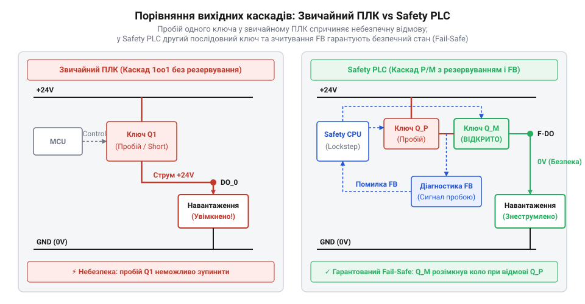
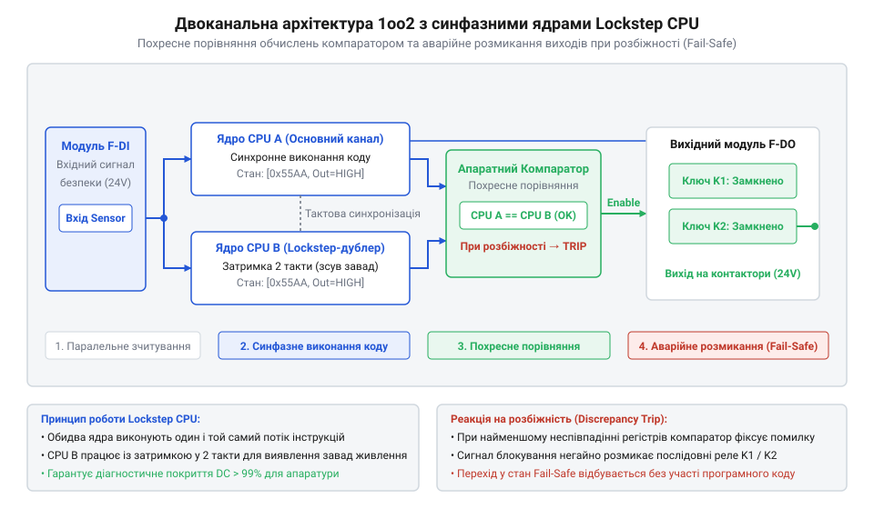
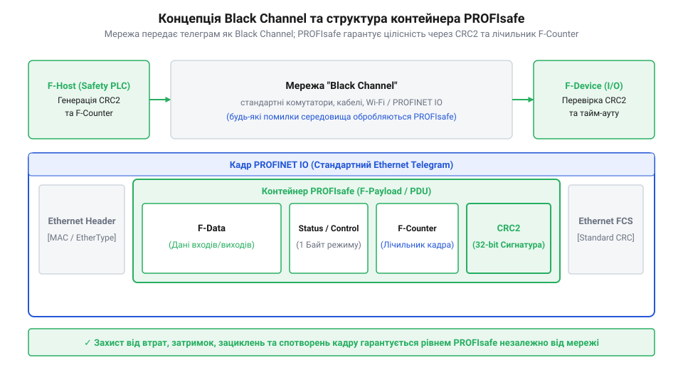

# Програмований логічний контролер безпеки

<preknowlist>
- [Вхідні модулі дискретних входів безпеки (F-DI)](root:cat-hw-boards/fail-safe-digital-input-modules) — Принципи підключення двоканальних датчиків безпеки та виявлення коротких замикань на входах
</preknowlist>

## Відмови звичайних контролерів у промисловості

У промисловості керування важкими механізмами спирається на програмовані логічні контролери (англ. @@en|PLC@@, від *Programmable Logic Controller* — програмований логічний контролер; @@en|ПЛК@@). Схемотехніка звичайного ПЛК розрахована на забезпечення безперервності процесу, тому містить єдиний обчислювальний канал та спрощені вихідні каскади. У разі теплового перевантаження чи електричного пробою напівпровідниковий ключ (англ. @@en|MOSFET-транзистор@@) спекається у стан постійної провідності, через що вихід залишається замкненим у стані HIGH незалежно від команд процесора. При комутації постійного струму електромеханічними реле приймистий дуговий розряд розплавляє матеріал подушечок і викликає приварювання контактної групи (англ. @@en|contact welding@@, від *contact* — контакт, та *welding* — зварювання; @@en|приварювання контактів@@).

*Порівняльна схема силового виходу стандартного ПЛК з ризиком пробою єдиного ключа та дубльованої вихідної структури контролера безпеки.*

Системні збої та зациклення коду створюють аналогічну загрозу: периферійний модуль утримує останній записаний стан регістру (англ. @@en|latch-up@@, від *latch* — заскочка, та *up* — вгору; @@en|фіксація стану@@). Стандартний контролер позбавлений внутрішніх схем діагностичного зчитування та дубльованих елементів вимкнення, тому не здатен самостійно розпізнати апаратне пошкодження й знеструмити виконавчі механізими при натисканні кнопки аварійного зупину.

## Архітектура резервування та гарантоване знеструмлення

Щоб усунути єдині точки відмови, програмований логічний контролер безпеки (англ. @@en|Safety PLC@@, від *safety* — безпека; @@en|Safety PLC@@) будують за принципом безумовного переходу у знеструмлений аварійний безпечний стан (англ. @@en|Fail-Safe State@@, від *fail* — відмова, та *safe* — безпечний; @@en|Fail-Safe State@@). Обчислювальне ядро контролера використовує двоканальну архітектуру `1oo2` (від англ. @@en|1oo2@@, *1 out of 2* — один із двох), де два автономні процесори виконують однакову програму користувача у синфазному режимі (англ. @@en|Lockstep CPU@@, від *lock* — фіксувати, та *step* — крок; @@en|ядра Lockstep CPU@@). Сигнали від зовнішніх датчиків приймають [Вхідні модулі дискретних входів безпеки (F-DI)](root:cat-hw-boards/fail-safe-digital-input-modules). Апаратний компаратор на кожному такті порівнює шини даних двох ядер; найменша розбіжність сигнатур або втрата синхронізації негайно блокує видачу команд.

*Двоканальна обчислювальна структура 1oo2 з апаратним порівнянням шин та розмиканням вихідних ключів.*

Принцип гарантованого знеструмлення діє і у силових вихідних каскадах, де послідовно вмикають два ключі: High-Side керується ядром A, а Low-Side — ядром B. Якщо транзистор верхнього плеча пробивається, друге ядро самостійно розриває ланцюг через нижній транзистор. Для систем із підвищеними вимогами до безперервності застосовують триканальну схему `2oo3` з мажоритарним арбітром, що дозволяє продовжувати роботу за більшістю голосів при відмові одного з трьох каналів.

## Стандарти безпеки та концепція Black Channel

Оцінювання надійності захисних функцій регламентують стандарти @@en|IEC 61508@@ (рівні повноти безпеки від @@en|SIL1@@ до @@en|SIL4@@) та @@en|ISO 13849-1@@ (рівні продуктивності від @@en|PL a@@ до @@en|PL e@@). Досягнення найвищого промислового рівня @@en|SIL3@@ вимагає зменшення ймовірності небезпечної відмови на годину (англ. @@en|PFHD@@) до `10⁻⁸–10⁻⁷` год⁻¹ та підтримки частки виявлених дефектів — діагностичного покриття (англ. @@en|Diagnostic Coverage@@; @@en|DC@@) — на рівні `DC ≥ 99%`. Для обміну даними між рознесеними модулями через стандартні ненадійні мережі застосовують концепцію «чорного каналу» (англ. @@en|Black Channel@@).

*Схема інкапсуляції безпекового кадру PROFIsafe у стандартний мережевий телеграм відповідно до концепції Black Channel.*

Протоколи @@en|PROFIsafe@@, @@en|CIP Safety@@ та @@en|FSoE@@ додають до кадру унікальну адресу @@en|F-Address@@, лічильник послідовності пакетів, сторожовий таймер та розширену контрольну суму `CRC-32`. Якщо через мережеві завади лічильник спотворених телеграм перевищує поріг, модуль запускає пасивацію (англ. @@en|passivation@@, від *passivate* — переводити у пасивний стан; @@en|пасивація каналу@@) із вимкненням виходів. Після усунення збою автоматичний пуск заборонено: повернення у робочий стан вимагає процедури реінтеграції (англ. @@en|reintegration@@, від *re-* — знову, та *integrare* — відновлювати; @@en|реінтеграція F-модуля@@) з обов'язковим ручним квитуванням оператором.
