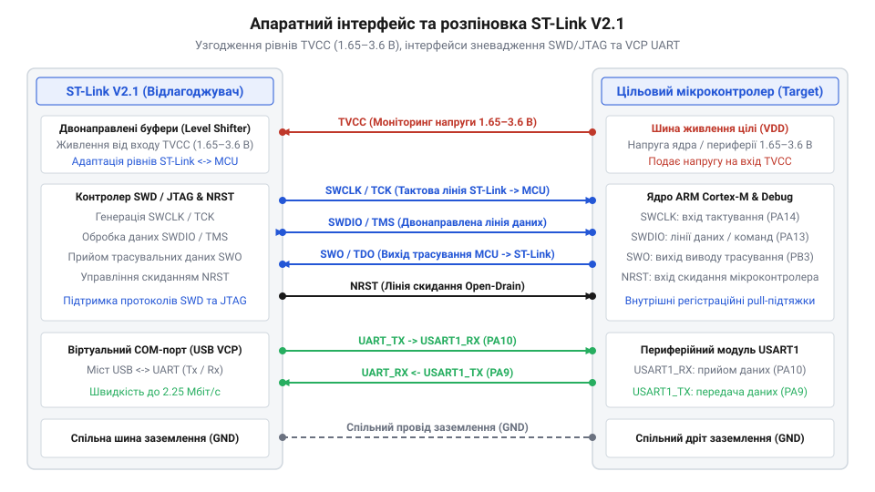
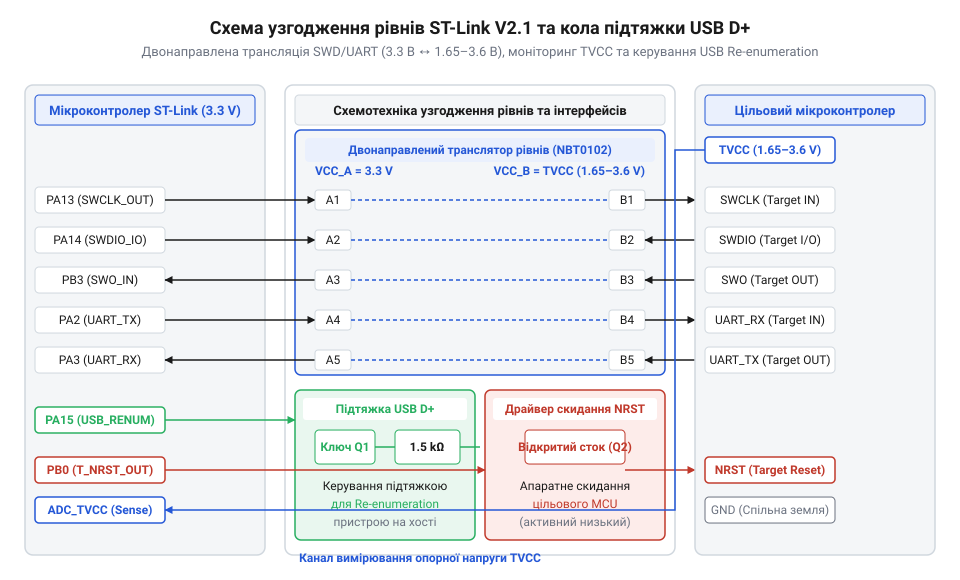

# Специфікація апаратного інтерфейсу, розпіновка та узгодження рівнів ST-Link V2.1

<preknowlist>
- [WeAct Mini Debugger (DAPLink / ST-Link V2.1)](root:cat-hw-boards/daplink-debugger) — схемотехнічне виконання плати відлагоджувача та розташування апаратних роз'ємів
- [Архітектура та принципи роботи програматора DAPLink](root:cat-hw-boards/daplink-programmer-architecture) — загальні принципи зневадження за протоколом SWD та організація віртуального COM-порту
</preknowlist>

## Проблема узгодження напруг та фізичний інтерфейс

Розробники вбудованих систем під час зневадження мікроконтролерів нерідко стикаються з апаратною проблемою: цільова плата може живитися від автономного джерела чи виділеного регулятора напругою 1.8 В, 2.5 В або 3.3 В, тоді як вихідні каскади програматора працюють на фіксованому потенціалі. Пряме з'єднання сигнальних ліній із різними напругами живлення призводить до протікання паразитних струмів через захисні діоди (англ. @@en|clamping diode@@, від *clamp* — затискати, та *diode* — діод; @@en|захисний діод clamping diode@@) КМОН-входів. Це спричиняє термодинамічний перегрів вхідних буферів, спотворення логічних рівнів та фізичну деградацію напівпровідникових кристалів обох пристроїв.

Для розв'язання цієї проблеми в апаратному відлагоджувачі ST-Link V2.1 застосовують ізольоване вимірювання опорного потенціалу цільової плати через спеціальний вхід `TVCC` (англ. @@en|Target VCC@@). Цей вивід не живить плату розробника, а слугує опорним джерелом для внутрішніх шинних трансляторів рівнів (англ. @@en|level shifter@@, від *level* — рівень, та *shift* — зміщувати; @@en|транслятор рівнів level shifter@@). Схемотехнічний механізм вимірювання реалізовано через високоомний резистивний дільник напруги, який знижує потенціал `TVCC` без навантаження джерела цільової плати та подає узгоджений сигнал на прямий вхід аналогового компаратора (англ. @@en|comparator@@, від *compare* — порівнювати; @@en|компаратор comparator@@). Інвертувальний вхід компаратора підключено до джерела внутрішньої опорної напруги `V_ref`, що формує чітко калібрований поріг спрацьовування 1.65 В: якщо напруга `TVCC` відсутня або падає нижче цієї межі, компаратор миттєво змінює стан і схемотехніка захисту впродовж затримки менше ніж 10 нс переводить сигнал дозволу виходу `OE` (англ. @@en|Output Enable@@) у пасивний стан. Високошвидкісне спрацьовування захисту `t_delay < 10 ns` відсікає вихідні драйвери до того, як паразитна інжекція струму встигне нагріти p-n переходи, а вбудований апаратний гістерезис компаратора величиною 50 мВ разом із RC-фільтрацією на вході дільника запобігає брязкоту лінії `OE` при імпульсних пульсаціях та просіданнях напруги `TVCC`. У результаті вихідні буфери програматора миттєво переходять у високоомний стан (англ. @@en|high-impedance state@@, @@en|high-Z@@), що блокує зворотне протікання струму у знеструмлену схему й запобігає апаратному пошкодженню вхідних каскадів.

Сумісність із різними родинами мікроконтролерів вимагає гнучкої адаптації фізичного інтерфейсу без погіршення фронтів сигналів на високих частотах. Використання активних двонаправлених ключів узгодження рівнів дозволяє ST-Link V2.1 стабільно працювати в діапазоні напруг від 1.65 В до 3.6 В, що є необхідною умовою для безпечного розроблення низькоспоживаючих пристроїв, про що також згадує [огляд відлагоджувачів WeAct Mini](root:cat-hw-boards/daplink-debugger).

## Специфікація розпіновки та сигнальні лінії

Апаратний роз'єм зневадження ST-Link V2.1 поєднує виводи послідовного відлагодження двохстандартного інтерфейсу @@en|SWD@@/@@en|JTAG@@ та сигнальні лінії віртуального послідовного порту (англ. @@en|Virtual COM Port@@, @@en|VCP@@). Основу зневаджувального обміну становить двопровідна шина @@en|SWD@@: лінія тактування `SWCLK` (англ. @@en|Serial Wire Clock@@), яка передає синхросигнал від відлагоджувача до цільового ядра, та двонаправлена лінія даних `SWDIO` (англ. @@en|Serial Wire Data Input/Output@@), по якій надсилаються команди, адреси регістрів та зчитані значення пам'яті.


*_Розпіновка та комутація сигнальних ліній ST-Link V2.1 із цільовою платою._*

Додатково до основної шини підключається лінія трасування `SWO` (англ. @@en|Serial Wire Output@@), яка реалізує однопровідне виведення діагностичних повідомлень прямого апаратного трасування `ITM` (англ. @@en|Instrumentation Trace Macrocell@@, від *instrumentation* — оснащення інструментами, *trace* — трасувати, та *macrocell* — макрокомірка; @@en|макрокомірка трасування ITM@@) без зупинки процесорного ядра. Внутрішня структура модуля `ITM` складається з 32 логічних каналів стиснення даних, які апаратно формують пакети подій та виводять їх через `SWO` у кодуванні NRZ або Манчестер. Часові характеристики сигналу `SWO` жорстко прив'язані до системної частоти ядра `HCLK`: приймач відлагоджувача ST-Link V2.1 декодує потік даних на швидкостях до 2 Мбіт/с (залежно від дільника внутрішнього прескалера), що гарантує передачу трасувальних логів без втрати часових інтервалів. При необхідності переключення з двопровідного SWD на повнофункціональний 5-провідний режим @@en|JTAG@@ відлагоджувач передає спеціальну 16-бітну часову послідовність перемикання на лінії `SWDIO`/`TMS` після утримання лінії тактування у високому стані понад 50 тактів. У режимі JTAG фізичні виводи перевизначаються: `SWCLK` стає тактовою лінією `TCK`, `SWDIO` — лінією вибору режимів `TMS`, `SWO` мультиплексується під вихід даних `TDO`, а також задіюються вхід даних `TDI` та лінія апаратного скидання TAP-контролера `TRST`. Сигнальна лінія скидання `NRST` (англ. @@en|Negative Reset@@) підключається до виводу апаратного скидання мікроконтролера і працює у режимі відкритого стоку (англ. @@en|open-drain@@), дозволяючи програматору вимушено перезапускати систему перед записом прошивки. Для обміну текстовими даними з комп'ютером роз'єм містить лінії `TX` та `RX` внутрішнього моста @@en|UART@@, який функціонує паралельно з основними каналами зневадження, як описує [архітектура програматора DAPLink](root:cat-hw-boards/daplink-programmer-architecture).

## Схемотехніка узгодження рівнів та USB-інтерфейс

Фізичне узгодження логічних рівнів між внутрішньою мікросхемою відлагоджувача (що працює від стабілізованої напруги 3.3 В) та довільною напругою цільової плати `TVCC` реалізується на базі спеціалізованих двоживних трансляторів рівнів серії @@en|74LVC8T245@@ або @@en|NTS0104@@. Електрична схема містить дві незалежні шини живлення: первинну `VCC_A` (3.3 В від USB-стабілізатора відлагоджувача) та вторинну `VCC_B` (вимірну напругу від виводу `TVCC`). 


*_Принципова схема трансляції логічних рівнів напруги та узгодження шини USB._*

Для двонаправленої лінії `SWDIO` застосовують автоматичне визначення напрямку передачі (англ. @@en|auto-direction sensing@@) або динамічне керування сигналом дозволу виходу `OE` (англ. @@en|Output Enable@@). Схемотехнічний механізм автовизначення в мікросхемах @@en|NTS0104@@ базується на використанні слабкого внутрішнього підтягувального резистора та одноперехідного прискорювача фронтів (англ. @@en|edge-rate accelerator@@), який відстежує перепади напруги і під час кожного фронту короткочасно (на 10–30 нс) вмикає внутрішній низькоомний КМОН-ключ для форсованої зарядки або розрядки ємності лінії. Проте цей апаратний розв'язок накладає суворе обмеження на ємність навантаження: якщо паразитна ємність траси чи кабелю перевищує `C_load > 30 pF`, прискорювач фронтів не встигає зреагувати або спричиняє паразитний дзвін, що спотворює дані `SWDIO`. Для захисту від брязкоту та помилкових перемикань під час тривалих фронтів у кожен канал вбудовано тригер Шмітта (англ. @@en|Schmitt trigger@@, від прізвища *Schmitt*; @@en|тригер Шмітта Schmitt trigger@@), гістерезис якого відфільтровує імпульсні наводки та шум. Така комбінація гарантує мінімальну затримку поширення сигналу `t_pd < 5 ns`, що критично необхідно для збереження часових інтервалів тактування `SWCLK` на частотах до 10 МГц.

Паралельно вузол узгодження шини USB керує підтягувальним резистором опором 1.5 кОм на сигнальній лінії `USB D+`. За специфікацією @@en|USB 2.0 Full-Speed@@ (12 Мбіт/с) ця підтяжка повідомляє хост-контролер комп'ютера про підключення нового пристрою. У ST-Link V2.1 резистор підключається через ключ на полевому транзисторі, що дозволяє мікроконтролеру відлагоджувача програмно ініціювати повторну ідентифікацію (англ. @@en|soft re-enumeration@@) на шині USB під час перезавантаження або оновлення прошивки без фізичного виймання кабелю з роз'єму.

## Схема апаратного скидання та діагностика

Сигнальний вузол апаратного скидання `NRST` побудований за схемою з відкритим стоком на польовому N-канальному транзисторі. Вивід `NRST` мікроконтролера ST-Link V2.1 підключається до затвора транзистора, тоді як його стік з'єднується з виводом скидання цільового мікроконтролера, підтягнутим через резистор 10 кОм до напруги `TVCC`. Для надійного перезапуску цільового ядра відлагоджувач генерує відлагоджувальний імпульс скидання з мінімальною тривалістю `t_RST ≥ 100 µs`, що гарантує повне розряджання внутрішніх ємностей скидання. Така схемотехніка є необхідною умовою реалізації режиму підключення під час скидання (англ. @@en|Connect Under Reset@@), коли цільове ядро перебуває в глибокому енергозберігаючому стані або збійна прошивка перевизначила ніжки SWD у звичайні GPIO. У цьому режимі відлагоджувач примусово утримує лінію `NRST` на землі, встановлює прапори апаратного зупину ядра через відлагоджувальний порт і лише після цього відпускає лінію скидання, перехоплюючи керування до виконання першої інструкції прошивки. Лінія `NRST` додатково оснащується паралельним конденсатором ємністю 100 нФ для фільтрації високочастотних завад (англ. @@en|high-frequency noise filtering@@), що виключає хибні перезавантаження від імпульсних перехідних процесів у колах живлення. Така конфігурація реалізує монтажне АБО (англ. @@en|wired-AND@@), що дозволяє як програматору, так і фізичній кнопці скидання на цільовій платі примусово притягувати лінію до землі без виникнення міжвихідних коротких замикань.

Діагностика апаратних збоїв зв'язку базується на послідовній перевірці електричних параметрів роз'єму вхідним каскадом відлагоджувача:

```text
Схема виявлення апаратних помилок інтерфейсу ST-Link V2.1:
[TVCC < 1.65 V]         => [Target Power Missing]   Відсутнє живлення цільової плати
[NRST притиснуто до 0]  => [Target Held in Reset]   Замикання лінії скидання на землю
[Помилка CRC на SWDIO]  => [SWD Communication Error] Неякісний кабель або наводки на SWCLK/SWDIO
```

При відсутності напруги `TVCC` утиліти програмування миттєво видають помилку підключення та блокують подачу сигналів зневадження для захисту буферів. Порушення контактів на лініях `SWCLK` та `SWDIO` призводить до розсинхронізації пакетів та помилок зчитування `IDCODE` цільового ядра. Розуміння цих схемотехнічних залежностей дозволяє швидко локалізувати несправності кабелів та правильно налаштовувати апаратні інструменти, про що розказують [інструменти прошивання мікроконтролерів](root:cat-hw-boards/flashing-tools-esptool-and-nodemcu-pyflasher).
