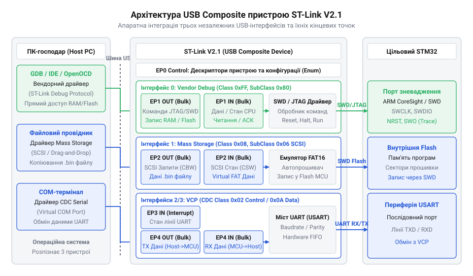
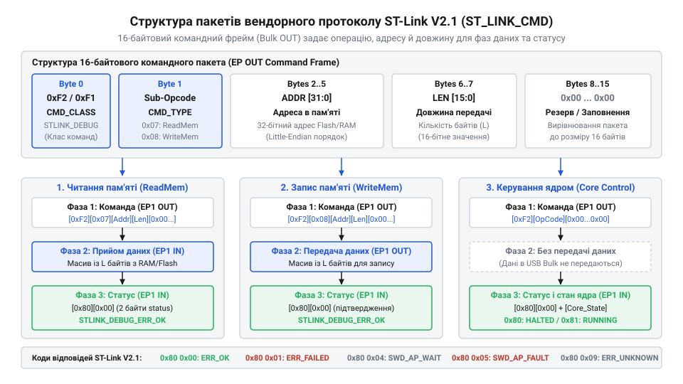

# Довідник USB-дескрипторів, вендорного протоколу команд та SCSI-інтерфейсу ST-Link V2.1

<preknowlist>
- [WeAct Mini Debugger (DAPLink / ST-Link V2.1)](root:cat-hw-boards/daplink-debugger) — Призначення каналів SWD/VCP та фізичне підключення відлагоджувача
- [Архітектура та принципи роботи програматора DAPLink](root:cat-hw-boards/daplink-programmer-architecture) — Базові принципи емуляції накопичувача MSC та відлагодження через SWD
</preknowlist>

## Втрата зв'язку та структура пристрою

Під час спроби прямої взаємодії з апаратним відлагоджувачем ST-Link V2.1 розробники нерідко стикаються з зависанням каналу USB або відсутністю відповідей на надіслані пакети. Довільне надсилання команд у керуючу кінцеву точку без врахування апаратної конфігурації призводить до блокування шини. Причина полягає у тому, що ST-Link V2.1 оперує як складений пристрій USB (англ. @@en|Composite Device@@, від *composite* — складений, та *device* — пристрій; @@en|складений пристрій USB@@), який об'єднує на одному фізичному контролері три незалежні функціональні інтерфейси: вендорний відлагоджувач (англ. @@en|ST-Link Debug Interface@@), емульований накопичувач масового сховища (англ. @@en|Mass Storage Class@@; @@en|MSC@@) та віртуальний послідовний порт (англ. @@en|Virtual COM Port@@, від *virtual* — віртуальний; @@en|віртуальний послідовний порт VCP@@).

*Структурна організація складеного USB-пристрою ST-Link V2.1 з виділеними інтерфейсами та кінцевими точками.*

Кожен із трьох інтерфейсів обробляє власний потік даних через окремі канальні кінцеві точки (англ. @@en|Endpoint@@, від *end* — кінець, та *point* — точка; @@en|кінцева точка USB@@). Відлагоджувальний канал використовує пару гальванічно виділених точок масового обміну (англ. @@en|Bulk transaction@@, від *bulk* — масовий; @@en|масова транзакція Bulk@@) для передачі команд та отримання даних пам'яті. Фізичне підключення ліній розглянуто в описі [WeAct Mini Debugger (DAPLink / ST-Link V2.1)](root:cat-hw-boards/daplink-debugger), а принципи емуляції накопичувача висвітлює [архітектура та принципи роботи програматора DAPLink](root:cat-hw-boards/daplink-programmer-architecture). Якщо програмне забезпечення помилково надсилає вендорний запит зневадження в кінцеву точку невідповідного інтерфейсу (наприклад, у канал MSC чи VCP), USB-контролер програматора не розпізнає конфігураційний оперкод і повертає апаратний сигнал заклинення (англ. @@en|STALL handshake@@, від *stall* — застопорювати; @@en|сигнал STALL@@). Отримання цього сигналу переводить відповідний канал у заблокований стан HALT, у якому пристрій відхиляє всі наступні пакети доти, доки хост-контролер не надішле спеціальний системний керуючий запит `ClearFeature(ENDPOINT_HALT)` (англ. @@en|ClearFeature@@, від *clear* — очищати, та *feature* — ознака; @@en|запит ClearFeature@@) для скидання прапорця помилки та вирівнювання лічильників тактування. Процедура скидання обмежена тайм-аутом очікування хоста до 500 мс: після відправки `ClearFeature` драйвер витримує захисну затримку не менше 5 мс для повного очищення внутрішнього буфера FIFO та скидання біта тумблера даних `DATA0/DATA1`, а якщо адаптер не відповідає впродовж визначеного тайм-ауту, хост ініціює апаратний перезапуск USB-порту.

Щоб уникнути неконтрольованого блокування шини, розробники низькорівневих драйверів перед початком сесії зневадження виконують програмне опитування конфігураційного дескриптора пристрою (англ. @@en|Configuration Descriptor@@, від *configuration* — конфігурація; @@en|дескриптор конфігурації Configuration Descriptor@@). Процес ініціалізації полягає у послідовному скануванні масиву дескрипторів інтерфейсів (англ. @@en|Interface Descriptor@@) та пошуку відповідного номера класу (англ. @@en|Class Code@@): для зневаджувального каналу програматора шукають вендорний клас `0xFF`, після чого зчитані адреси кінцевих точок занотовуються у системний хендл операцій читання й запису. Такий підхід забезпечує точне адресування команд без ризику випадкового надсилання даних у канали емуляції диска чи віртуального COM-порту.

## USB-дескриптори та конфігурація кінцевих точок

Ініціалізація програмного сеансу взаємодії з адаптером ST-Link V2.1 вимагає зчитування стандартних дескрипторів USB. Дескриптор пристрою (англ. @@en|Device Descriptor@@) ідентифікує адаптер за допомогою вендорного коду виробника Vendor ID `VID = 0x0483` (STMicroelectronics) та продуктового коду Product ID `PID = 0x374B` (для версії ST-Link V2.1 із підтримкою MSC та VCP). Конфігураційний дескриптор містить три послідовні інтерфейси `Interface 0` (канал зневадження), `Interface 1` (масовий накопичувач MSC) та `Interface 2` (послідовний порт VCP).

Для каналу відлагодження `Interface 0` конфігуруються дві основні напрямкові точки типу Bulk із розміром пакета 64 байти на швидкості Full-Speed (`12 Мбіт/с`):
- `EP1 OUT (0x01)` — відправка вендорних команд від хоста до програматора;
- `EP1 IN (0x81)` — отримання відповідей та даних читання пам'яті від адаптера.

Окремий інтерфейс `Interface 1` використовує кінцеві точки `EP2 OUT (0x02)` та `EP2 IN (0x82)` для транзакцій масового сховища `Mass Storage Class` за протоколом Bulk-Only Transport (BOT). Для реалізації віртуального порту VCP протокол об'єднує керуючий інтерфейс `Interface 2` з кінцевою точкою переривань `EP3 IN (0x83)` та потоковий інтерфейс `Interface 3` з точками `EP4 OUT (0x04)` / `EP4 IN (0x84)` за допомогою дескриптора асоціації інтерфейсів IAD (англ. @@en|Interface Association Descriptor@@, від *interface* — інтерфейс, *association* — об'єднання, та *descriptor* — описувач; @@en|дескриптор асоціації інтерфейсів IAD@@). Блок `IAD` вказує операційній системі хоста, що два незалежні USB-інтерфейси належать до єдиного функціонального класу комунікаційних пристроїв (англ. @@en|Communications Device Class@@; @@en|CDC-ACM@@) із базовим номером `bFirstInterface = 2` та кількістю `bInterfaceCount = 2`. Завдяки цьому системний драйвер безпомилково зв'язує лінії керування Baudrate та переривання стану з каналами обміну символами UART. Хост-контролер ініціалізує сесію шляхом вибору активної конфігурації `SetConfiguration(1)` та відкриття робочих каналів `EP1 OUT` і `EP1 IN`.

## Вендорні команди зневадження та пам'яті

Обмін даними відлагодження виконується надсиланням 16-байтових пакетів команд у кінцеву точку `EP1 OUT (0x01)`. Перший байт визначає групу команд: `0xF1` — системні команди пристрою (англ. @@en|ST_LINK_GET_VERSION@@, @@en|ST_LINK_GET_CURRENT_MODE@@), а `0xF2` — команди зневадження (англ. @@en|ST_LINK_DEBUG_COMMAND@@).

*Формат 16-байтового пакета вендорної команди ST_LINK_CMD та структура даних відповіді.*

Для прямих операцій з адресним простором мікроконтролера STM32 (RAM та Flash) застосовуються підкоманди групи `0xF2`:
- `0xF2 0x07` (`ST_LINK_DEBUG_READMEM_32BIT`) — читання 32-бітних слів пам'яті;
- `0xF2 0x08` (`ST_LINK_DEBUG_WRITEMEM_32BIT`) — запис 32-бітних слів пам'яті.

Пакет читання пам'яті у байтах `2–5` містить 32-бітну цільову адресу (наприклад, `0x20000000` для оперативної пам'яті SRAM), а у байтах `6–7` — довжину даних у байтах у форматі Little-Endian. Після відправки командного пакета в `EP1 OUT` хост виконує зчитання з `EP1 IN (0x81)`, отримуючи зчитаний масив байтів. При записі у флеш-пам'ять або оперативну пам'ять після 16-байтового заголовка команди у тому ж виклиці `EP1 OUT` передається блок даних бінарного образу. Використання 32-бітних команд `ST_LINK_DEBUG_READMEM_32BIT` вимагає вирівнювання адреси за межею 4 байтів, тому для роботи з неузгодженими структурами чи довільним байтовим зсувом застосовуються 8-бітні команди `ST_LINK_DEBUG_READMEM_8BIT` (`0xF2 0x0C`) та `ST_LINK_DEBUG_WRITEMEM_8BIT` (`0xF2 0x0D`). Аналогічно для доступу до 16-бітних периферійних регістрів таймерів та АЦП передбачено 16-бітні команди `ST_LINK_DEBUG_READMEM_16BIT` (`0xF2 0x0E`) та `ST_LINK_DEBUG_WRITEMEM_16BIT` (`0xF2 0x0F`), що запобігає апаратним помилкам вирівнювання шини AHB/APB.

## SCSI-команди для емульованого накопичувача MSC

Емульований накопичувач `Mass Storage Class` у ST-Link V2.1 реалізує механізм автоматичного прошивання за технологією Drag-and-Drop. При підключенні до ПК операційна система розпізнає адаптер як стандартний USB-диск із файловою системою FAT12 або FAT16. Взаємодія з цим диском спирається на блоки команд SCSI (англ. @@en|Command Block Wrapper@@; @@en|CBW@@), які передаються через кінцеву точку `EP2 OUT (0x02)`.

Основні SCSI-команди, що обробляються адаптером:
- `INQUIRY` (`0x12`) — запит ідентифікації накопичувача, повертає рядки "STMicroelectronics" та "ST-Link V2.1";
- `READ_10` (`0x28`) — зчитування секторів емульованого диска (повертає віртуальний сектор таблиці FAT та файл `DETAILS.TXT`);
- `WRITE_10` (`0x2A`) — запис секторів диска.

Коли користувач копіює бінарний файл `.bin`, `.hex` або `.srec` на віртуальний диск, драйвер прошивки ST-Link V2.1 перехоплює SCSI-запити `WRITE_10`. Внутрішній контролер аналізує заголовок файлу та дані секторів, реалізуючи потоковий алгоритм парсингу текстових образів формату @@en|Intel HEX@@ та @@en|Motorola S-Record@@. Під час накопичення секторів парсер зчитує текстові рядки-записи, перевіряє префікси (двокрапку `:` для Intel HEX та літеру `S` для S-Record), обчислює контрольні суми й декодує початкові адреси завантаження з полів розширеної адресації (типи `04` Extended Linear Address в Intel HEX чи `S2`/`S3` в S-Record). Отриманий чистий бінарний код послідовно буферизується й прошивається у флеш-пам'ять цільового мікроконтролера STM32 через SWD-інтерфейс. По завершенню запису накопичувач повертає статус `Command Status Wrapper` (англ. @@en|CSW@@) зі значенням `0x00` (Success) або створює файл `FAIL.TXT` із кодом помилки.

## Керування ядром та обробка помилок

Для керування станом виконання процесорного ядра ARM Cortex-M у вендорному протоколі передбачено групу команд `ST_LINK_DEBUG_COMMAND` (`0xF2`):
- `0xF2 0x02` (`ST_LINK_DEBUG_RUNCORE`) — запуск виконання коду з поточної адреси;
- `0xF2 0x03` (`ST_LINK_DEBUG_STEPCORE`) — виконання одного покрокового інструкційного такту;
- `0xF2 0x05` (`ST_LINK_DEBUG_READALLREGS`) — зчитування стану загальних регістрів ядра `R0–R15`, `xPSR`, `SP`;
- `0xF2 0x09` (`ST_LINK_DEBUG_ENTER_MODE`) — перехід у режим SWD (`0x0A`) або JTAG (`0x00`).

Кожна виконана команда повертає 2-байтовий статус відповіді у кінцеву точку `@@en|EP1 IN@@`. Значення `0x80 0x00` (`@@en|ST_LINK_DEBUG_ERR_OK@@`) підтверджує успішне виконання транзакції. У разі апаратного збою ліній зв'язку або відсутності живлення цільової плати адаптер повертає коди помилок: `0x80 0x01` (`@@en|ST_LINK_DEBUG_ERR_FAULT@@`), `0x80 0x02` (`@@en|ST_LINK_DEBUG_ERR_WRITE_FAIL@@`) чи `0x80 0x04` (`@@en|ST_LINK_DEBUG_ERR_WAIT@@`). Для побудови відмовостійких утиліт хост-програма аналізує статус відповіді і при виявленні помилки виконує скидання каналу через команду `@@en|ST_LINK_DEBUG_RESETSYS@@` (`0xF2 0x03`) чи повний перезапуск USB-інтерфейсу. Крім того, команда скидання підтримує два критичні режими ініціалізації цільового мікроконтролера: `@@en|Normal Reset@@` (англ. *normal reset*, від *normal* — звичайний, *reset* — скидання) та `@@en|Connect Under Reset@@` (англ. *connect under reset*, від *connect* — з'єднувати, *under* — під). У режимі `@@en|Normal Reset@@` адаптер спочатку встановлює зв'язок по шині `@@en|SWD@@` або `@@en|JTAG@@`, після чого подає сигнал скидання через програмний реєстр `@@en|AIRCR@@` (англ. *Application Interrupt and Reset Control Register*, від *application* — застосунок, *interrupt* — переривання, *control* — керування) чи лінію `@@en|NRST@@` (англ. *Negative Reset*, від *negative* — інверсний). Однак якщо прошивка контролера одразу після старту вимикає відлагоджувальні піни `@@en|GPIO@@` або переводить пристрій у режим глибокого сну, режим `@@en|Normal Reset@@` завершується помилкою `@@en|ST_LINK_DEBUG_ERR_FAULT@@`. Для обходу цієї пастки в процедурі `@@en|Connect Under Reset@@` адаптер апаратно утримує лінію `@@en|NRST@@` у низькому логічному рівні, ініціалізує порт `@@en|SWD@@` та налаштовує вектор зупинки ядра в реєстрі `@@en|DEMCR@@` (`@@en|VC_CORERESET@@`) до того, як процесор виконає бодай одну інструкцію.
