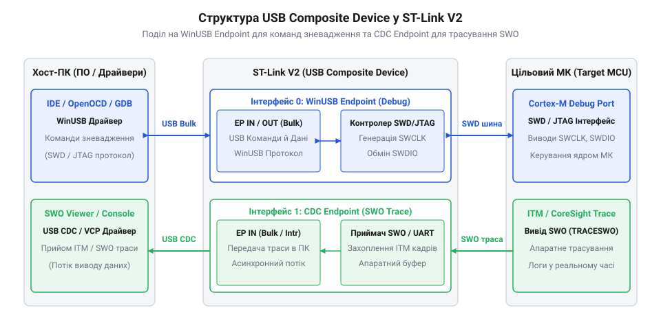
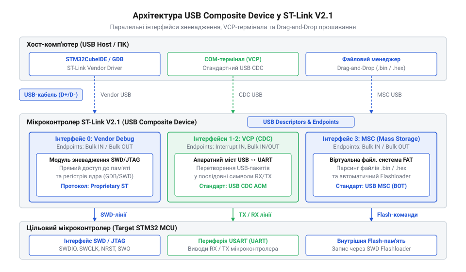

# Еволюція прошивок та архітектури програматорів ST-Link від V1 до V2.1

<preknowlist>
- [Архітектура та принципи роботи програматора DAPLink](root:cat-hw-boards/daplink-programmer-architecture) — Принципи побудови USB-інтерфейсу відлагоджувачів на базі класу MSC та CMSIS-DAP
</preknowlist>

## Монолітна ревізія V1 та обмеження SCSI-інтерфейсу

Наприкінці 2000-х років компанія STMicroelectronics представила перші демонстраційні плати сімейства STM32VL Discovery, які вимагали дешевого та компактного вбудованого програматора. Для вирішення цього завдання розробники створили першу ревізію інструменту під назвою @@en|ST-Link V1@@ (англ. @@en|ST-Link@@, від абревіатури компанії *ST* та англ. *link* — зв'язок). Головною метою проекту була відмова від зовнішніх громіздких JTAG-адаптерів і забезпечення живлення й прошивки через єдиний кабель універсальної послідовної шини (англ. @@en|USB@@, від *Universal Serial Bus* — універсальна послідовна шина). Однак апаратна реалізація першої ревізії зіштовхнулася з серйозним технічним обмеженням: інтегрований мікроконтролер мав суворо обмежену кількість дескрипторів і точок обміну даними.

Щоб оминути потребу в розробці власного складеного USB-драйвера для операційної системи Windows, інженери застосували нестандартний хід — емуляцію класу масових накопичувачів (англ. @@en|MSC@@, від *Mass Storage Class* — клас накопичувачів) на основі команд системного інтерфейсу малих комп'ютерних систем (англ. @@en|SCSI@@, від *Small Computer System Interface*). Оновлення прошивки та прошивання цільового мікроконтролера відбувалися шляхом загортання команд зневадження в описувачі файлових блоків SCSI. Тобто з точки зору операційної системи програматор виглядав як звичайний USB-накопичувач, якому середовище розробки надсилало специфічні бінарні контейнери. Фізичний механізм цього пакування полягав у інкапсуляції низькорівневих відлагоджувальних інструкцій @@en|JTAG@@ та @@en|SWD@@ у 31-байтову структуру обгортки блоку команд (англ. @@en|CBW@@, від *Command Block Wrapper* — обгортка блоку команд). У цій структурі 16-байтовий блок описувача команди (англ. @@en|CDB@@, від *Command Descriptor Block* — блок описувача команди) містив спеціальний вендорний код операції читання або запису регістрів чи пам'яті цільового мікроконтролера. Після обміну даними через кінцеві точки масового передавання @@en|Bulk Out@@ та @@en|Bulk In@@ прошивка програматора повертала 13-байтову структуру обгортки статусу команди (англ. @@en|CSW@@, від *Command Status Wrapper* — обгортка статусу команди), яка підтверджувала операційній системі успішність виконання транзакції.

Такий підхід викликав численні апаратні пастки й обмежував швидкість роботи. Спроба передати команди зневадження через накопичувач призводила до високих накладних витрат протоколу SCSI, оскільки кожна операція читання пам'яті вимагала проходження повного циклу квитування файлової системи. Будь-яке затримання операційної системи або спроба антивірусного сканування віртуального диска блокувала сесію зневадження, а операційні системи Linux та macOS регулярно відключали пристрій через відсутність стандартної таблиці розділів. До того ж проприєтарна монолітна прошивка V1 не підтримувала захоплення сигналів трасування в реальному часі. Виникла гостра потреба створення кардинально нової USB-архітектури для відлагоджувачів.

## Перехід до складеного USB-пристрою ревізії V2

Для подолання технологічного глухокутника монолітного SCSI-інтерфейсу в 2011 році компанія STMicroelectronics випустила нове покоління програматорів @@en|ST-Link V2@@. Базовою апаратною платформою став доступний мікроконтролер STM32F103C8, який мав повношвидкісний USB-контролер і розширену пам'ять програм. Головним архітектурним проривом ревізії V2 стала відмова від емуляції накопичувача на користь прямого стандартизованого складеного пристрою (англ. @@en|USB Composite Device@@, від *composite* — складений).

Замість одного SCSI-диска прошивка V2 оголошувала в дескрипторах USB кілька незалежних кінцевих точок. Основний канал зневадження був реалізований як вендорний клас пристрою (англ. @@en|WinUSB@@, від *Windows USB*), де розширений дескриптор сумісності OS (англ. @@en|Extended Compat ID@@) автоматично підключав системний драйвер ОС без встановлення сторонніх файлів, а обмін даними відбувався через кінцеві точки типів Bulk IN та Bulk OUT. Механізм цього автоматичного підключення спирався на спеціальні дескриптори операційної системи Microsoft (англ. @@en|Microsoft OS Descriptors@@, від *Microsoft Operating System Descriptors* — дескриптори операційної системи Microsoft): під час первинного запиту прошивка V2 повертала у структурі @@en|Extended Compat ID@@ 8-байтовий підпис `"WINUSB\0\0"`, розпізнавши який, Windows миттєво монтувала універсальний драйвер @@en|winusb.sys@@ без використання сторонніх інсталяційних файлів `.inf`. Це дозволило середовищам розробки надсилати прямі низькорівневі команди протоколів зневадження по двопровідній лінії (англ. @@en|SWD@@, від *Single Wire Debug* — однодротове зневадження) або класичній шині (англ. @@en|JTAG@@, від абревіатури *Joint Test Action Group*) без накладних витрат файлових систем. Для апаратного узгодження сигналів прошивка керувала виводами розмикання тристатного буфера (англ. @@en|tri-state buffer@@, від *tri-* — три, *state* — стан та *buffer* — буфер), який динамічно перемикав напрямок двоспрямованої лінії SWDIO між виводом даних і зчитуванням у режимі високого імпедансу для запобігання колізіям.

*Розподіл USB-точок у ST-Link V2 забезпечує паралельну роботу команд зневадження та потокового трасування.*

Окремо від основного каналу зневадження прошивка V2 виділила ізольовану кінцеву точку для виведення апаратного трасування (англ. @@en|SWO@@, від *Single Wire Output* — однодротовий вивід трасування). Це дозволило передавати діагностичні дані з цільового мікроконтролера на ПК на високій швидкості без зупинки ядра процесора. Завдяки переходу на кросплатформені драйвери WinUSB та libusb, програматор V2 отримав повноцінну підтримку в Linux та macOS, а відкриті інструменти розробки змогли прошивати мікроконтролери без проприєтарних бібліотек. Порівняно з пізнішими проєктами відлагоджувачів, якими є [програматор DAPLink](root:cat-hw-boards/daplink-programmer-architecture) та його похідні, ревізія ST-Link V2 стала еталонним стандартом для зовнішніх свистків та вбудованих відлагоджувачів плат Discovery.

## Ревізія V2.1 та автоматичне прошивання Drag-and-Drop

У 2014 році вихід масової лінійки відлагоджувальних плат Nucleo вимагав нової концепції бортового програматора. Користувачі прагнули прошивати мікроконтролери без встановлення важких середовищ розробки й одночасно мати вбудований канал зв'язку для виведення логів через відлагоджувальний консольний порт. Компанія STMicroelectronics відповіла на цей запит випуском ревізії @@en|ST-Link V2.1@@ на потужнішому мікроконтролері STM32F103CB.

Архiтектурним підґрунтям прошивки V2.1 став повноцінний трикомпонентний складений пристрій @@en|USB Composite Device@@. На відміну від попереднього покоління, де був наявний лише канал зневадження та точка SWO, ревізія V2.1 одночасно ініціалізує три незалежні USB-інтерфейси: вендорний відлагоджувальний порт, віртуальний послідовний порт (англ. @@en|VCP@@, від *Virtual COM Port*) класу комунікаційних пристроїв (англ. @@en|CDC@@, від *Communications Device Class*) та емульований віртуальний диск класу @@en|MSC@@.

*Архітектура ST-Link V2.1 об'єднує незалежні USB-інтерфейси для відлагодження, термінального виводу та файлового прошивання.*

Класична функція прошивання «перетягуванням» (англ. @@en|Drag-and-Drop@@, від *drag* — тягнути та *drop* — скидати) реалізована шляхом перехоплення операцій запису на віртуальний диск MSC. Оскільки бортовий відлагоджувач позбавлений фізичної мікросхеми флеш-пам'яті, прошивка V2.1 емулює таблицю файлової системи FAT12/FAT16 безпосередньо у власній оперативній пам'яті RAM, динамічно синтезуючи заголовок диска та каталог. Алгоритм обробки спирається на аналіз логічних адрес блоків (англ. @@en|LBA@@, від *Logical Block Addressing* — логічна адресація блоків): прошивка фільтрує сектори FAT-каталогу, витягуючи назву файла та його розширення. Для сирого бінарного файла `.bin` вхідний потік даних накопичується у буферній черзі (англ. @@en|FIFO@@, від *First-In, First-Out* — перший надійшов, перший оброблений) і послідовно записується у флеш-пам'ять цільового контролера через порт доступу до пам'яті (англ. @@en|MEM-AP@@, від *Memory Access Port* — порт доступу до пам'яті) починаючи з базової адреси `0x08000000`. У випадку файлів формату @@en|Intel HEX@@ вбудований текстовий аналізатор декодує рядки записів, перевіряє контрольні суми та витягує абсолютні адреси призначення для кожного блоку. Коли операційна система надсилає блоки бінарного файла `.bin` чи `.hex`, контролер перехоплює файлові сектори «на льоту» і передає їх у пам'ять цільового мікроконтролера по шині @@en|SWD@@. Якщо ж під час розпізнавання файлу чи програмування виникає апаратний збій — наприклад, обрив ліній SWD, захист флеш-пам'яті від запису чи невідповідність адреси, — прошивка миттєво перебудовує емульовану структуру FAT у RAM і повертає ОС віртуальний текстовий файл `FAIL.TXT` із точною причиною відмови. Подібний підхід до спрощеного завантаження використовує й [архітектура програматора DAPLink](root:cat-hw-boards/daplink-programmer-architecture). Проте існує міф, ніби функція Drag-and-Drop здатна повністю замінити протокол SWD. Насправді віртуальний накопичувач є лише одностороннім транспортним каналом запису готового бінарного образу: він не підтримує покрокового виконання коду, точок зупинки та читання регістрів ядра, які лишаються виключною прерогативою вендорного відлагоджувального каналу.

## Захист прошивки, оновлення та альтернативні конверсії

Важливою складовою еволюції ST-Link стала безпека інтелектуальної власності виробника. Щоб запобігти клонуванню прошивки китайськими виробниками апаратних адаптерів, STMicroelectronics впровадила криптографічно захищений завантажувач (англ. @@en|bootloader@@, від *bootstrap loader* — початковий завантажувач). Завантажувач перевіряє цифровий підпис бінарного образу та унікальний ідентифікатор UID мікроконтролера. Під час оновлення через офіційну утиліту @@en|ST-Link Upgrade@@ пристрій виконує перезапуск і реенумерацію в спеціальний режим завантаження, де файл оновлення розпаковується з використанням шифрування.

Паралельно з цим з'явився поширений міф про нібито суто фізичні відмінності між ревізіями V2 та V2.1, згідно з яким плату V2 неможливо перетворити на V2.1. Насправді ключова відмінність полягає в обсязі флеш-пам'яті мікроконтролера програматора (128 КБ у V2.1 проти 64 КБ у дешевих клонах V2) та структурі дескрипторів USB. Утиліти сторонніх розробників уможливили кастомну конвертацію апаратних плат ST-Link V2.1 у прошивки @@en|CMSIS-DAP@@ (англ. *Cortex Microcontroller Software Interface Standard Debug Access Port*) або проприєтарні прошивки @@en|J-Link OB@@ (від англ. *on-board* — вбудований) компанії Segger. Окремим механізмом цієї конвертації та оновлення є процедура повторного перерахування шини. Під час переходу з режиму оновлення прошивки пристрою (англ. @@en|DFU@@, від *Device Firmware Upgrade* — оновлення прошивки пристрою) у робочий режим зневадження мікроконтролер програматора програмно вимикає підтягувальний резистор лінії @@en|USB D+@@, імітуючи фізичне від'єднання. Операційна система фіксує скидання шини, після чого пристрій подає нові ідентифікатори виробника та продукту (англ. @@en|VID@@/@@en|PID@@, від *Vendor Identifier* та *Product Identifier* — ідентифікатори виробника та продукту) й дескриптори складеного пристрою з відповідними кінцевими точками замість спрощеного описувача завантажувача.

Така конвертація перетворює бортовий ST-Link на універсальний бездрайверний відлагоджувач для будь-яких мікроконтролерів з ядром ARM Cortex-M, зближуючи його з такими пристроями, як [компактний відлагоджувач WeAct Mini Debugger](root:cat-hw-boards/daplink-debugger). Водночас зворотна конвертація обмежується захистом завантажувача STMicroelectronics, який блокує встановлення офіційних прошивок ST-Link на пристрої без валідного криптографічного ключа. Еволюція прошивок від монолітної V1 до гнучкої V2.1 показала, як стандартизація USB-класів та модульність перетворили простий інструмент прошивки на універсальну платформу для розробки.
