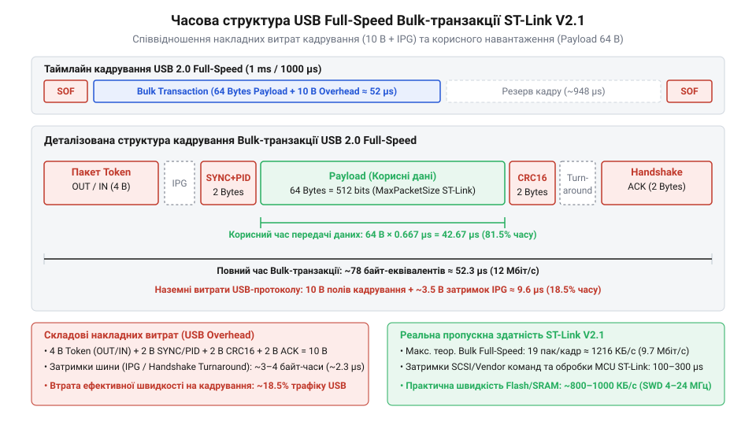
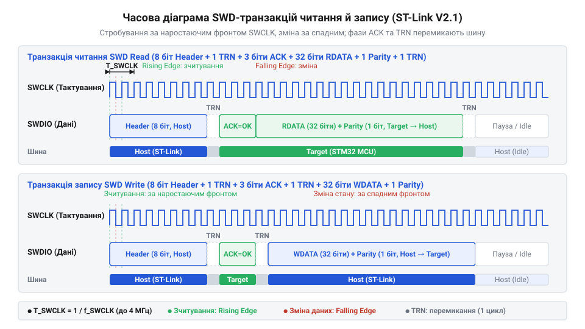

# Математичний розрахунок пропускної здатності USB Bulk та таймінгів SWD-тактування ST-Link V2.1

<preknowlist>
- [WeAct Mini Debugger (DAPLink / ST-Link V2.1)](root:cat-hw-boards/daplink-debugger) — Принципи апаратної організації бортових програматорів та призначення інтерфейсів SWD і VCP
- [Архітектура та принципи роботи програматора DAPLink](root:cat-hw-boards/daplink-programmer-architecture) — Організація USB-ендпоінтів та протоколу обміну даними між ПК та зневаджувачем
</preknowlist>

## Проблема затримок при прошиванні через USB

Під час розробки та промислового виробництва електронних пристроїв на базі мікроконтролерів сімейства STM32 швидкість завантаження бінарного коду в пам'ять є критичним параметром. Спроба обчислити час прошивання на основі лише частоти тактування інтерфейсу @@en|SWD@@ (англ. Serial Wire Debug) призводить до значних розбіжностей із реальністю. Наприклад, якщо частоту тактування шини `SWCLK` встановлено на рівні 4 МГц, наївний розрахунок передбачає передачу 4 Мбіт/с (500 КБ/с), що мало б забезпечити запис прошивки обсягом 512 КБ менш ніж за 1 секунду. Проте на практиці процес прошивання через бортовий [програматор DAPLink](root:cat-hw-boards/daplink-debugger) або ST-Link V2.1 триває від 6 до 10 секунд, тобто у 6–10 разів довше за розрахований час.

Таке суттєве падіння продуктивності зумовлене тим, що швидкість обміну вимірюється не окремим фізичним інтерфейсом, а складною послідовною ланцюговою системою. Кожна ланка додає власні часові затримки (англ. latency):
1. Кадрування та періодичні інтервали шини USB 2.0 Full-Speed.
2. Обмеження розміру пакетів розширюваного каналу передачі (англ. Bulk transfer).
3. Протокольні накладні витрати (англ. overhead) командної обгортки програматора та емуляції накопичувача масового збереження (англ. Mass Storage Class).
4. Затримки обробки команд у прошивці мікроконтролера ST-Link.
5. Апаратні часові інтервали стирання та запису сторінок Flash-пам'яті цільового пристрою.

У підсумковому часовому балансі скрізного циклу прошивання найбільшу частку займає апаратне програмування та стирання Flash-пам'яті, яке становить близько `55–65%` від загальної тривалості операції. Транспортування даних по шині USB 2.0 Full-Speed разом із кадруванням забирає `15–20%` часу, передача по фізичному інтерфейсу SWD на частоті 4 МГц відповідає за `15%`, а внутрішня обробка команд прошивкою мікроконтролера ST-Link V2.1 створює додаткові `5–10%` затримок. Розуміння цього розкладу показує, що оптимізація лише тактування SWD без урахування затримок Flash та USB не дозволяє суттєво прискорити завантаження коду.

Для точного прогнозування часу технологічних операцій та усунення тайм-аутів під час зневадження необхідно побудувати скрізну математичну модель. Вивчення [архітектури USB-програматора](root:cat-hw-boards/daplink-programmer-architecture) показує, що першим обмежувальним бар'єром на цьому шляху є фізичні й транспортувальні властивості шини USB 2.0 Full-Speed, яка з'єднує персональний комп'ютер із мікроконтролером ST-Link V2.1.

Математично скрізний коефіцієнт ланцюгової затримки `K_delay` описує відношення фактичного часу прошивання `t_total` до ідеального теоретичного часу передачі по SWD `t_swd_ideal` і визначається як сума часових внесків усіх п'яти ланок:

```text
t_total
= t_flash + t_usb + t_swd + t_firmware    [складові скрізного часового балансу]

K_delay
= t_total / t_swd_ideal                  [коефіцієнт перевищення теоретичного часу]
= (t_flash + t_usb + t_swd + t_firmware) / t_swd_ideal
```

У цьому розкладі роль USB-інтерфейсу визначається часткою `t_usb / t_total ≈ 0.15–0.20`, де транспортувальна затримка `t_usb` визначається фіксованим 1 мс кадруванням шини та накладними витратами Bulk-транзакцій, що створює апаратну нижню межу затримки доставки даних на програматор ще до початку їх передачі по фізичній шині SWD.

## Модель пропускної здатності USB Bulk Full-Speed

Програматор ST-Link V2.1 підключається до хост-контролера ПК через фізичний інтерфейс USB 2.0 Full-Speed з номінальною бітовою частотою `f_bit = 12 МГц`, що відповідає тривалості одного бітового інтервалу `t_bit = 83.33 нс`. Передача масивів даних прошивки здійснюється через кінцеві точки (англ. endpoints) типу Bulk. На фізичному та канальному рівнях USB 2.0 дані передаються не безперервним потоком, а дискретними кадрами тривалістю 1 мс, які починаються з маркерного пакета початку кадру @@en|SOF@@ (англ. Start of Frame). Для режимів Full-Speed максимальний обсяг поля даних одного Bulk-пакета обмежується значенням `wMaxPacketSize = 64 байти`.

Кожна транзакція Bulk OUT або Bulk IN складається з трьох послідовних пакетів: службового пакета токена (англ. token packet), пакета даних (англ. data packet) та пакета квитування (англ. handshake packet). Скрізний часовий розрахунок однієї транзакції передачі 64 байтів враховує бітовий розмір усіх полів та затримки між пакетами (англ. interpacket delay):

```text
N_token
= 8 + 8 + 11 + 5                    [SYNC (8 бітів) + PID (8 бітів) + ADDR/ENDP (11 бітів) + CRC5 (5 бітів) = 32 біти]

N_data
= 8 + 8 + (64 × 8) + 16              [SYNC (8 бітів) + PID (8 бітів) + Payload (512 бітів) + CRC16 (16 бітів) = 544 біти]

N_handshake
= 8 + 8                              [SYNC (8 бітів) + PID (8 бітів) ACK = 16 бітів]

N_base
= N_token + N_data + N_handshake + N_ipd
= 32 + 544 + 16 + 24                 [сума полів плюс 3 міжпакетні паузи по 8 бітів = 616 бітів]
```

Окрім базових полів, фізичний рівень USB застосовує біт-стаффінг (англ. bit stuffing) — примусове вставлення нульового біта після кожної послідовності з шести одиниць для підтримки синхронізації прийомопередавачів. Для випадкових бінарних даних прошивки це додає в середньому `3.5%` додаткових бітів, що збільшує обсяг транзакції до `N_total ≈ 616 × 1.035 = 638 бітів`.


*Часова діаграма структури кадрування USB Full-Speed Bulk-транзакції та розподілу часових затримок.*

Упродовж одного кадру тривалістю 1 мс шина містить `N_frame = 12000 бітових інтервалів`. З урахуванням пакета @@en|SOF@@ та резервного інтервалу в кінці кадру, доступний часовий ресурс становить близько 11920 бітових інтервалів. При зменшенні розміру корисного навантаження пакета з 64 до 32 байтів фіксовані накладні витрати заголовків та міжпакетних пауз починають домінувати: для 32-байтового пакета сумарна тривалість транзакції скорочується до `N_total_32 ≈ 373 бітів`, що дозволяє розмістити більше транзакцій у кадрі, але знижує корисну пропускну здатність. Максимальна кількість 64-байтових та 32-байтових Bulk-транзакцій у кадрі обчислюється діленням:

```text
N_trans_64
= 11920 / 638                        [ділення часового ресурсу кадру на тривалість 64-байтової транзакції]
= 18.68                              [округлення до цілого 18 транзакцій на кадр]

R_raw_64
= 18 × 64 / 0.001                    [18 пакетів по 64 байти за 1 мс]
= 1152000 bytes/s                    [корисна пропускна здатність 1.152 МБ/с]

N_trans_32
= 11920 / 373                        [ділення часового ресурсу кадру на тривалість 32-байтової транзакції]
= 31.95                              [округлення до цілого 31 транзакція на кадр]

R_raw_32
= 31 × 32 / 0.001                    [31 пакет по 32 байти за 1 мс]
= 992000 bytes/s                     [корисна пропускна здатність 0.992 МБ/с]
```

Порівняння показує, що хоча кількість 32-байтових транзакцій у кадрі зростає до 31, корисна швидкість падає на 13.9% (з 1.152 МБ/с до 0.992 МБ/с) через збільшення питомої ваги накладного протокольного кадрування.

```text
N_trans
= 11920 / 638                        [ділення часового ресурсу кадру на тривалість транзакції]
= 18.68                              [округлення до нижчого цілого 18 транзакцій на кадр]

R_raw
= 18 × 64 / 0.001                    [18 пакетів по 64 байти за 1 мс]
= 1152000 bytes/s                    [пропускна здатність 1.152 МБ/с]
```

Таким чином, гранична теоретична швидкість передачі сирих даних для Bulk-каналу USB 2.0 Full-Speed становить `1.152 МБ/с`. Будь-які протокольні обгортки вищого рівня лише зменшують цю величину.

Однак у реальних фізичних умовах фактична кількість переданих пакетів виявляється меншою через накопичувальний вплив часового фазового тремтіння (англ. @@en|SOF jitter@@, від *jitter* — фазове тремтіння) та затримок перемикання напрямку шини (англ. @@en|bus turnaround time@@, від *turnaround time* — час перемикання напрямку шини). Стандарт USB 2.0 допускає відхилення моменту генерації маркера початку кадру до `±500 нс`, а також вимагає обов'язкового захисного інтервалу кінця кадру (англ. @@en|EOF@@, від *End of Frame* — кінець кадру) тривалістю `t_EOF ≈ 16 бітових інтервалів` (`1.33 мкс`) для запобігання накладанню транзакцій. Крім того, під час кожного переходу від передачі даних пакета до очікування відповіді квитування фізичні трансивери витрачають до 8 бітових інтервалів (`666.6 нс`) на перемикання прийомопередавача в стан високого імпедансу. Сумарна втрата часового ресурсу зменшує доступне вікно кадру з 11920 до 11490 бітових інтервалів, у результаті чого хост-контролер встигає гарантовано розмістити не 18, а лише 17 повних 64-байтових Bulk-транзакцій у кадрі. Це знижує реальну фізичну пропускну здатність шини Full-Speed до значення `17 × 64 = 1088 КБ/с` (`1.088 МБ/с`).

## Накладні витрати протоколу ST-Link та SCSI MSC

Над транспортувальними Bulk-пакетами USB 2.0 прошивка ST-Link V2.1 реалізує протоколи верхнього рівня. Залежно від режиму роботи програматор використовує або прямий вендорний командний інтерфейс (англ. vendor-specific command interface), або емуляцію накопичувача масового збереження @@en|MSC@@ (англ. Mass Storage Class) для функціоналу перетягування файлів (англ. drag-and-drop).

При прямому зневадженні через вендорний API (наприклад, під управлінням OpenOCD чи STM32CubeProgrammer) кожна командна передача містить заголовок команди ST-Link розміром `L_hdr = 16 байтів`. При пересиланні блоку даних обсягом `L_data` байтів загальний обсяг байтів на шині USB становить `L_total = L_hdr + L_data`. Коефіцієнт корисної дії транспортування даних обчислюється як:

```text
η_vendor
= L_data / (L_hdr + L_data)          [відношення корисного коду до загального обсягу]
= 1024 / (16 + 1024)                 [підстановка для блоку 1024 байти]
= 1024 / 1040
= 0.9846                             [ефективність вендорного протоколу становить 98.46%]
```

При використанні режиму MSC обмін здійснюється за протоколом @@en|BOT@@ (англ. Bulk-Only Transport) з командними блоками @@en|SCSI@@. Кожна операція запису сектора пам'яті обсягом 512 байтів вимагає передачі трьох окремих фаз:
1. Заголовок командного блоку @@en|CBW@@ (англ. Command Block Wrapper) — 31 байт.
2. Блок корисних даних — 512 байтів.
3. Блок статусу виконання @@en|CSW@@ (англ. Command Status Wrapper) — 13 байтів.

Співвідношення корисних даних до повного обсягу службової інформації для одного сектора обчислюється наступним чином:

```text
η_msc
= 512 / (31 + 512 + 13)              [протокольний розклад транзакції SCSI BOT]
= 512 / 556
= 0.9208                             [ефективність режиму MSC становить 92.08%]
```

Окрім байтового overhead, режим MSC додає обов'язкові часові затримки перемикання напрямку передачі (англ. turnaround time) між фазою CBW (OUT), передачею даних (OUT) та очікуванням CSW (IN). Прошивка мікроконтролера ST-Link V2.1 витрачає від 50 до 150 мкс на обробку та декодування кожного командного блоку SCSI. При малому розмірі кластера файлової системи FAT16 або FAT32 (`S_cluster = 512 байтів`) для кожного сектора генерується окрема транзакція SCSI з повним циклом очікування CSW та повторним оновленням таблиці FAT, що знижує корисну ефективність до `η_msc = 512 / (31 + 512 + 13) ≈ 92.08%` та дає швидкість `R_msc_512 ≈ 350–450 КБ/с`. При збільшенні розміру кластера до `S_cluster = 4096 байтів` (8 секторів) один командний блок SCSI пересилає 4 КБ даних з єдиною парою CBW/CSW, завдяки чому протокольна ефективність зростає до `η_msc_4k = 4096 / (31 + 4096 + 13) ≈ 98.93%`, а частота обробки заголовків зменшується в 8 разів, підвищуючи реальну швидкість передачі до `R_msc_4k ≈ 750–820 КБ/с`, що наближається до прямого вендорного режиму `R_vendor ≈ 800–950 КБ/с`.

Щоб наочно оцінити вплив розміру кластера файлової системи на продуктивність прошивки, розрахуємо частоту обробки заголовків `f_scsi` (у герцах) та сумарний часовий простій процесора `T_proc` (у секундах) при пересиланні бінарного образу обсягом `V_image` байтів. Для початкових умов візьмемо образ розміром `V_image = 131072` байти (128 КБ), середню затримку обробки одного заголовка мікроконтролером `@@en|ST-Link@@` `t_proc = 0.0001` секунди (100 мкс), розмір кластера `S_cluster_1 = 512` байтів і швидкість обміну `R_msc_512 = 409600` байтів за секунду (400 КБ/с). Кількість транзакцій `N_scsi_512`, частота обробки `f_scsi_512` та сумарні часові витрати `T_proc_512` обчислюються наступним чином:

```text
N_scsi_512
= V_image / S_cluster_1                  [ділення обсягу образу на розмір кластера]
= 131072 / 512
= 256                                    [кількість необхідних SCSI-транзакцій]

f_scsi_512
= R_msc_512 / S_cluster_1                [обчислення частоти запитів на секунду]
= 409600 / 512
= 800                                    [частота обробки заголовків становить 800 Гц]

T_proc_512
= N_scsi_512 × t_proc                    [сумарний час декодування всіх CBW та CSW]
= 256 × 0.0001
= 0.0256                                 [простій процесора становить 0.0256 секунди]
```

Із розрахунку видно, що при 512-байтовому кластері прошивка програматора змушена обробляти 800 командних обгорткових блоків `@@en|CBW@@`/`@@en|CSW@@` на секунду, витрачаючи понад 25 мс чистого часу обчислювача на інтерпретацію команд. Для обчислення аналогічних показників `N_scsi_4k`, `f_scsi_4k` та `T_proc_4k` при розширеному кластері `S_cluster_2 = 4096` байтів і швидкості `R_msc_4k = 819200` байтів за секунду (800 КБ/с) застосуємо той самий алгоритм:

```text
N_scsi_4k
= V_image / S_cluster_2                  [ділення обсягу образу на новий розмір кластера]
= 131072 / 4096
= 32                                     [кількість необхідних SCSI-транзакцій]

f_scsi_4k
= R_msc_4k / S_cluster_2                  [обчислення частоти запитів на секунду]
= 819200 / 4096
= 200                                    [частота обробки заголовків знижується до 200 Гц]

T_proc_4k
= N_scsi_4k × t_proc                     [сумарний час декодування зменшеної кількості заголовків]
= 32 × 0.0001
= 0.0032                                 [простій процесора знижується до 0.0032 секунди]
```

Збільшення розміру кластера в 8 разів зменшує підсумкову кількість `@@en|SCSI@@`-транзакцій з 256 до 32, що пропорційно знижує накладний простій процесора `T_proc` з `0.0256` до `0.0032` секунди та вивільняє обчислювальний ресурс прошивки для прискорення низькорівневих операцій запису `@@en|Flash@@`-пам'яті.

## Математика тактування та затримок інтерфейсу SWD

Після проходження фізичного каналу USB дані з буфера мікроконтролера ST-Link V2.1 передаються в цільовий мікроконтролер STM32 через двопровідний інтерфейс @@en|SWD@@ (англ. Serial Wire Debug). Сигнал тактування `SWCLK` формується апаратним таймером або периферійним блоком програматора. Частота тактування `f_SWCLK` обчислюється через системну частоту ядра ST-Link `f_CPU` та коефіцієнт прескалера (англ. prescaler):

```text
f_SWCLK
= f_CPU / (2 × Prescaler)            [розрахунок частоти SWCLK через прескалер]
```

Для стандартної частоти `f_SWCLK = 4 МГц` період одного такту становить `T_SWCLK = 250 нс`. Кожна транзакція читання або запису 32-бітного слова через інтерфейс SWD складається з п'яти послідовних фаз:
1. Фаза запиту (англ. Request Header) — 8 тактів протоколу (1 Start, 1 APnDP, 1 RnW, 2 Addr, 1 Parity, 1 Stop, 1 Park).
2. Фаза перемикання напрямку шини (англ. Turnaround, TRN) — 1 такт.
3. Фаза квитування (англ. Acknowledge, ACK) — 3 такти.
4. Фаза даних (англ. Data Phase) — 32 байти даних плюс 1 біт паритету (33 такти).
5. Фаза міжтранзакційної паузи (англ. Idle cycles) — 3 такти.

Загальна кількість тактових імпульсів `N_swd` для однієї повної успішної транзакції запису 32-бітного слова становить `N_swd = 8 + 1 + 3 + 1 + 33 + 2 = 48 тактів`. Однак якщо шина або мост зневадження цільового мікроконтролера зайняті внутрішніми операціями (наприклад, стиранням сторінки Flash-пам'яті), фаза квитування повертає стан `ACK_WAIT` замість `ACK_OK`. У такому разі фаза даних скасовується, а програматор вимушений виконувати `n_retry` повторних спроб. Кожна спроба повтору додає додатковий цикл з `N_wait_cycle = 8 + 1 + 3 + N_idle = 12 + N_idle` тактів, а додатковий час очікування обчислюється виразом `t_wait_extra = n_retry × N_wait_cycle × T_SWCLK`. При відсутності повторних очікувань за наявності лише `ACK_OK` час виконання однієї базової транзакції SWD обчислюється наступним чином:

```text
t_swd_word
= N_swd × T_SWCLK                    [множення кількості тактів на період SWCLK]
= 48 × 250 нс
= 12000 нс                           [12 мікросекунд на 32-бітне слово]

R_swd_max
= 4 / 0.000012                       [передача 4 байтів за 12 мікросекунд]
= 333333 bytes/s                     [гранична швидкість SWD становить 333.33 КБ/с]
```


*Часова діаграма SWD-транзакцій читання й запису з розподілом тактових імпульсів SWCLK та фаз квитування.*

Таким чином, навіть при відсутності затримок з боку шини USB фізична межа пропускної здатності шини SWD на частоті 4 МГц становить `333.33 КБ/с`.

При виникненні затримок шини цільового мікроконтролера фаза квитування повертає стан `ACK_WAIT` замість `ACK_OK`, що змушує програматор розгортати цикл повторних спроб `n_retry`. У разі отримання `ACK_WAIT` фаза даних скасовується, а повторний очікувальний цикл додає `N_wait_cycle = 8 + 1 + 3 + N_idle = 12 + N_idle` тактових імпульсів `SWCLK`. Для типової паузи між транзакціями `N_idle = 3` такти сумарна тривалість одного циклу очікування становить `N_wait_cycle = 15` тактів, що додає затримку `t_wait_single = N_wait_cycle × T_SWCLK = 15 × 250 нс = 3.75 мкс`. Загальні додаткові часові витрати при виконанні `n_retry` повторних спроб розраховуються за формулою:

```text
t_wait_extra
= n_retry × N_wait_cycle × T_SWCLK      [множення кількості повторів на тривалість циклу очікування]
= n_retry × 15 × 250 нс
= n_retry × 3.75 мкс                    [додаткова затримка від повторних спроб]
```

Якщо цільовий флеш-контролер виконує стирання сторінки тривалістю 20 мс, кількість повторних спроб сягає `n_retry = 20000 / 3.75 ≈ 5333` циклів, а підсумковий час транзакції `t_swd_total = t_swd_word + t_wait_extra = 12 мкс + 20000 мкс = 20.012 мс`, що знижує реальну пропускну здатність SWD для цього слова до `199.88 B/s`.

## Розрахунок граничної швидкості прошивання Flash-пам'яті

Під час запису прошивки в цільовий мікроконтролер STM32 підсумкова швидкість обмежується апаратними часовими затримками внутрішньої Flash-пам'яті. Фізичний запис в осередки пам'яті вимагає виконання двох послідовних апаратних процедур: стирання сторінок (англ. Page Erase) та безпосереднього програмування слів (англ. Word Programming).

Запис виконується не через прямі SWD-команди для кожного слова, а за допомогою алгоритму завантажувача Flash (англ. Flash loader), який ST-Link V2.1 попередньо записує в оперативну пам'ять @@en|SRAM@@ цільового мікроконтролера. Програматор передає масив даних у подвійний буфер SRAM, після чого ядро цільового МК автономно переносить дані з SRAM у Flash-пам'ять.

Для прошивання блоку обсягом 64 КБ (32 сторінки по 2 КБ) при часі стирання однієї сторінки `t_erase = 20 мс` та часі програмування 32-бітного слова `t_prog = 40 мкс` розрахунок скрізного часу `t_total` має вигляд:

```text
t_erase_total
= 32 × 20 мс                         [стирання 32 сторінок по 2 КБ]
= 640 мс                             [час стирання Flash-пам'яті]

t_swd_transfer
= 16384 × 12 мкс                     [передача 16384 слів через SWD]
= 196.6 мс                           [час передачі даних по шині SWD]

t_flash_prog
= 16384 × 40 мкс                     [апаратне програмування осередків Flash]
= 655.4 мс                           [час фізичного запису Flash]

t_total
= t_erase_total + max(t_swd_transfer, t_flash_prog) + t_usb_overhead
= 640 мс + 655.4 мс + 50 мс          [сумарний скрізний час із урахуванням USB-затримок]
= 1345.4 мс                          [підсумковий час прошивання 1.345 секунди]

R_eff
= 65536 / 1.3454                     [64 КБ ділені на підсумковий час]
= 48711 bytes/s                      [реальна ефективна швидкість прошивання 48.71 КБ/с]
```

Отриманий результат пояснює, чому реальна швидкість прошивання складає близько `48.7 КБ/с`, що у 10 разів менше за теоретичну частоту SWCLK. Якщо час стирання або програмування перевищує допуски тайм-аутів хост-програми, цільовий контролер повертає статус `ACK_WAIT`, що вимагає налаштування додаткових циклів очікування у прошивці ST-Link для запобігання фатальним збоям зв'язку. Для усунення цих простоїв завантажувач Flash (англ. @@en|Flash loader@@) використовує подвійне буферизування (англ. @@en|double buffering@@) в @@en|SRAM@@ цільового мікроконтролера, де мінімальний обсяг подвійного буфера `S_buf_min` математично росте пропорційно швидкості SWD-передачі `R_swd` та часу програмування блоку `t_flash_block`. Щоб інтерфейс SWD не зупинявся у очікуванні готовності Flash, час заповнення одного півбуфера `t_swd_block = S_buf_half / R_swd` має дорівнювати або перевищувати час запису попереднього блоку `t_flash_block = N_words × t_prog`, звідки розмір одного півбуфера визначається як `S_buf_half ≥ R_swd × N_words × t_prog`, а повний обсяг становить `S_buf_min = 2 × S_buf_half ≥ 2 × R_swd × N_words × t_prog`. При `R_swd = 83.3 КБ/с` та блочному записі `2 КБ` це обґрунтовує виділення не менше `2 КБ`–`4 КБ` @@en|SRAM@@ цільового МК під подвійний буфер для забезпечення конвеєрного прошивання без виникнення тайм-аутів.
