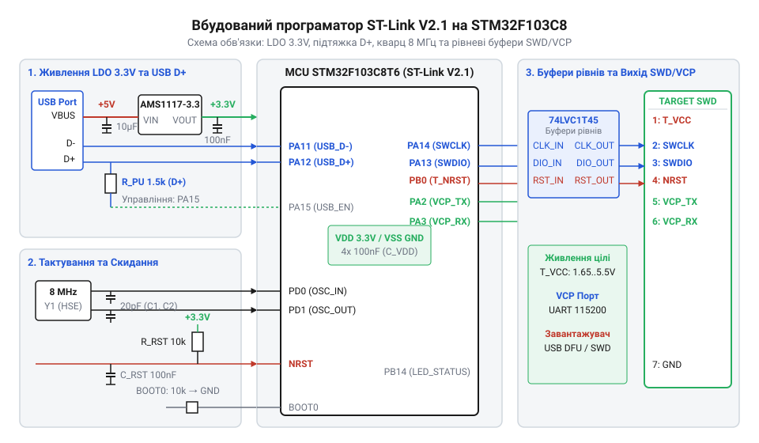
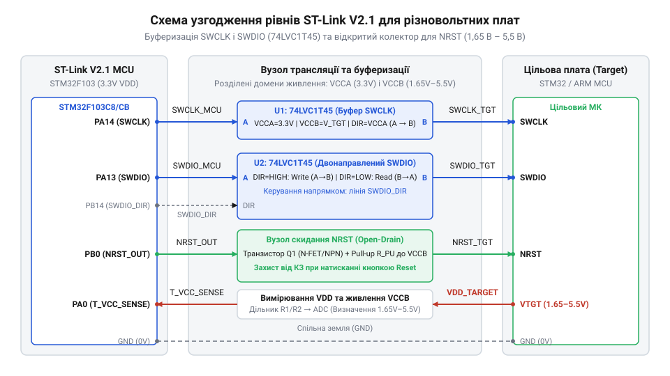

# Розробка та складання вбудованого зневаджувача ST-Link V2.1 на власній платі

<preknowlist>
- [WeAct Mini Debugger (DAPLink / ST-Link V2.1)](root:cat-hw-boards/daplink-debugger) — потрібні знання схемотехнічної розпіновки та живлення міні-програматорів.
- [Архітектура та принципи роботи програматора DAPLink](root:cat-hw-boards/daplink-programmer-architecture) — потрібні знання про фізичні лінії SWD та роботу віртуального COM-порту.
</preknowlist>

## Потреба у вбудованому зневаджувачі ST-Link

Під час проєктування та налагодження складних електронних пристроїв на базі @@en|STM32@@ розробник неминуче стикається з потребою постійного оновлення прошивки та контролю виконання коду. Найпростіший шлях — підключення зовнішнього програматора через гнучкі макетні провідники — швидко стає джерелом сильного роздратування та систематичних апаратних помилок. Гнучкий провід має високу паразитну індуктивність та ємність, що спотворює крутизну фронтів високочастотних сигналів. Коли лінія тактування @@en|SWCLK@@ працює на частотах від 4 до 10 МГц, будь-яка неузгодженість імпедансу створює паразитні відбиття сигналу. У результаті програматор втрачає зв'язок із цільовим @@en|microcontroller@@ (з @@en|Greek mikros та Latin controller@@), виводячи помилки сесії зневадження.

Друга критична проблема дротів — ненадійний електричний контакт та відсутність спільної низькоімпедансної шини заземлення. Якщо земляний дріт між зовнішнім зневаджувачем та цільовою платою має помітний опір або випадково від'єднується під час роботи, напруга зсуву між логічними рівнями спричиняє спотворення даних на лінії @@en|SWDIO@@. Крім того, імпульсні завади можуть спровокувати довільне скидання процесора через лінію @@en|NRST@@. У польових умовах або під час випробувань пристрою в корпусі макетні дроти взагалі унеможливлюють нормальну експлуатацію: постійне випадання пінів з роз'ємів загрожує випадковим коротким замиканням кіл живлення на лінії даних.

Відсутність інтегрованого зневаджувального вузла створює незручності й при отриманні налагоджувальної інформації. Для виведення текстових логів розробнику доводиться підключати додатковий модуль конвертера @@en|USB-UART@@, задіюючи ще один USB-порт комп'ютера та захаращуючи робоче місце хаосом із кабелів. На противагу цьому, вбудований зневаджувальний блок @@en|ST-Link V2.1@@ реалізує повноцінний інтерфейс @@en|SWD@@ (з @@en|English Single Wire Debug@@) та апаратний @@en|Virtual COM Port@@ (з @@en|English Virtual Communications Port@@) або @@en|VCP@@ через один фізичний кабель @@en|USB@@. Принцип реалізації та драйверну підтримку інтерфейсу описує [налаштування віртуального COM-порту VCP у зневаджувачах](root:cat-hw-boards/vcp-virtual-com-port-setup).

Інтеграція схемотехнічного блоку @@en|ST-Link V2.1@@ безпосередньо на друковану плату виробу повністю усуває проблеми зв'язку. Трасування сигнальних ліній фіксованими мідними доріжками з контрольованим імпедансом гарантує відсутність завад та надійну роботу на граничних частотах тактування. Хоча під час швидкого прототипування часто застосовують [компактні зовнішні програматори](root:cat-hw-boards/daplink-debugger) для прошивання дослідних плат, інтегроване рішення є єдиним стандартним підходом для серійних та налагоджувальних материнських плат. Розглядаючи [архітектурні принципи побудови](root:cat-hw-boards/daplink-programmer-architecture) сучасних зневаджувальних систем, стає очевидним: наявність власного блоку @@en|ST-Link V2.1@@ на платі перетворює готовий пристрій на самодостатній відлагоджувальний комплекс, який підключається до ПК звичайним кабелем @@en|USB Type-C@@.

## Схемотехніка MCU та USB-інтерфейсу

Серцем вбудованого зневаджувача @@en|ST-Link V2.1@@ є @@en|microcontroller@@ @@en|STM32F103C8@@ або @@en|STM32F103CB@@ у корпусі LQFP48. Для забезпечення стабільної роботи апаратного ядра необхідно побудувати надійне коло живлення, систему тактування та правильно розвести шину @@en|USB@@.

Живлення схемотехнічного вузла здійснюється від лінії @@en|VBUS@@ напругою +5 В шини @@en|USB@@. Оскільки ядро та периферія @@en|STM32F103C8@@ працюють від напруги +3.3 В, на платі встановлюється лінійний стабілізатор @@en|LDO@@ (з @@en|English Low Dropout Regulator@@) з низьким рівнем власних шумів, наприклад AP2112K-3.3 або AMS1117-3.3. Для придушення високочастотних завад та забезпечення транзієнтної стабільності LDO на його вході та виході розміщують керамічні конденсатори ємністю 10 мкФ.

Кожна пара виводів живлення цифрового ядра `VDD` та `VSS` мікроконтролера (виводи 24, 36, 48, 9) повинна мати власне шунтуюче коло з керамічного конденсатора @@en|decoupling capacitor@@ (з @@en|English decoupling capacitor@@) на 100 нФ, встановленого якнайближче до корпусу мікросхеми. Для аналогового живлення `VDDA` застосовується фільтрація через феритовий фільтр @@en|ferrite bead@@ (з @@en|English ferrite bead@@) з опором 100 Ом на частоті 100 МГц та паралельне поєднання керамічних конденсаторів ємністю 100 нФ і 1 мкФ. Таке розв'язання запобігає проникненню цифрових перемикальних шумів у чутливе аналогове ядро та тактову систему @@en|PLL@@.

Тактування @@en|STM32F103C8@@ виконується від зовнішнього кварцового резонатора @@en|crystal oscillator@@ (з @@en|English crystal oscillator@@) частотою 8 МГц, підключеного до виводів `OSC_IN` (пін 5) та `OSC_OUT` (пін 6). Внутрішній множник @@en|PLL@@ підвищує цю частоту до 72 МГц для системної шини та формує точну частоту 48 МГц для контролера @@en|USB Full-Speed@@. Розрахунок ємності навантажувальних конденсаторів `C_L1` та `C_L2`, що підключаються між виводами кварцу та землею `GND`, здійснюється за формулою:

```
C_L1 = 2 × C_L - 2 × C_stray
     = 2 × 18 - 2 × 3          [підстановка значень ємності]
     = 30                      [розрахункова ємність навантаження, пФ]
```

У цій формулі позначення `C_L` відповідає паспортній ємності навантаження резонатора (типово 18 пФ), а `C_stray` — паразитна ємність доріжок друкованої плати та виводів мікроконтролера (зазвичай 2–5 пФ). Отже, обираються керамічні конденсатори типу NPO/C0G номіналом 22–30 пФ.


*Принципова схема обв'язки мікроконтролера STM32F103C8 у якості вбудованого програматора ST-Link V2.1.*

Інтерфейс @@en|USB Full-Speed@@ (12 Мбіт/с) виведено на піни `PA11` (`USB_DM`) та `PA12` (`USB_DP`). Для узгодження хвильового опору шини (90 Ом для диференціальної пари) послідовно в лінії `D+` та `D-` впаюються демпфуючі резистори опором 22 Ом. Захист від електростатичних розрядів забезпечує спеціалізована TVS-діодна збірка @@en|ESD protection@@ (з @@en|English electrostatic discharge protection@@), наприклад USBLC6-2SC6, встановлена безпосередньо біля роз'єму @@en|USB@@.

Для розпізнавання пристрою ПК-хостом на лінії `USB D+` має бути підтягувальний резистор @@en|pull-up resistor@@ (з @@en|English pull-up resistor@@) номіналом 1.5 кОм до напруги +3.3 В. Схемотехніка @@en|ST-Link V2.1@@ вимагає програмного керування цією підтяжкою для реалізації процедури повторного ініціалізування на шині (@@en|software disconnect@@). Для цього підтяжка 1.5 кОм комутується через p-n-p транзистор або p-канал MOSFET, затвор якого керований від GPIO-виводу `PA15` (або `PA8`). Коли мікроконтролер подає низький рівень на керуючий вивід, транзистор відкривається, підключаючи 1.5 кОм до лінії `D+`, що змушує комп'ютер ініціювати розпізнавання пристрою на шині @@en|USB@@.

## Трансляція рівнів SWD та RESET

Апаратне ядро вбудованого зневаджувача @@en|ST-Link V2.1@@ працює від фіксованого живлення 3.3 В. Однак цільові мікроконтролери на розроблюваній платі можуть живитися від шин із напругою в діапазоні від 1.65 В до 5.5 В (наприклад, енергоефективні серії на 1.8 В або промислові процесори на 5 В). Пряме підключення ліній @@en|SWD@@ з рівнями 3.3 В до цільового мікроконтролера з живленням 1.8 В призведе до пробою вхідних діодів захисту від @@en|ESD protection@@ та виходу з ладу цільової мікросхеми.

Для безпечного зневадження різновольтних систем застосовуються двонаправлені шинні транслятори рівнів @@en|bus transceiver@@ (з @@en|English bus transceiver@@) серії @@en|74LVC1T45@@ або @@en|74LVC2T45@@. Ці мікросхеми мають два незалежних виводи живлення: порт `VCC_A` підключається до напруги 3.3 В зневаджувача @@en|ST-Link V2.1@@, а порт `VCC_B` — до лінії живлення цільового процесора `VCC_TARGET`.

Лінія тактування @@en|SWCLK@@ є однонаправленою (сигнал прямує лише від зневаджувача до цільової плати). У мікросхемі транслятора @@en|74LVC1T45@@ вивід напрямку `DIR` жорстко прив'язується до напруги `VCC_A` (або земли, залежно від розпіновки), зафіксувавши передачу сигналу в напрямку від A до B.

Лінія даних @@en|SWDIO@@ вимагає високошвидкісного двонаправленого обміну: під час фази запису @@en|ST-Link V2.1@@ передає команди, а під час фази читання цільовий мікроконтролер повертає стан регістрів. Для керування напрямком транслятора @@en|74LVC1T45@@ вивід `DIR` підключається до окремої лінії GPIO мікроконтролера зневаджувача (типово `PB15`). Прошивка @@en|ST-Link V2.1@@ апаратно перемикає стан `PB15` перед кожною зміною напрямку потоку даних @@en|SWD@@.


*Схема підключення двонаправлених трансляторів рівнів 74LVC1T45 для ліній SWDIO, SWCLK та відкритим колектором NRST для зневадження різновольтних плат.*

Особливої уваги потребує схемотехніка лінії скидання @@en|NRST@@. Лінія скидання мікроконтролерів @@en|STM32@@ має конфігурацію з відкритим стоком та внутрішньою підтяжкою до `VCC_TARGET`. Це означає, що як програматор, так і сам цільовий процесор або зовнішня кнопка скидання повинні мати можливість притягнути лінію @@en|NRST@@ до землі `GND` без виникнення короткого замикання кіл живлення.

Для реалізації такого буферного каскаду застосовують схему з відкритим колектором @@en|open-collector@@ (з @@en|English open collector@@) на базі N-канального польового транзистора (наприклад, BSS138) або спеціалізованого буфера типу 74LVC1G07. Затвор транзистора підключається до виводу `PB0` мікроконтролера @@en|ST-Link V2.1@@, а сток під'єднується до лінії `NRST` цільової плати. На лінії `NRST` встановлюється зовнішній резистор @@en|pull-up resistor@@ номіналом 10 кОм до напруги `VCC_TARGET`.

Коли зневаджувач формує сигнал скидання, вивід `PB0` видає високий логічний рівень (3.3 В), транзистор відкривається і притягує лінію `NRST` цільового мікроконтролера до `GND`. Коли скидання відпущено, на затворі встановлюється низький рівень, транзистор закривається, і лінія `NRST` вільно підтягується до напруги `VCC_TARGET` через резистор. Також вивід `PA0` зневаджувача підключається через дільник напруги до лінії `VCC_TARGET` для вимірювання напруги цільової плати та блокування виходів програматора за відсутності живлення цільової системи.

## Монтаж компонентів та розводка плати

Шум у колах живлення та розрив USB-з'єднання під час зневадження найчастіше виникають не через помилки у схемі, а через нехтування правилами трасування друкованої плати (@@en|PCB@@). Коли мікроконтролер @@en|STM32F103@@ працює на частоті 72 МГц, а шина @@en|USB@@ обмінюється даними на високочастотних імпульсах, будь-яка паразитна індуктивність доріжок або відсутність повернення струму через шар землі перетворює друковану плату на випромінювач завад. Вбудований програматор @@en|ST-Link V2.1@@ має стабільно утримувати зв'язок із ПК навіть тоді, коли цільова плата перемикає потужні навантаження.

Головною вимогою під час розведення високочастотної шини @@en|USB@@ є створення @@en|differential pair@@ (від англійського *differential pair*, де *differentia* — різниця): двох симетричних провідників ліній D+ та D- однакової довжини. Якщо довжина трас відрізняється більше ніж на 0.5 мм, виникає фазове зміщення сигналів, що спричиняє спотворення очної діаграми та втрату пакетів даних. Обидві доріжки трасують паралельно із постійним зазором між ними, забезпечуючи хвильовий опір дифпари 90 Ом. Під цими провідниками на сусідньому шарі плати обов'язково повинен розташовуватися суцільний шар землі (@@en|ground plane@@) без розрізів та перехідних отворів, оскільки зворотний струм високої частоти протікає строго під сигнальними доріжками.

Фільтруючі керамічні конденсатори (@@en|decoupling capacitor@@) ємністю 100 нФ для кожної пари виводів живлення @@en|VDD@@ та землі @@en|VSS@@ мікроконтролера @@en|STM32F103@@ у корпусі @@en|LQFP48@@ розміщують якнайближче до відповідних ніжок. Якщо між конденсатором і ніжкою мікроконтролера утвориться довгий провідник, його власна індуктивність завадить миттєвому розряджанню кераміки під час стрибків споживання струму ядра. Шлях від виводу землі конденсатора до шару землі має проходити через перехідний отвір, розташований безпосередньо біля майданчика елемента. Для захисту від високочастотних завад з боку шини живлення USB послідовно із лінією 5 В встановлюють феритовий фільтр (@@en|ferrite bead@@), після якого напруга подається на лінійний стабілізатор (@@en|LDO@@).

Сигнальні лінії зневадження @@en|SWD@@ (лінія даних @@en|SWDIO@@ та лінія тактування @@en|SWCLK@@) разом із лінією скидання @@en|NRST@@ розводять із мінімальною довжиною до шинних трансляторів @@en|74LVC1T45@@. Для запобігання перехресним наведенням (@@en|crosstalk@@) лінію тактування @@en|SWCLK@@ відокремлюють від аналогових кіл та високочастотного кварцового резонатора (@@en|crystal oscillator@@) на 8 МГц. Для перевірки апаратних сигналів корисно порівняти схему з тим, як влаштований [компактний автономний зневаджувач](root:cat-hw-boards/daplink-debugger), де застосовано аналогічні кола розведення.


*Організація суцільного шару землі під сигнальними лініями запобігає появі високочастотних завад на шині USB та лініях SWD.*

Під час монтажу компоненти в корпусах @@en|LQFP48@@ та @@en|TSSOP8@@ вимагають дотримання акуратності через малий крок між виводами (0.5 мм та 0.65 мм відповідно). Головною проблемою ручного монтажу або пайки гарячим повітрям є утворення @@en|solder bridge@@ (від англійського *bridge* — міст): небажаної перемички з припою між сусідніми ніжками мікросхеми. Для запобігання короткому замиканню контактні майданчики попередньо покривають рідким або гелеподібним флюсом, який зменшує поверхневий натяг розплавленого припаю. Якщо перемичка все ж утворилася, її видаляють за допомогою мідної плетінки для зняття надлишків припаю (@@en|desoldering braid@@), змоченої флюсом, торкаючись зрізом паяльника до місця замикання без тривалого перегріву виводів.

## Первинна прошивка та тестовий запуск

Після завершення монтажу смонтована плата залишається «німою»: вбудований мікроконтролер @@en|STM32F103@@ має порожню флеш-пам'ять, тому при підключенні до @@en|USB@@ комп'ютер не розпізнає пристрій. Щоб перетворити мікроконтролер на функціональний програматор, у його пам'ять необхідно записати первинний @@en|bootloader@@ (від англійського *bootstrap loader*, де *bootstrap* — вушко чобота): базовий завантажувач, який приймає та перевіряє фірмовий код @@en|ST-Link V2.1@@. Опис функціонування та системних команд надає [протокол завантажувача USB DFU в мікроконтролерах STM32](root:cat-hw-boards/usb-dfu-bootloader-protocol).

Первинний запис завантажувача здійснюється одним із двох апаратних шляхів. Перший спосіб використовує вбудоване системне ПЗ мікроконтролера. Для цього підтягують вивід `BOOT0` до лінії 3.3 В (`BOOT0 = 1`), а вивід `BOOT1` з'єднують із землею (`BOOT1 = 0`) і виконують скидання мікроконтролера. При такій конфігурації ядро стартує з системної пам'яті (@@en|ROM@@), активуючи вбудований завантажувач @@en|USB DFU@@ (Device Firmware Upgrade). ПК визнає пристрій як завантажувач STMicroelectronics, що дає змогу прошити файл завантажувача через утиліту @@en|STM32CubeProgrammer@@. Другий спосіб є більш універсальним: прошивка записується через технологічний роз'єм @@en|SWD@@ за допомогою стороннього зневаджувача. Оскільки логіка обміну SWD та віртуального порту у багатьох програматорах збігається, вивчення того, як влаштована [загальна архітектура DAPLink](root:cat-hw-boards/daplink-programmer-architecture), допоможе зрозуміти обробку композитних USB-пристроїв. Коли первинний завантажувач прошито, підключення до цільового мікроконтролера виконується через спеціалізовані утиліти, подібні до тих, що описують [інструменти прошивання мікроконтролерів](root:cat-hw-boards/flashing-tools-esptool-and-nodemcu-pyflasher) для інших платформ. Покроковий алгоритм запису висвітлює [первинне прошивання завантажувача USB DFU в STM32](root:cat-hw-boards/usb-dfu-bootloader-flashing).

Після успішного прошивання завантажувача конфігурацію виводів повертають у робочий стан (`BOOT0 = 0`) та перезапускають живильний каскад. У цей момент пристрій повинен ініціалізуватися в операційній системі як @@en|composite device@@ (від латинського *compositus* — складений): один фізичний вузол, що надає операційній системі два незалежні логічні пристрої. Першим є зневаджувач класу @@en|ST-Link Debugger@@ для керування шиною @@en|SWD@@, а другим — віртуальний послідовний порт (@@en|VCP@@) для трансляції даних @@en|UART@@. Для завершення налаштування запускають фірмовий майстер оновлення прошивки ST-Link Upgrade, який перевіряє цілісність завантажувача та записує останнє актуальне мікропрограмне забезпечення.


*Покрокова перевірка режимів роботи дає змогу швидко ізолювати помилки монтажу від апаратних збоїв прошивки.*

Якщо комп'ютер видає помилку розпізнавання пристрою («USB Device Not Recognized»), першопричиною є апаратний збій ініціалізації шини. Передусім перевіряють кола підтяжки лінії D+: у схемі @@en|ST-Link V2.1@@ резистор 1.5 кОм керується виводом мікроконтролера через ключ (або підтягнутий до шини 3.3 В), і якщо підтяжка відсутня, комп'ютер не виявить появу пристрою на шині. Другою поширеною причиною є відсутність генерації кварцового резонатора (@@en|crystal oscillator@@) 8 МГц: якщо внутрішнє коло множення частоти (@@en|PLL@@) не зафіксує 72 МГц, USB-контролер мікроконтролера не зможе сформувати тактову частоту 48 МГц. 

Фінальна перевірка збудованого каскаду проводиться в середовищі розробки (@@en|IDE@@), наприклад @@en|STM32CubeIDE@@ або @@en|Keil@@. До роз'єму зневаджувача підключають цільовий мікроконтролер із напругою живлення від 1.65 В до 5.5 В. Втиснувши кнопку зчитування ідентифікатора ядра в @@en|IDE@@, перевіряють автоматичне узгодження рівнів трансляторами @@en|74LVC1T45@@ та стабільність зчитування регістрів target-процесора. Повна відсутність помилок скидання лінії @@en|NRST@@ та стабільний обмін через @@en|VCP@@ свідчать про готовність вбудованого програматора до експлуатації.
