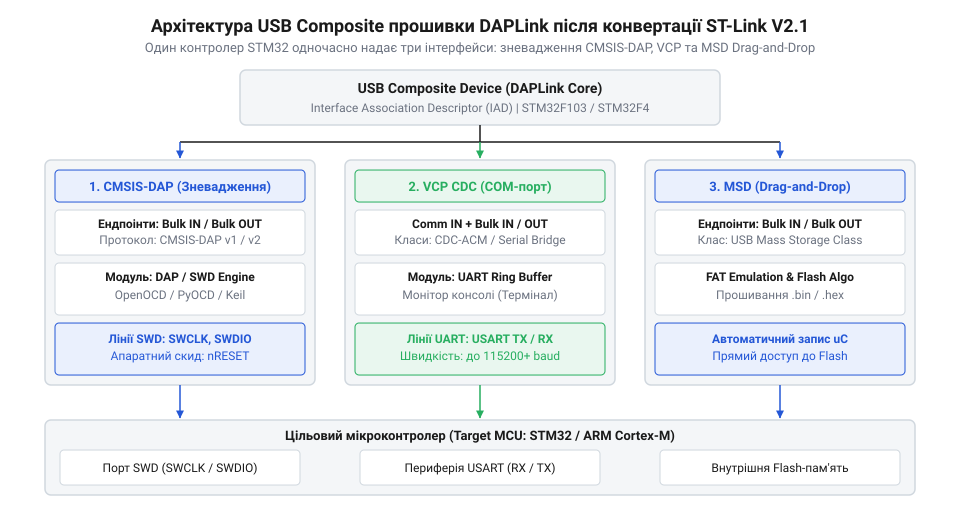
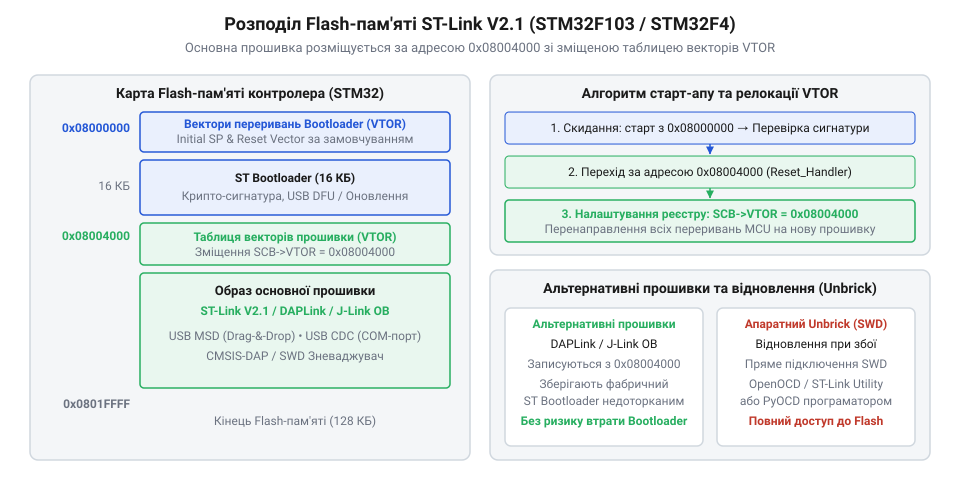

# Практичне оновлення та конвертація прошивки ST-Link V2.1 у DAPLink

<preknowlist>
- [WeAct Mini Debugger (DAPLink / ST-Link V2.1)](root:cat-hw-boards/daplink-debugger) — потрібні знання про схемотехніку та розпіновку програматорів на базі STM32F103.
- [Архітектура та принципи роботи програматора DAPLink](root:cat-hw-boards/daplink-programmer-architecture) — потрібні знання про базові інтерфейси CMSIS-DAP та підсистеми drag-and-drop.
</preknowlist>

## Обмеження фірмової прошивки ST-Link V2.1

Розробка схемотехніки та зневадження сучасних мікроконтролерів часто впираються в проблему пропрієтарної вендорної прив'язки (англ. *@@en|Vendor Lock-in@@*, від *vendor* — постачальник та *lock-in* — прив'язка). Заводські зневаджувальні модулі `@@en|ST-Link V2.1@@` (від англ. *link* — зв'язок), вбудовані у популярні відлагоджувальні плати сімейств `@@en|STM32 Nucleo@@` та `@@en|Discovery@@`, постачаються із закритим прошивочним стеком від компанії `@@en|STMicroelectronics@@`. Ця прошивка жорстко обмежує інженера можливістю працювати виключно з мікроконтролерами серії `@@en|STM32@@`. Спроба підключити через лінії зневадження чип іншого виробника — наприклад, `@@en|RP2040@@`, `@@en|nRF52@@` або `@@en|ESP32-C3@@` — блокується на рівні закритих USB-команд та драйверів фірмової утиліти.

Другим критичним недоліком фірмового стека є повна відсутність підтримки універсального відкритого стандарту `@@en|CMSIS-DAP@@` (від англ. *Cortex Microcontroller Software Interface Standard Debug Access Port*). Фірмовий адаптер `@@en|ST-Link V2.1@@` вимагає встановлення спеціалізованих USB-драйверів у системі та не розпізнається нативно стандартними відлагоджувальними середовищами на операційних системах `@@en|Linux@@` та `@@en|macOS@@` без додаткового прошарку сумісності. Крім того, штатна прошивка позбавлена зручної функції автономного прошивання `@@en|Drag-and-Drop@@` (від англ. *drag* — тягнути та *drop* — скидати), яка дозволяє завантажувати бінарний файл у мікроконтролер простим перетягуванням у вікні провідника без відкриття важких середовищ розробки.

Конвертація програматора у відкритий стек `@@en|DAPLink@@` кардинально змінює логіку взаємодії пристрою з хостом. Замість монолітного пропрієтарного протоколу пристрій стає складеним вузлом `@@en|USB Composite@@` (від англ. *composite* — складений пристрій), який одночасно надає системі три незалежні інтерфейси: ендпоінт `@@en|CMSIS-DAP@@` для зневадження через `@@en|OpenOCD@@` чи `@@en|PyOCD@@`, віртуальний послідовний порт `@@en|VCP@@` (від англ. *Virtual COM Port*) на базі класу `@@en|CDC@@` (від англ. *Communications Device Class*) для виведення логів та емульований накопичувач `@@en|MSD@@` (від англ. *Mass Storage Class*) для зручного прошивання. Детальний аналіз [архітектури програматора DAPLink](root:cat-hw-boards/daplink-programmer-architecture) показує, як ці інтерфейси співіснують у єдиному USB-стеку.

*Дерево апаратно-програмної архітектури прошивки DAPLink після конвертації з розділенням ендпоінтів CMSIS-DAP, VCP (CDC) та MSD.*

Оновлення офіційної прошивки через фірмову утиліту `@@en|ST-Link Upgrade Utility@@` пов'язане з високим ризиком блокування пристрою (англ. *@@en|Bricking@@*, від *brick* — цеглина). Якщо під час передачі блоку даних станеться збій живлення або пошкодження USB-пакета, фабричний завантажувач перериває верифікацію криптографічної сигнатури і блокує передачу керування до основного образу, залишаючи плату у стані безвідповідної «цеглини».

Програмний стек `@@en|DAPLink@@` усуває цю вразливість завдяки обробці команд `@@en|CMSIS-DAP@@` та емуляції файлової системи `@@en|VFAT16@@` для інтерфейсу `@@en|MSD@@`. Нижче наведено базові визначення команд протоколу та структуру буфера USB-пакетів з реалізації обробника:

:::code proj-stlink-v21-firmware-conversion-daplink/cpp/include/cmsis_dap_handler.hpp 12-44

Запит від хоста обробляється всередині головного циклу через декодування ідентифікатора команди та формування симетричного пакета відповіді фіксованого розміру:

:::code proj-stlink-v21-firmware-conversion-daplink/cpp/src/cmsis_dap_handler.cpp 164-195

Паралельно з цим модуль `@@en|MSD@@` емулює структуру файлової системи `@@en|FAT16@@`, перехоплюючи спроби запису секторів файлу прошивки та трансуючи їх у SWD-команди стирання й програмування Flash-пам'яті:

:::code proj-stlink-v21-firmware-conversion-daplink/cpp/include/vfat_msd_emulator.hpp 13-51

Для демонстрації взаємодії цих компонентів тестовий модуль реалізує повний цикл приймання USB-пакетів та емуляції запису бінарного образу:

:::code proj-stlink-v21-firmware-conversion-daplink/cpp/main.cpp 1-47

:::code proj-stlink-v21-firmware-conversion-daplink/cpp/src/vfat_msd_emulator.cpp 105-166

Таким чином, перехід на відкритий прошивальний стек `@@en|DAPLink@@` звільняє від обладнання вендора, забезпечує кросплатформову сумісність та гарантує стійкість до системних збоїв.

## Карта пам'яті та захист завантажувача

Успішна конвертація прошивки вимагає чіткого розуміння топології Flash-пам'яті керуючого мікроконтролера `@@en|STM32F103CB@@` або `@@en|STM32F401VG@@`, що встановлений у секції програматора `@@en|ST-Link V2.1@@`. Фізичний простір Flash-пам'яті починається з адреси `0x08000000`. Фабрична конфігурація `@@en|ST-Link V2.1@@` розбита на дві ізольовані області: перші 16 КБ (`0x4000` байтів) зарезервовані під первинний фабричний завантажувач (англ. *@@en|Bootloader@@*, від *boot* — завантаження та *loader* — завантажувач), а область з адреси `0x08004000` відведена під основний робочий образ прошивки програматора.

*Схема розподілу Flash-пам'яті контролера STM32F103/F4 у програматорі ST-Link V2.1.*

При подачі живлення процесор `@@en|ARM Cortex-M@@` завжди зчитує початкове значення вказівника стека `@@en|MSP@@` (англ. *Main Stack Pointer* — головний покажчик стека) з адреси `0x08000000`, а точку входу `@@en|Reset Handler@@` — з адреси `0x08000004`. Оскільки первинний `@@en|Bootloader@@` знаходиться в основі пам'яті, під час переходу до нової прошивки `@@en|DAPLink@@`, розміщеної із зсувом `0x08004000`, необхідно обов'язково виконати релокацію регістру зсуву таблиці векторів `@@en|VTOR@@` (від англ. *Vector Table Offset Register* — регістр зсуву таблиці векторів). Без оновлення `SCB->VTOR` будь-яке апаратне переривання або виклик периферифії призведе до передачі керування на старі обробники `@@en|Bootloader@@`, що викличе критичний збій `@@en|HardFault@@`.

Для захисту фабричного завантажувача від випадкового стирання під час перезапису використовується механізм апаратного захисту від зчитування та запису `@@en|RDP@@` (від англ. *Readout Protection* — захист від зчитування). Перед передачею керування застосунку `@@en|Bootloader@@` верифікує заголовок таблиці векторів цільового образу: перевіряє, чи знаходиться значення `@@en|MSP@@` у межах оперативної пам'яті `@@en|SRAM@@` (від англ. *Static Random-Access Memory* — статична оперативна пам'ять) за адресами `0x20000000`–`0x20005000`, та перевіряє наявність встановленого біта `@@en|Thumb@@` (LSB=1) в адресі `@@en|Reset Handler@@`.

Базові конфігураційні константи та структури перевірки заголовка таблиці векторів оголошені в низькорівневому заголовочному файлі:

:::code proj-stlink-v21-firmware-conversion-daplink/c/include/vtor_relocate.h 14-27

:::code proj-stlink-v21-firmware-conversion-daplink/c/include/vtor_relocate.h 96-114

Процедура підготовки до переходу вимагає коректного вимкнення всіх системних переривань у контролері `@@en|NVIC@@` (від англ. *Nested Vectored Interrupt Controller* — контролер вкладених векторних переривань), зупинки таймера `@@en|SysTick@@` та виконання бар'єрів пам'яті `@@en|DSB@@` (Data Synchronization Barrier) і `@@en|ISB@@` (Instruction Synchronization Barrier):

:::code proj-stlink-v21-firmware-conversion-daplink/c/src/vtor_relocate.c 57-93

Низькорівневий механізм верифікації та безпосереднього стрибка в адресацію `@@en|DAPLink@@` здійснюється за допомогою встановлення регістра `SCB->VTOR` та завантаження нового значення `@@en|MSP@@`:

:::code proj-stlink-v21-firmware-conversion-daplink/c/src/vtor_relocate.c 95-159

Точка входу C-модуля виконує послідовну перевірку цілісності заголовка та безпечно передає керування новій прошивці:

:::code proj-stlink-v21-firmware-conversion-daplink/c/main.c 9-60

Ознайомитися з прикладами реалізації подібних рішень на практиці можна у матеріалі щодо [відлагоджувальних плат DAPLink](root:cat-hw-boards/daplink-debugger). Дотримання вирівнювання таблиці векторів на 128 байтів та валідація адрес гарантують цілісність системи та захищають завантажувальний простір від пошкоджень.

## Апаратне підключення SWD для прошивання

Якщо в процесі оновлення прошивки або некоректної конфігурації регістра `@@en|VTOR@@` програматор перестав визначатися по USB, виникає потреба в апаратному відновленні (англ. *@@en|Unbrick@@*, від *unbrick* — розблокування, повернення з стану «цеглини»). Для цього використовується зовнішній зневаджувач, підключений до технологічних контактів виводу `@@en|SWD@@` (від англ. *Serial Wire Debug* — послідовне двопровідне зневадження) на платі `@@en|ST-Link V2.1@@`.

Апаратний інтерфейс відновлення вимагає з'єднання чотирьох основних ліній:
- `@@en|SWCLK@@` (від англ. *Serial Wire Clock* — тактування зневадження);
- `@@en|SWDIO@@` (від англ. *Serial Wire Data Input/Output* — двопровідна лінія даних);
- `@@en|NRST@@` (від англ. *Negative Reset* — інверсна лінія апаратного скидання);
- `@@en|GND@@` (спільна земля схеми).

Ключовим етапом апаратного відновлення є керування конфігураційним виводом `@@en|BOOT0@@` (від англ. *boot* — завантаження). Підтяжка лінії `@@en|BOOT0@@` до високого рівня напруги `3.3 В` під час подачі живлення примушує мікроконтролер `@@en|STM32F103@@` проігнорувати пошкоджений вміст Flash-пам'яті та завантажитися із зашитого у заводському `@@en|ROM Bootloader@@` (від англ. *Read-Only Memory Bootloader* — системний завантажувач у ПЗУ). Це відкриває доступ до зчитування та стирання пам'яті через системний інтерфейс `@@en|UART@@` або `@@en|SWD@@`.

Для автоматизації діагностики та примусового прошивання використовується утиліта `@@en|OpenOCD@@` (від англ. *Open On-Chip Debugger* — відкритий апаратний зневаджувач). Нижче наведено Python-скрипт керування сервером `@@en|OpenOCD@@`, який виконує сокетне підключення та відправляє TCL-команди зупинки процесора:

:::code proj-stlink-v21-firmware-conversion-daplink/py/stlink_openocd_tool.py 47-79

Процедура апаратного розблокування та повного стирання заблокованої Flash-пам'яті (`@@en|Unbrick@@`) включає примусове зняття захисту `@@en|RDP@@` та масове стирання секторів:

:::code proj-stlink-v21-firmware-conversion-daplink/py/stlink_openocd_tool.py 216-295

Перед записом нового дампа обов'язково виконується програмна валідація цілісності образу: аналізується вирівнювання `@@en|MSP@@`, перевіряється наявність біта `@@en|Thumb@@` у векторі `@@en|Reset Handler@@` та розраховуються контрольні суми `@@en|CRC32@@` і `@@en|SHA-256@@`:

:::code proj-stlink-v21-firmware-conversion-daplink/py/stlink_openocd_tool.py 321-428

Демонстраційний сценарій виконує повний цикл перевірки дампа та автономного стирання за допомогою OpenOCD:

:::code proj-stlink-v21-firmware-conversion-daplink/py/stlink_openocd_tool.py 461-547

Використання подібного автоматизованого інструментарію є аналогічним до практик із застосування інших [інструментів апаратного прошивання](root:cat-hw-boards/flashing-tools-esptool-and-nodemcu-pyflasher). Правильне схемотехнічне підключення ліній `@@en|SWD@@` та використання автоматизованих скриптів дозволяють гарантовано відновити роботоздатність програматора навіть після найтяжчих збоїв прошивки.

## Програмування та конфігурація образу DAPLink

Забезпечивши апаратне з'єднання за допомогою інструментів зневадження, інженер переходить до етапу збірки та безпосереднього завантаження бінарного образу відкритої прошивки `@@en|DAPLink@@` у Flash-пам'ять програматора `@@en|ST-Link V2.1@@`. Процес конвертації полягає у записі зкомпільованого бінарника (файлу з розширенням `.bin`) за адресою `0x08004000` (для збереження штатного завантажувача) або з початкової адреси `0x08000000` (при повній заміні завантажувального стеку). Для завантаження образу використовуються відкриті консольні утиліти `@@en|OpenOCD@@` (від англ. *Open On-Chip Debugger*) або `@@en|PyOCD@@` (від англ. *Python On-Chip Debugger*). Виконуючи команду `openocd -f interface/stlink.cfg -f target/stm32f1x.cfg -c "program daplink.bin 0x08004000 verify reset exit"`, утиліта підключається до мікроконтролера, виконує зупинку ядра, розблоковує сектори пам'яті та записує новий прошивочний простір.

Під час збірки образу `@@en|DAPLink@@` з вихідного коду для плат серії `@@en|STM32 Nucleo@@` або `@@en|Discovery@@` розробник може зіткнутися з проблемою переповнення обсягу Flash-пам'яті (англ. *@@en|Memory Overflow@@*, від *memory* — пам'ять та *overflow* — переповнення). Стандартний мікроконтролер `@@en|STM32F103CB@@`, встановлений на більшості модулів `@@en|ST-Link V2.1@@`, має `128 КБ` Flash-пам'яті, з яких під робочу прошивку відведено лише `112 КБ` (за мінусом `16 КБ` на `@@en|Bootloader@@`). Якщо до складу прошивки включено додаткові класи USB-пристроїв або розширені драйвери цільових плат, розмір вихідного файлу перевищує виділений ліміт. Для усунення помилки збирання у конфігураційних файлах `DAP_config.h` та `target_board.h` вимикають неліцензовані або невикористовувані модулі (наприклад, підтримку `@@en|WebUSB@@` чи емуляцію додаткових віртуальних дисків), оптимізуючи розмір бінарника під наявні апаратні межі.

Після перезавантаження контролера з новою прошивкою розгортається багатофункціональна апаратно-програмна структура `@@en|USB Composite@@` (від англ. *composite* — складений пристрій). Ключовим вузлом зневадження є клас `@@en|CMSIS-DAP@@`, який обробляє бінарні команди через кінцеві точки USB Bulk (англ. *@@en|Bulk Endpoints@@*, від *bulk* — масовий та *endpoint* — кінцева точка). Приймальний буфер утилізує масив фіксованого розміру `64 байти`, розбираючи команди ідентифікації `DAP_Info`, підключення `DAP_Connect` та читання-запису регістрів `DAP_Transfer`. Нижче наведено реалізацію структури обробника команд та безпечної роботи з буфером USB-пакетів:

:::code proj-stlink-v21-firmware-conversion-daplink/cpp/include/cmsis_dap_handler.hpp 47-96

Декодування команд та формування відповіді відбувається у високорівневих методах класу, які керують фізичними станами сигнальних ліній `@@en|SWCLK@@` та `@@en|SWDIO@@`:

:::code proj-stlink-v21-firmware-conversion-daplink/cpp/src/cmsis_dap_handler.cpp 197-251

Другим компонентом складеного пристрою є віртуальний послідовний порт `@@en|VCP@@` (від англ. *Virtual COM Port*) на основі специфікації `@@en|CDC ACM@@` (від англ. *Communications Device Class Abstract Control Model*), що забезпечує двосторонній обмін текстовими логами між цільовим мікроконтролером та комп’ютером розробника. Третій вузол — емулятор диска `@@en|MSD@@` (від англ. *Mass Storage Class*) — формує в оперативній пам'яті структури віртуальної файлової системи `@@en|VFAT16@@`. Пристрій обробляє низькорівневі `@@en|SCSI@@`-команди (від англ. *Small Computer System Interface*) та перехоплює спроби копіювання бінарних файлів з розширеннями `.BIN` або `.HEX`:

:::code proj-stlink-v21-firmware-conversion-daplink/cpp/include/vfat_msd_emulator.hpp 85-133

Низькорівневий обробник `@@en|SCSI CBW@@` (Command Block Wrapper) розпізнає запити опису пристрою `INQUIRY` та параметрів обсягу `READ CAPACITY`, після чого здійснює пряме прошивання цільового контролера через SWD-транзакції:

:::code proj-stlink-v21-firmware-conversion-daplink/cpp/src/vfat_msd_emulator.cpp 168-236

Успішне завершення конвертації перевіряється верифікацією переліку розпізнаних USB-пристроїв у операційній системі. При з’єднанні з комп'ютером у диспетчері пристроїв з'являються три незалежні об'єкти: пристрій зневадження `CMSIS-DAP`, послідовний порт `DAPLink VCP` та віртуальний накопичувач `DAPLINK`. На віртуальному диску створюється текстовий файл `INFO_DAP.TXT`, який містить ревізію прошивки та статус ініціалізації. Детальніше про внутрішню [архітектуру програматора DAPLink](root:cat-hw-boards/daplink-programmer-architecture) та організацію його ендпоінтів можна дізнатися у відповідній аналітичній статті. Конвертований програматор стає повністю готовим до підключення будь-яких сумісних платформ.

## Валідація та апаратний Unbrick програматора

Фінальним етапом реалізації проєкту є верифікація роботоздатності новоствореного програматора `@@en|DAPLink@@` під час реальної взаємодії з різноманітними цільовими мікроконтролерами. На відміну від штатного `@@en|ST-Link V2.1@@`, обмеженого виключно екосистемою `@@en|STM32@@`, конвертований модуль забезпечує повноцінне апаратне зневадження та прошивання чипів інших виробників, таких як `@@en|nRF52@@` (компанії `@@en|Nordic Semiconductor@@`) або `@@en|ESP32-C3@@` (архітектури `@@en|RISC-V@@` компанії `@@en|Espressif Systems@@`). Під час тестування через `@@en|OpenOCD@@` або `@@en|PyOCD@@` програматор ініціалізує лінію `@@en|SWD@@`, зчитує унікальний ідентифікатор `IDCODE` (наприклад, `0x2BA01477` для ядер Cortex-M4) та виконує покрокове виконання інструкцій за допомогою універсальних [інструментів апаратного прошивання](root:cat-hw-boards/flashing-tools-esptool-and-nodemcu-pyflasher).

У процесі експлуатації функції драгового прошивання `@@en|Drag-and-Drop@@` розробник може зіткнутися з аварійними ситуаціями, коли прошивання переривається помилкою. Емулятор `@@en|MSD@@` аналізує вхідний потік даних і при виявленні некоректного файлу (наприклад, невідповідного розміру образу, відсутності вирівнювання векторів або захищеної від запису Flash-пам'яті цілі) генерує на віртуальному диску текстовий документ `FAIL.TXT` замість `INFO_DAP.TXT`. Аналіз вмісту цього файлу дає змогу швидко діагностувати причину відмови: рядок `SWD ERROR` вказує на відсутність фізичного контакту на лініях `@@en|SWCLK@@`/`@@en|SWDIO@@`, рядок `TARGET FAULT` свідчить про перебування цільового МК у стані глибокого сну (`@@en|Deep Sleep@@`), а `BAD ALIGNMENT` означає пошкодження заголовка бінарника.

Найбільш критичною аварійною ситуацією є пошкодження самої прошивки програматора `@@en|DAPLink@@`, викликане збоєм живлення під час оновлення. Якщо за початковою адресою записано некоректне значення вказівника стека `@@en|MSP@@` або адреса `@@en|Reset Handler@@` не містить обов’язкового біта `@@en|Thumb@@` (LSB=1), процесор потрапляє в нескінченний цикл фатальної помилки `@@en|HardFault@@`, а пристрій втрачає здатність визначатися по USB. Для екстреного відновлення (`@@en|Unbrick@@`) застосовується зовнішній Python-інструментарій, який підключається до сокету `@@en|OpenOCD TCL@@` та виконує низькорівневі процедури керування:

:::code proj-stlink-v21-firmware-conversion-daplink/py/stlink_openocd_tool.py 80-143

:::code proj-stlink-v21-firmware-conversion-daplink/py/stlink_openocd_tool.py 165-214

Процедура `@@en|Unbrick@@` зупиняє процесор командою `reset halt`, знімає захист `@@en|RDP@@` через `unlock_target` та виконує масове стирання пошкоджених секторів Flash-пам'яті (`mass_erase`). Перед записом нового образу виконується автоматична валідація векторної таблиці для виключення повторного блокування:

:::code proj-stlink-v21-firmware-conversion-daplink/py/stlink_openocd_tool.py 287-319

Перевірка цілісності дампа за допомогою модуля `FirmwareValidator` здійснює аналіз належності `@@en|MSP@@` до меж `@@en|SRAM@@` (`0x20000000`–`0x20005000`) та перевірку наявності біта `@@en|Thumb@@` у векторі скидання:

:::code proj-stlink-v21-firmware-conversion-daplink/py/stlink_openocd_tool.py 373-428

Після відновлення та підтвердження стабільності системи розробник може адаптувати вихідний код `@@en|DAPLink@@` під власні апаратні модифікації. Змінюючи призначені виводи в файлах опису плат (`gpio_cfg.h`), можна перепризначити лінії `@@en|SWCLK@@`, `@@en|SWDIO@@`, `@@en|NRST@@` та світлодіоди індикації стану на будь-які вільні ніжки мікроконтролера. Це дає змогу створювати кастомні програматори на базі дешевих платок `@@en|STM32 Blue Pill@@` або модифікованих модулів `@@en|ST-Link V2.1@@`. З практичними аспектами експлуатації подібного обладнання можна ознайомитися в огляді [відлагоджувальних плат DAPLink](root:cat-hw-boards/daplink-debugger). Дотримання описаних інструкцій гарантує тривалий життєвий цикл адаптера та свободу від вендорних обмежень.
