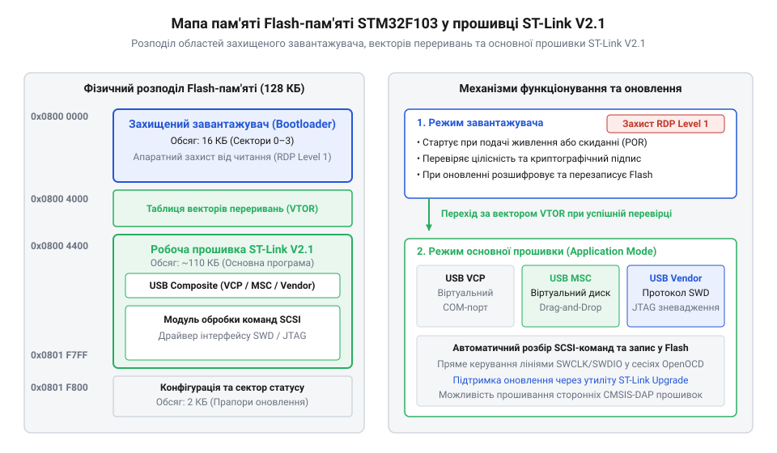
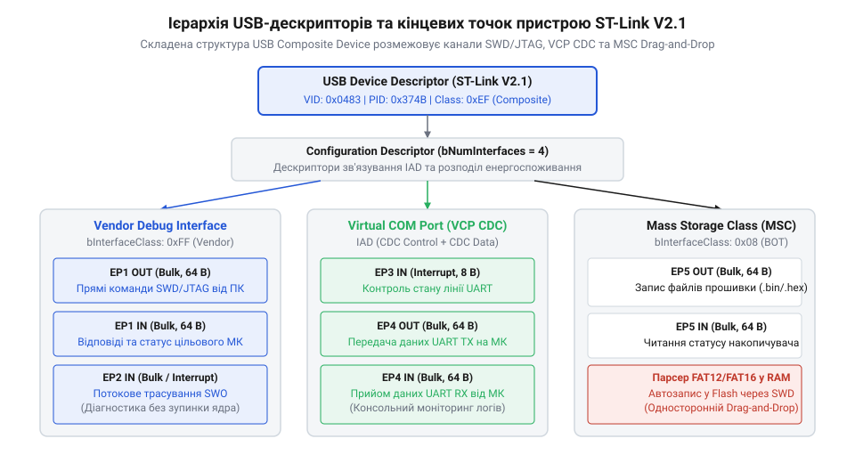
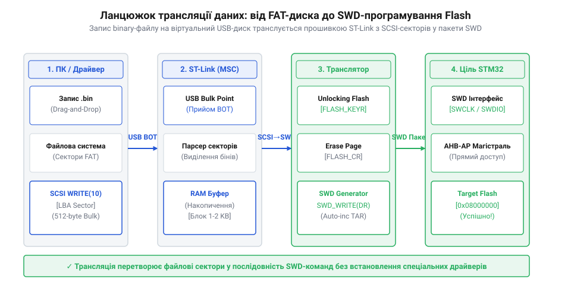
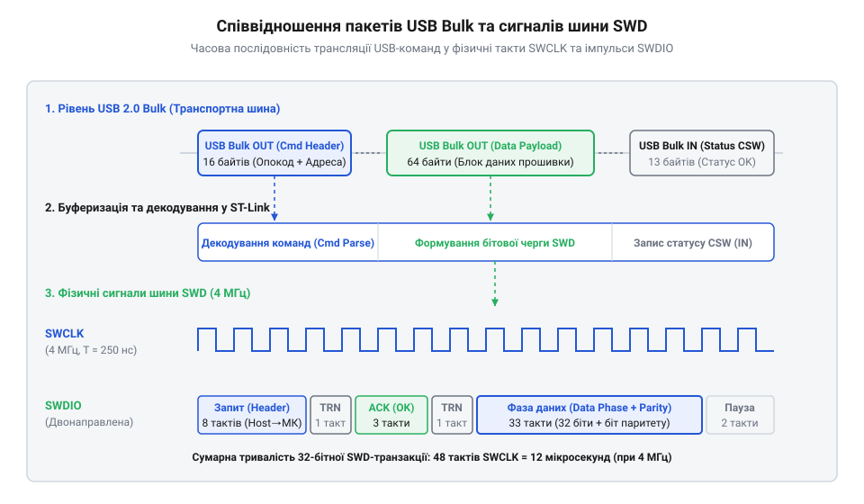

# Фірмова прошивка та протокол ST-Link V2.1

<preknowlist>
- [WeAct Mini Debugger (DAPLink / ST-Link V2.1)](root:cat-hw-boards/daplink-debugger) — Конструктивні особливості та призначення двохрежимних відлагоджувачів.
- [Архітектура та принципи роботи програматора DAPLink](root:cat-hw-boards/daplink-programmer-architecture) — Принципи роботи відкритих альтернатив CMSIS-DAP та DAPLink.
- [Інструменти прошивання мікроконтролерів ESP: esptool та GUI-завантажувачі](root:cat-hw-boards/flashing-tools-esptool-and-nodemcu-pyflasher) — Загальні уявлення про процес завантаження бінарного коду в мікроконтролери.
</preknowlist>

## Архітектура двокомпонентної прошивки та завантажувача

Фірмовий відлагоджувач `ST-Link V2.1` будується на базі 32-бітного мікроконтролера `STM32F103` з ядром `Arm Cortex-M3`. Внутрішнє програмне забезпечення пристрою розділено на дві автономні області у флеш-пам'яті: первинний завантажувач (від англ. @@en|bootloader@@ — завантажувач прошивки; @@en|первинний завантажувач@@) та основний системний образ виконуваної прошивки. Таке розділення є критичним для забезпечення відмовостійкості: при некоректній передачі даних або випадковому відключенні живлення під час оновлення системного програмного забезпечення первинний завантажувач залишається неушкодженим, запобігаючи перетворенню пристрою на неробочий чип без можливості відновлення.

*Мапування внутрішньої Flash-пам'яті мікроконтролера STM32F103 зі зміщенням вектора переривань VTOR для робочої прошивки.*

При подачі живлення або знятті сигналу скидання процесорне ядро завжди починає виконання коду з нульового зміщення адреси `0x08000000`, де розміщено первинний завантажувач обсягом близько 16 кБ. Завантажувач виконує базову ініціалізацію тактової частоти від зовнішнього кварцового резонатора, перевіряє цілісність вектора переривань основного образу за адресою `0x08004000` та обчислює контрольну суму (від англ. @@en|cyclic redundancy check@@ — циклічний надлишковий код; @@en|CRC@@). Якщо сигнатурні байти збігаються і від керуючої утиліти не надходило спеціального прапора переходу в режим оновлення через інтерфейс `DFU` (від англ. @@en|Device Firmware Upgrade@@ — оновлення прошивки пристрою; @@en|режим DFU@@), завантажувач модифікує регістр зміщення таблиці векторів `SCB->VTOR` на значення `0x08004000` і передає керування на початковий обробник скидання робочої прошивки. Деталі схемотехнічного підключення процесора та розпіновку відлагоджувального порту наведено у [специфікації апаратного інтерфейсу ST-Link V2.1](root:cat-hw-boards/stlink-v21-firmware-architecture/api-stlink-v21-hardware-pinout-and-schematic.md).

Процес верифікації перед передачею керування базується на суворому аналізі перших двох 32-бітних слів таблиці векторів за адресою `0x08004000` та опитуванні сигнатурних регістрів пам'яті @@en|RAM@@. Завантажувач першочергово перевіряє, чи вказує перше слово на коректну початкову адресу головного вказівника стека `@@en|MSP@@` (від англ. @@en|Main Stack Pointer@@ — головний вказівник стека) у межах оперативної пам'яті `0x20000000–0x20005000`, а друге слово містить точну адресу обробника вектора скидання (англ. @@en|Reset Vector@@) з виставлянням молодшого біта у `1` для режимів інструкцій `@@en|Thumb@@`. Для передачі бінарного образу використовується завантажувальний кадр із чітко структурованим заголовком (від англ. @@en|frame header@@; @@en|заголовок завантажувального кадру@@), який містить 32-бітний магічний ідентифікатор сесії, 32-бітне зміщення цільової адреси Flash-пам'яті, 16-бітний розмір корисного навантаження (від англ. @@en|payload@@; @@en|корисне навантаження кадру@@) та 32-бітний контрольний залишковий код. Покрокова процедура обчислення контрольної суми `@@en|CRC-32@@` реалізується через апаратний периферійний модуль мікроконтролера за нормативним поліномом `0x04C11DB7` (від англ. @@en|polynomial@@; @@en|базовий поліном@@): на першому кроці регістр `CRC->DR` ініціалізується еталонним значенням `0xFFFFFFFF` через запис біта `CRC_CR_RESET`, на другому — завантажувач послідовно записує 32-бітні слова корисного навантаження кадру в регістр даних, де за один тактовий цикл обчислюється проміжний залишковий результат, а на третьому — підсумкове значення порівнюється з контрольною сумою із заголовка. Якщо значення слів векторів знаходяться поза межами, виявлено розбіжність `@@en|CRC-32@@` або у резервних регістрах присутня магічна кодова послідовність (англ. @@en|Magic Keyword@@) примусового утримання чипа в режимі `@@en|DFU@@`, завантажувач блокує перехід до адреси `0x08004000`, залишаючи відлагоджувач у захищеному режимі відновлення.

Структура таблиці векторів у `Flash`-пам'яті за адресою `0x08004000` починається з адреси вказівника стека `MSP` та вектора скидання, після яких розміщено початкові обробники системних винятків `NMI` (від англ. @@en|Non-Maskable Interrupt@@ — немасковане переривання) та `HardFault`. Для перевірки цілісності образу завантажувач використовує апаратний модуль обчислення контрольної суми @@en|CRC-32@@, який послідовно зчитує 32-бітні слова основного сектору від `0x08004000` до останньої сторінки прошивки. Отримане значення порівнюється з еталонним чеком, збереженим у фінальних чотирьох байтах образу: лише при повній збігу обчисленого значення з зафіксованим чеком завантажувач переписує регістр зміщення векторів `SCB->VTOR` і передає керування, що забезпечує повний захист від виконання пошкодженого коду на пристроях на кшталт [дворежимного відлагоджувача](root:cat-hw-boards/daplink-debugger).

У разі виявлення пошкодження цілісності образу або примусової активації сесії оновлення з боку утиліт `ST-Link Utility` чи `STM32CubeProgrammer`, пристрій залишається у захищеному режимі завантажувача. Оновлення здійснюється шляхом передачі зашифрованих або підписаних блоків бінарного коду через USB-пакети. Тільки після повного запису секторів і верифікації CRC-хешу завантажувач знімає прапор блокування і дозволяє старт оновленої версії. Докладно етапи розвитку та зміну компоновки прошивок висвітлено в [історії розвитку прошивок ST-Link](root:cat-hw-boards/stlink-v21-firmware-architecture/hist-stlink-firmware-evolution.md). Для розробників, які бажають розгорнути власну апаратну версію пристрою, корисним буде [проєкт схемотехнічної обв'язки програматора](root:cat-hw-boards/stlink-v21-firmware-architecture/proj-stlink-v21-embedded-circuit-setup.md).

## Складений USB-пристрій та класи Composite

Головною відмінністю версії `ST-Link V2.1` від попередніх модифікацій є організація фізичного шинного інтерфейсу USB у вигляді складеного пристрою (від англ. @@en|composite device@@ — складений пристрій; @@en|складений USB-пристрій@@). Замість використання одного монолітного драйвера, мікроконтролер `STM32F103` надає операційній системі комп'ютера єдину фізичну лінію USB 2.0 Full-Speed (зі швидкістю 12 Мбіт/с), всередині якої логічно мультиплексуються три незалежні класи пристроїв. Це дозволяє операційній системі автоматично монтувати віртуальний послідовний порт, знімний диск для швидкого програмування та високошвидкісний канал зневадження без виникнення ресурсних конфліктів.

*Ієрархічна структура USB-дескрипторів складеного пристрою ST-Link V2.1 та розподіл кінцевих точок між інтерфейсами.*

Мультиплексування забезпечується на рівні USB-дескрипторів (від англ. @@en|descriptor@@ — дескриптор, опис структури даних; @@en|USB-дескриптор@@). Пристроєм оголошується головний дескриптор конфігурації, який описує три окремі логічні інтерфейси:
1. Клас пристроїв зв'язку `CDC` (від англ. @@en|Communications Device Class@@ — клас комунікаційних пристроїв; @@en|клас CDC@@), що реалізує віртуальний послідовний порт (від англ. @@en|Virtual COM Port@@ — віртуальний послідовний порт; @@en|VCP@@) для наскрізного зчитування логів із плати.
2. Клас масового накопичувача `MSC` (від англ. @@en|Mass Storage Class@@ — клас масового накопичувача; @@en|клас MSC@@), який емулює накопичувач з файловою системою FAT для завантаження файлів шляхом перетягування (від англ. @@en|drag-and-drop@@ — перетягування файлів).
3. Вендорний клас зневадження (від англ. @@en|vendor-specific class@@ — проприєтарний клас виробника), що використовує прямі канали пакетної передачі `Bulk` (від англ. @@en|bulk transfer@@ — масове пакетне передавання; @@en|пакетне передавання Bulk@@) для керування протоколами `SWD` та `JTAG`.

Усередині кожного з трьох інтерфейсів функціонування каналів зв'язку регламентується дескрипторами кінцевих точок (англ. @@en|Endpoint Descriptor@@ — дескриптор кінцевої точки). Для порту `VCP` прошивка конфігурує переривальну кінцеву точку `Interrupt IN` для опитування ліній керування `UART` та дві кінцеві точки `Bulk IN`/`OUT` для наскрізного передавання байтів із розміром пакета `wMaxPacketSize = 64` байти. Накопичувач `MSC` виділяє власну пару точок `Bulk IN`/`OUT` для передавання блоків SCSI-команд, а проприєтарний вендорний клас зневадження використовує окремі високошвидкісні канали `Bulk` для прокачування команд `SWD`/`JTAG`. Конфігурування дескрипторів вимагає точного розподілу оперативної пам'яті USB-периферії `PMA` (від англ. @@en|Packet Memory Area@@ — область пам'яті пакетів) у мікроконтролері `STM32F103`, де під кожну напрямну точку виділяється ізольований 64-байтовий апаратний буфер, що захищає від накладання мережевих пакетів при паралельній обробці команд, як це влаштовано і в [альтернативному програматорі DAPLink](root:cat-hw-boards/daplink-programmer-architecture).

Для запобігання конфліктам операційної системи при розпізнаванні багатоінтерфейсного складеного пристрою в прошивці задіяно дескриптор об'єднання інтерфейсів (від англ. @@en|Interface Association Descriptor@@; @@en|дескриптор IAD@@). Дескриптор IAD зв'язує керуючий та сигнальний інтерфейси класу `CDC` в єдиний логічний вузол `VCP`, гарантуючи, що системні драйвери операційної системи не плутатимуть їх із кінцевими точками класу `MSC` чи проприєтарного каналу `Bulk`. Для розв'язання апаратних конфліктів при одночасному інтенсивному логуванні через `VCP` та зневадженні через `Bulk` мікроконтролер `STM32F103` використовує подвійну буферизацію кінцевих точок (від англ. @@en|double buffering@@) та пріоритетизацію переривань USB: обробник транзакцій зневадження виділяється у високопріоритетну чергу, тоді як текстовий трафік `CDC` тимчасово буферизується у кільцевому масиві в оперативній пам'яті, що повністю запобігає втраті пакетів зневадження `SWD` та зависанню сесії при розгортанні альтернативних відлагоджувачів на кшталт [програматора DAPLink](root:cat-hw-boards/daplink-programmer-architecture).

Поведінка базі дводрайверного або мультиінтерфейсного USB-стека складеного пристрою має виражену специфіку залежно від операційної системи хост-комп'ютера. В операційних системах сімейства Windows прив'язка системних драйверів до логічних каналів `ST-Link V2.1` регулюється універсальними дескрипторами Microsoft (від англ. @@en|Microsoft OS Descriptors@@; @@en|MS OS-дескриптори@@): клас `VCP` автоматично мовчки підключає стандартний системний драйвер `usbser.sys`, накопичувач `MSC` мовчки монтується за допомогою `usbstor.sys`, а проприєтарний вендорний канал зневадження вимагає фірмової підсистеми `STLinkUSBdriver.dll` або універсальної бібліотеки `WinUSB` (від англ. @@en|WinUSB@@). Натомість у середовищі Linux ядерна підсистема USB самостійно розбирає дескриптор `IAD` і розщеплює трафік між незалежними модулями ядра: функція `VCP` миттєво ініціалізується драйвером `cdc_acm` із створенням віртуального термінала `/dev/ttyACM0`, накопичувач керується модулем `usb-storage`, а вендорний Bulk-канал доступний прямо з простору користувача через бібліотеку `libusb` (від англ. @@en|libusb@@). Оскільки в Linux допуск до сирих пакетів шини `Bulk` за замовчуванням вимагає прав адміністратора (root), для стабільної обробки сесій зневадження в середовищах розробки налаштовують спеціальні правила менеджера пристроїв `udev` (від англ. @@en|udev rules@@), які надають дозвіл на доступ безперервному потоку даних `SWD` без ризику виникнення помилок авторизації `LIBUSB_ERROR_ACCESS`.

Кожен із трьох інтерфейсів оперує власними виділеними кінцевими точками (від англ. @@en|endpoint@@ — кінцева точка шини; @@en|кінцева точка@@) у буферній пам'яті USB-контролера. Апаратний контролер `STM32F103` мультиплексує обробку переривань від кінцевих точок: коли операційна система надсилає SCSI-команду на MSC-інтерфейс, апаратний обробник передає байти в буфер зчитування накопичувача, не затримуючи транзит символів через VCP-порт. Повний список структур дескрипторів та форматів команд зведено у [довіднику USB-дескрипторів та SCSI-команд](root:cat-hw-boards/stlink-v21-firmware-architecture/api-stlink-v21-usb-protocol-and-scsi-commands.md). При бажанні змінити фірмовий стек на відкриту альтернативу розробник може виконати [перепрошивання у відкритий DAPLink](root:cat-hw-boards/stlink-v21-firmware-architecture/proj-stlink-v21-firmware-conversion-daplink.md), принципи якого описує загальна стаття про [архітектуру відлагоджувачів DAPLink](root:cat-hw-boards/daplink-programmer-architecture).

## Емуляція MSC та обробка SCSI-команд

Забезпечення швидкого та інтуїтивного завантаження прошивки у цільовий мікроконтролер без встановлення спеціалізованих драйверів розробки вимагає використання загальноприйнятих системних класів пристроїв. Для цього прошивка `ST-Link V2.1` реалізує клас масових накопичувачів @@en|MSC@@ (від англ. @@en|Mass Storage Class@@ — клас масових накопичувачів; @@en|MSC@@), перетворюючи програматор у віртуальний накопичувач при підключенні до ПК. Робота цього виділеного інтерфейсу базується на обробці команд системного інтерфейсу малих комп'ютерів @@en|SCSI@@ (від англ. @@en|Small Computer System Interface@@ — системний інтерфейс малих комп'ютерів; @@en|SCSI@@), які передаються всередині пакетів обгортки блоку команд @@en|CBW@@ (від англ. @@en|Command Block Wrapper@@ — обгортка блоку команд; @@en|CBW@@) та обгортки статусу команди @@en|CSW@@ (від англ. @@en|Command Status Wrapper@@ — обгортка статусу команди; @@en|CSW@@).

При ініціалізації віртуального диска операційна система зчитує головний завантажувальний запис та файлову систему @@en|FAT@@ (від англ. @@en|File Allocation Table@@ — таблиця розміщення файлів; @@en|FAT@@). Замість реального кристала флеш-пам'яті прошивка `ST-Link V2.1` емулює структури секторів у власному ОЗП: при надходженні SCSI-команди читання `READ(10)` мікроконтролер віддає згенеровані «на льоту» таблиці секторів `FAT12` або `FAT16`, розпізнавальний текстовий файл `DETAILS.TXT` та службові віртуальні файли. Коли користувач виконує прошивання перетягуванням бінарного файла `@@en|.bin@@` або `@@en|.hex@@` на диск, операційна система надсилає послідовність SCSI-команд запису `WRITE(10)` для відповідних 512-байтних секторів.

Внутрішній алгоритм прошивки обчислює віртуальні кластери `FAT12` або `FAT16` на вимогу, синтезуючи вміст секторів у локальному `ОЗП` без виділення пам'яті під повноцінний образ диска. При обробці команди `READ(10)` для завантажувального сектора сектор 0 генерується за шаблоном @@en|BPB@@ (англ. @@en|BIOS Parameter Block@@, від *parameter* — параметр, та *block* — блок), який задає розмір сектора 512 байтів та віртуальну таблицю розміщення файлів. Коли операційна система починає запис бінарного файла, вона надсилає команду `WRITE(10)` для перших секторів кореневого каталогу та завантажувального запису @@en|MBR@@ (англ. @@en|Master Boot Record@@, від *master* — головний, *boot* — завантаження, та *record* — запис). Модуль перехоплення `ST-Link V2.1` аналізує елементи каталогу у льоту: виявивши розширення `@@en|.bin@@` або `@@en|.hex@@`, прошивка зчитує розмір файла та ініціалізує внутрішній автомат станів завантажувача, виставляючи апаратне скидання цільового мікроконтролера та готуючи сесію [програматора DAPLink](root:cat-hw-boards/daplink-programmer-architecture) або ST-Link до потокового запису у `Flash`.

*На блочній схемі показано ланцюжок трансляції записаних на FAT-диск секторів через SCSI-команди у SWD-команди програмування Flash цілі.*

У момент прийому секторів даних внутрішній аналізатор прошивки перехоплює байти запису. Замість збереження даних на локальному носії, модуль перетворення транслює вміст бінарного файла у фізичні команди інтерфейсу послідовного дротового зневадження @@en|SWD@@ (від англ. @@en|Serial Wire Debug@@ — послідовне дротове зневадження; @@en|SWD@@). Процес включає розпаковування потоку, підтирання потрібних сторінок кристала цільового мікроконтролера `ARM Cortex-M` та запис бінарних слів безпосередньо у внутрішній `Flash`. Повний опис команд розкрито у [довіднику USB-дескрипторів та SCSI-команд](root:cat-hw-boards/stlink-v21-firmware-architecture/api-stlink-v21-usb-protocol-and-scsi-commands.md).

Трансляція потоку даних забезпечується внутрішнім автоматом станів прошивки, який послідовно проходить кілька етапів при отриманні кожного 512-байтного сектора. На початковому етапі розпізнавання автомат витягує з заголовка файла початкову адресу завантаження та переводить цільовий мікроконтролер у стан апаратного зупину через SWD-команду зміни регістра `DHCSR`, після чого надсилає послідовність ключових слів розблокування контролера `Flash`-пам'яті цілі. Далі автомат станів входить у цикл обробки секторів: він накопичує сирі байти у проміжному кільцевому буфері ОЗП, вирівнює їх у 32-бітні слова і, перед збереженням першого блоку адреси, генерує SWD-транзакцію стирання відповідної сторінки `Flash`. Після очищення сектору модуль послідовно записує вирівняні слова у пам'ять цілі через порт `AHB-AP` та опитує біт зайнятості `BSY` у регістрі стану флеш-контролера. Після отримання останнього сектора автомат станів закриває сесію програмування, блокує контролер `Flash` та ініціює перезапуск мікроконтролера через подачу сигналу на лінію `NRST` або виклик системного скидання `AIRCR`.

Механізм емуляції @@en|MSC@@ має суворі апаратні обмеження. Оскільки файлова система `@@en|FAT@@` очікує миттєвого підтвердження запису сектору, а операція програмування `Flash`-пам'яті цілі вимагає часу на стирання та стикування тактів, сповільнення відгуку може викликати таймаут операційної системи та помилку запису `@@en|FAIL.TXT@@`. Якщо записаний файл не відповідає кратності вирівнювання адрес або містить пошкоджений заголовок, `ST-Link V2.1` перериває процес завантаження, створюючи на віртуальному диску файл опису помилки. Подібні нюанси порівнюються з відкритими аналогами в [архітектурі програматора DAPLink](root:cat-hw-boards/daplink-programmer-architecture) та [двохрежимному зневаджувачі WeAct](root:cat-hw-boards/daplink-debugger). При апаратному конструюванні корисна інформація про [апаратний інтерфейс та розпіновку SWD](root:cat-hw-boards/stlink-v21-firmware-architecture/api-stlink-v21-hardware-pinout-and-schematic.md).

При виникненні апаратних або програмних збоїв під час завантаження прошивка `ST-Link V2.1` негайно перериває трансляцію `SCSI`-команд і динамічно генерує у кореневому каталозі віртуальної файлової системи `FAT` текстовий файл `FAIL.TXT`. Основними причинами формування цього файла є порушення вирівнювання адрес бінарного масиву, спроба запису за межі фізичної пам'яті цілі, активний апаратний захист зчитування або запису `Flash` (від англ. @@en|Readout Protection@@ — захист зчитування; @@en|RDP@@), а також раптовий зрив синхронізації на лінії `SWD` через просідання живлення цільової плати. Структура віртуального файла `FAIL.TXT` складається з трьох стандартних текстових рядків: перший містить короткий текстовий код помилки (наприклад, `FAIL: WRITE TIMEOUT`, `FAIL: FLASH PROTECTED` або `FAIL: ALIGNMENT ERROR`), другий вказує 32-бітну шістнадцяткову адресу байта `0x0800xxxx`, на якому перервався процес стирання чи програмування, а третій рядок наводить службовий статус автомата станів завантажувача. Ознайомлення з цим повідомленням дозволяє розробнику швидко діагностувати причину аварійної зупинки без підключення спеціалізованих системних утиліт зневадження, порівняно з поведінкою узагальненого [програматора DAPLink](root:cat-hw-boards/daplink-programmer-architecture) або [інструментами прошивання мікроконтролерів](root:cat-hw-boards/flashing-tools-esptool-and-nodemcu-pyflasher).

## Вендорний протокол команд SWD/JTAG

Для забезпечення низькорівневого та високошвидкісного зневадження у професійних середовищах розробки (наприклад, OpenOCD або ST-Link Utility) прошивка `ST-Link V2.1` надає вендорний проприєтарний інтерфейс. Цей канал спирається на масове пакетне передавання @@en|Bulk@@ (від англ. @@en|Bulk Transfer@@ — масове пакетне передавання; @@en|Bulk@@) протоколу `USB` через дві виділені кінцеві точки (вхідну та вихідну). Вендорний протокол функціонує за принципом «запит-відповідь», де хост-комп'ютер формує бінарні пакети команд, а відлагоджувач декодує їх та транслює у фізичні сигнали інтерфейсів @@en|SWD@@ або @@en|JTAG@@ (від англ. @@en|Joint Test Action Group@@ — об'єднана група з випробувань та автоматизації; @@en|JTAG@@).

Кожен пакет вендорного протоколу містить 16-байтний заголовок із кодом команди `@@en|STLINK_CMD@@`, параметрами адреси та довжиною переданих даних. При отриманні команди читання чи запису регістрів процесора `ARM Cortex-M` прошивка виконує швидке перетворення байтів у послідовність імпульсів тактування `SWCLK` та даних `SWDIO`.

При виконанні підкоманд `@@en|STLINK_DEBUG_APIRDRW@@` (доступ до периферії через шинний порт `@@en|AHB-AP@@`) та `@@en|STLINK_DEBUG_READCOREREG@@` (читання внутрішніх регістрів ядра) прошивка переходить у цикл опитування фізичної шини `@@en|SWD@@`. Під час транзакції віддалений мікроконтролер повертає 3-бітний стан підтвердження: `@@en|ACK@@` (від англ. @@en|Acknowledge@@ — підтвердження прийому; `0b001`), `@@en|WAIT@@` (від англ. @@en|Wait@@ — очікування; `0b010`) або `@@en|FAULT@@` (від англ. @@en|Fault@@ — збій; `0b100`). Зчитування регістрів ядра через `@@en|STLINK_DEBUG_READCOREREG@@` вимагає запису номера регістру в системний регістр `@@en|DCRSR@@` та очікування прапорця готовності в `@@en|DHCSR@@`, що створює часові затримки тривалістю в кілька мікросекунд. Якщо шина повертає `@@en|WAIT@@` через зайнятість ядра, прошивка відлагоджувача виконує внутрішні повторні спроби транзакції перед тим, як сформувати відповідь у пакеті `@@en|USB Bulk@@`. Таке апаратне регулювання таймінгів на рівні прошивки гарантує стабільний доступ до пам'яті цілі навіть під час виконання інтенсивних операцій запису у флеш-пам'яті на пристроях на кшталт [дворежимного відлагоджувача](root:cat-hw-boards/daplink-debugger).

*На часовій діаграмі показано співвідношення пакетів USB Bulk та сформованих сигналів тактування SWCLK і даних SWDIO.*

Взаємодія через вендорний протокол охоплює повний спектр операцій зневадження: ініціалізація порту, читання та запис внутрішніх регістрів ядра `@@en|R0@@`–`@@en|R15@@`, доступ до оперативної пам'яті та периферії через шинний порт `@@en|AHB-AP@@`, встановлення апаратних точок зупину `@@en|Breakpoint@@` та керування лінією апаратного скидання `NRST`. На відміну від автоматичного завантаження через `@@en|MSC@@`, вендорний протокол дозволяє інтерактивно контролювати покрокове виконання коду. Розрахувати часові затримки обміну допомагає [розрахунок пропускної здатності USB Bulk](root:cat-hw-boards/stlink-v21-firmware-architecture/math-stlink-v21-usb-bulk-and-swd-timing-calc.md).

Структура 16-байтного заголовка запиту `STLINK_CMD` має фіксований формат: перший байт задає код основної групи команд (наприклад, `0x22` для команд зневадження `STLINK_DEBUG_COMMAND`), другий байт визначає підкоманду (зокрема `STLINK_DEBUG_READMEM_32BIT` або `STLINK_DEBUG_WRITEMEM_32BIT`), байти з 2 по 5 містять 32-бітну цільову адресу в пам'яті у форматі прямих байтів @@en|Little-Endian@@, а байти 6 та 7 визначають 16-бітну довжину масиву даних у байтах чи словах. Решта байтів з 8 по 15 відведена під додаткові прапорці конфігурації шини та резервні параметри. При виконанні операцій читання чи запису через шинний порт `AHB-AP` прошивка перекладає цей заголовок у послідовність низькорівневих регістрових транзакцій @@en|CoreSight SWD@@: спочатку задається режим автоінкременту та роздільності вибірки в регістрі керування `CSW` (від англ. @@en|Control/Status Word@@ — регістр керування та стану; `CSW`), після чого адреса записується у регістр `TAR` (від англ. @@en|Transfer Address Register@@ — регістр адреси передавання; `TAR`), а самі дані безперервно зчитуються або записуються через регістр буфера даних `DRW` (від англ. @@en|Data Read/Write Register@@ — регістр читання та запису даних; `DRW`) без необхідності повторного перезапису цільової адреси на кожному кроці.

У відповідь на кожну транзакцію прошивка відлагоджувача формує зворотний пакет відповіді (від англ. @@en|response packet@@; @@en|пакет відповіді@@) через вхідну кінцеву точку USB Bulk, структура якого починається з 16-бітного поля коду стану (від англ. @@en|status code@@; @@en|код стану@@) `@@en|STLINK_DEBUG_ERR@@`. У разі успішного зчитування перші два байти містять прапор `STLINK_DEBUG_ERR_OK` (`0x0000`), після якого відразу передається запитаний 32-бітний масив даних або вміст регістрів ядра у форматі `@@en|Little-Endian@@`. Якщо ж зчитування регістрів чи пам'яті стає неможливим — наприклад, через відсутність тактування периферійного модуля, спробу доступу до незадіяних адрес або активний захист від зчитування (від англ. @@en|readout protection@@; @@en|захист від зчитування@@) `@@en|RDP@@` — прошивка перериває SWD-транзакцію та повертає код `STLINK_DEBUG_ERR_FAULT` (`0x0001`) або `STLINK_DEBUG_ERR_AP_FAULT` (`0x0004`). При тривалих затримках відповіді цільового процесора повертається статус `STLINK_DEBUG_ERR_WAIT` (`0x0002`), що інформує хост-утиліту про необхідність повторного запиту чи виклику примусового скидання ядра.

Завдяки прямій обробці пакетів у прошивці вдається досягти високої частоти тактування `SWCLK` (до 4 МГц і вище), що критично для швидкого зчитування великих масивів дампів пам'яті. У разі виникнення збоїв зв'язку (наприклад, при переході цілі в режим глибокого сну `@@en|STANDBY@@` чи відключенні ліній `SWD`), прошивка повертає відповідний код помилки у відповідному пакеті `@@en|Bulk@@`, даючи змогу утилітам на кшталт [інструментів прошивання esptool](root:cat-hw-boards/flashing-tools-esptool-and-nodemcu-pyflasher) або OpenOCD коректно виконати повторне підключення. Докладніше про перехід між прошивками розкрито в матеріалі про [конвертацію прошивки ST-Link у DAPLink](root:cat-hw-boards/stlink-v21-firmware-architecture/proj-stlink-v21-firmware-conversion-daplink.md), а нюанси інтеграції описує [розробка вбудованого зневаджувача ST-Link](root:cat-hw-boards/stlink-v21-firmware-architecture/proj-stlink-v21-embedded-circuit-setup.md). Еволюційні етапи цього протоколу висвітлює [історичний розвиток програматорів ST-Link](root:cat-hw-boards/stlink-v21-firmware-architecture/hist-stlink-firmware-evolution.md).

## Апаратна узгодженість рівнів та діагностика

Надійне функціонування відлагоджувача `ST-Link V2.1` вимагає суворого схемотехнічного узгодження електричних рівнів між програматором і цільовою платою. Основний фізичний інтерфейс зв'язку з ядрами `Arm Cortex-M` складається з сигнальних ліній тактування `SWCLK` (від англ. @@en|Single Wire Clock@@ — однопровідний тактовий сигнал; @@en|лінія SWCLK@@), двонапрямлених даних `SWDIO` (від англ. @@en|Single Wire Data Input/Output@@ — однопровідні дані введення-виведення; @@en|лінія SWDIO@@), асинхронного трасування `SWO` (від англ. @@en|Single Wire Output@@ — однопровідний вихід трасування; @@en|лінія SWO@@) та лінії скидання `NRST`. Ключовим елементом схемотехніки є вивід відстеження напруги живлення цілі `TVCC` (від англ. @@en|Target VCC@@ — напруга живлення цільової плати; @@en|вивід TVCC@@).

Вивід `TVCC` не подає живлення на цільову плату, а виконує опорну функцію для двонапрямлених перетворювачів рівнів (від англ. @@en|level shifter@@ — буферний перетворювач логічних рівнів; @@en|перетворювач рівнів@@). У фірмовій схемі `ST-Link V2.1` шинні трансивери живляться безпосередньо від виводу `TVCC` в діапазоні від 1.65 В до 3.6 В. Якщо вивід `TVCC` не підключено до опорного джерела цільового мікроконтролера, вихідні буфери відлагоджувача залишаються в знеструмленому або високоімпедансному стані, що унеможливлює передачу імпульсів `SWCLK` і спричиняє відмову ініціалізації сокета з помилкою відсутності зв'язку. Детальний розрахунок частотних обмежень шини та ємнісного навантаження кабелю наведено у [розрахунку таймінгів SWD-тактування](root:cat-hw-boards/stlink-v21-firmware-architecture/math-stlink-v21-usb-bulk-and-swd-timing-calc.md).

Поширеною фізичною причиною збоїв зневадження є виникнення плаваючих потенціалів та паразитних ємностей на лініях зв'язку. Для забезпечення завадостійкості на лінії `SWDIO` встановлюють підтягувальний резистор до джерела `TVCC` номіналом 100 кОм, а лінію `SWCLK` шунтують підтяжкою до землі на 100 кОм. Це запобігає апаратному засупкуванню кремнієвої структури (від англ. @@en|latch-up@@ — засувка структури) та неконтрольованим спрацьовуванням тригерів під час підключення кабелю. При роботі у складних умовах або при довжині шлейфу понад 15 см висока паразитна ємність спотворює прямокутні фронти імпульсів, що вимагає зниження тактової частоти `SWCLK` у налаштуваннях середовища відлагодження. 

Для запобігання викривленню тактового сигналу `SWCLK` схемотехнічний розрахунок обмежує граничну ємність навантаження `C_load`. Тривалість фронту наростання імпульсу `t_r` залежить від вихідного опору буфера `R_out` та ємності траси `C_load` за формулою `t_r = 2.2 × R_out × C_load`. При тактовій частоті `f_swclk = 4` МГц тривалість півперіоду становить 125 нс; щоб фронт не перевищував 20% від півперіоду (`t_r ≤ 25` нс) при `R_out = 50` Ом, гранична ємність становить `C_load = 25 × 10⁻⁹ ÷ (2.2 × 50) ≈ 227` пФ, що вимагає використання послідовних демпферних резисторів 22–33 Ом біля виводів відлагоджувача. Для лінії `NRST` застосовують схему активного придушення завад на базі інвертора з @@en|Schmitt trigger@@ (англ. @@en|Schmitt trigger@@, від прізвища *Schmitt* — Шмітт, та *trigger* — тригер) та @@en|RC@@-фільтра низьких частот, яка відфільтровує імпульсні @@en|EMI@@ (англ. @@en|Electromagnetic Interference@@, від *electromagnetic* — електромагнітний, та *interference* — завада) та унеможливлює самовільне скидання ядра під час зневадження на платах на кшталт [відлагоджувача WeAct](root:cat-hw-boards/daplink-debugger).

Для діагностики важкодоступних помилок, коли цільовий мікроконтролер заблоковано через помилкову конфігурацію виводів `GPIO` або перехід у режим глибокого енергозбереження, використовують режим зневадження зі скиданням (від англ. @@en|Connect Under Reset@@ — підключення з утриманням скидання). У цьому режимі програматор примусово подає низький рівень на лінію `NRST`, блокуючи ядро процесора до моменту ініціалізації відлагоджувального порту `DP`. Приклади підключення та вибір компонентів висвітлює [специфікація апаратного інтерфейсу ST-Link V2.1](root:cat-hw-boards/stlink-v21-firmware-architecture/api-stlink-v21-hardware-pinout-and-schematic.md), а готові рекомендації з проєктування власної плати надає [проєкт схемотехнічної обв'язки програматора](root:cat-hw-boards/stlink-v21-firmware-architecture/proj-stlink-v21-embedded-circuit-setup.md). При використанні компактних відлагоджувачів на кшталт [дебагера WeAct Mini Debugger](root:cat-hw-boards/daplink-debugger) дотримання правильного розведення опорного живлення `TVCC` забезпечує абсолютну стабільність сесій зневадження.

Під час розробки розпізнавання найтиповіших помилок зневадження — таких як `No target connected` або `SWD Read ACK Fault` — дозволяє швидко виявити перехід ядра у глибокий сон або випадкове перепризначення виводів `SWCLK`/`SWDIO` під звичайні `GPIO`. Виникнення помилки `SWD Read ACK Fault` вказує на те, що цільовий порт зневадження не повертає підтвердження `ACK = OK`: першим діагностичним кроком є перевірка наявності напруги на виводі `TVCC`, після чого контролюють відсутність обривів трас та знижують тактову частоту `SWCLK` в IDE з 4 МГц до 500 кГц для компенсації кабельної ємності. Якщо причиною збою є апаратні завади на однопровідній лінії асинхронного трасування `SWO`, що призводять до втрати кадрів `ITM`, на лінію встановлюють послідовний демпферний резистор номіналом 22–33 Ом поруч із виводом мікроконтролера та шунтують її підтяжкою 10 кОм до `TVCC` для приглушення наведень від сусідніх імпульсів `SWCLK`. Покроковий алгоритм відновлення зв'язку за допомогою `Connect Under Reset` полягає в тому, що відлагоджувач спочатку апаратно притискає лінію `NRST` до землі, фіксуючи ядро в стані скидання до виконання першої інструкції прошивки. Далі `ST-Link` надсилає по лінії `SWD` пакети ініціалізації порту `SW-DP` і записує прапори зупинки ядра в регістр `DHCSR`, після чого відпускає лінію `NRST` у високий рівень. Завдяки цьому процесор зупиняється на першому такті за адресою вектора скидання, що дозволяє виконувати повне стирання флеш-пам'яті чи відновлення з'єднання у середовищі розробки. Принципи функціонування подібних режимів відновлення також реалізовано в [архітектурі програматора DAPLink](root:cat-hw-boards/daplink-programmer-architecture), а універсальну сумісність пристроїв висвітлено в описі [дебагера WeAct Mini Debugger](root:cat-hw-boards/daplink-debugger).
