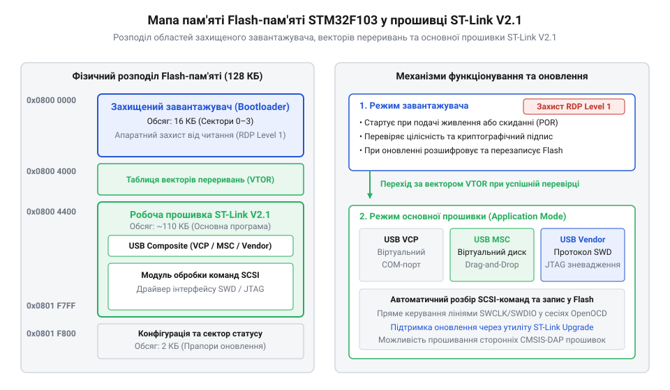
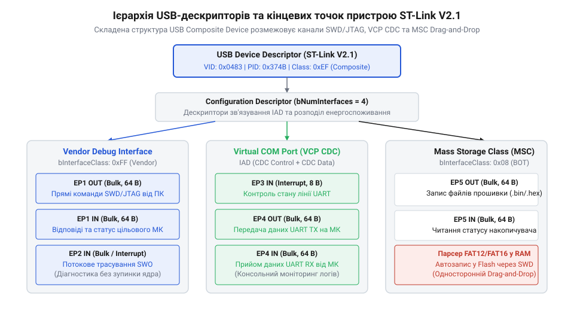
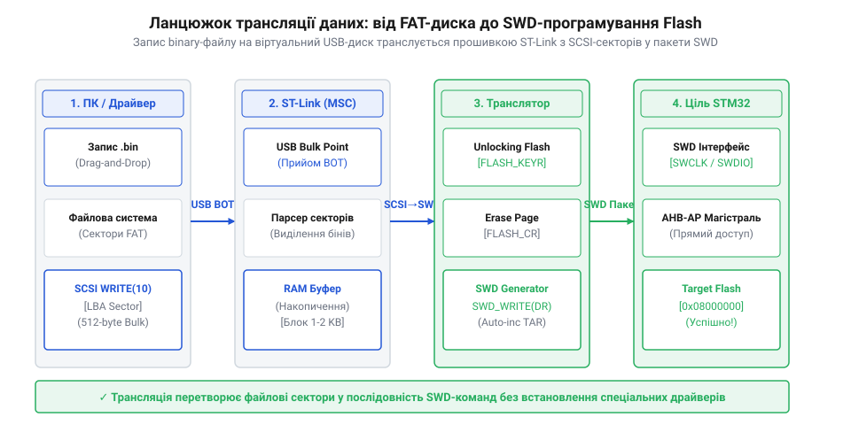
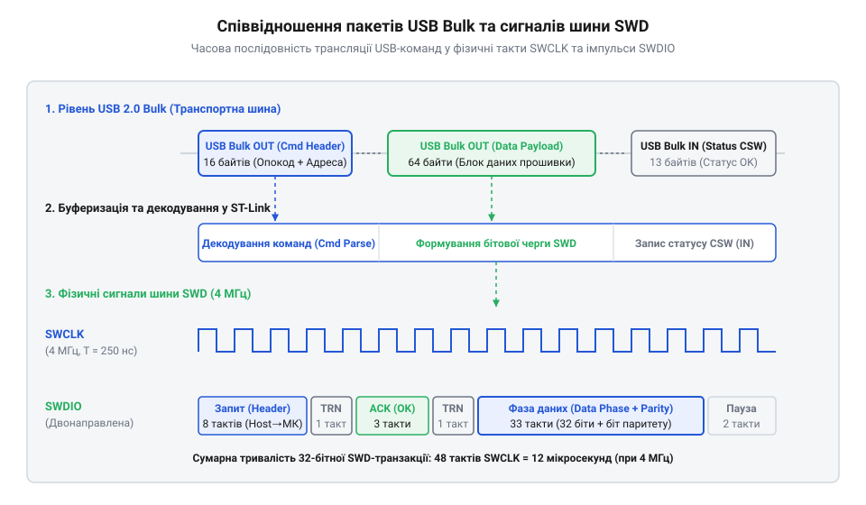

# Фірмова прошивка та протокол ST-Link V2.1

<preknowlist>
- [WeAct Mini Debugger (DAPLink / ST-Link V2.1)](root:cat-hw-boards/daplink-debugger) — Конструктивні особливості та призначення двохрежимних відлагоджувачів.
- [Архітектура та принципи роботи програматора DAPLink](root:cat-hw-boards/daplink-programmer-architecture) — Принципи роботи відкритих альтернатив CMSIS-DAP та DAPLink.
- [Інструменти прошивання мікроконтролерів ESP: esptool та GUI-завантажувачі](root:cat-hw-boards/flashing-tools-esptool-and-nodemcu-pyflasher) — Загальні уявлення про процес завантаження бінарного коду в мікроконтролери.
</preknowlist>

## Двокомпонентна прошивка та первинний завантажувач

Внутрішнє програмне забезпечення відлагоджувача @@en|ST-Link V2.1@@ розділено у пам'яті мікроконтролера STM32F103 на дві автономні області: первинний завантажувач (англ. @@en|bootloader@@, від *boot* — завантажувати та *load* — навантажувати; @@en|первинний завантажувач@@) та робочий системний образ. Завантажувач розміщується за базовою адресою `0x08000000` і становить непорушне ядро системи. Якщо під час оновлення прошивки відбувається раптове знеструмлення, первинний завантажувач залишається неушкодженим, що виключає апаратне блокування пристрою та дозволяє повторити сесію відновлення.

*Розподіл секторів Flash-пам'яті мікроконтролера та зміщення вектора VTOR робочої прошивки.*

При кожному подаванні живлення завантажувач перевіряє цілісність вектора переривань робочої прошивки за адресою `0x08004000` та обчислює апаратний циклічний контроль (англ. @@en|CRC-32@@, від *cyclic redundancy check*). Якщо сигнатура та вектор стека відповідають нормативу, завантажувач переписує регістр зміщення векторів `SCB->VTOR` на значення `0x08004000` та передає керування основному образу. Докладно принципи завантаження бінарного коду розглядають [інструменти прошивання мікроконтролерів](root:cat-hw-boards/flashing-tools-esptool-and-nodemcu-pyflasher).

## Мультиплексування інтерфейсів у складеному пристрої

Відлагоджувач @@en|ST-Link V2.1@@ надає комп'ютеру єдиний фізичний порт USB 2.0, усередині якого функціонує складений пристрій (англ. @@en|composite device@@, від лат. *componere* — складати; @@en|складений USB-пристрій@@). Шляхом логічного мультиплексування дескрипторів операційна система розпізнає три незалежні класи: віртуальний послідовний порт (англ. @@en|VCP@@, від *Virtual COM Port*), емульований накопичувач (англ. @@en|MSC@@, від *Mass Storage Class*) та проприєтарний вендорний канал (англ. @@en|Bulk@@).

*Структура логічних інтерфейсів складеного пристрою та розподіл буферних кінцевих точок.*

Щоб драйвери операційної системи не плутали канали між собою, прошивка використовує дескриптор об'єднання інтерфейсів IAD. Для захисту від втрати пакетів при паралельному зчитуванні логів через @@en|VCP@@ та відлагодженні плати мікроконтролер реалізує подвійну буферизацію у пам'яті USB-периферії. Подібну схему мультиплексування використовує й [архітектура програматора DAPLink](root:cat-hw-boards/daplink-programmer-architecture).

## Трансляція SCSI-команд у прошивання SWD

Автоматичне програмування мікроконтролера методом перетягування бінарних файлів спирається на емуляцію файлової системи FAT безпосередньо в оперативній пам'яті відлагоджувача. Прошивка @@en|ST-Link V2.1@@ опрацьовує команди системного інтерфейсу (англ. @@en|SCSI@@, від *Small Computer System Interface*) та перехоплює файлові сектори «на льоту».

*Схема потокової трансляції команд запису диска в процедуру стирання та програмування Flash цілі.*

Коли користувач копіює файл `.bin` на віртуальний диск @@en|MSC@@, автомат станів витягує дані та перетворює їх на послідовність транзакцій послідовного дротового зневадження (англ. @@en|SWD@@, від *Serial Wire Debug*). Якщо під час запису виникає обрив лінії або апаратний захист Flash, прошивка створює віртуальний текстовий файл `FAIL.TXT` із кодом помилки. Конструктивні особливості таких плат висвітлює [дворежимний відлагоджувач WeAct](root:cat-hw-boards/daplink-debugger).

## Вендорний протокол зневадження та діагностика

Для покрокового виконання коду та читання регістрів процесора середовища розробки використовують вендорний пакетизований протокол. Хост-комп'ютер надсилає бінарні блоки команд `STLINK_CMD` через вхідну та вихідну кінцеві точки @@en|Bulk@@, які відлагоджувач транслює у фізичні тактові імпульси `SWCLK` і дані `SWDIO`.

*Часова діаграма обміну пакетами USB Bulk та декодування сигнальних ліній SWD.*

Під час кожної транзакції прошивка аналізує підтвердження від цілі (`ACK`, `WAIT` або `FAULT`). Якщо цільовий процесор зайнятий, @@en|ST-Link V2.1@@ виконує повторні спроби опитування, гарантуючи детермінований доступ до пам'яті. У разі критичного збою відлагоджувач повертає код помилки `STLINK_DEBUG_ERR_FAULT`, дозволяючи швидко діагностувати обрив зв'язку.
