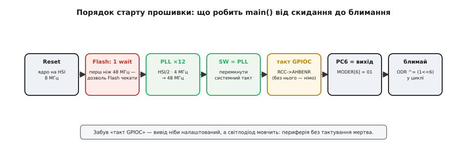
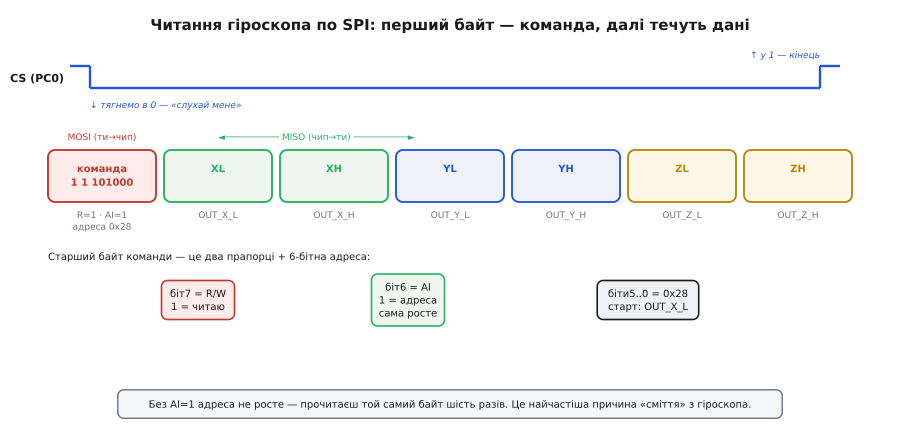

# ⚙️ Старт-проєкт: від порожньої теки до гіроскопа, що дихає в консоль

Задача цього довідника проста на словах і повчальна на ділі: зібрати **власний** проєкт під STM32F072B-DISCO з нуля, без CubeIDE-майстра, — так, щоб самому бачити кожну ланку. На виході має бути прошивка, що: піднімає такт до 48 МГц через PLL, блимає світлодіодом LD3 (вивід PC6), читає кутову швидкість з гіроскопа L3GD20 по SPI і виводить її числами в серійну консоль. Кожен із цих кроків на Arduino схований за одним рядком; тут ми його розкриємо — і саме тому, зробивши це раз, перестаєш боятися будь-якого STM32.

Зберемо все, що потрібно **саме під цю плату**: крос-тулчейн і CMake-файл під Cortex-M0, інтеграцію з Qt Creator і дебаг по SWD, мінімальний старт із тактуванням, перший блимаючий світлодіод (на регістрах і через HAL — щоб було видно різницю), робоче читання L3GD20, серійний вивід через окремий CP2102 на USART1 (PA9/PA10). І, головне, — де на цьому всьому спотикаються.

## Ідея: три речі, які тут робиш сам

Перш ніж писати код, варто в голові розкласти, **чим ця збірка відрізняється** від «натиснув Upload в Arduino IDE». Відмінність не косметична — вона в трьох місцях, і кожне дає свій клас помилок.

**Перше — компілятор не той, що на твоєму ПК.** Твій ноутбук — це x86 (чи ARM64 від Apple), а чип на платі — ARM Cortex-M0. Звичайний `gcc` зібрав би код для ноутбука; нам потрібен **крос-компілятор** `arm-none-eabi-gcc` — та сама GCC, але яка з коду робить машинні інструкції Cortex-M0 (`none` — без операційної системи, `eabi` — стандартна угода про бінарний інтерфейс bare-metal ARM).

**Друге — немає завантажувача.** На платі немає програмки, що ловить прошивку по USB. Заливає код **вбудований ST-LINK/V2** по двох дротах SWD, і робить це зовнішня утиліта (OpenOCD або `st-flash`), яку ми покличемо з CMake чи прямо з Qt Creator.

**Третє — після скидання чип не готовий.** Він стартує на голому внутрішньому генераторі 8 МГц, з вимкненою периферією, і навіть Flash-пам'ять ще не налаштована на майбутню швидкість. Усе, що на Arduino робить прихований `init()`, тут пишеш ти: такт, wait-state пам'яті, тактування кожного периферійного блоку.

> 🔧 **Навіщо це.** Ці три відмінності — не бюрократія, а причина, чому STM32-плата вчить більше за Arduino. Помилка «забув крос-компілятор» дасть код, що не влізе в чип; «промахнувся повз ST-LINK-роз'єм» — плата взагалі не з'явиться в системі; «не підняв такт» — усе працює, але вшестеро повільніше й з дивними збоями периферії. Кожну з цих ланок ти тут побачиш поіменно.

Порядок, у якому `main()` оживляє чип, найпростіше тримати як конвеєр — і саме в цьому порядку ми його й напишемо:


*Кожна клітинка — рядок ініціалізації, який на Arduino схований. Червона — та, про яку забувають найчастіше (Flash без wait-state на 48 МГц зависає), жовта — друга за підступністю (периферія без тактування мовчить, хоч регістри виглядають правильно).*

## Тулчейн і CMake: як код потрапляє в чип

Спершу — інструмент. Постав **GNU Arm Embedded Toolchain** (пакет `arm-none-eabi-gcc` з `objcopy`, `size`, `gdb`) і **OpenOCD** (він говорить із ST-LINK). Перевірити, що тулчейн на місці, можна одним рядком у терміналі:

```
arm-none-eabi-gcc --version
```

Тепер найважливіший файл проєкту після самого коду — **CMake-файл тулчейна**. Він каже CMake: «не збирай під цей ПК, збирай під Cortex-M0». Без нього CMake за звичкою покличе системний компілятор — і збірка або впаде, або дасть непридатний код. Ось робочий `arm-none-eabi.cmake`:

:::code proj-firmware/cmake/arm-none-eabi.cmake

Рядок `-mcpu=cortex-m0` — не косметика: Cortex-M0 розуміє лише набір інструкцій **Thumb** (архітектура ARMv6-M), без апаратного ділення й без рухомої коми. Скажеш компілятору не ту архітектуру — дістанеш інструкції, яких чип фізично не виконує, і він упаде в HardFault на першій же з них.

Тепер сам `CMakeLists.txt`. Він збирає код у `.elf`, а потім робить із нього «сирий» образ `.bin` для заливання й показує розмір — щоб одразу бачити, чи вліз у 128 КБ Flash:

:::code proj-firmware/cmake/tulchein-i-cmake-iak-kod.cmake

Конфігурується проєкт так, щоб CMake підхопив файл тулчейна:

```
cmake -B build -DCMAKE_TOOLCHAIN_FILE=arm-none-eabi.cmake
cmake --build build
```

> 🔧 **Навіщо це.** `-Wl,--gc-sections` разом із `-ffunction-sections` — не про красу, а про виживання в 128 КБ. Без них лінкер тягне в образ **усі** функції, навіть ті, що ніхто не викликає; з ними — лише реально вжиті. На великому ПК це байдуже, тут — різниця між «вліз» і «не вліз». Карта в `.map` показує пофункційно, хто скільки з'їв, — перше місце, куди дивишся, коли прошивка раптом розпухла. Як цей ланцюг збірки влаштований цілком — у [тулчейні embedded-розробки](root:sys-bsystem/toolchain).

Про **startup-код** і **скрипт лінкера** варто сказати окремо, бо вони — та частина, якої на Arduino не видно зовсім. Startup (`startup_stm32f072.s`, зазвичай береться готовий із CMSIS-пакета ST або з CubeMX) робить дві речі: кладе на початок Flash **таблицю векторів** (перше 32-бітне слово — початкова верхівка стека, друге — адреса функції Reset_Handler), а в Reset_Handler копіює початкові значення змінних з Flash у SRAM, обнуляє неініціалізовані змінні й лише тоді стрибає у твій `main()`. Скрипт лінкера (`.ld`) каже, де в пам'яті що лежить: код — у Flash за адресою 0x08000000, змінні — в SRAM за 0x20000000. Ці два файли для F072 стандартні; їх не пишуть щоразу, а беруть із CMSIS ST і кладуть у проєкт.

## Qt Creator і дебаг по SWD

CMake-проєкт Qt Creator відкриває напряму: **File → Open File or Project → CMakeLists.txt**. У налаштуваннях набору (Kit) вкажи той самий файл тулчейна (`arm-none-eabi.cmake`) як CMake-змінну `CMAKE_TOOLCHAIN_FILE`, а компілятором — `arm-none-eabi-gcc`. Далі Qt Creator сам конфігурує й збирає кнопкою.

Найцінніше — **дебаг прямо у вікні редактора**. Він тримається на двох програмах: OpenOCD відкриває SWD-канал до чипа через ST-LINK, а `arm-none-eabi-gdb` по цьому каналу керує ядром. У Qt Creator це загортається в кнопку: ставиш точку зупину клацанням по номеру рядка, тиснеш Debug — і прошивка стає на цьому рядку **на живому залізі**, а ти дивишся точні значення змінних і регістрів периферії. Це протилежність «залив і молись»: замість друкувати числа в порт і гадати, ти просто зупиняєш ядро в мить збою й читаєш стан.

Ключова деталь для цієї плати: дебаг іде через **той самий Mini-USB з боку ST-LINK**, що й прошивка, — окремого дебаг-кабелю не треба, два дроти SWD (SWCLK на PA14, SWDIO на PA13) вже розведені всередині плати від ST-LINK до чипа. Як влаштований сам протокол — у [деталях SWD/JTAG](root:sys-ide/swd-jtag-internals/detail).

> 🔧 **Навіщо це.** Один апаратний дебаг через SWD виправдовує вибір цієї плати для навчання. Коли гіроскоп повертає сміття, ти не засипаєш код `printf`-ами — ставиш точку зупину після SPI-обміну й **дивишся байти, що реально прийшли**. Видно 0x0F замість очікуваного 0xD4 у WHO_AM_I — значить, читаєш адресу, а не її вміст; видно шість однакових байтів — значить, забув біт авто-інкремента. Секунда погляду замість години здогадів.

## Такт 48 МГц: startup власними руками

Тепер код. Почнемо з того, що робить чип швидким. Після скидання Cortex-M0 біжить на внутрішньому RC-генераторі **HSI 8 МГц** — розігнати його до стелі 48 МГц мусить прошивка через **PLL** (фазове автопідстроювання). Порахуймо ланцюг для цього чипа:

**Умова: з внутрішніх 8 МГц HSI дістати рівно 48 МГц системного такту.**

```
Джерело PLL:        HSI, поділений на 2   → 8 МГц / 2 = 4 МГц
Множник PLL:        ×12                    → 4 МГц × 12 = 48 МГц
Стеля цього чипа:   48 МГц                 ← точно в неї і влучили
```

У F0 джерело PLL від HSI **завжди спершу ділиться на 2** (це особливість серії), тому множник у регістрі — 12, а не 6, хоч ефективно виходить те саме «8 × 6». Але перед перемиканням є крок, який пропускають найчастіше і який коштує найдорожче — **wait-state Flash**. Flash-пам'ять фізично повільніша за ядро на 48 МГц: вона не встигає віддати наступну інструкцію за один такт. Тому чипу треба **дозволити пам'яті чекати один такт** (LATENCY = 1), і зробити це треба **до** підняття частоти. Пропустиш — ядро на 48 МГц почне читати з Flash швидше, ніж та встигає, і чип зависне намертво, ще й невідтворювано.

Ось повний, робочий регістровий старт (заголовок `stm32f0xx.h` з CMSIS ST дає всі імена регістрів і бітів):

:::code proj-firmware/c/takt-48-mhts-startup.c

Два цикли `while` — не формальність. PLL фізично потребує мікросекунд, щоб стабілізувати частоту, а перемикання джерела такту — часу на синхронізацію. Поки апаратура не підняла прапорець готовності, рушати далі означає перемкнутися на ще нестабільне джерело й повісити чип. Ця «дисципліна очікування прапорців» — основа роботи з **будь-якою** периферією STM32, не лише з тактом.

## Перший світлодіод: регістри проти HAL

Тепер класичне «Hello, world» заліза — блимання LD3 на **PC6**. Покажемо його **двічі**, бо саме на контрасті видно, що ховає HAL.

**Спершу на голих регістрах** — щоб було видно кожен крок. Три речі: увімкнути тактування порту GPIOC (без цього порт мертвий, скільки не пиши в його регістри), налаштувати PC6 як вихід, і в циклі перемикати біт:

:::code proj-firmware/c/pershyi-svitlodiod.c

Вираз `1u << (6 * 2)` варто читати вголос: «беремо одиницю, зсуваємо на дванадцять позицій, бо кожен із шести молодших виводів займає по два біти режиму». Це не магія — це прямий доступ до апаратури: `MODER` каже, чим є вивід (вхід/вихід/альтернативна функція/аналог), `ODR` (output data register) — який на ньому логічний рівень. Регістрова робота з виводами у всіх деталях — у [регістрах GPIO STM32](root:sf-devices/gpio-registers).

**Тепер те саме через HAL** — бібліотеку абстракції ST. Той самий світлодіод, але кроки сховані за іменами:

:::code proj-firmware/c/pershyi-svitlodiod-2.c

Зверни увагу: `__HAL_RCC_GPIOC_CLK_ENABLE()` — це **той самий** рядок `RCC->AHBENR |= RCC_AHBENR_GPIOCEN`, лише під зрозумілим іменем. HAL нічого не робить магічно — він робить те саме, просто ховає номери бітів. Тому знаючи регістровий варіант, ти читаєш HAL-код як переклад, а не як заклинання; а коли HAL підводить (а він підводить на нестандартних сценаріях), спускаєшся на рівень регістрів без страху.

> 🔧 **Навіщо це.** Питання «регістри чи HAL» на практиці не стоїть як вибір «або-або»: реальні проєкти живуть на HAL заради швидкості, але **розуміння регістрів під ним** — те, що відрізняє того, хто лагодить дивну поведінку за хвилини, від того, хто тижнями воює з бібліотекою. Побач раз обидва рівні поруч — і `__HAL_RCC_GPIOC_CLK_ENABLE()` перестане бути чорною скринькою.

## Гіроскоп L3GD20 по SPI: робочий код

Це найзмістовніша частина. Гіроскоп **L3GD20** на цій платі висить на **SPI2**, і його виводи фіксовані розводкою плати: тактова лінія **SCK = PB13**, дані від чипа **MISO = PB14**, дані до чипа **MOSI = PB15**, а вибір давача (chip select) — **CS = PC0**, окремим виводом, яким керуємо руками. Ці числа не вигадані — так плата розпаяна на заводі, і саме так їх задає офіційний BSP ST для цієї плати.

Спершу — **ідея транзакції SPI**, бо в ній уся суть. SPI — це синхронна шина: майстер (наш STM32) генерує такт, і на кожен такт **одночасно** один біт іде туди по MOSI, інший — назад по MISO. Читання регістра давача виглядає так: тягнемо CS у нуль («слухай мене»), відсилаємо **один командний байт**, а тоді женемо такт далі — і давач у відповідь виставляє байти на MISO. Уся хитрість — у командному байті:


*Старший байт команди — це два прапорці плюс 6-бітна адреса регістра. Біт 7 = 1 означає «читаю», біт 6 = 1 — «після кожного байта сам збільшуй адресу» (авто-інкремент). Без другого біта прочитаєш той самий байт шість разів замість шести різних — класична причина «сміття» з гіроскопа.*

Отже, щоб прочитати шість байтів даних, що йдуть підряд від адреси OUT_X_L (0x28), командний байт = `0x28 | 0x80 | 0x40` = **0xE8**: адреса, плюс біт читання, плюс біт авто-інкремента.

Тепер код. Спершу — ініціалізація SPI2 і CS на регістрах (щоб було видно, що там нема нічого страшного), далі — функції обміну, тоді читання давача:

:::code proj-firmware/c/hiroskop-l3gd20-po-spi.c

Зверни увагу на **три тонкощі, кожна з яких — реальна причина, чому чужий код не працює**. Перша: запис у `SPI2->DR` роблено **саме байтом** (`*(volatile uint8_t *)`), а не 16-бітним словом; на F0 SPI віддає дані порціями за розміром доступу, і 16-бітний запис пошле два байти замість одного. Друга: `SPI_CR2_FRXTH` опускає поріг «прийнято» до одного байта — без нього прапорець RXNE не підніметься після одного байта, і `spi_xfer` зависне в очікуванні назавжди. Третя: CS перемикаємо через `BSRR` (bit set/reset register) — атомарний спосіб виставити/скинути один вивід без читання-модифікації-запису всього порту.

Тепер запуск давача й читання в реальних одиницях. L3GD20 після скидання **спить** — його треба розбудити, ввімкнувши всі осі, а перед читанням варто впевнитися, що це справді L3GD20:

:::code proj-firmware/c/hiroskop-l3gd20-po-spi-2.c

Число **0x0F** у CTRL_REG1 читається так: молодші чотири біти — це біт «увімкнено» (PD) плюс по біту на кожну вісь; `0b00001111` = живлення увімкнено, всі три осі активні. Пропустиш цей запис — давач спить, і читання дає нулі чи сміття.

Останнє — **перетворити сирі числа в градуси за секунду**. За замовчуванням (діапазон ±250 °/с) чутливість давача — **8.75 мілліградуса за секунду на одиницю** (значення з даташита L3GD20). Тобто сире 16-бітне число множимо на 0.00875:

**Умова: сире значення осі X = +1000. Скільки це °/с при діапазоні ±250?**

```
Чутливість (±250 °/с):   8.75 мілліградуса/с на одиницю = 0.00875 °/с
Кутова швидкість:        1000 × 0.00875 = 8.75 °/с
```

Тобто плата в цю мить оберталася навколо осі X зі швидкістю приблизно 8.75 градуса за секунду. У коді це один множник:

```c
#define L3GD20_SENS_250DPS  0.00875f   // °/с на одиницю, діапазон ±250

// приклад використання у циклі:
int16_t rx, ry, rz;
l3gd20_read_xyz(&rx, &ry, &rz);
float wx = rx * L3GD20_SENS_250DPS;    // кутова швидкість навколо X, °/с
```

Про сам давач і принцип MEMS — у статті про [гіроскоп](root:hw-sensing/gyroscope); про саму шину — у [SPI](root:com-devices/spi-bus).

## Серійний вивід: USART1 і окремий CP2102

Числа з гіроскопа треба **побачити**, а тут криється головна пастка цієї плати: **вбудований ST-LINK/V2 не дає віртуального COM-порту**. `printf` через USB ST-LINK нікуди не піде. Тому серійну консоль виводимо на **USART1** (виводи PA9 = TX, PA10 = RX) і чіпляємо до нього **окремий USB-UART перехідник** на [CP2102](root:cat-hw-boards/cp2102-usb-uart) — трьома дротами навхрест:

```
CP2102            STM32F072 (USART1)
──────            ──────────────────
TX      ───────►  PA10  (RX чипа)     вихід одного → вхід іншого
RX      ◄───────  PA9   (TX чипа)
GND     ───────   GND                 спільна земля — обов'язково
```

Налаштуємо USART1 на 115200 бод. Порахуймо дільник: USART ділить свій вхідний такт (48 МГц) на число в регістрі BRR, щоб дістати швидкість:

**Умова: з такту 48 МГц дістати 115200 бод.**

```
BRR = такт / швидкість = 48 000 000 / 115 200 = 416.67 → округляємо до 417
Реальна швидкість:      48 000 000 / 417 = 115 108 бод   (похибка 0.08% — цілком терпимо)
```

Код ініціалізації й функції виводу:

:::code proj-firmware/c/seriinyi-vyvid-usart1-i.c

`uart_print_int` написано руками зумисне: повний `printf` на цьому чипі тягне десятки кілобайтів бібліотеки заради форматування, а нам треба лише вивести число. На великому ПК про це не думаєш; тут кожен кілобайт із 128 на рахунку.

## Усе разом: гіроскоп, що дихає в консоль

Складемо повний `main`, який об'єднує всі ланки — такт, світлодіод-серцебиття, гіроскоп, вивід:

:::code proj-firmware/c/use-razom-hiroskop-shcho.c

Заливаєш це (`cmake --build build`, тоді `make flash` чи кнопка в Qt Creator), відкриваєш на боці CP2102 будь-який термінал на 115200 бод — і бачиш, як числа `wx/wy/wz` оживають, коли крутиш плату в руках. Нахилив праворуч — одна вісь стрибнула; вертиш навколо іншої осі — інша. Гіроскоп задихав у консоль.

## Складність і пастки

Зберемо в одному місці те, на чому тут губиться найбільше часу — впорядковано від найпідступнішого.

**Забув wait-state Flash — чип зависає на 48 МГц.** Найковарніша, бо код виглядає бездоганно. `FLASH->ACR |= FLASH_ACR_LATENCY` треба зробити **до** перемикання на PLL. Пропустиш — ядро читатиме Flash швидше, ніж пам'ять встигає, і чип повисне невідтворювано (то стартує, то ні). Ознака: на 8 МГц усе працює, а після підняття такту — тиша.

**Забув тактування периферії — блок мовчить при правильних регістрах.** Кожен периферійний блок треба спершу ввімкнути в RCC: `AHBENR` для портів GPIO, `APB1ENR` для SPI2, `APB2ENR` для USART1. Забудеш — записи в регістри блоку **нічого не роблять** (читаються назад як нулі), а виглядає код правильно. Це друга за частотою причина «нічого не працює, хоч усе написано вірно».

**Забув біт авто-інкремента — гіроскоп дає сміття.** Читаючи кілька регістрів підряд, командний байт має нести **обидва** біти: `0x80` (читання) **і** `0x40` (авто-інкремент). Тільки з `0x80` адреса не росте — прочитаєш той самий байт шість разів, і осі даватимуть однакову маячню. Ознака: WHO_AM_I правильний (0xD4), а дані XYZ — сміття чи однакові.

**Промахнувся повз ST-LINK-роз'єм — плата не з'являється.** Прошивка й дебаг ідуть **тільки** через Mini-USB **з боку ST-LINK**. Другий Mini-USB — це USB *пристрою*, код він не заливає. Ще банальніше: «кабель тільки для заряджання» без ліній даних — плата не з'явиться в системі взагалі, тож перше, що перевіряй, — інший кабель.

**Немає VCP — `printf` мовчить.** ST-LINK/V2 на цій платі **не має** віртуального COM-порту. Не побачивши тексту, легко подумати, що прошивка не йде, — а вона йде, просто вивід нема куди дівати без окремого CP2102 на USART1. Це особливість старішого ST-LINK, не поломка.

**5 В на 3.3-вольтовий вивід — псуєш чип.** Логіка STM32F072 — **3.3 В**. Багато CP2102-перехідників за замовчуванням дають 5-вольтову логіку на TX; подаси її на PA10 — повільно вбиваєш чип, а він **припаяний**, заміні не підлягає. Став перехідник у 3.3 В (перемичка 3V3) і **не живи плату вдруге** через CP2102, якщо вона вже під ST-LINK-кабелем — вистачить землі й двох сигнальних дротів.

**Не той SPI-режим — WHO_AM_I бреше.** L3GD20 за даташитом хоче режим 3 (CPOL=1, CPHA=1). Поставиш інший — читання поїде на пів такту, і WHO_AM_I поверне сміття замість 0xD4. Дрібниця: на практиці ST у власних прикладах для цієї плати іноді ставить режим 0 (CPOL=0, CPHA=0), і він теж працює, бо давач ловить потрібний фронт; але почни з режиму 3 за даташитом — це найпередбачуваніше.

Кожна з цих пасток — не поломка плати, а місце, де вона **не веде за руку** так, як вела Arduino. Пройди їх раз — і збірка будь-якого STM32-проєкту з нуля перестане бути таємницею: сам увімкнеш такт із правильним wait-state, сам заведеш периферію з її тактуванням, сам поговориш із давачем по SPI і виведеш результат туди, куди справді можна.
