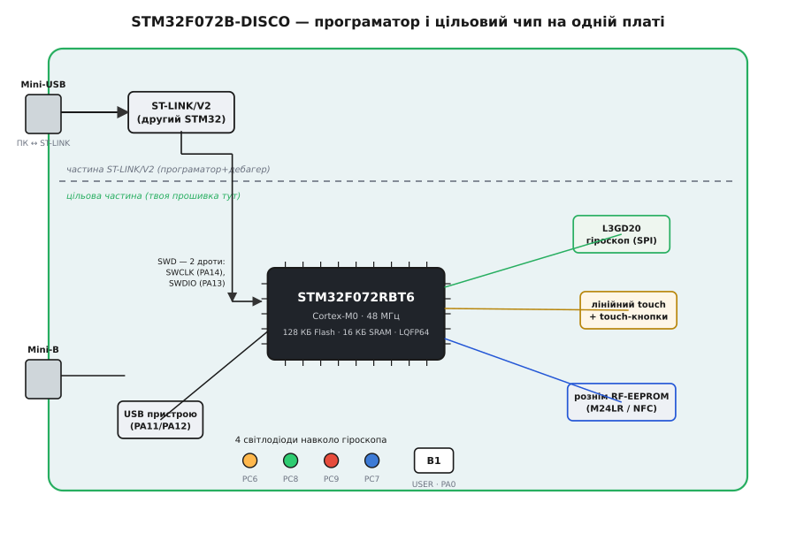
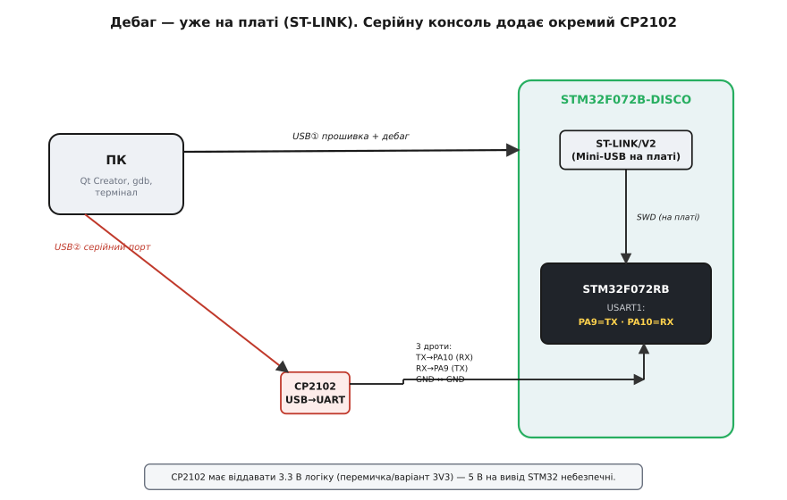

# STM32F072B-DISCO (Discovery, Cortex-M0)

## Архітектура плати та вбудований програматор ST-LINK

Розробницька плата STM32F072B-DISCO серії @@en|Discovery@@ спроєктована для освоєння 32-бітних мікроконтролерів сімейства @@en|ARM@@ @@en|Cortex-M0@@. Фізично плата розділена на дві автономні зони: у верхній частині розташовано вбудований програматор-дебагер @@en|ST-LINK/V2@@, а в нижній — цільовий мікроконтролер STM32F072RBT6 із периферійним обв'язуванням. Серцем плати є 32-бітна система, що працює на тактовій частоті до 48 МГц від внутрішнього високошвидкісного @@en|RC@@-генератора @@en|HSI@@ (від англ. @@en|High-Speed Internal@@ — високошвидкісний внутрішній).

*Структурне зонування плати Discovery: верхня частина містить програматор ST-LINK/V2, а нижня — цільовий мікроконтролер із периферією.*

Наявність інтегрованого дебагера @@en|ST-LINK/V2@@ дозволяє прошивати мікроконтролер та проводити покрокове апаратне налагодження коду без придбання зовнішніх програматорів. Зв'язок між програматором і цільовим чипом здійснюється за допомогою двопровідного інтерфейсу @@en|SWD@@ (від англ. @@en|Serial Wire Debug@@ — послідовне дротове налагодження). Завдяки спеціальним знімним джамперам на платі інженер може відключити внутрішні лінії та використовувати вбудований @@en|ST-LINK/V2@@ для прошивання сторонніх плат на базі мікроконтролерів @@en|STM32@@, наприклад [WeAct STM32G431CBU6](root:cat-hw-boards/stm32g431-weact).

Сам цільовий мікроконтролер STM32F072RBT6 містить 128 КБ флеш-пам'яті @@en|Flash@@ та 16 КБ оперативної пам'яті @@en|SRAM@@, виведеної на бічні дворядні з'єднувачі плати. Завдяки вбудованому генераторові @@en|HSI48@@ мікроконтролер здатен працювати на максимальній частоті 48 МГц без встановлення зовнішніх кварцових резонаторів. Програматор @@en|ST-LINK/V2@@ підключено до цільового чипа лініями @@en|SWCLK@@ (від англ. *@@en|Serial Wire Clock@@* — тактування налагодження) та @@en|SWDIO@@ (від англ. *@@en|Serial Wire Data Input/Output@@* — ввід-вивід даних налагодження), що забезпечує зчитування регістрів процесора та запис прошивки в реальному часі.

## Інтегрована периферія та інтерфейси плати

На платі STM32F072B-DISCO розпаяно набір периферійних пристроїв для вивчення стандартних системних шин. Для вимірювання кутових швидкостей встановлено трьохосьовий гіроскоп L3GD20, підключений до мікроконтролера через послідовний інтерфейс @@en|SPI@@. Для створення призначених для користувача інтерфейсів на плату виведено лінійну сенсорну панель ємнісного типу та шість світлодіодів індикації, що відображають стан системних режимів та напрямок руху.

Окремою особливістю платформи є наявність спеціального роз'єму для підключення дочірньої плати безконтактної пам'яті M24LR з інтерфейсом @@en|NFC@@ (від англ. @@en|Near Field Communication@@ — зв'язок близького поля). Для обміну даними з комп'ютером нативно реалізовано окремий порт @@en|USB@@, який підключається безпосередньо до системного контролера мікроконтролера без зовнішніх трансиверів.

## Підключення консолі та живлення плати

Основне живлення плати здійснюється напругою 5 В через роз'єм @@en|USB@@ програматора, яка потім знижується лінійним стабілізатором до логічного рівня 3.3 В. При використанні зовнішніх джерел живлення або периферії важливо суворо дотримуватися допустимих рівнів напруги: виводи мікроконтролера розраховані на 3.3-вольтову логіку, і подача 5 В на незахищені входи призведе до виходу чипа з ладу.

*Схема підключення серійної консолі: лінії TX та RX перехідника з'єднуються навхрест із відповідними контактами UART мікроконтролера.*

Вбудований програматор @@en|ST-LINK/V2@@ цієї модифікації не підтримує функцію віртуального @@en|COM@@-порту. Щоб вивести налагоджувальні текстові повідомлення в серійну консоль на ПК, розробнику необхідно підключити зовнішній перехідник @@en|USB-UART@@. Сигнальна лінія передачі @@en|TX@@ (від англ. @@en|transmitter@@ — передавач) перехідника з'єднується з лінією прийому @@en|RX@@ (від англ. @@en|receiver@@ — приймач) мікроконтролера, а лінія @@en|RX@@ перехідника — з лінією @@en|TX@@ мікроконтролера за допомогою перехресної схеми.
