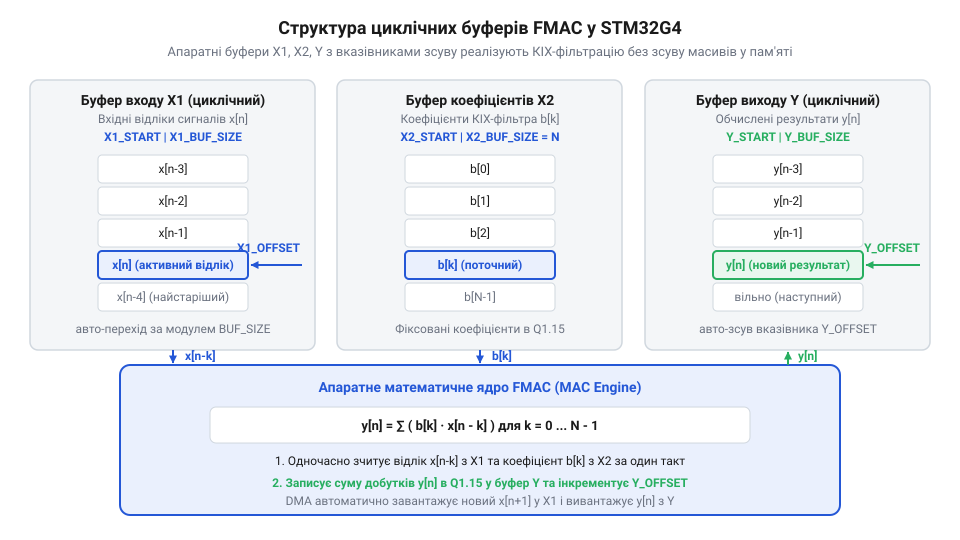
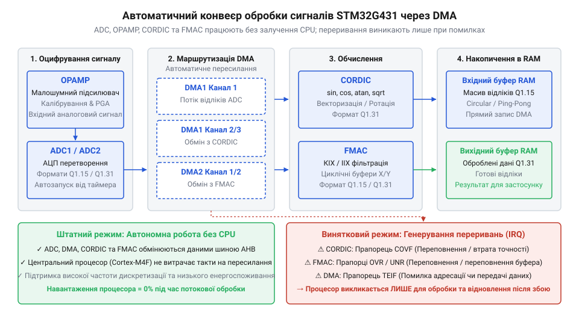

# Програмний інтерфейс HAL/LL для керування прискорювачами CORDIC, FMAC та OPAMP

<preknowlist>
- [STM32F072B-DISCO (Discovery, Cortex-M0)](root:cat-hw-boards/stm32f072b-disco) — Загальні принципи налаштування периферійних модулів та ініціалізації середовища STM32Cube HAL/LL.
</preknowlist>

## Перевантаження процесора при обробці сигналів

У системах обробки сигналів реального часу обчислення тригонометричних функцій та цифрова фільтрація створюють високе навантаження на процесорне ядро. Коли мікроконтролер @@en|STM32G431@@ обробляє потік відліків із аналого-цифрового перетворювача (англ. *Analog-to-Digital Converter* — @@en|ADC@@) на частотах у сотні кілогерц, виконання програмного коду обчислення синуса чи КІХ-фільтра силами ядра @@en|Cortex-M4@@ потребує десятків або й сотень тактів на кожен окремий відлік. Навіть за наявності апаратного блоку обчислень із плаваючою комою (англ. *Floating-Point Unit* — @@en|FPU@@) обчислення за допомогою бібліотек цифрової обробки сигналів (англ. *Digital Signal Processing* — @@en|DSP@@) відбирає левову частку процесорного часу, підвищує затримку обробки переривань та унеможливлює виконання інших критичних задач керування.

Причина цієї проблеми криється у послідовному виконанні математичних інструкцій загального призначення. Для розрахунку однієї тригонометричної функції за допомогою наближених поліноміальних рядів ядро мусить виконати довгий ланцюжок множень та додавань, кожне з яких послідовно проходить через конвеєр інструкцій. Аналогічно, обчислення дискретної згортки для фільтрації вимагає циклічного читання коефіцієнтів і затримок із оперативної пам'яті. Зі зростанням порядку фільтра або частоти дискретизації обчислювальна складність зростає лінійно, повністю виснажуючи обчислювальний ресурс мікроконтролера.

Щоб вивільнити процесорне ядро від рутинної математики, архітектура @@en|STM32G431@@ містить виділені апаратні прискорювачі: цифровий обчислювач повороту координат (англ. *COordinate Rotation DIgital Computer* — @@en|CORDIC@@) та математичний прискорювач фільтрів (англ. *Filter Math Accelerator* — @@en|FMAC@@). Ці периферійні блоки виконують математичні операції апаратно й паралельно до роботи ядра. Вони оперують числами із фіксованою комою у форматах @@en|Q1.15@@ та @@en|Q1.31@@, що дозволяє уникнути затратного перетворення типів із плаваючою комою та забезпечити детермінований час виконання операцій за лічену кількість тактів.

Для керування цими прискорювачами середовище STM32Cube надає два рівні прикладного програмного інтерфейсу (англ. *Application Programming Interface* — @@en|API@@). Високорівневий @@en|HAL@@ (англ. *Hardware Abstraction Layer* — рівень абстракції апаратури) забезпечує уніфіковане керування буферами, стан автомата драйвера та перевірку параметрів, проте додає накладні витрати на виклики функцій. Низькорівневий @@en|LL@@ (англ. *Low-Layer* — низький рівень) працює безпосередньо через макроси й інлайнові функції запису у регістри периферії. Вибір між @@en|HAL@@ та @@en|LL@@ визначається жорсткістю вимог до затримки: у критичних до часу обробки контурах застосовують @@en|LL@@, тоді як для фонової ініціалізації та типових сценаріїв зручнішим є @@en|HAL@@.

## Формати даних та рівні абстракції API

Апаратні прискорювачі обробляють числові дані у форматах із фіксованою комою, де знакові цілі числа інтерпретуються як дробові величини у діапазоні від -1.0 до +1.0 (виключаючи верхню межу +1.0). У форматі @@en|Q1.15@@ число займає 16 біт (один знаковий біт та 15 дробових бітів), що відповідає знаковому цілому типу `int16_t`. Формат @@en|Q1.31@@ використовує 32 біти (знаковий тип `int32_t`) із 31 дробовим бітом для досягнення вищої точності обчислень. Масштабування дійсного числа `x` у цілочисельний еквівалент `N` здійснюється шляхом множення на масштабний коефіцієнт 2¹⁵ для @@en|Q1.15@@ або 2³¹ для @@en|Q1.31@@ з подальшим округленням до найближчого цілого.

Величина цілого значення `N_Q15` обчислюється з дійсного числа `x` у діапазоні `[-1, 1)` за відповідним виразом:

**Обчислення значення числа 0.75 у форматі Q1.15:**
```
N_Q15 = round(x × 2¹⁵)
      = round(0.75 × 32768)      [множення на масштабний коефіцієнт 2¹⁵]
      = round(24576)             [обчислення добутку]
      = 24576                    [округлення до найближчого цілого]
```

Отримане значення `24576` (або `0x6000` у шістнадцятковій формі) записується безпосередньо у регістри прискорювача. Зворотне перетворення вихідного результату у дійсне число виконується діленням цілочисельного значення на масштабний коефіцієнт 2¹⁵.

Використання цих форматів тісно пов'язане з вибором рівня абстракції програмного інтерфейсу. Драйвер @@en|HAL@@ приховує пряму роботу з регістрами за допомогою структур конфігурації `CORDIC_ConfigTypeDef` чи `FMAC_FilterConfigTypeDef` та функцій вищого рівня на кшталт `HAL_CORDIC_Calculate()`. Він перевіряє вхідні параметри, стежить за прапорцями готовності та керує станом драйвера, що повністю виключає помилки ініціалізації периферії.

Навагу цьому, бібліотека @@en|LL@@ надає прямий доступ до регістрів через макроси й інлайнові функції `LL_CORDIC_WriteData()` та `LL_CORDIC_ReadData()`. Вона не витрачає цикли процесора на перевірку станів і збереження контексту, дозволяючи виконувати запис аргументу та зчитування результату за мінімальну кількість тактів. Це робить @@en|LL@@ ідеальним вибором для викликів усередині високочастотних обробників переривань, де кожен такт процесора є критичним для забезпечення стабільності системи реального часу.

## Обчислення трансцендентних функцій у модулі CORDIC

Модуль @@en|CORDIC@@ в мікроконтролері @@en|STM32G431@@ обчислює математичні функції шляхом послідовних ітераційних поворотів вектора на фіксовані кути. Модуль підтримує два основні режими обчислень: режим повороту (англ. *Rotation mode*), коли вхідний вектор повертається на заданий кут для одночасного розрахунку косинуса й синуса, та векторний режим (англ. *Vectoring mode*), у якому вектор повертається до осі абсцис для обчислення модуля й арктангенса. Крім цього, @@en|CORDIC@@ здатний обчислювати гіперболічний синус і косинус, натуральний логарифм та квадратний корінь.

Перед запуском обчислень у регістр конфігурації `CORDIC_CSR` заносяться параметри операції: обрана функція (`FUNCTION`), кількість ітерацій обчислення (`PRECISION`), масштаб вхідних і вихідних даних (`SCALE`), ширина даних (16-бітний @@en|Q1.15@@ чи 32-бітний @@en|Q1.31@@) та кількість вхідних і вихідних слів (`NWRITE`, `NREAD`). Збільшення кількості ітерацій підвищує точність результату, але пропорційно збільшує час обчислення: кожен крок ітерації виконується за один такт периферійного модуля.

Нижче наведено приклад конфігурації модуля @@en|CORDIC@@ для обчислення синуса й косинуса кута у форматі @@en|Q1.31@@ за допомогою програмних інтерфейсів @@en|HAL@@ та @@en|LL@@.

:::tabs
:::code api-weact-stm32g431-cordic-fmac-hal-ll-software-interface/c/stm32cube/snippet-1.c
:::code api-weact-stm32g431-cordic-fmac-hal-ll-software-interface/cpp/stm32cube/cordictrig.cpp
:::

У разі використання @@en|LL@@ записане у регістр `WDATA` значення кута автоматично ініціює апаратний цикл повороту вектора. Оскільки операція виконується апаратно, вже через 6 тактів периферії прапорець готовності підтверджує можливість зчитування результатів з регістра `RDATA`. Перше зчитане слово містить косинус, а друге — синус заданого кута.

## Цифрова фільтрація в прискорювачі FMAC

Прискорювач @@en|FMAC@@ призначений для апаратного прискорення обчислення цифрових фільтрів із скінченною імпульсною відповіддю (англ. *Finite Impulse Response* — @@en|FIR@@, або КІХ) та нескінченною імпульсною відповіддю (англ. *Infinite Impulse Response* — @@en|IIR@@, або ІІХ). В основі блоку лежить апаратний помножувач із накопичувачем (англ. *Multiply-Accumulate* — @@en|MAC@@), який виконує операцію множення двох 16-бітних чисел у форматі @@en|Q1.15@@ із додаванням до 26-бітного акумулятора за один такт.

Прискорювач містить внутрішній блок статичної оперативної пам'яті (англ. *Static Random-Access Memory* — @@en|SRAM@@) обсягом 256 слів по 16 біт. Ця пам'ять програмно розбивається на три циклічні буфери: буфер вхідних відліків та затримок X1, буфер коефіцієнтів фільтра X2 та буфер вихідних результатів Y.


*Структурний розподіл внутрішньої пам'яті FMAC на циклічні буфери для зберігання коефіцієнтів, затримок вхідного сигналу та вихідних результатів.*

Адреси початку та розміри кожного з трьох буферів конфігуруються у регістрах `FMAC_X1BUFCFG`, `FMAC_X2BUFCFG` та `FMAC_YBUFCFG`. При виконанні КІХ-фільтрації коефіцієнти попередньо завантажуються у буфер X2. Новий відлік сигналу записується у буфер X1, після чого @@en|FMAC@@ автоматично запускає розрахунок дискретної згортки, ітеруючи вказівники циклічних буферів X1 та X2 без участі ядра процесора @@en|Cortex-M4@@.

Нижче наведено приклад конфігурації прискорювача @@en|FMAC@@ для КІХ-фільтрації за допомогою драйверів @@en|HAL@@ та @@en|LL@@.

:::tabs
:::code api-weact-stm32g431-cordic-fmac-hal-ll-software-interface/c/stm32cube/snippet-3.c
:::code api-weact-stm32g431-cordic-fmac-hal-ll-software-interface/cpp/stm32cube/fmacfirfilter.cpp
:::

Після завершення обчислення результат накопичується в 40-бітному акумуляторі, піддається зсуву чи обрізанню відповідно до конфігурації та зберігається у буфері Y у форматі @@en|Q1.15@@. У цей момент встановлюється прапорець готовності виходу, сповіщаючи периферію про можливість читання нового вихідного відліку.

## Керування аналоговими підсилювачами OPAMP

Перед тим як цифрові прискорювачі @@en|CORDIC@@ та @@en|FMAC@@ зможуть опрацювати сигнал, його необхідно правильно оцифрувати аналого-цифровим перетворювачем @@en|ADC@@. Сигнали від первинних аналогових датчиків часто мають малу амплітуду або значний постійний зсув, що вимагає аналогової попередньої обробки. Для цього мікроконтролер @@en|STM32G431@@ містить інтегровані операційні підсилювачі (англ. *Operational Amplifier* — @@en|OPAMP@@).

Периферійний блок @@en|OPAMP@@ підтримує кілька режимів роботи: автономний (англ. *Standalone*), повторювач напруги (англ. *Follower*) та підсилювач із програмованим коефіцієнтом підсилення (англ. *Programmable Gain Amplifier* — @@en|PGA@@). У режимі @@en|PGA@@ внутрішня резистивна матриця зворотного зв'язку дозволяє вибирати коефіцієнт підсилення в діапазоні від 2 до 64 без встановлення зовнішніх точних резисторів на друковану плату.

Головна перевага інтегрованих підсилювачів @@en|OPAMP@@ полягає у можливості прямого внутрішнього комутування їхніх виходів на вхідні канали @@en|ADC@@. Завдяки цьому посилений аналоговий сигнал передається всередині кристала мікроконтролера без виходу на зовнішні виводи, що повністю усуває вплив зовнішніх завад, паразитної ємності друкованої плати та високочастотних наводьок.

Оскільки будь-який напівпровідниковий підсилювач має власну напругу зсуву, перед початком роботи необхідно виконати процедуру калібрування. Калібрування дозволяє компенсувати технологічний розкид параметрів транзисторів і мінімізувати постійну складову на вході перетворювача.

:::tabs
:::code api-weact-stm32g431-cordic-fmac-hal-ll-software-interface/c/stm32cube/snippet-5.c
:::code api-weact-stm32g431-cordic-fmac-hal-ll-software-interface/cpp/stm32cube/opampcontroller.cpp
:::

У результаті автокалібрування напруга зсуву мінімізується до значення нижче 1.5 мВ, забезпечуючи максимальний динамічний діапазон для подальшого оцифрування аналогового сигналу в @@en|ADC@@ та його подачі на прискорювачі @@en|CORDIC@@ і @@en|FMAC@@.

## Потокова обробка DMA та обробка помилок

Для побудови високопродуктивних трактів цифрової обробки сигналів математичні прискорювачі @@en|CORDIC@@ та @@en|FMAC@@ об'єднуються з каналами прямого доступу до пам'яті (англ. *Direct Memory Access* — @@en|DMA@@). Обмін даними здійснюється автономно через тригери подій периферії: @@en|ADC@@ генерує запит @@en|DMA@@ після завершення перетворення, побудований канал @@en|DMA@@ пересилає відлік безпосередньо у буфер X1 прискорювача @@en|FMAC@@, а після завершення фільтрації @@en|FMAC@@ генерує подібний запит для вивантаження вихідного відліку у масив оперативної пам'яті.


*Автоматизована конвеєрна обробка аналогових сигналів через OPAMP, ADC, CORDIC та FMAC за допомогою каналів DMA.*

Такий конвеєр діє абсолютно автономно без залучення ядра @@en|Cortex-M4@@. Процесор сповіщається лише за допомогою переривань по завершенні обробки всієї пачки відліків або при виникненні нештатних ситуацій. Прискорювачі мають власні прапорці переривань: у @@en|CORDIC@@ це прапорець готовності даних `RDTDF`, а в @@en|FMAC@@ — прапорці опустіння буфера виходу `YEMPTY` чи заповнення входу `X1FULL`.

Під час обчислень із фіксованою комою можуть виникати помилки переповнення чи втрати точності. Модуль @@en|CORDIC@@ сигналізує про помилку аргументу або арифметичне переповнення прапорцем `ERR` у регістрах стану `CORDIC_SR`. Прискорювач @@en|FMAC@@ виявляє переповнення 40-бітного акумулятора або насичення вихідного результату через прапорець `SAT`.

Обробник переривання повинен перевіряти ці прапорці, скидати помилки та виконувати процедуру відновлення потоку обчислень.

:::tabs
:::code api-weact-stm32g431-cordic-fmac-hal-ll-software-interface/c/stm32cube/snippet-7.c
:::code api-weact-stm32g431-cordic-fmac-hal-ll-software-interface/cpp/stm32cube/processingpipelineguard.cpp
:::

Коректне налаштування апаратних прискорювачі у зв'язці з периферією @@en|DMA@@ та обробкою прапорців помилок дозволяє створювати надійні системи цифрової обробки сигналів на мікроконтролері @@en|STM32G431@@ з мінімальною затримкою та нульовим навантаженням на процесор у штатному режимі.
