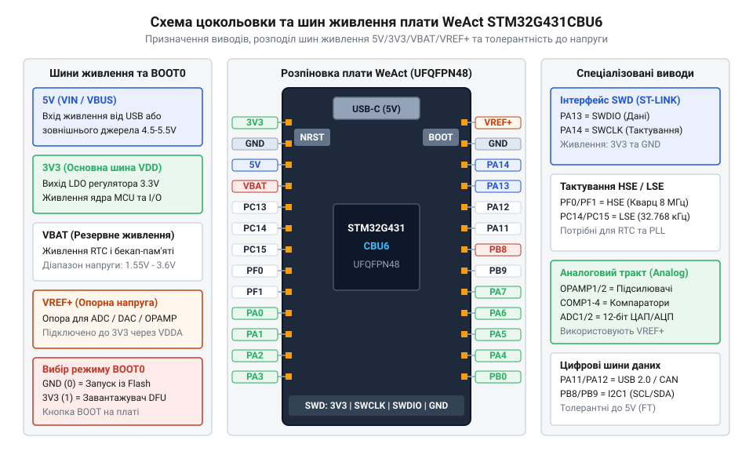
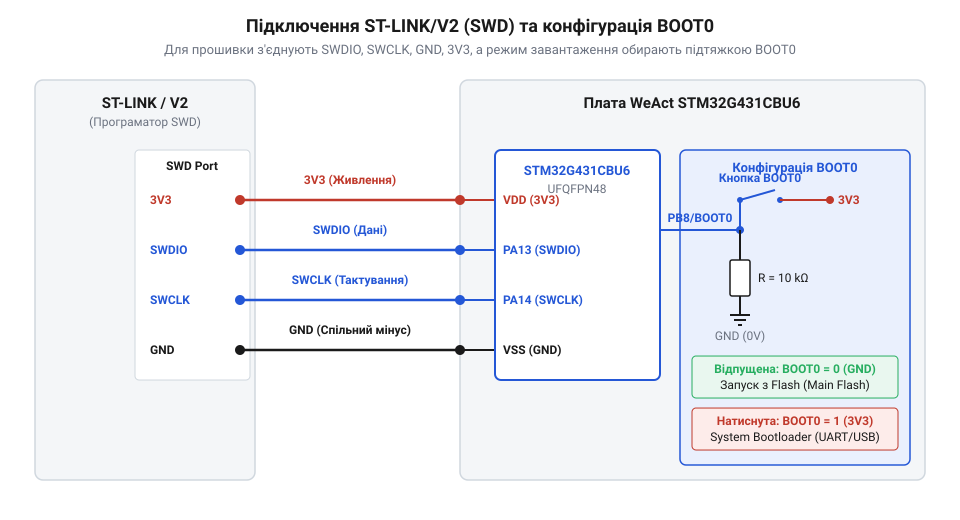

# Апаратна специфікація, цокольовка та фізичний інтерфейс WeAct STM32G431CBU6

<preknowlist>
- [STM32F072B-DISCO (Discovery, Cortex-M0)](root:cat-hw-boards/stm32f072b-disco) — Базові принципи організації відлагоджувальних інтерфейсів SWD та основи схемотехніки шин живлення мікроконтролерів серії STM32.
</preknowlist>

## Ризики збою живлення та помилок комутації

Будь-який розробник пристроїв на мікроконтролерах прагне якнайшвидше зібрати макет і перевірити роботу першої прошивки. Проте компактні налагоджувальні плати, як-от WeAct STM32G431CBU6 у щільному корпусі UFQFPN48, поєднують високу обчислювальну потужність ядра Arm Cortex-M4 із дуже чутливою фізичною топологією виводів. Забуваючи перевірити напруги та електричні параметри до подачі живлення, інженер ризикує миттєво спалити внутрішні кола мікроконтролера або лінійний регулятор напруги.

Головне джерело електричних загроз полягає в хибному розумінні схемотехніки розподілу напруг. Плата WeAct приймає зовнішнє живлення 5 В через роз'єм USB Type-C або відповідний контактний майданчик `5V`. Вбудований на платі регулятор напруги з малим падінням (англ. @@en|Low Dropout@@, LDO — від англ. *Low Dropout*, випадання) понижує вхідний потенціал до робочого рівня 3.3 В (шина `3V3`), що живить ядро мікроконтролера, пам'ять і периферійні блоки. Гранично припустима напруга живлення (`V_DD`) для кристала STM32G431CBU6 становить 3.6 В (абсолютний максимум — 4.0 В). Якщо випадково подати напругу 5 В безпосередньо на вивід `3V3`, відбудеться пробій затворного діелектрика транзисторів і необоротне термічне руйнування мікрочипа.

Іншою поширеною пасткою є неправильне використання виводів загального призначення (англ. @@en|General Purpose Input Output@@, GPIO — від англ. *General Purpose Input Output*, вхід-вихід загального призначення) із підтримкою п'ятивольтового рівня (англ. @@en|Five-Volt Tolerant@@, FT — від англ. *Five-Volt Tolerant*, що витримує п'ять вольт). Хоча більшість цифрових ліній STM32G431 є FT-толерантними, ця функція працює суворо за дотримання трьох електричних умов:

1. На шині живлення мікроконтролера присутня штатна робоча напруга (`V_DD` ≈ 3.3 В). Якщо плата знеструмлена (`V_DD` = 0 В), а на вхід FT подається напруга 5 В, струм починає протікати через паразитні діоди захисту від електростатичного розряду (англ. @@en|Electrostatic Discharge@@, ESD — від англ. *Electrostatic Discharge*, електростатичний розряд) у знеструмлену шину `V_DD`. Це викликає хаотичне паразитне живлення всієї плати, виникнення логічного защіпання (англ. @@en|Latch-up@@ — від англ. *Latch-up*, защіпання) та вигоряння внутрішніх провідників кристала.
2. Вивід сконфігуровано суворо як цифровий вхід або вихід. Якщо програмне забезпечення переводить вивід в аналоговий режим для роботи ADC, DAC, OPAMP чи COMP, внутрішній буфер FT-захисту вимикається, і сигнал прямує безпосередньо на аналоговий мультиплексор. Подача напруги понад `V_DDA` + 0.3 В (понад 3.6 В) в аналоговому режимі знищує аналогову периферію.
3. Вивід належить до категорії FT. Лінійки виводів без позначення FT (наприклад, спеціалізовані аналогові або тактові входи) взагалі не витримують напругу вище за `V_DD` + 0.3 В.

Окрім напруги, критично контролювати струмові навантаження. Максимальний струм витоку або втікання для окремого виводу GPIO становить ±20 мА (для стабільної логіки рекомендовано не більше ніж ±8 мА), а сумарний струм усіх виводів кристала не повинен перевищувати $I_{DD} = 100\,\text{мА}$. Перевищення цього ліміту призводить до перегріву корпусу UFQFPN48. Нарешті, під час розробки відлагоджувальних систем на базі [плат серії STM32](root:cat-hw-boards/stm32f072b-disco) обов'язково треба комутувати спільний дріт заземлення (GND) до підключення сигнальних ліній; різниця потенціалів між ізольованими Землями створює стрибки напруги, здатні вивести з ладу вхідні каскади.

> 🔧 **Навіщо це.**
> Систематичний контроль напруги живлення та електричних обмежень виводів запобігає незворотному термічному й електростатичному руйнуванню мікроконтролера ще до першого подання живлення на макетну плату.

## Живлення та архітектура виводів плати

Для безпечної та стабільної комутації периферійних модулів необхідно чітко розуміти схемотехніку розподілу шин живлення та призначення виводів на друкованій платі (англ. @@en|Printed Circuit Board@@, PCB — від англ. *Printed Circuit Board*, друкована плата) WeAct STM32G431CBU6. Корпус UFQFPN48 містить 48 виводів по периметру та металізований майданчик заземлення на черевці кристала, що вимагає уважного планування розпіновки.

Шини живлення плати розподіляються наступним чином:

- `5V` (або `VBUS`): Підключається до лінії живлення роз'єму USB Type-C та виведена на крайовий роз'єм. Вона живить вбудований LDO-регулятор і може віддавати струм зовнішнім 5-вольтовим виконавчим пристроям. Подача зовні напруги понад 5.5 В на цю шину знищує регулятор та MCU.
- `3V3`: Вихід вбудованого LDO-регулятора, який постачає напругу 3.3 В на цифрові (`V_DD`) та аналогові (`V_DDA`) виводи живлення мікроконтролера. Сумарне споживання зовнішніх датчиків від шини `3V3` не повинно перевищувати 300 мА, щоб уникнути перегріву LDO й просідання напруги.
- `VREF+`: Вивід опорної напруги для внутрішнього аналого-цифрового перетворювача (англ. @@en|Analog-to-Digital Converter@@, ADC — від англ. *Analog-to-Digital Converter*, аналого-цифровий перетворювач) та цифро-аналогового перетворювача (англ. @@en|Digital-to-Analog Converter@@, DAC — від англ. *Digital-to-Analog Converter*, цифро-аналоговий перетворювач). На платі WeAct лінія `VREF+` виведена на контактний майданчик і за замовчуванням з'єднана з `3V3` через фільтруючий елемент. Для прецизійних вимірювань лінію `VREF+` можна відокремити й подати на неї зовнішнє прецизійне джерело опорної напруги (наприклад, 2.048 В або 3.0 В). Якщо вивід `VREF+` залишити незапитаним або подати потенціал вище за `V_DDA`, результати аналогових перетворень спотворяться, а вхідний буфер зазнає перевантаження.
- `VBAT`: Вивід живлення резервного домену для годинника реального часу (англ. @@en|Real-Time Clock@@, RTC — від англ. *Real-Time Clock*, годинник реального часу) та зберігання даних у резервних реєстрах при вимкненні основної напруги `V_DD`. Підтримує діапазон напруг від 1.55 В до 3.6 В (зазвичай від батарейки CR2032). Якщо джерело резервного живлення не використовується, вивід `VBAT` мусить бути фізично підключений до шини `3V3`; залишати `VBAT` у плаваючому стані заборонено через ризик збоїв RTC та зростання струму витоку.

Для придушення високочастотних завад від ядра Cortex-M4, що працює на частоті до 170 МГц, біля кожної пари виводів $V_{DD}$ і $V_{DDA}$ на платі встановлюються керамічні блокируючі конденсатори ємністю 100 нФ, які доповнюються згладжувальним конденсатором 4.7 мкФ на головній шині 3.3 В.

*Принципова схема цокольовки плати WeAct STM32G431CBU6 та розподілу шин живлення 5V, 3V3, VBAT і VREF+ у корпусі UFQFPN48.*

> 🔧 **Навіщо це.**
> Правильний розподіл шин живлення та підключення ліній VREF+ і VBAT забезпечують стабільність аналогових вимірювань і запобігають спотворенню даних у резервному домені мікроконтролера.

## Конфігурація BOOT0 та інтерфейс SWD

Розробка пристрою вимагає постійного завантаження нових версій виконуваного коду у флеш-пам'ять (англ. @@en|Flash Memory@@ — від англ. *Flash Memory*, флеш-пам'ять) та покрокового контролю виконання інструкцій. Апаратна платформа STM32G431 містить гнучкий селектор режимів старту та швидкісний відлагоджувальний інтерфейс.

Вибір джерела завантаження мікроконтролера в момент скидання здійснюється шляхом зчитування логічного рівня на dedicated-виводі `BOOT0`. Під час наростаючого фронту сигналу на лінії скидання `NRST` внутрішній контролер системної конфігурації фіксує стан `BOOT0`:

- `BOOT0 = 0` (логічний нуль, забезпечується вбудованим на плату стягуючим резистором): мікроконтролер відображає основну Flash-пам'ять на початкові адреси виконання (`0x0800 0000`) та запускає користувацьку прошивку.
- `BOOT0 = 1` (логічна одиниця, подається натисканням кнопки BOOT0 на платі під час скидання): адреси старту перенаправляються на внутрішню системну пам'ять (постійний запам'ятовувальний пристрій, англ. @@en|Read-Only Memory@@, ROM — від англ. *Read-Only Memory*, постійний запам'ятовувальний пристрій). Це активує фабричний завантажувач і дає змогу виконати пряме оновлення прошивки (англ. @@en|Direct Firmware Upgrade@@, DFU — від англ. *Direct Firmware Upgrade*, пряме оновлення прошивки) через інтерфейси USB Type-C або USART1 без застосування зовнішнього програматора. Для поглиблення знань про роботу системного ROM завантажувача корисним є вивчення [протоколу завантаження DFU](root:sys-ide/stm32-system-dfu-bootloader).

Поведінку старту можна додатково перевизначити програмними реєстрами Option Bytes (англ. @@en|Option Bytes@@ — від англ. *Option Bytes*, байти опцій), зафіксувавши старт із Flash незалежно від стану фізичної кнопки.

Для внутрішньосхемного налагодження та прошивки використовується фізична шина Serial Wire Debug (англ. @@en|Serial Wire Debug@@, SWD — від англ. *Serial Wire Debug*, послідовне дротове налагодження), яка вимагає чотирьох обов'язкових з'єднань:

1. `SWDIO` (PA13): Двонапрямлена лінія даних із внутрішньою підтяжкою до 3.3 В.
2. `SWCLK` (PA14): Лінія тактування від програматора ST-LINK з внутрішнім стягуванням до Землі.
3. `GND`: Спільний дріт заземлення. Відсутність надійного контакту GND створює зсув фаз і шум на тактовій лінії, що унеможливлює зв'язок або випалює вхідний буфер.
4. `3V3` (Target `V_CC`): Вхід вимірювання опорної напруги цільової плати програматором ST-LINK для узгодження логічних рівнів.

Додатково вкрай рекомендовано підключати апаратну лінію скидання `NRST` (вивід PB2 / NRST). Це забезпечує режим підключення під час скидання (англ. @@en|Connect Under Reset@@), який необхідний, якщо робоча прошивка випадково переконфігурувала PA13/PA14 під звичайні GPIO або перевела процесор у глибокі режими енергозбереження (Stop/Standby).

Головна помилка комутації: ніколи не підключайте вивід 5V від програматора ST-LINK до контакту `3V3` плати! Подача 5 В у шину 3.3 В випалює мікроконтролер. При живленні плати від USB лінію живлення від ST-LINK залишають відключеною, комутуючи лише SWDIO, SWCLK та GND.

*Схема фізичного підключення програматора ST-LINK/V2 до інтерфейсу SWD та конфігурації кнопкового виводу BOOT0.*

> 🔧 **Навіщо це.**
> Розуміння схемотехніки виводу BOOT0 та лінії NRST у шині SWD дозволяє відновлювати доступ до мікроконтролера навіть у разі помилкового блокування налагоджувальних портів програмним кодом.

## Підключення ліній тактування та аналогового тракту

Отримання високої тактової частоти ядра (до 170 МГц) та забезпечення точної обробки швидких аналогових сигналів вимагають дотримання специфічних правил трасування й комутації зовнішніх тактових резонаторів і аналогових блоків мікроконтролера.

Тактова система WeAct STM32G431CBU6 спирається на два зовнішніх джерела:

- **HSE** (англ. @@en|High Speed External@@, HSE — від англ. *High Speed External*, високошвидкісне зовнішнє тактування): Вбудований кварцовий резонатор (зазвичай 8 МГц), підключений до виводів `PF0-OSC_IN` та `PF1-OSC_OUT`. Сигнал HSE подається на внутрішнє коло фазової автопідстройки частоти (англ. @@en|Phase-Locked Loop@@, PLL — від англ. *Phase-Locked Loop*, фазова автопідстройка частоти) для синтезу системної частоти 170 МГц та стабільних 48 МГц для шини USB і FDCAN. Кварц потребує симетричних керамічних конденсаторів навантаження ($C_L \approx 12-22\,\text{пФ}$) та мінімальної довжини доріжок на PCB для запобігання зриву генерації.
- **LSE** (англ. @@en|Low Speed External@@, LSE — від англ. *Low Speed External*, низькошвидкісне зовнішнє тактування): Кварцовий резонатор 32.768 кГц на виводах `PC14-OSC32_IN` та `PC15-OSC32_OUT`, який живить домен RTC. Завдяки низькому споживанню коло LSE є вкрай чутливим до наводок; його лінії захищають екрануючим контуром Землі на платі.

Аналоговий тракт STM32G431 містить 3 високошвидкісні операційні підсилювачі (англ. @@en|Operational Amplifier@@, OPAMP — від англ. *Operational Amplifier*, операційний підсилювач) із швидкістю наростання до 45 В/мкс та 4 швидкісні компаратори (англ. @@en|Comparator@@, COMP — від англ. *Comparator*, компаратор) з часом відгуку до 16.7 нс.

Під час фізичної комутації OPAMP слід враховувати:
1. Виводи неінвертуючого (+), інвертуючого (-) входів та виходу підсилювачів суміщені з конкретними GPIO (наприклад, PA1, PA2, PA3).
2. При роботі в режимі підсилювача з програмним коефіцієнтом підсилення (англ. @@en|Programmable Gain Amplifier@@, PGA — від англ. *Programmable Gain Amplifier*, підсилювач із програмним коефіцієнтом підсилення) або буфера, вхідна напруга не повинна виходити за межі діапазону $[V_{SSA}, V_{DDA}]$ (від 0 В до 3.3 В). Для вивчення внутрішніх схем підключення корисний огляд [режимів конфігурації OPAMP та PGA](root:hw-arch/stm32g4-opamp-pga-modes).
3. Вихід OPAMP не розрахований на пряме підключення великих ємкісних навантажень; для запобігання самозбудженню підсилювача послідовно з виходом ставлять резистор 22–47 Ом.

Внутрішні компаратори COMP порівнюють аналоговий сигнал з опорними рівнями для аварійного вимкнення силових ключів в імпульсних джерелах живлення (англ. @@en|Switched-Mode Power Supply@@, SMPS — від англ. *Switched-Mode Power Supply*, імпульсне джерело живлення) та приводах двигунів. Щоб уникнути хибних спрацьовувань компаратора через цифрові завади, аналогові сигнал-лінії відокремлюють від високочастотних шин (SWCLK, SPI), а аналогову Землю ($V_{SSA}$) з'єднують із цифровою ($V_{SSD}$) в одній точці під корпусом мікроконтролера.

> 🔧 **Навіщо це.**
> Грамотне розведення тактових ліній HSE/LSE та електричне ізолювання аналогового тракту OPAMP/COMP забезпечують високу точність вимірювань і надійний апаратний захист силових кіл без хибних спрацьовувань.
