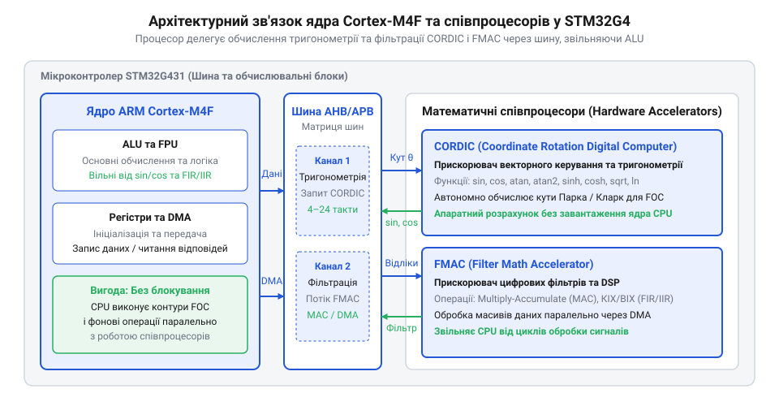
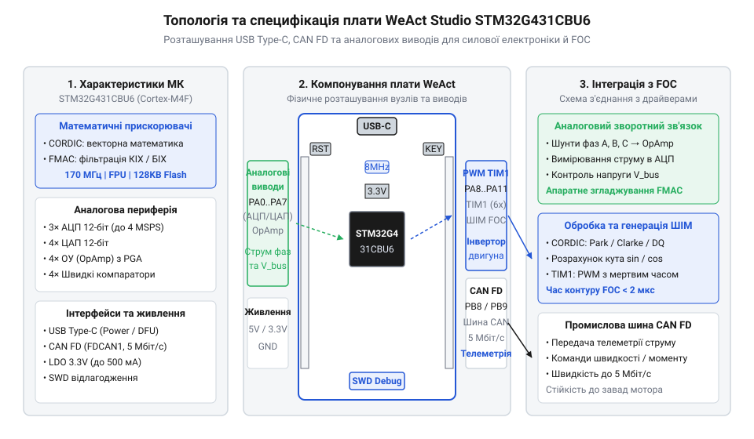

# Еволюція серії STM32G4 та історія створення плати WeAct Studio

## Обмеження STM32F3 у цифровому керуванні

Силові імпульсні інвертори та системи @@en|FOC@@ (від @@en|Field-Oriented Control@@ — векторне керування, орієнтоване за магнітним полем) електродвигунами вимагають від мікроконтролера безперервного та швидкого розрахунку складних математичних моделей у реальному часі. Для точного утримання моменту та швидкості ротора алгоритм векторного керування на кожному такті силового шімування мусить обробляти дані струмів фаз і виконувати прямі та зворотні тригонометричні перетворення @@en|Clarke@@ та @@en|Park@@. Для цих обчислень необхідно багаторазово розраховувати функції `sin(θ)` та `cos(θ)`, а також згладжувати високочастотні шуми вимірювань за допомогою цифрової фільтрації в задачах @@en|DSP@@ (від @@en|Digital Signal Processing@@ — цифрова обробка сигналів).

Серія мікроконтролерів @@en|STM32F3@@, випущена компанією @@en|STMicroelectronics@@ у 2012 році, створювалася як гібридне аналогово-цифрове рішення. Вона містила обчислювальне ядро @@en|Cortex-M4F@@ із тридцятидвохбітним блоком @@en|FPU@@ (від @@en|Floating-Point Unit@@ — математичний блок обчислень із плаваючою комою). На відміну від раніших базових мікроконтролерних систем на кшталт [навчальної плати STM32F072B-DISCO](root:cat-hw-boards/stm32f072b-disco) на основі ядра @@en|Cortex-M0@@, де будь-яка плаваюча математика виконувалася виключно програмно, наявність апаратного @@en|FPU@@ у серії @@en|STM32F3@@ була суттєвим кроком уперед. Проте під час обробки високошвидкісних алгоритмів векторного керування пропускної здатності стандартизованого ядра @@en|Cortex-M4F@@ виявилося недостатньо.

Основна проблема полягала в тому, що блок @@en|FPU@@ у ядрі @@en|Cortex-M4F@@ здатний апаратно виконувати лише базові арифметичні операції: додавання, віднімання, множення та добування квадратного кореня. Складні трансцендентні функції, такі як синус, косинус або арктангенс, не мають прямої системної інструкції в наборі команд ядра. Їхній обчислювальний алгоритм доводилося реалізовувати програмно — через розкладання в ряди Тейлора, апроксимацію поліномами Чебишова або через пошукові таблиці в оперативній пам'яті. Розрахунок лише однієї пари тригонометричних функцій `sin(θ)` та `cos(θ)` розкладом у ряд займав у ядра @@en|Cortex-M4F@@ від `40` до `80` процесорних тактів.

Ситуацію ускладнювала необхідність цифрової фільтрації сигналів зі зчитувачів струму та датчиків положення ротора. Розрахунок цифрових фільтрів із скінченною імпульсною характеристикою @@en|FIR@@ (від @@en|Finite Impulse Response@@ — скінченна імпульсна характеристика) або нескінченною імпульсною характеристикою @@en|IIR@@ (від @@en|Infinite Impulse Response@@ — нескінченна імпульсна характеристика) вимагає послідовного виконання довгої серії операцій множення з накопиченням. Оскільки процесорне ядро вимушене було послідовно обирати інструкції з пам'яті та оновлювати регістри, цикл обробки переривання перетворення аналогово-цифрового конвертера @@en|ADC@@ (від @@en|Analog-to-Digital Converter@@ — аналогово-цифровий перетворювач) ставав надто довгим.

При роботі ядра @@en|Cortex-M4F@@ на тактовій частоті `72 MHz` (максимальна частота для лінійки @@en|STM32F3@@) повний розрахунок одного контуру векторного керування займав від `10` до `20` мікросекунд. Це накладало жорстке фізичне обмеження на несучу частоту генерації широтно-імпульсної модуляції @@en|PWM@@ (від @@en|Pulse-Width Modulation@@ — широтно-імпульсна модуляція). Інвертор не міг працювати на частотах перемикання силових ключів вище `15`–`20 kHz` без загрози повного перевантаження процесора. За таких умов переривання алгоритму @@en|FOC@@ споживали понад `50%` усього ресурсу ядра @@en|CPU@@ (від @@en|Central Processing Unit@@ — центральний процесор).

Така висока обчислювальна затримка унеможливлювала керування високооборотними безколекторними двигунами та застосування сучасних силових транзисторів на основі карбіду кремнію @@en|SiC@@ чи галію нітриду @@en|GaN@@, які вимагають частоти шімування від `50` до `100 kHz` для досягнення високого коефіцієнта корисної дії. Процесорне ядро просто не встигало виконувати фонові завдання системної діагностики, обробку мережевих протоколів передачі даних та розрахунок траєкторій руху. На ринку цифрового керування електроприводом постала гостра потреба в архітектурі, яка здатна звільнити центральний процесор від рутинних тригонометричних та фільтраційних обчислень.

## Апаратний прорив серії STM32G4 2019 року

У відповідь на обчислювальні обмеження серії @@en|STM32F3@@ компанія @@en|STMicroelectronics@@ у травні 2019 року випустила нове сімейство мікроконтролерів @@en|STM32G4@@. Розробники позиціонували цю лінійку не як чергове універсальне оновлення загального призначення, а як спеціалізований аналогово-цифровий математичний обчислювач для цифрової обробки сигналів та векторного керування силовою електронікою. Головним архітектурним досягненням серії стала інтеграція обчислювального ядра @@en|Cortex-M4F@@ із тактовою частотою до `170 MHz` та двох автономних апаратних математичних прискорювачів: блоку @@en|CORDIC@@ (від @@en|COordinate Rotation DIgital Computer@@ — цифровий обчислювач повороту координат) та прискорювача @@en|FMAC@@ (від @@en|Filter Math Accelerator@@ — математичний прискорювач фільтрів).

Апаратний прискорювач @@en|CORDIC@@ розв'язав проблему повільного обчислення тригонометрії. Він імплементує ітераційний алгоритм повороту вектора на фіксованій сітці кутів, використовуючи лише прості бітові зсуви та додавання в цілочисельній арифметиці. Модуль @@en|CORDIC@@ здатен обчислити функції `sin(θ)` та `cos(θ)`, арктангенс `atan2(y, x)` або модуль вектора `√(x² + y²)` всього за `4`–`12` процесорних тактів. Процесорному ядру @@en|Cortex-M4F@@ достатньо записати вхідні аргументи у відповідний регістр прискорювача та зчитати готовий результат через декілька тактів, або доручити цю передачу прямому доступу до пам'яті @@en|DMA@@ (від @@en|Direct Memory Access@@ — прямий доступ до пам'яті).

Другий прискорювач, @@en|FMAC@@, узяв на себе виконання обчислювально містких цифрових фільтрів. Він містить апаратний блок множення з накопиченням @@en|MAC@@ (від @@en|Multiply-Accumulate@@ — множення з накопиченням) та власну локальну оперативну пам'ять для збереження коефіцієнтів і квантів даних. Блок @@en|FMAC@@ може повністю автономно обробляти фільтри @@en|FIR@@ та @@en|IIR@@, а також здійснювати операції згортки сигналів. Завдяки прямому зв'язку з контролером @@en|DMA@@ прискорювач @@en|FMAC@@ зчитує відліки з аналогово-цифрового перетворювача @@en|ADC@@, виконує цифрове згладжування шумів і записує результат у буфер без жодного залучення команд процесорного ядра.

*Схема взаємодії обчислювального ядра Cortex-M4F із магістральними шинами та автономними апаратними прискорювачами CORDIC і FMAC.*

Поява прискорювачів кардинально змінила баланс обчислювального навантаження в мікроконтролері. Перенесення тригонометричних розрахунків алгоритмів @@en|Park@@ і @@en|Clarke@@ у блок @@en|CORDIC@@ та цифрової фільтрації у блок @@en|FMAC@@ зменшило тривалість обробки контуру векторного керування у `4`–`6` разів. Частка ресурсу @@en|CPU@@, яку вимагало переривання @@en|FOC@@, знизилася з `50%` до менш ніж `10%`. Це дозволило розробникам підняти частоту модуляції @@en|PWM@@ до `100 kHz` і більше, забезпечуючи високу точність керування швидкодіючими електродвигунами.

Практичне впровадження нових математичних блоків породило серед розробників два поширених міфи. Перша хибна думка полягає в тому, ніби @@en|CORDIC@@ та @@en|FMAC@@ є повноцінними автономними процесорними ядрами, які працюють паралельно як незалежні обчислювачі загального призначення замість основного @@en|CPU@@. Насправді ж це периферійні співпроцесори з фіксованою функціональністю, які не мають власного командного декодера і виконують лише чітко визначений набір арифметичних матричних або тригонометричних операцій за вказівкою основного ядра.

Другий міф виник стосовно позиціонування всієї серії: нібито сімейство @@en|STM32G4@@ створювалося як загальносистемна заміна універсальним мікроконтролерам високої продуктивності @@en|STM32F4@@. Проте мікроконтролери @@en|STM32G4@@ розроблялися не як універсальні процесори загального призначення для медіапристроїв чи графічних інтерфейсів, а як вузькоспеціалізована аналогово-цифрова платформа, оптимізована під перетворення сигналів у реальному часі, керування силовими інверторами, джерелами живлення та високоточною моторикою.

## Міфи про прискорювачі та призначення STM32G4

Поява в архітектурі @@en|STM32G4@@ спеціалізованих математичних блоків @@en|CORDIC@@ та @@en|FMAC@@ породила серед розробників поширене помилкове уявлення, ніби ці прискорювачі є автономними процесорними ядрами. Інженери нерідко очікують від них поведінки повноцінного вторинного обчислювача, здатного незалежно виконувати довільні програми паралельно з основним @@en|CPU@@. Тим часом реальний механізм роботи прискорювачів влаштований фундаментально інакше. Блоки @@en|CORDIC@@ та @@en|FMAC@@ не мають власного вибірника інструкцій, лічильника команд чи лінійки регістрів загального призначення. Вони є апаратними співпроцесорними периферійними блоками із фіксованою комбінаторною логікою, підключеними безпосередньо до системної шини мікроконтролера.

Прискорювач @@en|CORDIC@@ реалізує алгоритм ітераційного обертання вектора на фіксованому наборі зсувів та додавань, обчислюючи тригонометричні перетворення Парка та Кларка, синуси, косинуси чи модулі векторів за 6–12 тактів шини без використання таблиць у пам'яті. Прискорювач @@en|FMAC@@ містить локальний двопортовий буфер коефіцієнтів та відліків, виконуючи операції множення з накопиченням для цифрової фільтрації сигналів струмових датчиків у фільтрах КІХ (від англ. *Finite Impulse Response* — скінченна імпульсна характеристика) та ІІХ (від англ. *Infinite Impulse Response* — нескінченна імпульсна характеристика).

Для виконання обчислення центральний процесор @@en|CPU@@ або контролер прямого доступу до пам'яті @@en|DMA@@ мусить записати вхідні аргументи у регістри даних прискорювача. Поки апаратний блок обробляє вектор або формує вихідний відлік фільтра, процесорне ядро залишається вільним для виконання системної логіки, опитування датчиків та обробки переривань. Прискорювачі розвантажують процесор не шляхом автономного виконання довільного коду, а за рахунок апаратного скорочення трудомістких математичних операцій до декількох тактів шини.

Другим стійким міфом стало сприйняття серії @@en|STM32G4@@ як безпосередньої замінниці універсальних високопродуктивних мікроконтролерів @@en|STM32F4@@. Таке змішування позиціонування призводить до помилкових архітектурних рішень при виборі компонента для нових розробок. Лінійка @@en|STM32F4@@ створювалася як загальносистемний обчислювач високої потужності з широким набором універсальних периферійних інтерфейсів. Вона розрахована на задачі, що вимагають підключення зовнішньої паралельної пам'яті, побудови графічних інтерфейсів або обробки мережевих протоколів через апаратний контролер @@en|Ethernet@@.

Натомість серія @@en|STM32G4@@ є вузькоспеціалізованим аналогово-цифровим комплексом, розробленим для цифрового керування силовою електронікою, джерелами живлення та сервоприводами. Замість нарощування обсягів системної пам'яті чи паралельних шин, інженери @@en|STMicroelectronics@@ інтегрували у чип надшвидкісну аналогову периферію та розгалужену матрицю прямих апаратних зв'язків. До складу периферії входять операційні підсилювачі з програмованим коефіцієнтом підсилення @@en|PGA@@ (від англ. *Programmable Gain Amplifier* — підсилювач із програмованим коефіцієнтом підсилення), вимірювальні аналогово-цифрові перетворювачі @@en|ADC@@ із часом вибірки від 200 наносекунд, надшвидкі компаратори із затримкою спрацьовування 16.7 наносекунд та високороздільні таймери @@en|HRTIM@@ (від англ. *High-Resolution Timer* — таймер високої роздільної здатності) із точністю формування комплементарного ШІМ-сигналу з мертвою зоною до 184 пікосекунд. Пряме з'єднання компараторів із таймерами дозволяє здійснювати апаратне поциклове відсікання струму короткого замикання за десятки наносекунд без участі @@en|CPU@@.

Критерій вибору між цими платформами спирається на характер обробки даних у кінцевому пристрої. Якщо проєкт вимагає керування трифазним інвертором безколекторного двигуна за алгоритмом векторного керування @@en|FOC@@ або побудови цифрового контуру стабілізації напруги, оптимальним рішенням стає @@en|STM32G4@@. У таких задачах ключовими є мінімальна затримка між вимірюванням струму та зміною коефіцієнта заповнення ШІМ, а також апаратне прискорення тригонометрії. Якщо ж пристрій орієнтований на складну загальносистемну логіку, файлові системи та комунікаційні хаби, доцільно використовувати [архітектурну лінійку STM32F4](root:cat-hw-boards/stm32f4-architecture-overview), залишаючи @@en|STM32G4@@ сферу силової та моторної автоматики.

## Поява плати WeAct Studio STM32G431CBU6

Незважаючи на високий обчислювальний та аналоговий потенціал серії @@en|STM32G4@@, її масове освоєння інженерами та мейкерами тривалий час стримувалося високим порогом входження до апаратної розробки. Офіційні відлагоджувальні плати від виробника мали значні габарити та відносно високу вартість. Водночас проектування власної друкованої плати вимагало складного чотиришарового розведення з дотриманням жорстких вимог до трасування аналогових кіл живлення, заземлення та завадозахищеності.

Розв'язанням цієї проблеми стала поява у 2020 році компактного відлагоджувального модуля від компанії @@en|WeAct Studio@@, збудованого на базі мікроконтролера @@en|STM32G431CBU6@@. Розробники обрали корпус @@en|UFQFPN48@@ (від англ. *Ultra Thin Fine-Pitch Quad Flat Package No-Lead* — ультратонкий корпус із 48 виводами без ніжок), що дозволило вмістити повноцінний 32-бітний аналогово-цифровий обчислювач із тактовою частотою до 170 Мегагерц у модуль розміром 53 на 22 міліметри.

Основним інженерним досягненням плати стало раціональне компонування сучасних комунікаційних інтерфейсів та живлення на мінімальній площі. Інтеграція симетричного роз'єму @@en|USB Type-C@@ забезпечила зручне живлення модуля та швидкісний обмін даними з комп'ютером для оновлення прошивки через вбудований системний @@en|bootloader@@ мікроконтролера. Для підключення периферії на платі передбачено користувацьку кнопку, світлодіод індикації та кнопкове перемикання режиму @@en|bootloader@@. Для побудови розподілених робототехнічних мереж та промислових шин на платі розміщено апаратний контролер шини @@en|CAN FD@@ (від англ. *Controller Area Network Flexible Data-rate* — мережа контролерів із гнучкою швидкістю даних), який підтримує передачу кадрів зі швидкістю до 5 Мегабіт на секунду в умовах сильних електромагнітних завад від силових інверторів.

*Розміщення компонентів і периферійних інтерфейсів на друкованій платі WeAct Studio STM32G431CBU6.*

Схема живлення модуля містить лінійний регулятор зі зниженим рівнем шумів та виділений фільтр для аналогової лінії живлення @@en|VDDA@@. Тактова система стабілізована високоточним кварцовим резонатором на 8 Мегагерц та додатковим кварцом 32.768 Кілогерц для годинника реального часу. Це дозволяє збережити точність вимірювань аналогово-цифрових перетворювачів @@en|ADC@@ при роботі у шумному середовищі силових плафонів.

Топологія розпінування плати @@en|WeAct Studio STM32G431@@ була розроблена з урахуванням специфіки векторного керування електродвигунами. Аналогові виводи мікроконтролера, з'єднані з внутрішніми підсилювачами @@en|PGA@@ та входами швидких перетворювачів @@en|ADC@@, виведені на крайові з'єднувачі суцільними групами. Таке групування мінімізує довжину провідників до зовнішніх шунтових датчиків струму та запобігає наведенню завад від високочастотних сигналів ШІМ.

На відміну від громіздких макетів, які застосовувалися в [класичних відлагоджувальних платах](root:cat-hw-boards/stm32f072b-disco), модуль @@en|WeAct Studio@@ легко монтується безпосередньо на плату силового драйвера безколекторного двигуна @@en|BLDC@@ (від англ. *Brushless Direct Current* — безколекторний двигун постійного струму) як дочірня плата. Для програмування та внутрішньосхемного налагодження реального часу на плату виведено стандартний чотириконтактний інтерфейс @@en|SWD@@ (від англ. *Serial Wire Debug* — послідовне двопровідне налагодження). Поєднання низької вартості, наявності трансивера @@en|CAN FD@@ та оптимізованої топології зробило плату @@en|WeAct Studio STM32G431CBU6@@ стандартом для відкритих проєктів електроприводу, таких як @@en|SimpleFOC@@, та локальних контролерів робототехнічних суглобів.
