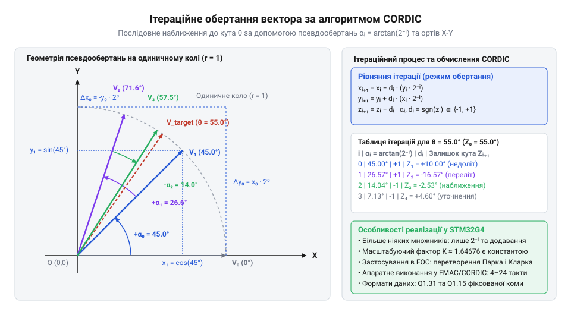
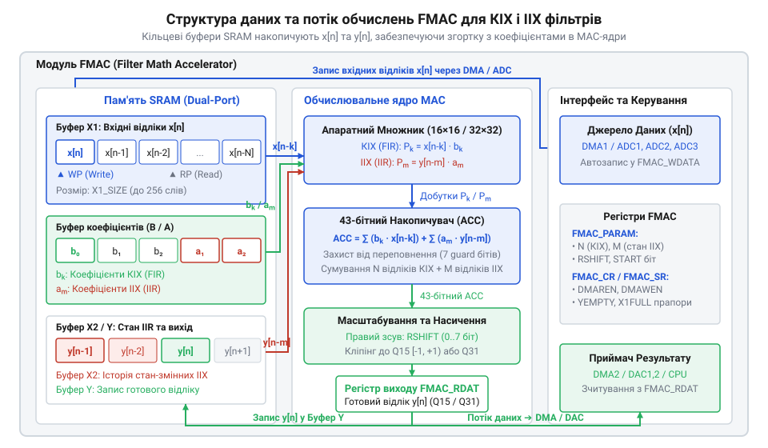

# Розрахунок тригонометричних функцій у CORDIC та фільтрації у FMAC

<preknowlist>
- [Огляд архітектури та можливостей серії мікроконтролерів STM32F4](root:cat-hw-boards/stm32f4-architecture-overview) — базові принципи шинної організації мікроконтролерів STM32 та організація обробки сигналів на ядрах Cortex-M
</preknowlist>

## Обмеження програмних обчислень у FOC

Високочастотне @@en|векторне керування@@ (англ. *Field-Oriented Control*, від *field* — поле, *orient* — орієнтувати, *control* — керування, або @@en|FOC@@) синхронними й асинхронними електродвигунами вимагає постійного перерахунку тригонометричних функцій та цифрового фільтрування струмів статора в кожному циклі переривання широтно-імпульсної модуляції (від *широтно-імпульсна модуляція*, або @@en|ШІМ@@). Для формування оптимального магнітного потоку мікроконтролер зчитує аналогові струми фаз, виконує [математичних перетворень Кларка](root:hw-motion/foc-park-clarke-transformations) (англ. *Clarke transformation*, на честь інженерки *Edith Clarke*) для переходу до нерухомої двофазної системи координат `(i_α, i_β)`, а потім застосовує @@en|перетворення Парка@@ (англ. *Park transformation*, на честь інженера *Robert H. Park*) для повертання вектора струму в обертову систему координат `(i_d, i_q)`, прив'язану до ротора. Обчислення прямого @@en|перетворення Парка@@ вимагає розрахунку значень синуса `sin(θ)` та косинуса `cos(θ)` кута положення ротора `θ`:

i_d = i_α · cos(θ) + i_β · sin(θ)
i_q = -i_α · sin(θ) + i_β · cos(θ)

У високодинамічних електроприводах частота дискретизації контуру струму становить від 10 до 100 кГц, що залишає на виконання всього алгоритму від 10 до 100 мікросекунд. Обчислення тригонометрії безпосередньо на центральному процесорі створює суттєві обчислювальні вузькі місця:

Обчислення через @@en|ряд Тейлора@@ (англ. *Taylor series*, на честь математика *Brook Taylor*) або поліноми Паде вимагає виконання послідовності операцій множення та ділення з плаваючою або фіксованою комою. На процесорних ядрах без спеціалізованих векторних інструкцій обчислення однієї пари синуса й косинуса займає від 50 до 150 тактів процесора. За частоти @@en|ШІМ@@ 50 кГц і тактовій частоті ядра 170 МГц весь процес переривання має тривати не більше 3400 тактів, з яких понад 10% витрачається лише на тригонометричні обчислення для прямого та зворотного @@en|перетворення Парка@@.
2. Таблична апроксимація (англ. *Look-Up Table*, від *look up* — шукати, *table* — таблиця, або @@en|Look-Up Table@@) із лінійною інтерполяцією потребує значного обсягу пам'яті @@en|Flash@@ для збереження таблиць високої точності. Використання малих таблиць призводить до похибок квантування кута, що породжує вищі гармоніки в струмі статора. Крім того, звернення до пам'яті супроводжується затримками зчитування та часовим джитером (англ. *jitter*, від *jitter* — тремтіти) через промахи в кеш-пам'яті.
3. Софтверна цифрова фільтрація виміряних струмів, що містять високі рівні комутаційних завад інвертора, вимагає виконання згортки сигнала через @@en|КІХ-фільтр@@ (від *скінченна імпульсна характеристика*). Розрахунок скалярного добутку для фільтра з 32 коефіцієнтами потребує 32 послідовних операцій множення з накопиченням (англ. *Multiply-Accumulate*, @@en|MAC@@) на один канал вимірювання в кожному такті дискретизації.

При виконанні таких обчислень на молодших [платформах на базі Cortex-M0](root:cat-hw-boards/stm32f072b-disco) або навіть при аналізі [архітектури мікроконтролерів STM32](root:cat-hw-boards/stm32f4-architecture-overview) середньої продуктивності процесорний час вичерпується надто швидко. Виникає детермінований фазовий зсув між реальним кутом ротора та обчисленою матрицею повороту. Цей фазовий запізнювальний зсув спричиняє розкачування струму осі `d`, зниження коефіціента корисної дії двигуна, пульсації моменту та потенційну втрату стійкості контуру керування на високих швидкостях обертання.

Для звільнення центрального процесора від рутинних математичних операцій у сучасних мікроконтролерах @@en|STM32G4@@ застосовують спеціалізовані апаратні прискорювачі: сопроцесор обчислення координатних обертань @@en|CORDIC@@ (англ. *COordinate Rotation DIgital Computer*, від *coordinate* — координата, *rotation* — обертання, *digital* — цифровий, *computer* — обчислювач) для векторної тригонометрії та математичний прискорювач фільтрації @@en|FMAC@@ (англ. *Filter Math Accelerator*, від *filter* — фільтр, *math* — математичний, *accelerator* — прискорювач) для апаратної обробки сигналів @@en|DSP@@ (англ. *Digital Signal Processing*, від *digital* — цифровий, *signal* — сигнал, *processing* — обробка).

## Математичний принцип ітераційного алгоритму CORDIC

В основі роботи [апаратного сопроцесора CORDIC](root:hw-arch/stm32g4-cordic-hardware-co-processor) лежить ітераційний алгоритм обчислення векторних трансформацій, який замінює складні операції множення послідовністю простих бітових зсувів та додавань. Алгоритм розв'язує задачу обертання двовимірного вектора `V₀ = (x₀, y₀)` у декартовій системі координат на заданий кут `φ`.

Класичні формули повороту вектора проти годинникової стрілки мають вигляд:

x' = x₀ · cos(φ) - y₀ · sin(φ)
y' = x₀ · sin(φ) + y₀ · cos(φ)

Шляхом винесення косинуса кута `cos(φ)` за дужки вирази зводяться до форми, де тригонометрична залежність виражається через тангенс:

x' = cos(φ) · [x₀ - y₀ · tan(φ)]
y' = cos(φ) · [y₀ + x₀ · tan(φ)]

Основна ідея алгоритму @@en|CORDIC@@ полягає в розкладанні довільного кута повороту `φ` на суму послідовних елементарних псевдоосновних кутів `θᵢ`:

φ = ∑ dᵢ · θᵢ

тут символ `dᵢ` визначає напрямок обертання на кроці `i` і набуває значень `+1` (проти годинникової стрілки) або `-1` (за годинниковою стрілкою). Елементарні кути `θᵢ` обираються таким чином, щоб їхній тангенс дорівнював від'ємному степеню двійки:

tan(θᵢ) = 2⁻ⁱ

Завдяки цьому вибору множення будь-якого числа на `tan(θᵢ)` в арифметиці з @@en|фіксована кома@@ (англ. *fixed-point*, від *fixed* — фіксований, *point* — крапка/кома) еквівалентне арифметичному зсуву вправо на `i` розрядів (`>> i`). Значення елементарних кутів `θᵢ = arctan(2⁻ⁱ)` розраховуються заздалегідь і зберігаються у внутрішній апаратній таблиці констант:

θ₀ = arctan(2⁰) = arctan(1) ≈ 0.785398 rad (45.0°)
θ₁ = arctan(2⁻¹) = arctan(0.5) ≈ 0.463648 rad (26.565°)
θ₂ = arctan(2⁻²) = arctan(0.25) ≈ 0.244979 rad (14.036°)
θ₃ = arctan(2⁻³) = arctan(0.125) ≈ 0.124355 rad (7.125°)

Дістаємо вираз для нових координат вектора `xᵢ₊₁` та `yᵢ₊₁` після виконання покрокового обертання початкового вектора `(xᵢ, yᵢ)` на елементарний кут `θᵢ` із винесенням загального множника косинуса. У формулі символ `xᵢ` позначає координату вздовж осі абсцис на кроці `i`, `yᵢ` — координату вздовж осі ординат, `dᵢ` — напрямок обертання, `θᵢ` — елементарний кут, а `2⁻ⁱ` — коефіцієнт бітового зсуву.

xᵢ₊₁ = xᵢ · cos(dᵢ · θᵢ) - yᵢ · sin(dᵢ · θᵢ)
= cos(θᵢ) · [xᵢ - yᵢ · dᵢ · tan(θᵢ)]      [непарність синуса sin(-α)=-sin(α) та парність косинуса cos(-α)=cos(α)]
= cos(θᵢ) · [xᵢ - dᵢ · yᵢ · 2⁻ⁱ]            [підстановка умови елементарного кута tan(θᵢ) = 2⁻ⁱ]

Отриманий вираз показує, що ітераційний крок обчислення координати `xᵢ₊₁` розбивається на дві частини: множник `cos(θᵢ)`, який зміщує модуль вектора, та внутрішню дужку, де операцію множення повністю замінено на арифметичний зсув `yᵢ · 2⁻ⁱ` та віднімання або додавання залежно від знака `dᵢ`. Аналогічно для координати `yᵢ₊₁` вираз набуває вигляду `yᵢ₊₁ = cos(θᵢ) · [yᵢ + dᵢ · xᵢ · 2⁻ⁱ]`.

Ігнорування множника `cos(θᵢ)` на кожному кроці називається псевдообертанням. Воно спрощує ітерацію до трьох базових операцій:

xᵢ₊₁ = xᵢ - dᵢ · (yᵢ >> i)
yᵢ₊₁ = yᵢ + dᵢ · (xᵢ >> i)
zᵢ₊₁ = zᵢ - dᵢ · θᵢ

тут змінна `zᵢ` слугує кутовим акумулятором, який на початку ініціалізується заданим кутом `z₀ = φ`. На кожному кроці знак обертання `dᵢ` обирається за умовою `dᵢ = +1`, якщо `zᵢ ≥ 0`, і `dᵢ = -1`, якщо `zᵢ < 0`, що забезпечує послідовне зменшення залишкового кута `zᵢ` до нуля.


*Геометричне представлення ітераційного обертання вектора на одиничному колі з послідовним зменшенням псевдоосновних кутів.*

Однак псевдообертання збільшує довжину вектора на кожній ітерації в `√(1 + tan²(θᵢ)) = √(1 + 2⁻²ⁱ)` разів.

Обчислюємо накопичений коефіцієнт збільшення довжини вектора `Aₙ` в результаті `n` послідовних псевдообертань від кроку `i = 0` до `n - 1`. Символ `Aₙ` позначає загальний коефіцієнт масштабування амплітуди вектора, `θᵢ` — елементарний кут повороту на кроці `i`, а `2⁻ⁱ` — коефіцієнт бітового зсуву на кроці `i`.

Aₙ = ∏ᵢ₌₀ⁿ⁻¹ √(1 + tan²(θᵢ))
= ∏ᵢ₌₀ⁿ⁻¹ √(1 + (2⁻ⁱ)²)                  [заміна тригонометричного тангенса на бітовий зсув 2⁻ⁱ]
= ∏ᵢ₌₀ⁿ⁻¹ √(1 + 2⁻²ⁱ)                     [піднесення до степеня у підкореневому виразі]

Оскільки значення квадратів знаків `dᵢ² = 1`, підсумковий коефіцієнт масштабування `Aₙ` не залежить від конкретної послідовності напрямків обертання і визначається лише кількістю ітерацій `n`. Для нескінченної кількості ітерацій значення масштабувального коефіцієнта прямує до константи `A ≈ 1.6467602581`. Його обернена величина `K = 1 ÷ A ≈ 0.6072529350` є масштабувальною константою алгоритму @@en|CORDIC@@.

Для отримання точних координат повернутого вектора початковий вектор `(x₀, y₀)` або попередньо множать на константу `K`, або підсумкові координати `(xₙ, yₙ)` масштабують на значення `K` після завершення останньої ітерації. У режимі обертання (англ. *rotation mode*) для прямого @@en|перетворення Парка@@ на входи подаються координати `x₀ = K · i_α`, `y₀ = K · i_β` та кут `z₀ = θ`. Після виконання `n` ітерацій акумулятор `zₙ` обнуляється, а виходи `xₙ` та `yₙ` дають точні значення обертових струмів `i_d` та `i_q` без єдиної операції програмного множення синусів і косинусів.

## Математична модель та передавальні функції FMAC

Обчислення цифрової фільтрації в реальному часі для контурів керування струмом частотою 20–50 кГц вимагає виконання розрахунку дискретної згортки на кожному періоді дискретизації. Виконання КІХ та ІІХ фільтрів програмним кодом на стандартних процесорних ядрах створює значні накладні витрати: переміщення відліків у масивах, зсув кільцевих покажчиків, урахування умовних переходів та виконання операцій помноження з накопиченням. Навіть за наявності спеціалізованих інструкцій вибірка даних з пам'яті забирає дорогоцінні такти центрального процесора. Для повного апаратного прискорення та розвантаження ядра в мікроконтролерах сімейства @@en|STM32G4@@ інтегровано спеціалізований математичний сопроцесор @@en|FMAC@@ (від англ. @@en|Filter Math Accelerator@@, filter — фільтр, math — математика, accelerator — прискорювач).

Математичною основою роботи сопроцесора @@en|FMAC@@ є апаратне обчислення дискретної згортки над даними, що зберігаються у внутрішніх кільцевих буферах. На відміну від софтверних циклів, @@en|FMAC@@ оновлює покажчики читання та запису автоматично на кожному такті, виконуючи одну операцію @@en|MAC@@ (від англ. @@en|Multiply-Accumulate@@, multiply — множити, accumulate — накопичувати) за один системний такт.

Для дискретного сигналу `x[n]` цифровий КІХ-фільтр (скінченна імпульсна характеристика, @@en|FIR@@, від англ. @@en|Finite Impulse Response@@, finite — скінченний, impulse — імпульс, response — відгук) у часовій області описується різницевим рівнянням, яке формує вихідний послідовний відлік `y[n]` як зважену суму поточного та попередніх вхідних значень:

```
y[n] = ∑ (b_k · x[n-k])        [формула згортки КІХ-фільтра в часовій області]
     = b₀·x[n] + b₁·x[n-1] + ... + b_N-1·x[n-N+1]  [розгортання суми для N коефіцієнтів]
```

У цьому виразі `x[n]` позначає поточний вхідний відлік сигналу, `x[n-k]` — вхідні відліки, затримані на `k` періодів дискретизації, `b_k` — вагові коефіцієнти імпульсної характеристики фільтра, `N` — порядок КІХ-фільтра (кількість коефіцієнтів або тактів згортки), а `y[n]` — відфільтрований вихідний відлік.

Передавальна функція КІХ-фільтра у Z-області визначається поліномом від від'ємних степенів `z⁻¹`:

```
H(z) = ∑ (b_k · z⁻ᵏ)          [передавальна функція КІХ-фільтра в Z-області]
     = b₀ + b₁·z⁻¹ + b₂·z⁻² + ... + b_N-1·z⁻ⁿ⁺¹  [поліном затриманих елементів]
```

Оператор `z⁻¹` у Z-перетворенні відповідає затримці сигналу на один період дискретизації. Оскільки передавальна функція не містить полюсів у знаменнику (окрім нульових), КІХ-фільтр є повністю стійким цифровим фільтром.

Для цифрових ІІХ-фільтрів (нескінченна імпульсна характеристика, @@en|IIR@@, від англ. @@en|Infinite Impulse Response@@, infinite — нескінченний, impulse — імпульс, response — відгук) вихідне значення `y[n]` залежить не лише від вхідних відліків `x[n-k]`, а й від попередніх вихідних значень `y[n-m]`.

Різницеве рівняння ІІХ-фільтра має вигляд:

```
y[n] = ∑ (b_k · x[n-k]) - ∑ (a_m · y[n-m])   [рівняння ІІХ-фільтра в часовій області]
```

Де `b_k` — коефіцієнти чисельника (нерекурсивна частина), `a_m` — коефіцієнти знаменника (рекурсивна частина зворотного зв'язку, причому `a₀ = 1`), `M` — кількість зв'язків регресії.

Передавальна функція ІІХ-фільтра у Z-просторі описується дробово-раціональним виразом:

```
H(z) = (∑ b_k · z⁻ᵏ) ÷ (1 + ∑ a_m · z⁻ᵐ)     [передавальна функція ІІХ-фільтра]
```

У порівнянні з обчисленням обробки сигналів на [базових ядрах Cortex-M](root:cat-hw-boards/stm32f4-architecture-overview), де операції помноження з накопиченням вимагають постійних програмних інструкцій вибірки та збереження регістрів, сопроцесор @@en|FMAC@@ реалізує цей обчислювальний граф повністю апаратно. Для цього у внутрішній пам'яті @@en|FMAC@@ виділяється три роздільні блоки: кільцевий буфер `X` для вхідних відліків `x[n]`, кільцевий буфер `Y` для вихідних відліків `y[n]`, та вектор коефіцієнтів `K`, у який послідовно записуються коефіцієнти `B` та `A`.


_Структурна схема обчислення цифрової згортки КІХ та ІІХ фільтрів у сопроцесорі FMAC та зв'язок між кільцевими буферами X, Y і коефіцієнтами B, A._

При виконанні фільтрації центральний процесор або контролер @@en|DMA@@ просто записує новий відлік `x[n]` у буфер `X`. Сопроцесор @@en|FMAC@@ автоматично запускає апаратний цикл згортки: вбудований автомат зсуває покажчики в кільцевому буфері, перемножує відліки на коефіцієнти та підсумовує результат в акумуляторі.

Проілюструємо математичне обчислення одного відліку КІХ-фільтра 3-го порядку на конкретному прикладі.

**Розрахунок виходу КІХ-фільтра з трьома коефіцієнтами**
```
y[n] = b₀·x[n] + b₁·x[n-1] + b₂·x[n-2]      [рівняння КІХ-фільтра 3-го порядку]
     = 0.5·0.8 + 0.25·0.4 + 0.125·0.2        [підстановка відліків x[n]=0.8, x[n-1]=0.4, x[n-2]=0.2]
     = 0.4 + 0.1 + 0.025                    [множення коефіцієнтів на відповідні відліки]
     = 0.525                                [підсумкова акумуляція результату]
```

Новий відлік `0.8` записується в кільцевий буфер, заміщуючи найстаріше значення. Три такти помноження з накопиченням виконуються апаратно за 3 такти сопроцесора, після чого кінцеве значення `0.525` стає доступним у вихідному регістрі.

## Похибки квантування та розрядність фіксованої коми

Математичні алгоритми в апаратних блоках @@en|CORDIC@@ (від англ. @@en|Coordinate Rotation Digital Computer@@, coordinate — координата, rotation — обертання, digital — цифровий, computer — обчислювач) та @@en|FMAC@@ працюють із числами у форматах фіксованої коми (@@en|fixed-point@@). Використання фіксованої коми виключає витрати площі кристала та часові затримки, властиві обчислювачам із плаваючою комою, проте дискретизація неперервних величин у цілочисельну сітку створює похибки квантування, шум округлення та ризик арифметичного переповнення.

У мікроконтролерах сімейства @@en|STM32G4@@ апаратні сопроцесори підтримують два основних формати представлення даних: `Q1.15` (16-бітове число) та `Q1.31` (32-бітове число). Формат `Q1.15` містить 1 знаковий біт та 15 дробових бітів. Числове значення `X` у форматі `Q1.15` пов'язане з його цілочисельним кодом `X_int` співвідношенням:

```
X = X_int ÷ 2¹⁵               [декодування числа з формату Q1.15]
```

Діапазон чисел у форматі `Q1.15` обмежений інтервалом від `-1.0` (цілий код `-32768`) до `+1.0 - 2⁻¹⁵ = +0.9999694824` (цілий код `+32767`). Крок дискретизації або квант розрядності `Δ` для 16-бітового формату обчислюється як:

```
Δ_q15 = 1 ÷ 32768             [розрахунок кроку квантування Q1.15]
      = 2⁻¹⁵                  [степеневий запис]
      ≈ 3.0517578 × 10⁻⁵      [десяткове значення кроку]
```

Для 32-бітового формату `Q1.31` крок дискретизації є значно меншим: `Δ_q31 = 2⁻³¹ ≈ 4.65661287 × 10⁻¹⁰`. Це забезпечує високу точність обчислень, але подвоює обсяг пам'яті для буферів та коефіцієнтів.

Основними джерелами похибок у системі цифрової обробки сигналів є:

1. **Квантування коефіцієнтів**: При переводі дійсного плаваючого коефіцієнта `b` у розрядну сітку відбувається його округлення до найближчого цілого коду. Максимальна похибка представлення одного коефіцієнта не перевищує `Δ / 2`.

Розглянемо це на обчислювальному прикладі.

**Оцінка похибки квантування коефіцієнта у форматі Q1.15**
```
b_float = 0.33333333                               [точне значення коефіцієнта]
b_int   = round(0.33333333 × 32768)                [масштабування на 2¹⁵]
        = round(10922.6666)                        [проміжний розрахунок]
        = 10923                                    [округлення до цілого коду]
b_quant = 10923 ÷ 32768                            [відновлене число з формату Q1.15]
        = 0.333343505859375                        [обчислене дробове значення]
e_quant = 0.333343505859375 - 0.33333333           [різниця між точним та квантованим значеннями]
        = 0.000010175859375                        [абсолютна похибка квантування]
```

Отримана абсолютна похибка `1.0176 × 10⁻⁵` не перевищує `Δ / 2 ≈ 1.5259 × 10⁻⁵`. Проте у багатоетапних ІІХ-фільтрах квантування коефіцієнтів знаменника `a_m` може змістити полюси передавальної функції за межі одиничного кола, спричиняючи втрату стійкості.

2. **Шум округлення акумулятора**: При перемноженні двох 16-бітових чисел у форматі `Q1.15` утворюється 32-бітовий результат у форматі `Q2.30`. Сопроцесор @@en|FMAC@@ накопичує добутки у 43-бітовому розширеному акумуляторі, що повністю виключає проміжні похибки округлення під час сумування. Однак при записі кінцевого результату назад у 16-бітовий буфер виходу `Y` відбувається усічення молодших бітів. Це створює білий шум округлення, дисперсія якого визначається рівномірним розподілом похибки:

```
σ² = Δ² ÷ 12                  [дисперсія шуму округлення]
```

3. **Переповнення та насичення**: Якщо проміжна або вихідна сума у КІХ чи ІІХ фільтрі перевищує діапазон `[-1.0, 1.0)`, виникає арифметичне переповнення. У звичайній цілочисельній арифметиці це призводить до знакового інвертування, коли число `+1.02` перетворюється на `-0.98`. У алгоритмах [векторного керування електродвигунами](root:hw-motion/foc-control) це викликає аварійні кидки струму.
Щоб запобігти цьому, в апаратних блоках застосовують апаратне насичення (saturation) та нормування коефіцієнтів (gain scaling). Для гарантованого запобігання переповненню коефіцієнти фільтра масштабуються нормувальним множником `S`:

```
S ≤ 1 ÷ (∑ |b_k|)             [умова масштабування коефіцієнтів для виключення переповнення]
```

Нормування гарантує, що при будь-якому вхідному сигналі `|x[n]| ≤ 1.0` вихідний сигнал `y[n]` не вийде за межі одиничного інтервалу `[-1.0, 1.0)`.

## Розрахунок тактової точності та конфігурування DSP

У високошвидкісних системах цифрової обробки сигналів та векторного керування електродвигунами (@@en|FOC@@, від англ. @@en|Field Oriented Control@@, field — поле, oriented — орієнтований, control — керування) обчислення мають виконуватися суворо детерміновано за часом. При частоті ШІМ 20 кГц період контуру керування становить рівно 50 мікросекунд. Протягом цього часу мікроконтролер має зчитати дані з аналогово-цифрового перетворювача (@@en|ADC@@), виконати прямі перетворення Кларка та Парка за допомогою @@en|CORDIC@@, відфільтрувати струми у @@en|FMAC@@, обчислити зворотні трансформації та оновити коефіцієнти заповнення ШІМ.

Алгоритм @@en|CORDIC@@ виконує послідовне обертання вектора на кути `θ_i = arctan(2⁻ⁱ)`. Кожна ітерація додає приблизно 1 біт точності обчислення кута та тригонометричних функцій `sin` і `cos`.
Для `N` ітерацій обчислення гранична кутова похибка `E_theta` у радіанах оцінюється виразом:

```
E_theta ≈ 2⁻ᴺ                [оцінка кутової похибки CORDIC]
```

При роботі у 16-бітовому режимі `Q1.15` максимальна точність обмежена розрядністю сітки і становить `2⁻¹⁵` радіан. Виконання більше ніж 15 ітерацій у форматі `Q1.15` є надлишковим, оскільки похибка алгоритму стає меншою за крок квантування.

Тривалість обчислення у сопроцесорі @@en|CORDIC@@ у тактах `Cycles_cordic` складається з кількості ітерацій `N` та накладних витрат на конвеєризацію аргументів (запис входів та зчитування результату):

```
Cycles_cordic = N + 4        [загальна кількість тактів CORDIC]
```

Проведемо покроковий розрахунок точності та затримки обчислення кута для мікроконтролера @@en|STM32G4@@ при частоті ядра 170 МГц.

**Обчислення часових витрат та кутової точності CORDIC у STM32G4 при 170 МГц**
```
N_iter = 15                                      [кількість ітерацій для Q1.15]
T_clock = 1 ÷ 170000000                          [період одного такту в секундах]
        = 5.88235 × 10⁻⁹ с                         [тривалість такту: 5.88 нс]
Cycles = 15 + 4                                  [підстановка N_iter та накладних тактів]
       = 19                                       [загальна кількість тактів]
t_calc = 19 × 5.88235 × 10⁻⁹                       [обчислення загального часу розрахунку]
       = 111.76 × 10⁻⁹ с                           [результат розрахунку: 111.8 нс]
Error_rad = 2⁻¹⁵                                  [гранична кутова похибка в радіанах]
          = 3.0517578 × 10⁻⁵ рад                  [значення в радіанах]
Error_deg = (3.0517578 × 10⁻⁵) × (180 ÷ 3.14159265) [переведення радіан у градуси]
          = 0.0017486°                            [підсумкова кутова точність]
```

Обчислення синуса й косинуса займає `111.8 нс` із кутовою похибкою не більше `0.00175°`.

Сопроцесор @@en|FMAC@@ розраховує 1 відлік КІХ-фільтра порядку `M` за `M + 2` такти. Фільтр 16-го порядку виконується за `18` тактів, що при 170 МГц дорівнює лише `105.9 нс`.

Повний обчислювальний контур узгоджується через прямий доступ до пам'яті (@@en|DMA@@) у такій послідовності:

1. Оцифровані відліки @@en|ADC@@ (12 бітів, від `0` до `4095`) нормуються у формат `Q1.15` зі зміщенням нуля: `x_q15 = (ADC_val - 2048) × 16`.
2. Нормований кут ротора подається в @@en|CORDIC@@, який за 19 тактів обчислює `sin(θ)` та `cos(θ)`.
3. Отримані значення використовуються для перетворення Парка, формуючи проекції струму `i_d` та `i_q`.
4. Струми `i_d` та `i_q` фільтруються у сопроцесорі @@en|FMAC@@ за 18 тактів для вилучення шумів ШІМ.
5. Відфільтровані струми подаються на регулятори, а зворотні трансформації генерують значення для таймерів ШІМ.

Сумарна затримка обчислювального контуру (CORDIC + FMAC + векторні трансформації) становить менше 50 тактів процесора (`< 295 нс`). При робочому циклі 50 мкс апаратне обчислення займає менше `0.6%` процесорного часу, повністю виключаючи затримки фазового зсуву та звільняючи ядро для основної логіки додатка.
