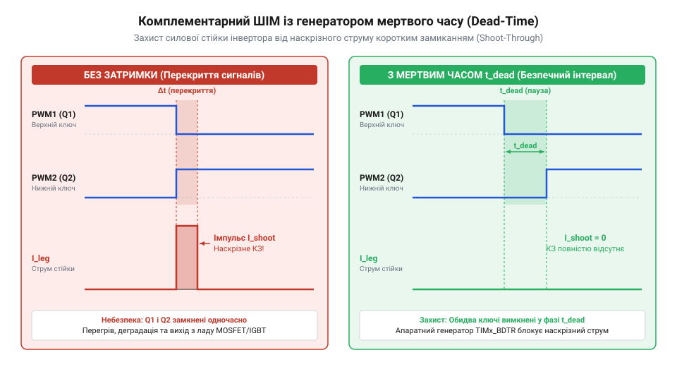

# Розрахунок частот ШІМ, ділітелів таймерів та мертвого часу ключових каскадів

<preknowlist>
- [STM32F072B-DISCO](root:cat-hw-boards/stm32f072b-disco) — базова архітектура таймерів STM32, принципи кодування регістрів ARR і PSC та концепція лічильника CNT
</preknowlist>

## Наскрізні струми в комплементарних ключах

Керування мостовими та півмостовими інверторами живлення вимагає перемикання комплементарної (від лат. @@la|complementum@@ — доповнення) пари силових транзисторів — верхнього (від англ. @@en|High-Side@@) та нижнього (від англ. @@en|Low-Side@@) ключів стійки інвертора. У стаціонарному режимі один із них перебуває у відкритому стані, підключаючи навантаження до шини живлення `V_DC`, а інший — у закритому. Проте під час динамічного перемикання реальні силові ключі (наприклад, @@en|MOSFET@@ або @@en|IGBT@@ транзистори) та їхні гейтові драйвери (від англ. @@en|gate driver@@) затримують зміни стану через накопичення й розряд електричних зарядів у паразитній ємності затвору `C_iss`.

Якщо сформувати ідеально протифазні ШІМ-сигнали без захисного часового інтервалу, виникає ситуація, коли відкриваючий сигнал застосовується до одного ключа раніше, ніж протилежний ключ встигає повністю закритися. Внаслідок цього виникає пряме коротке замикання шини живлення на землю безпосередньо через обидва транзистори стійки. Цей ефект називається наскрізним струмом (від англ. @@en|shoot-through current@@).

Динаміка затримки вимкнення зазвичай перевищує затримку увімкнення. Повний час вимкнення `t_off` складається з затримки вимкнення `t_d(off)` та часу спаду струму `t_f`. Повний час увімкнення `t_on` включає затримку увімкнення `t_d(on)` та час наростання `t_r`. Додатково мікросхема драйвера додає власні час розповсюдження вимкнення `t_pOFF` та час розповсюдження увімкнення `t_pON`. Часовий інтервал перекриття провідного стану двох ключів визначається за такою залежністю:

    t_overlap = (t_pOFF_max + t_off_max) - (t_pON_min + t_on_min)    [визначення тривалості перекриття]

Якщо значення `t_overlap > 0`, упродовж цього інтервалу виникає імпульс наскрізного струму, амплітуда якого описується виразом:

    I_shoot = V_DC / (R_DS(on)1 + R_DS(on)2)                         [амплітуда наскрізного струму]

де `R_DS(on)1` та `R_DS(on)2` — відкриті опори каналів верхнього та нижнього ключа. Оскільки опір відкритих каналів сучасних @@en|MOSFET@@ становить декілька міліом, амплітуда `I_shoot` досягає сотень ампер, що призводить до миттєвого виділення пікової потужності `P_peak = V_DC × I_shoot`. Це викликає швидкий тепловий розгін кристала напівпровідника та його незворотне фізичне руйнування.

Щоб повністю усунути перекриття провідності ключів, у систему вводиться регульована затримка увімкнення кожного з комплементарних сигналів — мертвий час (від англ. @@en|dead time@@).

*Часові діаграми керуючих сигналів комплементарної пари ключових елементів та імпульс наскрізного струму при відсутності захисного інтервалу.*

## Модель частоти та дискретності ШІМ

Формування якісних сигналів широтно-імпульсної модуляції (від англ. @@en|Pulse-Width Modulation@@, @@en|PWM@@) у мікроконтролері @@en|STM32G431@@ покладено на розширені таймери @@en|TIM1@@ та @@en|TIM8@@. Вони тактуються від периферійної шини з частотою `f_TIM` (що сягає до 170 МГц при максимальній швидкодії системи). Для розуміння того, як лічильник `CNT` взаємодіє з регістрами порівняння, корисно опрацювати матеріал про [базову архітектуру таймерів](root:cat-hw-boards/stm32f072b-disco) сімейства STM32.

Базовий період ШІМ задається двома основними регістрами: преддільником (від лат. @@la|prae-@@ та @@uk|ділити@@) `PSC` (від англ. @@en|Prescaler@@) та регістром автоперезавантаження (від грец. @@el|autós@@ та @@uk|перезавантажувати@@) `ARR` (від англ. @@en|Auto-Reload Register@@). Преддільник зменшує тактову частоту таймера `f_TIM` до частоти лічильника `f_CNT = f_TIM / (PSC + 1)`.

Таймер може працювати в одному з двох основних режимів відліку:
1. Односпрямований відлік (від англ. @@en|edge-aligned mode@@): лічильник `CNT` інкрементується від `0` до значення `ARR`, після чого скидається в `0`.
2. Двонапрямлений або симетричний відлік (від англ. @@en|center-aligned mode@@): лічильник `CNT` зростає від `0` до `ARR`, а потім зменшується від `ARR` до `0`. Саме двонапрямлений режим є стандартом у силових інверторах та приводах електродвигунів, оскільки він зменшує вищі гармоніки струму й випромінювані електромагнітні завади.

Частота ШІМ `f_PWM` залежить від вибраного режиму відліку та значень регістрів. Для односпрямованого відліку співвідношення має вигляд:

    f_PWM = f_TIM / ((PSC + 1) × (ARR + 1))                          [частота ШІМ при односпрямованому відліку]

Для двонапрямленого (симетричного) відліку тривалість повного циклу лічильника подвоюється:

    f_PWM = f_TIM / (2 × (PSC + 1) × ARR)                            [частота ШІМ при симетричному відліку]

Дискретність регулювання коефіцієнта заповнення (від англ. @@en|duty cycle@@) визначається кількістю квантів лічильника на один період ШІМ. Розрядність регулювання у бітах `R_bits` та мінімальний крок зміни коефіцієнта заповнення `ΔD` виражаються формулами:

    R_bits = log2(ARR)                                               [розрядність ШІМ у бітах]
    ΔD = 1 / ARR                                                     [дискретність коефіцієнта заповнення]

Оскільки висока дискретність критична для точного позиціонування систем керування, слід прагнути максимального значення `ARR` при мінімально можливому `PSC` (ідеально `PSC = 0`).

**Розрахунок параметрів для симетричного ШІМ інвертора**:

Нехай тактова частота таймера @@en|TIM1@@ становить `f_TIM = 170 МГц`, задана частота ШІМ для мостового інвертора `f_PWM = 100 кГц`, режим відліку — двонапрямлений (симетричний), `PSC = 0`. Обчислимо необхідне значення регістру `ARR`:

    ARR = f_TIM / (2 × (PSC + 1) × f_PWM)                           [виведення ARR з формули симетричного ШІМ]
    ARR = 170 000 000 / (2 × (0 + 1) × 100 000)                      [підстановка значень]
    ARR = 170 000 000 / 200 000                                      [проміжне обчислення]
    ARR = 850                                                        [числове значення ARR]

При `ARR = 850` розрядність регулювання становить `R_bits = log2(850) ≈ 9.73 біт`, а мінімальний крок дискретизації коефіцієнта заповнення дорівнює `ΔD = 1 / 850 ≈ 0.001176` (тобто `0.1176%`).

## Алгоритм дискретизації генератора мертвого часу

У мікроконтролерах @@en|STM32G431@@ апаратну затримку мертвих часів комплементарних каналів розширених таймерів @@en|TIM1@@ та @@en|TIM8@@ виконує генератор мертвого часу (від англ. @@en|Dead-Time Generator@@, @@en|DTG@@). Його конфігурація задається 8-бітним полем `DTG[7:0]` у регістрі керування та блокування @@en|TIMx_BDTR@@ (від англ. @@en|Break and Dead-Time Register@@).

Базовою одиницею відліку для генератора є квант часу `t_DTS` (від англ. @@en|Dead-Time and Sampling Clock@@). Він формується шляхом ділення тактової частоти таймера `f_TIM` за допомогою бітів `CKD[1:0]` (від англ. @@en|Clock Division@@) у регістрі `TIMx_CR1`:
- `CKD = 00`: `t_DTS = t_TIM = 1 / f_TIM` (дільник 1);
- `CKD = 01`: `t_DTS = 2 × t_TIM` (дільник 2);
- `CKD = 10`: `t_DTS = 4 × t_TIM` (дільник 4).

Для забезпечення широкого діапазону регулювання затримок (від декількох наносекунд до мікросекунд) при збереженні високої роздільної здатності на малих часах, апаратний декодер `DTG[7:0]` реалізує чотири макро-діапазони формувальника. Алгоритм декодування залежить від старших бітів байти `DTG[7:0]`:

1. **Діапазон 1** (якщо `DTG[7] = 0`, значення поля `0 ... 127`):

    t_dt = DTG[6:0] × t_DTS                                      [діапазон 0 ... 127 × t_DTS, крок 1 × t_DTS]

2. **Діапазон 2** (якщо біти `DTG[7:6] = 10`, значення поля `128 ... 191`):

    t_dt = (64 + DTG[5:0]) × 2 × t_DTS                           [діапазон 128 ... 254 × t_DTS, крок 2 × t_DTS]

3. **Діапазон 3** (якщо біти `DTG[7:5] = 110`, значення поля `192 ... 223`):

    t_dt = (32 + DTG[4:0]) × 8 × t_DTS                           [діапазон 256 ... 504 × t_DTS, крок 8 × t_DTS]

4. **Діапазон 4** (якщо біти `DTG[7:5] = 111`, значення поля `224 ... 255`):

    t_dt = (32 + DTG[4:0]) × 16 × t_DTS                          [діапазон 512 ... 1008 × t_DTS, крок 16 × t_DTS]

При зворотному розрахунку під задану тривалість затримки `t_dt_req` обчислюється число необхідних тактів `N_ticks = t_dt_req / t_DTS`. Значення `N_ticks` зіставляється з чотирма межами діапазонів, після чого розраховується відповідне значення поля `DTG[7:0]`.

## Розрахунок затримок та кодування регістрів

Для практичної реалізації захисту силового каскаду необхідно звести паспортні характеристики транзисторів та драйвера у єдиний методичний розрахунок. 

Спершу визначаємо максимальний час вимкнення та мінімальний час увімкнення півмоста з урахуванням розкиду параметрів мікросхеми драйвера і силових ключів.

**Умова розрахунку силового каскаду**:
- Тактова частота таймера @@en|STM32G431@@: `f_TIM = 170 МГц` (`t_TIM = 1 / 170 МГц ≈ 5.88235 нс`).
- Параметри драйвера: `t_pOFF_max = 120 нс`, `t_pON_min = 80 нс`.
- Параметри силового MOSFET: `t_d(off)_max = 70 нс`, `t_f_max = 30 нс`, `t_d(on)_min = 25 нс`, `t_r_min = 15 нс`.
- Технічний запас на температурну деградацію та розкид компонентів: `t_margin = 100 нс`.

Обчислимо тривалість захисного мертвого часу:

    t_off_total = t_pOFF_max + t_d(off)_max + t_f_max                [повний час вимкнення плеча]
    t_off_total = 120 + 70 + 30 = 220 нс                             [підстановка значень вимкнення]

    t_on_total = t_pON_min + t_d(on)_min + t_r_min                   [повний час увімкнення плеча]
    t_on_total = 80 + 25 + 15 = 120 нс                               [підстановка значень увімкнення]

    t_dead_min = t_off_total - t_on_total                            [критичний перекривальний час]
    t_dead_min = 220 - 120 = 100 нс                                  [результат мінімального інтервалу]

    t_dead_req = t_dead_min + t_margin                               [необхідний мертвий час із запасом]
    t_dead_req = 100 + 100 = 200 нс                                  [підсумкове значення мертвого часу]

Тепер виберемо квантування часу `t_DTS`. Встановивши біти `CKD = 00` у регістрі `TIM1->CR1`, маємо `t_DTS = t_TIM = 5.88235 нс`. 

Розрахуємо необхідну кількість тактів:

    N_ticks = t_dead_req / t_DTS                                     [кількість тактів затримки]
    N_ticks = 200 / 5.88235 ≈ 34.0                                   [число тактів]

Оскільки `N_ticks = 34` потрапляє у першу зону (`0 ... 127`), застосовуємо формулу першого діапазону (`DTG[7] = 0`):

    DTG[6:0] = 34 = 0x22                                             [кодування поля DTG]

Фактично сформований апаратний мертвий час дорівнюватиме:

    t_dt_actual = 34 × 5.88235 нс = 200.0 нс                         [фактична апаратна затримка]

Для запису в регістр @@en|TIM1_BDTR@@ значення `DTG[7:0] = 0x22` розміщується у молодших 8 бітах. Нижче наведено код прямими маніпуляціями з регістрами для конфігурації таймера @@en|TIM1@@:

:::code math-weact-stm32g431-pwm-deadtime-timer-calc/c/stm32g431/snippet-1.c
