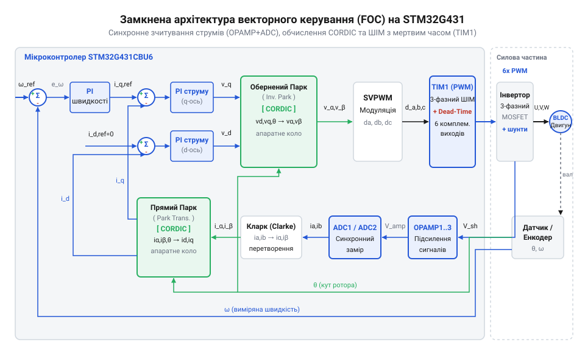
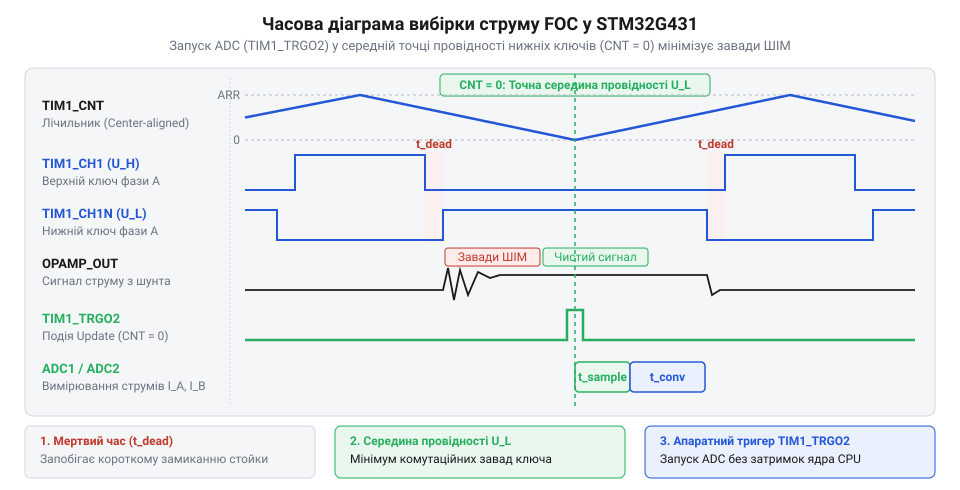

# Проєкт векторного керування безколекторним двигуном FOC на платі WeAct STM32G431

<preknowlist>
- [STM32F072B-DISCO (Discovery, Cortex-M0)](root:cat-hw-boards/stm32f072b-disco) — розуміння базової архітектури ядра Cortex-M, ініціалізації периферії через HAL/LL та обмежень обчислень без апаратного прискорювача
</preknowlist>

## Проблема керування BLDC і векторний підхід

При керуванні безколекторними двигунами постійного струму (англ. @@en|Brushless DC Motor@@, @@en|BLDC@@) традиційними скалярними або 6-кроковими трапецеїдальними методами розробник неминуче стикається з обмеженням ефективності та високим рівнем пульсацій крутного моменту. Трапецеїдальне керування поодинці комутує дві з трьох фазних обмоток кожні 60 електричних градусів. Таке дискретне перемикання створює стрибки магнітного потоку статора й нерівномірну електромагнітну силу, що викликає акустичний шум, вібрації механіки та значні втрати енергії на нагрів.

Щоб усунути пульсації та досягти максимального ККД, застосовують векторне керування (англ. @@en|Field-Oriented Control@@, @@en|FOC@@; від лат. *vector* — той, що везе). Ідея @@en|FOC@@ полягає у підтримці строго ортогонального (під кутом 90°) кута між вектором магнітного поля ротора (постійних магнітів) і вектором магнітного поля статора, яке створюється трифазними струмами. Для цього трифазна змінна система струмів `i_A`, `i_B`, `i_C` математично перераховується в обертову систему координат, прив'язану до ротора.

Перший крок — перетворення Кларка (англ. @@en|Clarke transformation@@), яке переводить трифазну стаціонарну систему струмів у двофазну декартову систему `i_alpha`, `i_beta` на площині статора:

```
i_alpha = i_A
i_beta  = (i_A + 2 × i_B) ÷ √3      [за умови симетрії фаз i_A + i_B + i_C = 0]
```

Другий крок — перетворення Парка (англ. @@en|Park transformation@@), яке обертає оси `alpha`, `beta` на поточний електричний кут ротора `theta`, преобразуючи їх у синхронні оси `d` (пряма, англ. @@en|direct axis@@) та `q` (квадратурна, англ. @@en|quadrature axis@@):

```
i_d =  i_alpha × cos(theta) + i_beta × sin(theta)
i_q = -i_alpha × sin(theta) + i_beta × cos(theta)
```

В осі `q` сконцентровано весь струм, що створює корисний обертальний момент, а струм в осі `d` створює радіальне стискальне поле. У стандартному режимі уставильне значення `i_d` підтримують рівним нулю, що забезпечує максимальну питому потужність. Для роботи на надвисоких швидкостях застосовують алгоритми [польового ослаблення](root:hw-motion/foc-field-weakening), подаючи від'ємний струм по осі `d`. При відсутності фізичного датчика положення кут `theta` розраховують за допомогою алгоритмів [безсенсорного визначення положення](root:hw-motion/bldc-sensorless-observer).

Для практичної реалізації замкненого @@en|FOC@@-контролера мікроконтролер має виконувати перетворення й розрахунок регуляторів із частотою ШІМ (типово 20 кГц, тобто кожні 50 мкс). На відміну від простих рішень на [базовій платі STM32F072B](root:cat-hw-boards/stm32f072b-disco), мікроконтролер @@en|STM32G431@@ оснащено апаратним співпроцесором @@en|CORDIC@@ та спеціалізованою аналоговою периферією, що дає змогу розраховувати тригонометрію та зчитувати струми за частки мікросекунди.


*Схема замкненого контуру FOC: перетворення Кларка й Парка виділяють струми осей d і q, ПІ-регулятори формують напруги, а співпроцесор CORDIC та модуль SVPWM розраховують коефіцієнти заповнення ШІМ.*

:::tabs
@tab C
:::code proj-weact-stm32g431-foc-bldc-controller/c/foc.c 77-93
@tab C++
:::code proj-weact-stm32g431-foc-bldc-controller/cpp/src/cordic_math.cpp 50-69
:::

## Генерація трифазного ШІМ з мертвим часом

Після того як ПІ-регулятори струму обчислили необхідні вихідні напруги `v_d` та `v_q` і зворотне перетворення Парка дало напруги `v_alpha` та `v_beta`, потрібно сформувати силі силові імпульси для 6 транзисторів трифазного інвертора. Кожна фаза двигуна підключена до напівмоста з двох силових ключів (верхнього та нижнього). Якщо обоє транзисторів напівмоста відкриються одночасно, станеться наскрізне коротке замикання шини живлення `V_dc`, що миттєво виведе з ладу силові ключі.

Для безпечного керування силовим каскадом застосовують комплементарну широтно-імпульсну модуляцію (англ. @@en|Pulse-Width Modulation@@, @@en|PWM@@; від лат. *modulatio* — розміреність) із мертвим часом (англ. @@en|dead time@@). Мертвий час — це апаратно вносима затримка між вимкненням одного ключа напівмоста та увімкненням іншого, під час якої обидва ключі заперті. Це дає змогу зарядам розсмоктатися в затворах МОП-транзисторів.

На платі @@en|WeAct STM32G431@@ за генерацію трифазного ШІМ відповідає 16-бітний просунутий таймер @@en|TIM1@@. Для мінімізації гармонійних завад таймер налаштовують у центрований режим лічби (англ. @@en|Center-aligned PWM Mode 1@@). У цьому режимі інкрементний лічильник рахує від `0` до значення автоперезавантаження `ARR`, а потім реверсує напрямок і декрементує до `0`.

При частоті ядра `170 МГц` і цільовій частоті ШІМ `20 кГц` значення `ARR` розраховують за формулою:

```
ARR = f_sys ÷ (2 × f_pwm)
    = 170000000 ÷ (2 × 20000)    [період двонапрямної лічби дорівнює 2 × ARR тактів]
    = 4250
```

Тривалість мертвого часу задається в регістрі `TIM1->BDTR` за допомогою генератора `DTG`. Для комутації виходів таймер генерує комплементарні пари сигналів (`CH1`/`CH1N`, `CH2`/`CH2N`, `CH3`/`CH3N`), а головний біт дозволу виходів `MOE` (англ. @@en|Main Output Enable@@) забезпечує миттєве блокування інвертора при аварійних подіях.

Замість класичної синусоїдальної модуляції застосовують просторово-векторну модуляцію (англ. @@en|Space Vector PWM@@, @@en|SVPWM@@). Вона додає до фазних напруг потрійну гармоніку нульової послідовності `v_zero`:

```
v_zero = 0.5 × (max(v_A, v_B, v_C) + min(v_A, v_B, v_C))
```

Це зміщення піднімає коефіцієнт використання напруги шини живлення `V_dc` на 15.5% (до значення `2 / √3 ≈ 1.155`), порівняно зі звичайним синусом, запобігаючи передчасному насиченню ШІМ.

:::tabs
@tab C
:::code proj-weact-stm32g431-foc-bldc-controller/c/foc.c 95-128
@tab C++
:::code proj-weact-stm32g431-foc-bldc-controller/cpp/src/cordic_math.cpp 71-96
:::

:::tabs
@tab C
:::code proj-weact-stm32g431-foc-bldc-controller/c/mcu_periph.c 24-49
@tab C++
:::code proj-weact-stm32g431-foc-bldc-controller/cpp/src/tim1_pwm.cpp 41-76
:::

## Вимірювання фазних струмів OPAMP і ADC

Для зворотного зв'язку за струмом @@en|FOC@@-контролер має точно зчитувати фазні струми двигуна на кожному такті ШІМ. Проте вимірювання струму через низькоомні шунти (наприклад, `10 мОм`) у симетричних напівмостах супроводжується потужними комутаційними завадами. Сигнали з шунтів мають амплітуду в десятки мілівольт, які плавають відносно силової землі при перемиканні транзисторів.

Мікроконтролер @@en|STM32G431@@ вирішує цю проблему за допомогою вбудованих операційних підсилювачів @@en|OPAMP1@@ та @@en|OPAMP2@@. Їх налаштовують у режим підсилювача із програмованим коефіцієнтом підсилення (англ. @@en|Programmable Gain Amplifier@@, @@en|PGA@@, наприклад `Gain = 16`). Масштабований аналоговий сигнал подається безпосередньо на внутрішні канали аналогово-цифрового перетворювача (англ. @@en|Analog-to-Digital Converter@@, @@en|ADC@@). Це усуває потребу у зовнішніх вимірювальних операційних підсилювачах на платі.

Якщо виконати вибірку АЦП у довільний момент часу, виміряне значення буде спотворено високовольтними спайками від відкриття й закриття силових ключів. Щоб отримати чистий сигнал, вибірку АЦП синхронізують із таймером @@en|TIM1@@. Завдяки центруванню ШІМ, у моменти досягнення лічильником `TIM1` вершин або низин (коли нижні ключі інвертора повністю відкриті), струм у шунтах протікає стабільно, а комутаційні завади дорівнюють нулю. Таймер @@en|TIM1@@ генерує апаратний тригер `TRGO2` (через канал `CCR4`), який ініціює одночасне інжектоване перетворення в `ADC1` та `ADC2`.

Оскільки в трифазній ізольованій системі сума фазних струмів за першим законом Кірхгофа завжди дорівнює нулю (`i_A + i_B + i_C = 0`), достатньо виміряти струми лише двох фаз `i_A` та `i_B`. Струм третьої фази відновлюється програмно:

```
i_C = -i_A - i_B
```

Перед запуском ШІМ виконується автоматичне калібрування зсуву нуля (англ. @@en|zero-current offset calibration@@). У стані спокою, коли через обмотки струм не тече, АЦП зчитує опорну напругу зсуву підсилювача (типово біля `2048` відліків для 12-бітного АЦП). Отриманий зсув зберігається й віднімається від кожного наступного сирого виміру.


*Часове узгодження лічильника TIM1 у центрованому режимі, генерації комплементарних сигналів із мертвим часом та тригерного стробування TRGO2 для вибірки струму в момент мінімуму комутаційних завад.*

:::tabs
@tab C
:::code proj-weact-stm32g431-foc-bldc-controller/c/mcu_periph.c 67-83
@tab C++
:::code proj-weact-stm32g431-foc-bldc-controller/cpp/src/adc_opamp.cpp 14-73
:::

## Прискорення векторної математики співпроцесором CORDIC

Після того як виміряні фазні струми перетворено у нерухому систему координат, контролер мусить обчислити їхні проекції на обертові осі d і q. Для цього в кожному циклі розрахунку векторного керування необхідно знайти тригонометричні значення синуса та косинуса електричного кута ротора. Якщо виконувати ці обчислення програмно через стандартні математичні функції або поліноміальні наближення, ядро мікроконтролера витрачає десятки циклів тактового генератора. У системах реального часу із частотою ШІМ 20 кГц період обробки переривання становить усього 50 мкс, тому програмна тригонометрія швидко вичерпує обчислювальний ресурс CPU.

Для розв'язання цієї проблеми в мікроконтролері STM32G431 передбачено апаратний співпроцесор @@en|CORDIC@@ (англ. @@en|Coordinate Rotation Digital Computer@@, від *coordinate rotation digital computer* — цифровий обчислювач повороту координат). Він реалізує ітераційний алгоритм обертання вектора на фіксованій системі зсувів та додавань, виконуючи обчислення синуса й косинуса у форматі з фіксованою точкою всього за 4–6 тактів.

Перед подачею кута в апаратний модуль значення кута в радіанах необхідно нормалізувати до діапазону [-π, π] та перевести у 32-бітний формат із фіксованою точкою Q1.31, де число 1.0 відповідає куту π радіан:

```
q31_angle = (angle_rad / π) · 2147483648       [переведення кута у формат Q1.31]
```

Отримавши значення cos(θ) та sin(θ) від CORDIC, контролер виконує пряме перетворення Кларка для переходу від 3-фазних струмів i_A, i_B до двофазних i_alpha, i_beta, після чого застосовує пряме перетворення Парка для отримання струмів i_d, i_q:

```
i_alpha = i_a                                  [компонента Кларка по осі alpha]
i_beta  = (i_a + 2.0 · i_b) · 0.57735027       [компонента Кларка по осі beta]

i_d     =  i_alpha · cos(θ) + i_beta · sin(θ)  [поздовжній струм осі d]
i_q     = -i_alpha · sin(θ) + i_beta · cos(θ)  [квадратурний струм осі q]
```

На відміну від [простіших ядер Cortex-M0](root:cat-hw-boards/stm32f072b-disco), де тригонометричні обчислення створюють високе обчислювальне навантаження, використання CORDIC дозволяє виконати векторне перетворення майже миттєво.

Програмне керування апаратним модулем CORDIC та виконання прямого перетворення реалізовано у драйвері периферії:

:::tabs
@tab C
:::code proj-weact-stm32g431-foc-bldc-controller/c/mcu_periph.c 87-101
@tab C++
:::code proj-weact-stm32g431-foc-bldc-controller/cpp/src/cordic_math.cpp 14-62
:::

Завдяки CORDIC період тригонометричного розрахунку скорочується з десятків мікросекунд до часток мікросекунди, звільняючи обчислювальне ядро для виконання задач регулювання та діагностики.

## Побудова замкнених контурів керування струмом

Перетворення фазних струмів у систему координат d-q дозволяє керувати електромагнітним моментом і магнітним потоком двигуна як двома незалежними величинами постійного струму. Струм квадратурної осі i_q прямо пропорційний створюваному обертальному моменту, тоді як струм поздовжньої осі i_d відповідає за намагнічування ротора. У класичному режимі FOC задане значення струму i_d підтримується рівним нулю для мінімізації втрат, а струм i_q задає необхідний момент.

Для формування необхідних напруг v_d та v_q застосовуються два незалежні Пропорційно-Інтегральні (ПІ) регулятори. У дискретній формі алгоритм регулювання розраховується на кожному такті ШІМ:

```
e_d(k)      = target_i_d - i_d(k)               [помилка розсогласування осі d]
p_term_d    = Kp_d · e_d(k)                     [пропорційний вплив осі d]
i_term_d    = i_term_d + Ki_d · e_d(k) · dt     [інтегральний вплив осі d]
v_d_raw     = p_term_d + i_term_d               [необмежена напруга осі d]
```

При різких змінах навантаження або розгоні вихідне значення напруги регулятора може перевищити фізично можливу напругу силової шини. У такому разі інтегральна сума продовжує безмежно зростати, що призводить до явища інтегрального насичення. Для запобігання цьому застосовується механізм @@en|anti-windup protection@@ (англ. @@en|anti-windup protection@@, від *wind up* — закручування або накопичення інтеграла). Його суть полягає у заморожуванні накопичення інтегральної суми, якщо розрахований керуючий вплив виходить за встановлені межі обмеження.

Отримані значення напруг v_d та v_q за допомогою зворотного перетворення Парка перевозяться у стаціонарну систему координат (v_alpha, v_beta):

```
v_alpha = v_d · cos(θ) - v_q · sin(θ)          [зворотне перетворення Парка alpha]
v_beta  = v_d · sin(θ) + v_q · cos(θ)          [зворотне перетворення Парка beta]
```

Далі використовується алгоритм просторово-векторної модуляції @@en|SVPWM@@ (англ. @@en|Space Vector PWM@@, від *space vector pulse-width modulation* — просторово-векторна широтно-імпульсна модуляція). Для максимального використання напруги шини живлення до фазних напруг додається гармоніка нульової послідовності (інжекція нульової послідовності), що зсуває фазні сигнали до центру діапазону ШІМ:

```
v_a = v_alpha                                  [початкова напруга фази A]
v_b = -0.5 · v_alpha + 0.8660254 · v_beta      [початкова напруга фази B]
v_c = -0.5 · v_alpha - 0.8660254 · v_beta      [початкова напруга фази C]

v_zero = 0.5 · (max(v_a, v_b, v_c) + min(v_a, v_b, v_c)) [інжектований зсув]
d_a = clamp((v_a - v_zero) / V_bus + 0.5, 0.0, 1.0)      [коефіцієнт заповнення ШІМ фази A]
```

Програмна реалізація ПІ-регулятора з анти-віндапом та обчислення швидкісного контуру струму представлена нижче:

:::tabs
@tab C
:::code proj-weact-stm32g431-foc-bldc-controller/c/foc.c 18-34
:::code proj-weact-stm32g431-foc-bldc-controller/c/foc.c 130-160
@tab C++
:::code proj-weact-stm32g431-foc-bldc-controller/cpp/src/pi_controller.cpp 23-46
:::code proj-weact-stm32g431-foc-bldc-controller/cpp/src/foc_controller.cpp 50-86
:::

Завдяки захисту від інтегрального насичення та оптимізованій SVPWM модуляції контур струму відпрацьовує стрибки навантаження без перерегулювання за мінімальний час.

## Інтеграція контуру швидкості та налагодження

Для точного підтримки заданої частоти обертання вала двигуна поверх внутрішнього контуру струму будується зовнішній контур регулювання швидкості. Така двоконтурна підсистема утворює каскадну структуру регулювання (англ. @@en|cascade control system@@). Зовнішній ПІ-регулятор швидкості порівнює задане значення кутової швидкості із фактичним значенням, отриманим від датчика положення або алгоритму [безсенсорного визначення кута](root:hw-motion/sensorless-flux-observer). Виходом регулятора швидкості є уставильний струм квадратурної осі i_q_ref, який визначає необхідний обертальний момент.

Оскільки механічна стала часу ротора значно перевищує електричну сталу часу фазних обмоток, контур швидкості не потребує виконання на кожному такті ШІМ. Застосовується часове квантування обробки переривань (англ. @@en|multirate sampling@@): внутрішній контур струму виконується синхронно з вибіркою АЦП на частоті 20 кГц (період 50 мкс), а зовнішній контур швидкості оновлюється з частотою 1 кГц (період 1 мс).

Для досягнення швидкостей, що перевищують номінальні значення при обмеженій напрузі шини живлення, у розширених алгоритмах використовують [алгоритми ослаблення поля](root:hw-motion/field-weakening-control), шляхом подачі негативного струму i_d.

Під час практичного налагодження FOC-системи на платі @@en|WeAct STM32G431@@ ключовим етапом є автоматичне калібрування нуля струмових вимірювальних підсилювачів OPAMP. Перед запуском силового ШІМ мікроконтролер виконує серію зчитувань АЦП при нульовому струмі фаз для визначення статичного зсуву raw_offset_a та raw_offset_b. Помилка калібрування зсуву нуля всього на декілька одиниць АЦП викликає появу пульсацій струму з частотою обертання ротора.

Організація обробника переривання АЦП та фонового циклу керування швидкістю показана на прикладі коду:

:::tabs
@tab C
:::code proj-weact-stm32g431-foc-bldc-controller/c/main.c 45-70
@tab C++
:::code proj-weact-stm32g431-foc-bldc-controller/cpp/src/main.cpp 14-25
:::code proj-weact-stm32g431-foc-bldc-controller/cpp/src/main.cpp 75-88
:::

Правильний розподіл обчислювального навантаження між перериванням АЦП та фоновим циклом гарантує стабільну роботу двигуна без пропусків тактів ШІМ і забезпечує високу завадостійкість керування.
