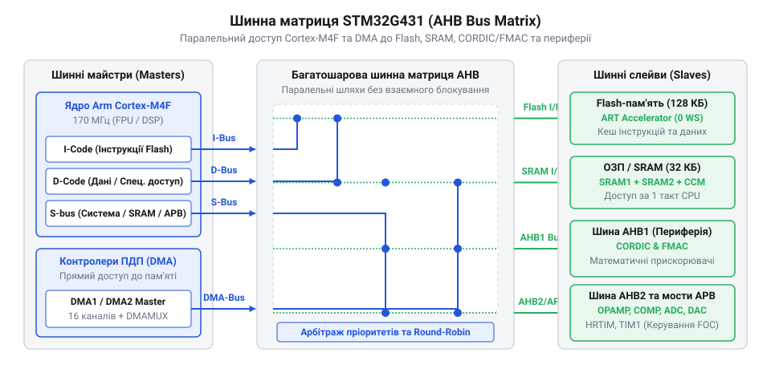
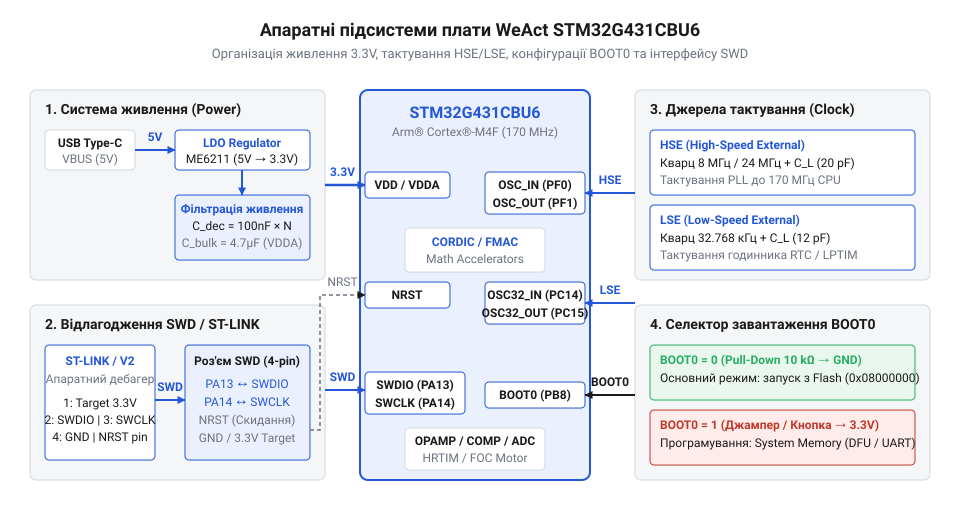
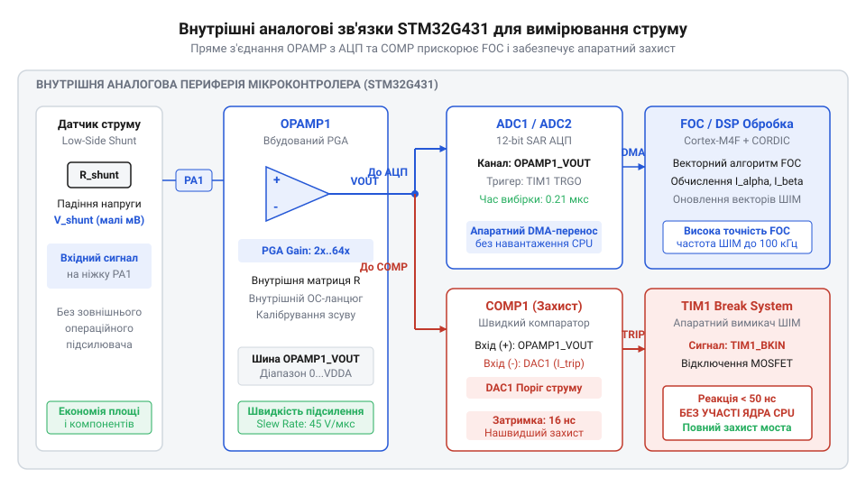
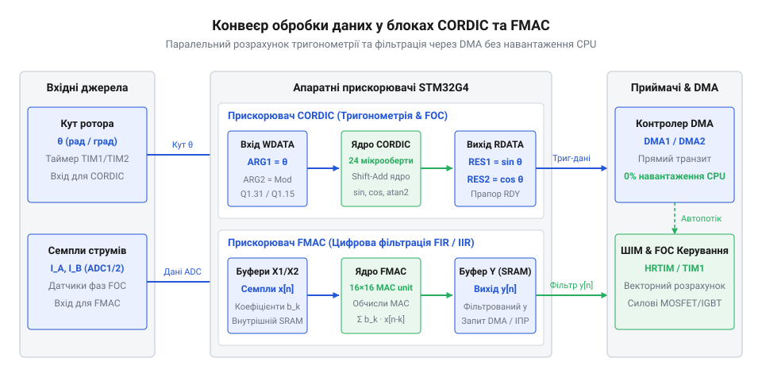
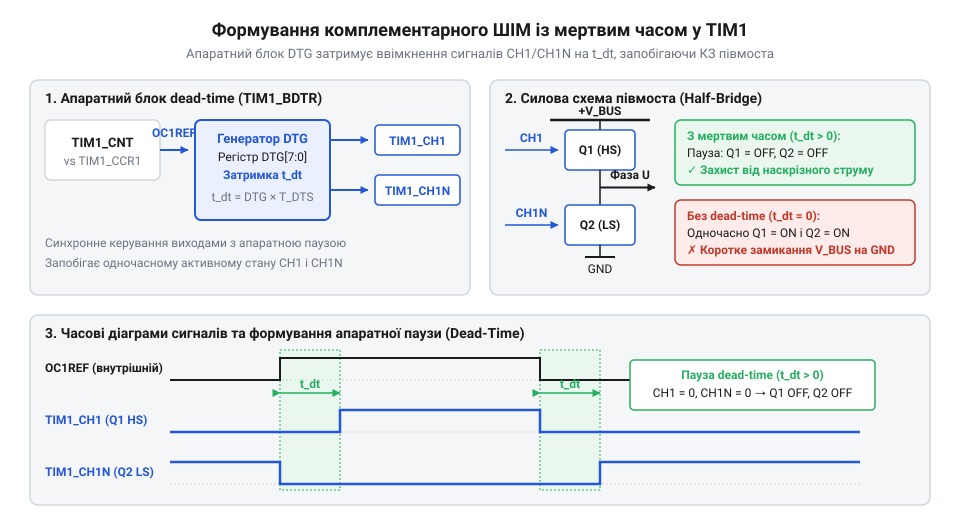

# WeAct STM32G431CBU6

<preknowlist>
- [STM32F072B-DISCO (Discovery, Cortex-M0)](root:cat-hw-boards/stm32f072b-disco) — Базове розуміння екосистеми мікроконтролерів STM32, архітектури ядер ARM Cortex та систем взаємодії з периферією.
</preknowlist>

## Архітектура ядра Cortex-M4F та системна концепція

Складні задачі цифрового керування електроприводом та вимірювальною периферією у розробці вбудованих систем швидко впираються у ліміт обчислювальної потужності класичних 8-бітних та 32-бітних мікроконтролерів початкового рівня. При виконанні матричних перетворень та розрахунку тригонометричних алгоритмів векторного керування класичні ядра змушені витрачати сотні тактів процесора на емуляцію операцій із дробовими числами. Потреба у швидкій обробці аналогових сигналів у реальному часі зумовила появу мікроконтролера `STM32G431CBU6` на високопродуктивній платі `WeAct Studio` (англ. @@en|WeAct Studio@@). В основі модуля лежить 32-бітне процесорне ядро `Arm Cortex-M4F` (англ. @@en|Arm Cortex-M4F@@), яке працює на тактовій частоті до `170 МГц` і містить апаратний математичний співпроцесор `FPU` (англ. @@en|FPU@@, від @@en|Floating-Point Unit@@ — блок обчислень із плаваючою крапкою, від лат. @@la|fluctuans@@ — рухомий, плаваючий). На відміну від базових платформ, таких як [оцінна плата STM32F072B-DISCO](root:cat-hw-boards/stm32f072b-disco) на ядрі `Cortex-M0`, наявність блоку `FPU` стандарту `IEEE 754` дає змогу виконувати апаратне додавання, віднімання та множення чисел із плаваючою крапкою одиночної точності всього за один системний такт. Потужність обчислень додатково підсилюється набором інструкцій цифрової обробки сигналів @@en|DSP@@ та розширень @@en|SIMD@@ (англ. @@en|Single Instruction, Multiple Data@@ — одна інструкція, багато даних): апаратна логіка ядра дає змогу пакувати два 16-бітних відліки сигналів у єдиний 32-бітний регістр і виконувати їхнє паралельне множення з накопиченням у команді `SMLAD` за один процесорний такт із захистом від арифметичного переповнення.

Порівняльний аналіз часових витрат ядра при обчисленні прямих та обернених перетворень Кларка й Парка (англ. @@en|Park/Clarke transforms@@) показує виражене скорочення затримок при переході від програмного середовища `soft-fp` до апаратного блоку `FPU`:

| Режим / Архітектура обчислень | Описова характеристика інструкцій | Витрати на перетворення Кларка (тактив) | Витрати на перетворення Парка (тактив) | Сумарні затримки FOC-вектора (тактив) |
|---|---|---|---|---|
| Програмна емуляція (без FPU, Cortex-M0) | Виклики `soft-fp` (`__aeabi_fmul`, `__aeabi_fadd`) | 120–180 | 180–270 | 300–450 |
| Фіксована кома Q31 (без FPU, Cortex-M3) | Цільові макроси з вирівнюванням та зсувами | 35–55 | 55–85 | 90–140 |
| Апаратний FPU (Cortex-M4F, IEEE 754) | Однотактові команди `vmul.f32`, `vadd.f32`, `vfma.f32` | 6–10 | 10–18 | 16–28 |
| FPU + прискорювач CORDIC (STM32G431) | Паралельний обчислювач тригонометрії без CPU | 4–6 | 4–8 | 8–14 |

Таке прискорення обчислень у 15–30 разів вивільняє понад 90% обчислювальних ресурсів ядра `Arm Cortex-M4F`, дозволяючи мікроконтролеру `STM32G431CBU6` здійснювати високочастотну контурну обробку струмів на частотах ШІМ до 100 кГц без загрози пропуску контурних ітерацій.


*Схема шинної матриці AHB/APB та зв'язку ядра Cortex-M4F з пам'яттю Flash/SRAM і периферією.*

Для усунення затримок при зчитуванні команд із внутрішньої спалах-пам'яті `Flash` обсягом `128 кБ` у SoC впроваджено спеціалізований прискорювач пам'яті `ART Accelerator` (англ. @@en|ART Accelerator@@, від @@en|Adaptive Real-Time Memory Accelerator@@ — адаптивний прискорювач пам'яті реального часу). При роботі ядра на частоті `170 МГц` прямий шинний доступ до флеш-пам'яті вимагає впровадження від 4 до 8 тактів очікування `@@en|latency@@`. Прискорювач `ART Accelerator` реалізує функціонал кеш-пам'яті інструкцій `I-Cache` та даних `D-Cache` обсягом по 2 КБ (розбитих на сторінки завширшки 128 біт), а також лінійний блок попередньої вибірки `@@en|prefetch buffer@@`. Під час послідовного виконання коду блок `@@en|prefetch buffer@@` фоново зчитує 128-бітові рядки інструкцій за один шинний такт наперед. Однак при умовних або безумовних розгалуженнях коду (команди переходів `B`, `BL`, виклики функцій та переривання) лінійний потік порушується: якщо адреса переходу відсутня в кеш-рядках `I-Cache`, відбувається промах кешу (англ. @@en|cache miss penalty@@), що змушує ядро чекати повні 4–8 тактів на зчитування нової сторінки з спалах-пам'яті. Якщо ж тіло циклу обробки (наприклад, алгоритм `FOC`) повністю вміщується у виділені сторінки кешу, наступні ітерації виконуються без промахів із нульовими тактами затримки `0 wait states`, досягаючи максимальної швидкодії у `213 DMIPS` (англ. @@en|DMIPS@@, від @@en|Dhrystone MIPS@@ — мільйон інструкцій на секунду за тестом Драйстон). Багатошарова шинна матриця `AHB/APB` (англ. @@en|AHB/APB@@, від @@en|Advanced High-Performance Bus / Advanced Peripheral Bus@@) забезпечує паралельний доступ ядра, контролера `DMA` та периферійних модулів до двох незалежних блоків оперативної пам'яті `SRAM` загальним обсягом `32 кБ` без взаємних блокувань шини. Загальний огляд лінійки та її архітектурні відмінності висвітлює [родина мікроконтролерів STM32G4](root:hw-arch/stm32g4-family-overview), а передумови створення конкретної серії описує [історія еволюції серії STM32G4](root:cat-hw-boards/stm32g431-weact/hist-weact-stm32g431-evolution.md).

Крім апаратної розв'язки шинної матриці, для захисту системної пам'яті `SRAM` від випадкового викривлення даних або несанкціонованого перезапису з боку потенційно незахищеного коду в ядрі `Cortex-M4F` впроваджено апаратний блок захисту пам'яті `MPU` (англ. @@en|MPU@@, від @@en|Memory Protection Unit@@ — блок захисту пам'яті). Блок `MPU` дозволяє розбивати адресний простір на 8 незалежно конфігурованих регіонів із визначенням суворих прав доступу (зокрема тільки для читання `Read-Only` або із забороною виконання інструкцій `XN`, від англ. @@en|eXecute Never@@ — заборона виконання коду). При спробі виконання коду з даних буфера `SRAM` або запису у зарезервовану системну область апаратна логіка ядра негайно блокує транзакцію та генерує системний виняток `MemManage Fault` (англ. @@en|MemManage Fault@@, від @@en|Memory Management Fault@@ — виняток помилки керування пам'яттю), що зупиняє виконання небезпечних команд і запобігає руйнуванню векторних алгоритмів керування в реальному часі.

Додатково ядро `Cortex-M4F` збагачене апаратним набором інструкцій для цифрової обробки сигналів `DSP` (англ. @@en|DSP@@, від @@en|Digital Signal Processing@@ — цифрова обробка сигналів), включаючи інструкції накопичення множення `SIMD` (англ. @@en|SIMD@@, від @@en|Single Instruction, Multiple Data@@ — одна інструкція, багато даних) та насиченої арифметики. Зокрема, спеціалізовані розширення на кшталт `SMLAD` дають змогу пакувати два 16-бітних відліки сигналів у єдиний 32-бітний регістр і виконувати їхнє паралельне множення на коефіцієнти фільтра з накопиченням у 64-бітному акумуляторі всього за один такт процесора. Таке апаратне сумування захищає від арифметичного переповнення та прискорює обчислення цифрових фільтрів і миттєвий розрахунок векторів реального часу в [основах векторного керування FOC](root:hw-motion/foc-control), що неможливо на базовому ядрі [навчальної плати STM32F072B-DISCO](root:cat-hw-boards/stm32f072b-disco).

## Схемотехніка живлення, тактування та налагодження

Надійна робота високочастотного мікроконтролера вимагає ретельного проєктування схемотехніки підключення живлення та джерел тактування на друкованій платі. Модуль `WeAct STM32G431CBU6` живиться від зовнішнього джерела 5 В через роз'єм `USB Type-C` або окремі виводи шини. Для забезпечення чистою напругою системних ядер на платі встановлено лінійний регулятор `LDO` (англ. @@en|LDO@@, від @@en|Low Dropout Regulator@@ — регулятор напруги з малим падінням), який знижує вхідну напругу до `3.3 В`. Внутрішнє цифрове ядро чипа вимагає ще нижчої напруги `VCORE` (близько `1.2 В`), яка формується вбудованим регулятором напруги `@@en|main voltage regulator@@`. Для зниження завад аналогово-цифрових перетворень аналогова лінія живлення `VDDA` та опорна напруга `VREF+` розв'язані від цифрової шини за допомогою фільтруючих керамічних конденсаторів та феритових бусин. Оптимальна схема фільтрації передбачає паралельне підключення керамічного конденсатора ємністю `10 мкФ` (тип `X5R` для низькочастотної згладжувальної компенсації) та малоіндуктивного високочастотного конденсатора ємністю `100 нФ` (тип `X7R` з низьким еквівалентним послідовним опором `ESR < 10 мОм`), які розводять у безпосередній близькості (не далі 2 мм) до виводів `VDDA` та `VREF+`. Такий двоступеневий розв'язувальний вузол ефективно пригнічує як низькочастотні пульсації джерела, так і високочастотні завади перемикання цифрових шин на частотах понад 10 МГц, зберігаючи високу точність вимірювань АЦП.


*Схема системи живлення, кварцових резонаторів HSE/LSE, селектора завантаження BOOT0 та порту SWD.*

Система тактування плати спирається на два зовнішні кварцові резонатори: високочастотний резонатор `HSE` (англ. @@en|HSE@@, від @@en|High-Speed External@@ — зовнішнє високочастотне джерело тактування) частотою `8 МГц` та низькочастотний годинниковий резонатор `LSE` (англ. @@en|LSE@@, від @@en|Low-Speed External@@ — зовнішнє низькочастотне джерело тактування) частотою `32.768 кГц` для системного годинника реального часу `RTC`. Сигнал від `HSE` подається на вхід блоку фазового автопідлаштування частоти `PLL` (англ. @@en|PLL@@, від @@en|Phase-Locked Loop@@ — фазове автопідлаштування частоти), де ділиться входженням `PLLM = 2`, множиться конфігурацією `PLLN = 85` та ділиться дільником `PLLR = 2`, що примножує частоту до максимальних `170 МГц` для ядра та системної шини `AHB`. Співвідношення коефіцієнтів ділення та множення блоку `@@en|PLL@@` визначає як кінцеву системну частоту `f_SYSCLK`, так і рівень накопиченого періодного фазового джитера `@@en|phase jitter@@` (англ. @@en|phase jitter@@ — фазове тремтіння тактового сигналу). Покроковий розрахунок частотного конвеєра та середньоквадратичного фазового джитера `sigma_SYSCLK` при вхідній нестабільності кварцового резонатора `sigma_HSE = 2.5 пс` подається наступним чином:

Для безкварцового живлення периферії `USB` мікроконтролер `STM32G431CBU6` має внутрішній підналагоджувальний `RC`-генератор `@@en|HSI48@@` на 48 МГц, який усуває потребу у високоточному зовнішньому резонаторі `HSE`. Програмна ініціалізація вимагає увімкнення генератора встановленням біта `HSI48ON` у регістрі `RCC_CRRCR` та очікування прапорця готовності `HSI48RDY`. Апаратна затримка виходу осцилятора на робочий режим становить `t_STARTUP = 6 мкс`, що при системній частоті `f_SYSCLK = 170 МГц` вимагає циклу очікування тривалістю `N_cycles = 1020` тактів ядра. Після стабілізації `HSI48` комутують на периферію через поле `CLK48SEL` регістра `RCC_CCIPR` та вмикають систему автопідлаштування `@@en|CRS@@` (англ. @@en|Clock Recovery System@@ — система автопідлаштування частоти тактування; `@@en|CRS@@`). Система `@@en|CRS@@` автоматично коригує частоту `HSI48` за маркерами кадру `@@en|USB SOF@@` (англ. @@en|Start of Frame@@ — початковий маркер кадру; `@@en|USB SOF@@`), що утримує відхилення в межах суворих вимог специфікації `@@en|USB 2.0 Full-Speed@@` (±0.25%).

```
f_VCO_IN = f_HSE ÷ PLLM
         = 8 ÷ 2              [ділення вхідного кварцу 8 МГц]
         = 4 МГц              [вхідна частота генератора VCO]

f_VCO_OUT = f_VCO_IN × PLLN
          = 4 × 85            [множення фактором PLLN]
          = 340 МГц           [частота внутрішнього осцилятора VCO]

f_SYSCLK = f_VCO_OUT ÷ PLLR
         = 340 ÷ 2            [вивідне ділення дільником PLLR]
         = 170 МГц            [системна тактова частота]

sigma_SYSCLK = sigma_HSE × √ ( PLLN ÷ PLLM )
             = 2.5 × √ ( 85 ÷ 2 )       [коефіцієнт підсилення фазового шуму PLL]
             ≈ 2.5 × 6.52               [обчислення квадратного кореня]
             ≈ 16.3 пс                  [підсумковий СВК фазовий джитер періоду]
```

Отриманий рівень фазового джитера `16.3 пс` складає менше ніж 0.28% від періоду тактування `T_SYSCLK = 5.88 нс`, що повністю задовольняє вимоги до апертурної невизначеності АЦП та не спричиняє фазових похибок при формування високочастотних сигналів ШІМ силових таймерів. Отримана системна частота розподіляється між периферійними шинами через програмовані дільники `PPRE1` (шина `APB1`) та `PPRE2` (шина `APB2`): при роботі на максимальній частоті `170 МГц` дільники встановлюють у режим `DIV1`, що забезпечує граничну швидкодію периферії та дозволяє внутрішнім таймерам працювати на повній частоті. Для захисту від апаратних відмов система захисту тактування `CSS` (англ. @@en|CSS@@, від @@en|Clock Security System@@ — система захисту тактування) постійно відстежує наявність фронтів `HSE`. При зриві генерації кварцу `CSS` апаратно вимикає осцилятор `HSE` та блок `PLL`, генерує немасковане переривання (від англ. @@en|Non-Maskable Interrupt@@; @@en|NMI-переривання@@) і миттєво перемикає джерело системного тактування `SYSCLK` на внутрішній генератор `HSI16` (`16 МГц`), даючи змогу аварійній програмі безпечно перевести силові ключі в безпечний стан. Запуск чипа та вибір джерела завантажувального коду здійснюються за допомогою виводу `BOOT0`. Спеціальна кнопка на платі дозволяє притягнути вивід `BOOT0` до високого рівня `3.3 В` під час скидання, перемикаючи системний завантажувач у режим підключення через вбудований `ROM Bootloader` по `USART` або `USB DFU` (англ. @@en|USB DFU@@, від @@en|Device Firmware Upgrade@@ — оновлення прошивки пристрою).

Для завантаження користувацьких програм та апаратного покрокового налагодження коду на платі виведено окремий 4-піновий роз'єм `SWD` (англ. @@en|SWD@@, від @@en|Serial Wire Debug@@ — послідовне дротове налагодження). Двопровідна лінія складається з тактового сигналу `SWCLK` та лінії даних `SWDIO`. Розробник підключає зовнішній програматор `ST-LINK/V2` або `J-Link` до цих виводів, що дає змогу прямо зчитувати регістри процесора, встановлювати точки зупинки `@@en|breakpoints@@` та прошивати пам'ять `Flash` безпосередньо з середовищ розробки `STM32CubeIDE` або `Keil MDK`. Фізичне підключення та повну розпіновку описує [апаратна специфікація та розпіновка WeAct](root:cat-hw-boards/stm32g431-weact/api-weact-stm32g431-pinout-and-hardware-interface.md).

## Вбудована аналогова периферія та обробка сигналів

Головною відмінністю мікроконтролера STM32G431CBU6 на платі WeAct є його змішана аналогово-цифрова архітектура (англ. @@en|Mixed-Signal Architecture@@, від *mixed* — змішаний, та *signal* — сигнал), орієнтована на швидкодіючі системи керування силовою електронікою. На відміну від базових лінійок на кшталт [STM32F072B-DISCO (Discovery, Cortex-M0)](root:cat-hw-boards/stm32f072b-disco), кристал містить розвинений аналоговий фронтенд, який дозволяє відмовитися від зовнішніх операційних підсилювачів і компараторів на друкованій платі.

До складу аналогового блоку входять три прецизійні операційні підсилювачі (англ. @@en|operational amplifier@@, @@en|OPAMP@@, від *operational* — операційний, та *amplifier* — підсилювач) із смугою пропускання до 15 МГц та високою швидкістю наростання вихідної напруги 45 В/мікросекунду. Підсилювачі можуть працювати в режимі повторювача напруги, підсилювача із програмованим коефіцієнтом підсилення (англ. @@en|Programmable Gain Amplifier@@, @@en|PGA@@) від `2×` до `64×`, або в повноцінному диференційному режимі PGA. Для придушення синфазної завади при вимірюванні малого падіння напруги на токовимірювальних шунтах диференційне включення використовує внутрішню прецизійну матрицю резисторів із вибором коефіцієнта підсилення від `2×` до `32×` без застосування зовнішніх дискретних компонентів. Вбудований апаратний матричний перемикач (конфігурований через регістри `OPAMPx_CSR` полями `VP_SEL` та `VN_SEL`) дає змогу гнучко комутувати входи трьох підсилювачів `OPAMP1`, `OPAMP2` та `OPAMP3` безпосередньо до фазних шунтів моторної стійки. Це створює повноцінний трифазний тракт зчитування струмів `I_A`, `I_B`, `I_C` із внутрішньою розводкою виходів `OPAMP` на входи `ADC1`, `ADC2` та `ADC3` відповідно, усуваючи потребу в зовнішніх комутаційних трасах. Схемотехнічний розрахунок замкненого тракту диференційного підсилення при вибраному коефіцієнті підсилення `A_v = 16×` (параметр `PGA_GAIN = 16`) визначає граничну смугу пропускання `f_3dB` (за добутку підсилення на смугу `f_GBW = 15 МГц`) та підсумковий коефіцієнт придушення синфазного сигналу `CMRR` (англ. @@en|Common-Mode Rejection Ratio@@) при відносній технологічній розбіжності резисторів матриці `epsilon = ΔR / R = 0.1%` (`0.001`):

Для запобігання хибним спрацьовуванням апаратного захисту через імпульсні аналогові шуми та пульсації напруги в силових колах силового інвертора входи компараторів @@en|COMP@@ оснащено програмованим блоком гістерезису (англ. @@en|hysteresis@@, від грец. *hysteresis* — запізнення). При порівнянні сигналів поблизу опорної напруги високочастотна завада викликає паразитний брязкіт виходу (англ. @@en|chatter@@), що може спричинити передчасну зупинку ШІМ-генерації таймерів. Програмне конфігурування розрядів `HYST[2:0]` у керуючому регістрі `COMPx_CSR` дозволяє вибрати один із чотирьох рівнів: від відсутності гістерезису (`COMP_HYSTERESIS_NONE`) до низького (`10 мВ`), середнього (`20 мВ`) або високого (`30 мВ`, значення `COMP_HYSTERESIS_HIGH`). Сформоване вікно напруги `ΔV_hyst` зсуває поріг скидання виходу компаратора нижче за поріг його спрацьовування, завдяки чому високочастотна пульсація сигналу струму в межах вікна гістерезису не викликає повторного перемикання цифрового виходу. Це апаратне відсікання завад зберігає надшвидку затримку розповсюдження 16.7 наносекунд та усуває потребу у внесенні програмних часових затримок чи цифрових фільтрів, які б уповільнювали реагування в аварійній ситуації.

```
f_3dB = f_GBW ÷ A_v
      = 15000 ÷ 16            [ділення GBWP 15 МГц на коефіцієнт підсилення 16x]
      = 937.5 кГц             [гранична смуга пропускання -3 дБ]

CMRR_linear = (1 + A_v) ÷ (4 × epsilon)
            = (1 + 16) ÷ (4 × 0.001)    [розрахунок відношення за точністю резисторів 0.1%]
            = 17 ÷ 0.004                 [ділення суми підсилення на похибку]
            = 4250                       [лінійний коефіцієнт придушення синфазного сигналу]

CMRR_dB = 20 × lg(4250)
        ≈ 20 × 3.628          [десятковий логарифм значення]
        ≈ 72.56 дБ            [коефіцієнт придушення в децибелах]
```

Отримана смуга пропускання `937.5 кГц` перевищує найвищі високочастотні гармоніки ШІМ-струму на частоті 50 кГц майже у 20 разів, що виключає фазові викривлення сигналу під час токового вимірювання. Водночас високий коефіцієнт придушення синфазного сигналу `72.56 дБ` ефективно відсікає імпульсні перехідні завади синфазної напруги на напівмості інвертора. Для компенсації температурного дрейфу та технологічного розкиду параметрів передбачено апаратне калібрування зсуву нуля (від англ. @@en|offset calibration@@): під час ініціалізації входи підсилювача внутрішньо закорочуються, а спеціальний допоміжний 5-бітовий ЦАП підстроювання (англ. @@en|trimming DAC@@) ступенчасто зсуває потенціал дифкаскаду до перемикання внутрішнього компаратора, що фіксує калибрувальні значення для NMOS і PMOS транзисторів та зменшує початковий зсув напруги з `±5 мВ` до менше ніж `1 мВ`. Внутрішня матриця комутації дозволяє безпосередньо підключати виходи OPAMP до входів аналого-цифрових перетворювачів (англ. @@en|Analog-to-Digital Converter@@, @@en|ADC@@, @@en|АЦП@@) зі швидкістю дискретизації до 4 мільйонів вибірок на секунду.

```text
Схема вимірювання струму через шунт:
[Шунт фази A] -> (Вхід OPAMP1) -> [Внутрішній PGA: 16x] -> (Вхід ADC1_IN3) -> [Переривання завішення]
```


*_Схема внутрішнього з'єднання підсилювачів OPAMP, компараторів COMP та каналів АЦП для поточеного вимірювання фазних струмів._*

Крім того, чип оснащено чотирма надшвидкісними компараторами (англ. @@en|comparator@@, @@en|COMP@@, від *compare* — порівнювати) із затримкою розповсюдження сигналу всього 16.7 наносекунд. Виходи компараторів апаратно з'єднані із входами аварійного вимкнення (англ. @@en|break input@@) силових таймерів `TIM1` та `TIM8`. При перевищенні допустимого струму в мостовому інверторі компаратор миттєво обриває генерацію керуючих ШІМ-сигналів на апаратному рівні, минаючи процесорне ядро, що виключає вигорання MOSFET-ключів. Схемотехнічну інтеграцію аналогових трактів розкриває [Проєкт векторного керування](root:cat-hw-boards/stm32g431-weact/proj-weact-stm32g431-foc-bldc-controller.md), а загальні можливості серії описує [Родина мікроконтролерів STM32G4 Mixed-Signal](root:hw-arch/stm32g4-family-overview).

## Математичні прискорювачі CORDIC та FMAC

Для реалізації складної цифрової обробки сигналів та алгоритмів [Основи векторного керування FOC безколекторними двигунами](root:hw-motion/foc-control) кристал STM32G431CBU6 оснащено двома виділеними апаратними співпроцесорами. Ці блоки виконують математичні операції паралельно з основним ядром Arm Cortex-M4F, розвантажуючи процесорний час для прикладних задач.

Першим математичним блоком є апаратний обчислювач цифрового обертання координат CORDIC (англ. @@en|COordinate Rotation DIgital Computer@@, @@en|CORDIC@@). Він реалізує ітераційний алгоритм розрахунку тригонометричних функцій ($\sin$, $\cos$, $\arctan$, $\sqrt{x^2+y^2}$, $\sinh$, $\cosh$) у форматі з фіксованою комою Q1.23 за 4–8 тактів процесора. У задачах векторного керування CORDIC виконує прямо й обернене перетворення Парка та Кларка, обчислюючи синус і косинус кута ротора без використання ресурсомістких таблиць у пам'яті Flash чи обчислень у FPU.


*_Конвеєр обробки даних апаратними прискорювачами CORDIC та FMAC без участі центрального процесора._*

Другим прискорювачем є математичний блок фільтрації та згортання FMAC (англ. @@en|Filter Math Accelerator@@, @@en|FMAC@@). Він містить апаратне помножувально-накопичувальне ядро (англ. @@en|Multiply-Accumulate@@, @@en|MAC@@) та двопортову оперативну пам'ять для коефіцієнтів і відліків. FMAC самостійно обраховує цифрові фільтри зі скінченною імпульсною характеристикою (англ. @@en|Finite Impulse Response@@, @@en|FIR@@, КІХ) та нескінченною імпульсною характеристикою (англ. @@en|Infinite Impulse Response@@, @@en|IIR@@, ІІХ). Внутрішня 16-бітна двопортова оперативна пам'ять обсягом 256 слів конфігурується у вигляді трьох апаратних кільцевих буферів: вхідних відліків `X`, вагових коефіцієнтів `K` та вихідних результатів `Y`. Під час автономного обчислення `@@en|FIR@@`-фільтра апаратні вказівники автоматично інкрементуються по модулю розміру відповідного буфера при надходженні кожного нового відліку від АЦП через прямий доступ до пам'яті `@@en|DMA@@` (англ. @@en|Direct Memory Access@@, @@en|DMA@@). Двопортова структура пам'яті дозволяє контролеру `@@en|DMA@@` записувати наступне значення у буфер `X` одночасно з тим, як `@@en|MAC@@`-ядро зчитує попередні відліки та коефіцієнти для згортання. Завдяки цій паралельній конвеєризації оновлення вхідних даних та вивантаження відфільтрованого результату в пам'ять відбувається прохідним чином без блокування чи зупинки обчислювального циклу `@@en|FMAC@@` і без виклику переривань процесорного ядра.

Окрім фільтрів зі скінченною імпульсною характеристикою, математичний співпроцесор `@@en|FMAC@@` підтримує апаратне обчислення рекурсивних фільтрів із нескінченною імпульсною характеристикою `@@en|IIR@@` (від англ. @@en|Infinite Impulse Response@@ — нескінченна імпульсна характеристика; `@@en|IIR@@`), що реалізуються за каскадною схемою біквадратних секцій другої порядковості у прямій формі I (англ. @@en|biquad Direct Form I@@, @@en|Direct Form I@@). Для запобігання числовій нестабільності та переповненню розрядної сітки при 16-бітному кодуванні `Q1.15` високі порядки фільтрів розкладаються на послідовний ланцюжок каскадних блоків `@@en|biquad@@`, де кожен біквадратний модуль описується п'ятьма коефіцієнтами `{b₀, b₁, b₂, a₁, a₂}` та обчислює поточний відлік `yₙ` за різницевим рівнянням:

```
yₙ = b₀ · xₙ + b₁ · xₙ₋₁ + b₂ · xₙ₋₂ + a₁ · yₙ₋₁ + a₂ · yₙ₋₂   [різницеве рівняння біквадратної ланки Direct Form I]
```

У цьому режимі двопортова оперативна пам'ять `@@en|FMAC@@` розподіляється між вхідним буфером `X`, буфером зворотного зв'язку за виходом `Y` та масивом коефіцієнтів `K`, які заздалегідь інвертуються за знаком для зведення операцій віднімання до накопичувального додавання у `@@en|MAC@@`-ядрі. При каскадуванні декількох ланок вихідний результат попереднього біквадратного блоку `y_m` безпосередньо передається як вхідна величина `x_{m+1}` для наступного каскаду всередині пам'яті прискорювача, що дає змогу реалізувати прецизійне смугове або режекторне фільтрування цифрових сигналів у задачах [векторного керування безколекторними двигунами](root:hw-motion/foc-control) із частотою оновлення до сотень кілогерц без залучення обчислювальних ресурсів ядра `@@en|Arm Cortex-M4F@@`.

Обчислення `@@en|FIR@@`-фільтра виконується над 16-бітними даними у форматі з фіксованою комою Q1.15, де крок квантування становить `LSB = 2⁻¹⁵`. Внутрішнє `@@en|MAC@@`-ядро виконує перемноження 16×16 біт з утворенням 32-бітного проміжного добутку та підсумовуванням у розширеному 40-бітному накопичувачі. Оцінимо максимальну абсолютну похибку округлення `E_round` вихідного результату `yₙ` при сумуванні `N` відліків:

S = ∑ₖ₌₀ᴺ⁻¹ bₖ · xₙ₋ₖ           [точна сума добутків у 40-бітному акумуляторі FMAC]
E_round = 0.5 · LSB             [округлення до найближчого значення у форматі Q1.15]
= 0.5 · 2⁻¹⁵                    [підстановка величини найменшого значущого розряду LSB]
= 2⁻¹⁶                          [зведення степенів двійки]
≈ 1.52588 · 10⁻⁵                [обчислення десяткового еквівалента похибки]

З розрахунку видно, що використання розширеного 40-бітного акумулятора повністю усуває накопичення похибок проміжних округлень між кроками сумування. Похибка квантування виникає лише один раз під час підсумкового округлення 40-бітного значення до 16-бітного результату Q1.15, що забезпечує високе відношення сигналу до шуму `@@en|SNR@@` (від англ. @@en|Signal-to-Noise Ratio@@ — відношення сигнал/шум; `@@en|SNR@@`) близько 96 дБ незалежно від довжини фільтра `N`.

```text
Обчислювальний конвеєр FMAC:
[Вхідні відліки АЦП] -> (Буфер RAM FMAC) -> [Апаратне MAC-ядро] -> (Результат фільтрації) -> [Передавання DMA]
```

Завдяки зв'язку з прямим доступом до пам'яті (англ. @@en|Direct Memory Access@@, @@en|DMA@@) прискорювач FMAC фільтрує дані від АЦП повністю у фоновому режимі. Детальний математичний аналіз продуктивності та алгоритми наведено у вставці [Розрахунок тригонометричних функцій у CORDIC](root:cat-hw-boards/stm32g431-weact/math-weact-stm32g431-cordic-fmac-dsp-calculations.md), програмні виклики функцій містить [Програмний інтерфейс HAL/LL](root:cat-hw-boards/stm32g431-weact/api-weact-stm32g431-cordic-fmac-hal-ll-software-interface.md), а історичні передумови впровадження цих блоків висвітлює [Еволюція серії STM32G4](root:cat-hw-boards/stm32g431-weact/hist-weact-stm32g431-evolution.md).

## Спеціалізовані таймери та керування силовими ключами

Керування сучасними інверторами та силовими мостами у задачах векторного керування по полю @@en|FOC@@ (від англ. @@en|Field-Oriented Control@@ — векторне керування по полю; @@en|FOC@@) безколекторними двигунами @@en|BLDC@@ (від англ. @@en|Brushless DC Motor@@ — безколекторний двигун постійного струму; @@en|BLDC@@) вимагає суворої синхронізації широтно-імпульсної модуляції @@en|PWM@@ (від англ. @@en|Pulse-Width Modulation@@ — широтно-імпульсна модуляція; @@en|ШІМ@@) з вимірювальними трактами. У мікроконтролері `STM32G431CBU6` на платі `WeAct` за цю задачу відповідають 16-бітні розширені таймери `TIM1` та `TIM8`. На відміну від стандартних таймерів загального призначення, розширені модулі мають по шість незалежних каналів, здатних генерувати три пари комплементарних ШІМ-сигналів із прямою та інверсною полярністю для керування верхніми й нижніми ключами трьохфазного напівмостового інвертора.

Головною небезпекою при керуванні ключовими каскадами є виникнення наскрізного струму: якщо верхній та нижній мосфети однієї фазної стійки відкриються одночасно навіть на частки мікросекунди через затримку виключення транзисторів, виникне коротке замикання лінії живлення на землю. Для запобігання цій аварії таймери `TIM1` та `TIM8` містять апаратний блок затримки мертвого часу @@en|Dead-Time@@ (від англ. @@en|dead-time@@ — мертвий час; @@en|мертвий час@@).


*Схема формування фазових ШІМ-сигналів розширеним таймером TIM1 із блоком апаратного мертвого часу dead-time.*

Блок затримки автоматично вставляє паузу заданої тривалості між моментом закриття одного ключа та відкриттям його комплементарного партнера. Тривалість мертвого часу задається у регістрі `TIMx_BDTR` через 8-бітне поле `DTG[7:0]` (від англ. @@en|Dead-Time Generator@@ — генератор мертвого часу; @@en|DTG@@) і розраховується на основі базового періоду тактування `t_DTS`, утвореного дільником з частоти `TIMx_CLK` (до 170 МГц): залежно від значення маски старших бітів `DTG[7:5]` апаратний лічильник обирає один із чотирьох діапазонів ділення, де тривалість паузи обчислюється як `DTG[6:0] × t_DTS` для коротких інтервалів і сягає `(32 + DTG[4:0]) × 16 × t_DTS` при керуванні масивними силовими транзисторами. Внесення цієї безпечної затримки неминуче спотворює вихідну напругу силової стійки: фазовий зсув моментів відмикання й замикання створює падіння ефективної напруги та пульсації еквівалентної фазної амплітуди, що викликає появу непарних гармонік у формі напруги й вимагає програмної компенсації у контролері векторного керування. Для усунення гармонік у системі керування @@en|FOC@@ рекомендується розраховувати амплітудні коефіцієнти компенсації `V_comp = (t_dead + t_on - t_off) / T_PWM × V_dc`, де `t_dead` — тривалість апаратного пасивного інтервалу, `t_on` та `t_off` — затримки ввімкнення та вимкнення силових ключових транзисторів, `T_PWM` — період модуляції, а `V_dc` — напруга шини постійного струму. Знаки компенсаційних поправок для кожної фази визначають за полярністю виміряного струму `i_phase`, застосовуючи функцію згладжування з пороговим інтервалом `sat(i_phase / I_th)` поблизу нуля для запобігання високочастотним автоколиванням при переході через нуль, після чого отримані поправки додають до фазних напруг перед вектором векторної модуляції @@en|SVM@@ (від англ. @@en|Space Vector Modulation@@ — ротаційно-векторна широтно-імпульсна модуляція; @@en|SVM@@). Покроковий розрахунок дільностей та пауз наведено у [розрахунку частот ШІМ та мертвого часу](root:cat-hw-boards/stm32g431-weact/math-weact-stm32g431-pwm-deadtime-timer-calc.md).

Окрім генерації силових ШІМ-сигналів, розширені таймери `TIM1` та `TIM8` містять апаратний інтерфейс квадратурного енкодера (англ. @@en|Quadrature Encoder@@, від лат. *quadratura* — надання квадратної форми та грец. *γράμμα* — запис), який визначає кутове положення та швидкість ротора без навантаження процесорного ядра. Входи `TI1` та `TI2` (канали `CH1` і `CH2`) підключаються до сигнальних ліній енкодера A і B, зміщених на фазовий кут 90°. Апаратний декодер у регістрі `TIMx_SMCR` (режим `SMS[3:0] = 0011`) аналізує зсув фаз і перепадам на обох каналах, автоматично визначаючи напрямок обертання та керуючи напрямком відліку лічильника `TIMx_CNT` (біт `DIR`). Режим чотириразової дискретизації множить роздільну здатність датчика в чотири рази: енкодер на 1000 імпульсів генерує 4000 відліків на один оберт. Для пригнічення завад від комутації силових ключів вхідні сигнали проходять через цифрові фільтри `IC1F`/`IC2F`, а нульовий імпульс Z-каналу на вході `ETR` виконує апаратне скидання `TIMx_CNT` у нуль для точного прив'язування електричного кута ротора в [системах векторного керування FOC](root:hw-motion/foc-control).

Окрім формування пауз, розширені таймери підтримують апаратний захист через входи аварійного вимкнення @@en|Break@@ (від англ. @@en|Break Input@@ — вхід апаратного аварійного відключення; @@en|Break-вхід@@) `BRK` та `BRK2`. У разі спрацьовування аналогового компаратора `COMP` при перевищенні порогу струму або подачі зовнішнього сигналу тривоги, апаратна логіка таймера миттєво скидає прапорець головного дозволу виходів @@en|MOE@@ (від англ. @@en|Main Output Enable@@ — головний дозвіл виходу; @@en|MOE@@) за частки наносекунд без участі ядра процесора. Це примусово перевозить силові виходи у безпечний високоімпедансний стан або заданий рівень пасивної підтяжки. Схемотехнічний розрахунок максимального часу реакції тракту апаратного відключення `Break1` при короткому замиканні в силовому мосту враховує затримку аналогового компаратора `@@en|COMP@@`, тривалість фільтрації цифрового шуму `BKF` (англ. @@en|Break Filter@@) та апаратну затримку скидання прапорця `@@en|MOE@@`:

```
t_COMP_PROP = 16.7 нс                    [найгірша затримка поширення компаратора COMP]

t_FILTER = N_samples × t_DTS
         = 6 × 5.882                     [6 вибірок на частоті f_TIM_CLK 170 МГц]
         ≈ 35.29 нс                      [затримка цифрового фільтра завад BKF=4]

t_TIM_LATENCY = 2 × t_DTS
              = 2 × 5.882                [2 такти апаратної логіки скидання MOE]
              ≈ 11.76 нс                 [затримка перемикання вихідних тригерів]

t_REACTION_TOTAL = t_COMP_PROP + t_FILTER + t_TIM_LATENCY
                 = 16.7 + 35.29 + 11.76  [сумування ланок апаратного тракту]
                 ≈ 63.75 нс              [підсумковий максимальний час реакції]
```

Отриманий сумарний час реакції `63.75 нс` суттєво менший за граничний час стійкості силових мосфетів до короткого замикання (англ. @@en|Short-Circuit Withstand Time@@, `SCWT`), який становить від 1 до 10 мікросекунд. Це гарантує надійне збереження силових ключів інвертора від кристалічного пробою навіть за найкритичніших аварійних режимів у мостових стійках.

Синхронізація запуску Аналого-Цифрового Перетворювача (`АЦП`) відбувається апаратно через події тригера оновлення `TRGO` або `TRGO2` у момент вершини або підошви трикутного ШІМ-сигналу. Це гарантує вимірювання фазного струму точно посередині інтервалу включення ключа, коли комутаційні завади від перемикання повністю згасають. На цій синхронізації будується [проєкт векторного керування безколекторним двигуном FOC](root:cat-hw-boards/stm32g431-weact/proj-weact-stm32g431-foc-bldc-controller.md) та застосовуються [основи векторного керування FOC](root:hw-motion/foc-control).

Для зручності конфігурування на платі `WeAct` призначення фізичних виводів висвітлює [апаратна специфікація та розпіновка](root:cat-hw-boards/stm32g431-weact/api-weact-stm32g431-pinout-and-hardware-interface.md), а програмні виклики керування таймерами надає [програмний інтерфейс HAL/LL](root:cat-hw-boards/stm32g431-weact/api-weact-stm32g431-cordic-fmac-hal-ll-software-interface.md). Концепцію побудови цих силових периферійних модулів висвітлює [еволюція серії STM32G4](root:cat-hw-boards/stm32g431-weact/hist-weact-stm32g431-evolution.md) та загальна [родина мікроконтролерів STM32G4 Mixed-Signal](root:hw-arch/stm32g4-family-overview). Математичний супровід векторного перетворення надає [розрахунок тригонометричних функцій у CORDIC](root:cat-hw-boards/stm32g431-weact/math-weact-stm32g431-cordic-fmac-dsp-calculations.md), що доповнює досвід роботи з навчальною [платою STM32F072B-DISCO](root:cat-hw-boards/stm32f072b-disco).
