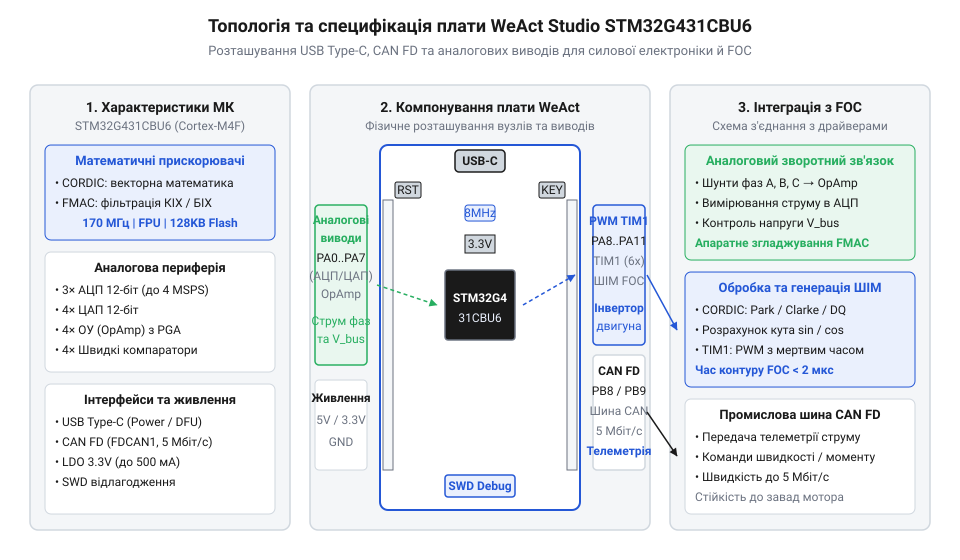

# WeAct STM32G431CBU6

<preknowlist>
- [STM32F072B-DISCO (Discovery, Cortex-M0)](root:cat-hw-boards/stm32f072b-disco) — базові принципи організації оцінних плат сімейства STM32 та використання вбудованих периферійних модулів.
</preknowlist>

## Апаратна платформа WeAct STM32G431CBU6

Розробка силових перетворювачів та систем керування двигунами традиційно вимагала громіздкої схемотехніки з десятками дискретних аналогових компонентів. Плата @@en|WeAct Studio STM32G431CBU6@@ вирішує цю проблему, поєднуючи потужну обчислювальну платформу та аналоговий обв'язок на єдиній мініатюрній друкованій платі. Інтерфейсний роз'єм @@en|USB Type-C@@ (від англ. *@@en|Universal Serial Bus@@* — універсальна послідовна шина) оснащено підтягувальними резисторами на лініях `CC1` та `CC2` опором `5.1 кОм`, що забезпечує точне визначення ролі веденого пристрою та узгодження живлення 5 В від хоста.

*Компоновка елементів плати WeAct STM32G431CBU6 із виводами GPIO та роз'ємом USB Type-C.*

Для захисту сигнальних ліній шини USB від сплесків статичної напруги на платі встановлено діодну збірку @@en|TVS@@ (від англ. *@@en|Transient Voltage Suppressor@@* — супресор імпульсних перенапруг). Живлення мікроконтролера забезпечує лінійний стабілятор @@en|LDO@@ (від англ. *@@en|Low Dropout Regulator@@* — стабілятор напруги з малим спадом) з високим коефіцієнтом пригнічення пульсацій, який живить кристал напругою 3.3 В.

## Обчислювальне ядро та математичні прискорювачі

В основі плати лежить 32-бітний мікроконтролер із ядром @@en|ARM Cortex-M4@@, що працює на тактовій частоті `170 МГц`. Ядро оснащене апаратним модулем плаваючої коми @@en|FPU@@ (від англ. *@@en|Floating-Point Unit@@* — блок плаваючої коми) та інструкціями цифрової обробки сигналів @@en|DSP@@ (від англ. *@@en|Digital Signal Processing@@* — цифрова обробка сигналів), що знайомо розробникам по інших [платах сімейства STM32](root:cat-hw-boards/stm32f072b-disco).

*Архітектура обчислювального ядра з апаратними прискорювачами CORDIC та FMAC.*

Для розвантаження процесора в задачах векторного керування двигунами @@en|FOC@@ (від англ. *@@en|Field-Oriented Control@@* — векторне керування) вбудовано апаратний обчислювач @@en|CORDIC@@ (від англ. *@@en|Coordinate Rotation Digital Computer@@* — цифровий обчислювач повороту координат), який обчислює синуси, косинуси та арктангенси за кілька тактів. Додатково прискорювач @@en|FMAC@@ (від англ. *@@en|Filter Math Accelerator@@* — математичний прискорювач фільтрації) з власною двопортовою пам'яттю розраховує КІХ та ІІХ фільтри через прямий доступ до пам’яті без залучення ядра.

## Розвинена аналогова та моторна периферія

Аналоговий тракт містить два операційні підсилювачі @@en|OPAMP@@ (від англ. *@@en|Operational Amplifier@@* — операційний підсилювач), які можуть працювати як підсилювачі з програмованим коефіцієнтом @@en|PGA@@ (від англ. *@@en|Programmable Gain Amplifier@@* — підсилювач із програмованим коефіцієнтом підсилення). Це дозволяє оцифровувати струми фаз двигуна без зовнішніх схематичних рішень.

*Схема зв'язків між операційними підсилювачами, компараторами та таймером TIM1.*

Швидкісні компаратори @@en|COMP@@ підключені напряму до входу аварійного захисту `BRK` моторного таймера `TIM1`. При виникненні струмового перевантаження компаратор апаратно вимикає генерацію ШІМ-сигналів за десятки наносекунд, захищаючи силові ключі інвертора.

## Схема живлення, розпіновка та BOOT0

Висока точність 12-бітних АЦП досягається завдяки розділенню цифрових та аналогових шин живлення `VDDA` й `VSSA` через фільтрувальні дроселі. При підключенні датчиків слід враховувати, що аналогові входи не є 5V-толерантними, і подача напруги понад 3.6 В пошкодить кристал.

*Схема кіл живлення, кнопки BOOT0 та контактів SWD плати WeAct.*

Вибір джерела завантаження здійснюється за допомогою кнопки `BOOT0` або через конфігураційні біти Flash-пам'яті. Це дає змогу завантажувати код через апаратний завантажувач @@en|DFU@@ (від англ. *@@en|Device Firmware Upgrade@@* — оновлення прошивки пристрою) по USB або відлагоджувати програму через дводротовий інтерфейс @@en|SWD@@ (від англ. *@@en|Serial Wire Debug@@* — послідовний дводротовий інтерфейс відлагодження).
