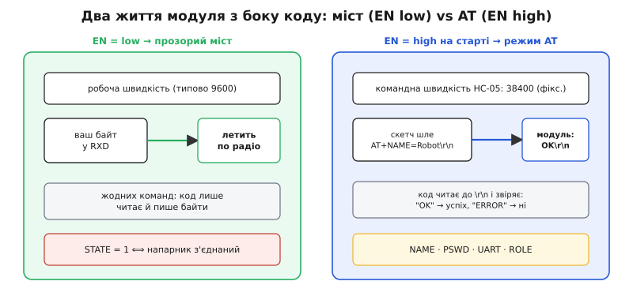
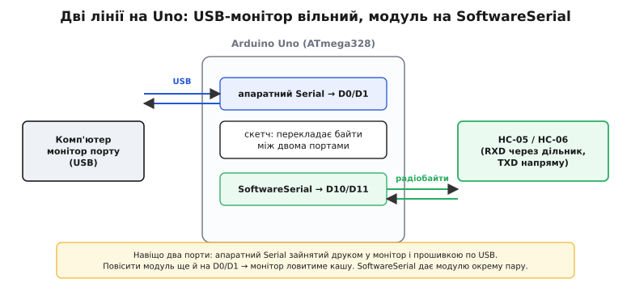

# 📋 HC-05/HC-06 з коду: порт, AT-команди й ніжка STATE

<preknowlist>
- [Кадр UART](root:com-devices/uart-frame) — як ніжки TX/RX шлють байти й що таке швидкість (baud); увесь код нижче — це читання й запис у такий порт.
- [Керування виводами](root:sf-devices/gpio-registers) — як із коду підняти чи опустити одну ніжку; так ми смикаємо EN у режим AT і читаємо STATE.
- [Таймер millis()](root:sf-devices/millis-micros) — неблокувальний відлік часу без `delay`; ним таймаутимо відповіді модуля, не заморожуючи програму.
</preknowlist>

Модуль HC-05 дає розкішну обіцянку: пиши в нього байти звичайним UART — і вони летять по радіо. З боку коду це означає, що весь «драйвер Bluetooth» зводиться до двох рядків: `port.write(byte)` шле, `port.read()` приймає. Ніякого стеку, ніяких пакетів, ніяких колбеків. Але під цією простотою ховаються **три контракти**, які й треба знати, щоб керувати модулем із коду: **який порт** дати модулю на різних платах, як заговорити з ним у **режимі AT** (інша швидкість, інші кінці рядка, розбір відповіді) і як прочитати **факт зв'язку** з ніжки STATE. Але спершу треба чітко побачити, що саме програма тримає в руках, коли говорить із модулем.

---

## Код бачить не радіо, а два байтові струмки

А тримає вона рівно те саме, що й при звичайному дротяному UART: об'єкт послідовного порту з чотирма діями.

```
port.available()  → скільки байтів уже прийшло й чекає в буфері
port.read()       → забрати найстарший байт (або -1, якщо порожньо)
port.write(b)     → відправити байт
port.print("...") → відправити рядок тексту (ті самі write під капотом)
```

Уся «бездротовість» захована **за цими чотирма викликами**. Називаються вони в кожному середовищі по-своєму — `Serial.read()` в Arduino, `uart_read_bytes()` в ESP-IDF, `HAL_UART_Receive()` на STM32, звичайний `read()` з `/dev/ttyS*` у Linux, — але дій усе одно рівно чотири. Коли ви пишете `port.write('F')`, байт `'F'` (число 70) лягає в передавач модуля, летить по радіо, і на іншому кінці — у телефоні чи в другому модулі — виходить із приймача той самий байт 70. Ваш код цього польоту не бачить: для нього це звичайний запис у порт, який просто виявився повільним і бездротовим.

> 🔧 **Навіщо це.** Тримаючи в голові цю картину — «два байтові струмки, туди й назад» — ви правильно ставите будь-яке питання. «Чому не приходять дані?» → або напарник не пише, або TX/RX переплутані, або немає з'єднання (гляньте STATE). «Чому модуль не слухає команди?» → бо в прозорому режимі команд немає взагалі; треба спершу підняти EN. Ви не гадаєте про «радіо» — ви дивитеся на конкретний струмок байтів і питаєте, де він перервався.

Модуль живе у **двох життях**, і код мусить розрізняти, у якому він зараз.


*Ліва половина — щоденний режим: EN низько, код просто возить байти на робочій швидкості, а STATE каже, чи є напарник. Права — налаштування: EN високо на старті, розмова на 38400 з `\r\n`, і кожна команда повертає `OK` або `ERROR`, які код читає до кінця рядка. Один і той самий модуль, але два зовсім різні контракти з вашою програмою.*

Почнемо з найпершого контракту — як фізично дати модулю UART-порт, бо на різних платах це влаштовано по-різному.

---

## Контракт перший: дати модулю порт

### Arduino Uno через SoftwareSerial

На Uno апаратний UART **один-єдиний**, і сидить він на ніжках D0 (RX) та D1 (TX). Але ці самі ніжки заведені на USB-перетворювач плати — саме ними ви заливаєте скетч і саме через них працює монітор порту. Повісити туди ще й HC-05 можна, але тоді два джерела байтів (комп'ютер по USB і модуль) б'ються за одну лінію: у моніторі з'являється каша, а щоб прошити плату, доводиться щоразу від'єднувати модуль. Морока.

Вихід — дати модулю **окремий, програмний** послідовний порт на двох вільних ніжках. Бібліотека `SoftwareSerial` уміє «вдавати» UART на майже будь-якій парі виводів, смикаючи їх у потрібному ритмі програмно. Апаратний `Serial` тоді лишається цілком за USB-монітором, а модуль говорить своєю парою.


*Чому саме так: апаратний `Serial` зайнятий друком у монітор і заливкою прошивки по USB. Якщо повісити модуль ще й на D0/D1, монітор ловитиме кашу, а прошивка конфліктуватиме. `SoftwareSerial` на D10/D11 дає модулю окрему пару ніжок — і скетч спокійно перекладає байти між двома незалежними портами.*

**Оголошення й запуск.** Створюємо програмний порт на двох ніжках і задаємо йому **робочу** швидкість модуля (типово 9600 — не плутати з командними 38400, вони знадобляться в режимі AT).

:::code api-hc05-uart/c/arduino/arduino-uno-cherez.ino

Зверніть увагу на порядок аргументів `SoftwareSerial(10, 11)`: **перший — RX** (ніжка, що слухає модуль), **другий — TX** (ніжка, що шле в модуль). Переплутати їх — класична помилка: код виглядає правильно, а зв'язку немає, бо ви слухаєте ніжку, у яку самі ж пишете. І пам'ятайте фізику: TX Arduino (D11) — це 5-вольтовий вихід, а RXD модуля терпить лише 3.3 В, тож між ними обов'язковий дільник; зустрічна лінія (TXD модуля → D10) іде напряму. Докладніше про сам дільник — [дільник напруги](root:hw-analog/voltage-divider).

**Наскрізне возіння — обидва напрями.** Найпростіший корисний скетч: усе, що прийшло з монітора, віддати модулю, і навпаки. Це «дротик» між комп'ютером і радіо — ним зручно вручну слати щось напарнику й бачити відповіді.

:::code api-hc05-uart/c/arduino/arduino-uno-cherez-2.ino

Оце вже повноцінний бездротовий термінал. Кожен `if` перевіряє свій струмок і, якщо байт є, миттю перекладає його в інший порт. Ніяких `delay`, ніякого чекання — цикл крутиться вільно, тому обидва напрями обслуговуються майже одночасно.

### ESP32 і STM32 через апаратний UART

На платах з кількома апаратними UART морока з програмним портом зникає: даємо модулю **справжній** апаратний порт, а USB-монітор лишається на своєму. І, що приємно, ці плати самі на 3.3 В — дільник на RXD не потрібен, усе з'єднується напряму.

**ESP32.** У нього три апаратні UART: UART0 зайнятий USB-монітором, модулю даємо UART2 — типово на ніжках GPIO16 (RX) і GPIO17 (TX). В Arduino-ядрі ці порти видно як об'єкти `Serial` і `Serial2`, у чистому ESP-IDF — як номери `UART_NUM_0` / `UART_NUM_2` у драйвері `driver/uart.h`.

:::tabs
:::code api-hc05-uart/c/arduino/esp32-i-stm32-cherez.ino
:::code api-hc05-uart/c/esp-idf/esp32-i-stm32-cherez.c
:::

Форма `Serial2.begin(9600, SERIAL_8N1, 16, 17)` явно задає й формат кадру (`SERIAL_8N1` — 8 біт даних, без парності, 1 стоп-біт: рівно те, що чекає HC-05), і ніжки. Ніжки можна поставити майже будь-які — ESP32 маршрутизує UART на різні GPIO, — але типові 16/17 працюють, якщо на вашій платі вони вільні (на модулях із PSRAM ці два виводи бувають зайняті внутрішньо, тоді беруть інші).

**STM32.** Тут теж кілька USART. Один із них зазвичай виведений на USB або на ST-Link і слугує монітором; модулю даємо інший — наприклад USART1 на штатних ніжках PA9/PA10. В ядрі Arduino_Core_STM32 це об'єкт `Serial1`, у згенерованому CubeMX проєкті — хендл `huart1`.

:::tabs
:::code api-hc05-uart/c/arduino/esp32-i-stm32-cherez-2.ino
:::code api-hc05-uart/c/stm32/esp32-i-stm32-cherez.c
:::

Суть скрізь одна: **звідки прилітають байти — це деталь плати**, а не радіо. Програмний порт на Uno, UART2 на ESP32, USART1 на STM32 — усе це той самий порт із чотирма діями (в Arduino вони звуться `available/read/write/print`, деінде інакше), і будь-яка логіка над ним не залежить від того, який фізичний UART його живить. Це прямий наслідок картини «код бачить не радіо, а байтовий струмок».

---

## Контракт другий: режим AT

Дотепер EN ми не чіпали — модуль возив байти прозоро. Тепер зовсім інша задача: **налаштувати** модуль. Дати йому ім'я замість заводського `HC-05`, змінити PIN із `1234` на свій, виставити робочу швидкість, а для HC-05 — ще й роль. Усе це робиться **AT-командами**, і тут вступають три правила, порушення яких — головна причина «модуль не відповідає».

Правило перше — **EN високо на старті**. Модуль читає рівень EN у момент подачі живлення. Високо — прокидається в режимі команд (нікуди не з'єднується, слухає AT); низько — прозорий міст. Отже, EN треба підняти **до** того, як модуль запуститься. Заведемо EN на вільну ніжку мікроконтролера й підніматимемо її самі.

Правило друге — **швидкість 38400** (для HC-05). Робоча швидкість модуля (9600) тут ні до чого: у режимі команд HC-05 слухає на власній, фіксованій швидкості 38400, хоч би що ви виставили як робочу. Заговорите на 9600 — модуль просто мовчатиме. (У HC-06 інакше: він приймає AT на робочій швидкості, доки немає з'єднання.) За джерелами модуля, у режимі AT HC-05 працює на 38400 і вимагає завершувати кожну команду `\r` і `\n` — це підтверджують і документація набору команд, і практичні розбори модуля.

Правило третє — **кінці рядка `\r\n`**. HC-05 вважає команду закінченою, лише побачивши повернення каретки й переведення рядка (`\r\n`, тобто байти 13 і 10). Пошлете `AT` без них — модуль чекатиме продовження й нічого не відповість. (У моніторі Arduino це відповідає пункту «Both NL & CR».)

**Керуємо EN із коду.** Заведемо ніжку EN на вихід і піднімемо її перед тим, як живити модуль — на макетці це зручно зробити так: EN модуля на цифровий вихід МК, VCC модуля — на керований вихід (транзистор чи просто ніжку, якщо струм малий), і спершу підняти EN, тоді дати живлення.

:::tabs
:::code api-hc05-uart/c/arduino/kontrakt-druhyi-rezhym-at.ino
:::code api-hc05-uart/c/esp-idf/kontrakt-druhyi-rezhym-at.c
:::code api-hc05-uart/c/stm32/kontrakt-druhyi-rezhym-at.c
:::

Якщо живлення модуля ви не комутуєте з коду (VCC просто на 5 В постійно), то EN піднімають кнопкою на платі, натиснутою під час подачі живлення, — а програма тоді лише відкриває порт на 38400. Але керувати EN із коду зручніше: не треба тримати кнопку.

**Шлемо команду й розбираємо відповідь.** Ось серце всього — функція, що надсилає одну AT-команду, чекає відповідь до кінця рядка й каже, чи побачила `OK`. Саме брак цієї перевірки робить налаштування «сліпим»: команду послали, а спрацювала вона чи ні — невідомо.

:::tabs
:::code api-hc05-uart/c/arduino/kontrakt-druhyi-rezhym-at-2.ino
:::code api-hc05-uart/c/esp-idf/kontrakt-druhyi-rezhym-at-2.c
:::code api-hc05-uart/c/stm32/kontrakt-druhyi-rezhym-at-2.c
:::

Розберемо, чому кожен крок саме такий. **Очищення буфера** на початку прибирає недочитані байти минулої команди — інакше вони приклеяться до нової відповіді й зіб'ють розбір. **`\r\n` після команди** — те саме залізне правило: без них модуль не вважатиме команду завершеною. **Збір до `\n`** — модуль закінчує відповідь переведенням рядка, тож поява `\n` означає «рядок цілий, можна розбирати»; чекати далі нема сенсу. І **таймаут за годинником контролера** (`millis()` в Arduino, `esp_timer_get_time()` в ESP-IDF, `HAL_GetTick()` на STM32) — щоб функція не зависла назавжди, якщо модуль мовчить (не та швидкість, не піднято EN): не діждавшись рядка за секунду, чесно повертаємо `false`.

Пошук підрядка (`indexOf` в Arduino, `strstr` у звичайному C) навмисне м'який — шукаємо `OK` **десь** у відповіді, а не вимагаємо точної рівності. Річ у тім, що модуль часто відповідає з переносами (`\r\nOK\r\n`), а деякі команди-запити повертають спершу значення, тоді `OK` окремим рядком. Шукати підрядок надійніше, ніж звіряти весь текст побайтово.

**Уся послідовність налаштування.** Тепер зберемо конфігурацію в один прохід. Кожну команду шлемо, друкуємо відповідь у монітор і зупиняємось, якщо щось не `OK`, — бо далі гнати команди в модуль, який уже не відповідає, безглуздо.

:::tabs
:::code api-hc05-uart/c/arduino/kontrakt-druhyi-rezhym-at-3.ino
:::code api-hc05-uart/c/esp-idf/kontrakt-druhyi-rezhym-at-3.c
:::code api-hc05-uart/c/stm32/kontrakt-druhyi-rezhym-at-3.c
:::

Кілька слів про самі команди, бо їхній синтаксис теж має пастки. `AT+UART=9600,0,0` задає **три** речі одразу: робочу швидкість (9600), стоп-біти (0 = один стоп-біт), парність (0 = немає) — і кома між ними обов'язкова. `AT+ROLE=0` робить модуль веденим (чекає вхідне з'єднання), `AT+ROLE=1` — ведучим (сам шукає й під'єднується); але `ROLE=1` осмислений лише на HC-05 — у HC-06 команди немає, він завжди ведений. `AT+PSWD=4726` (на новіших прошивках PIN беруть у лапки: `AT+PSWD="4726"`) міняє PIN із заводського `1234`. Якщо якась команда впала на `ERROR`, найчастіша причина — версія прошивки з іншим синтаксисом (з лапками чи без), і варто звірити відповідь `AT+VERSION?`.

Ці факти — фіксовані 38400 у режимі команд, обов'язкові `\r\n`, тріо `швидкість,стоп,парність` у `AT+UART` — підтверджені документацією набору AT-команд HC-05 і практичними розборами модуля; статус: усталена, багаторазово перевірена поведінка конкретного модуля.

---

## Контракт третій: ніжка STATE

Лишився третій контракт — не байти, а сам факт зв'язку. Ніжка STATE тримає **1**, коли напарник під'єднаний, і **0**, коли ні. Це єдиний надійний спосіб дізнатися з коду, що зв'язок є (чи зник), не гадаючи це з тиші в порту: тиша може означати і «немає з'єднання», і «з'єднання є, але напарник просто мовчить» — а це геть різні ситуації.

Заводимо STATE на вільний вхід і читаємо як звичайну ніжку. Але корисне не саме значення, а **момент переходу**: щойно STATE впав з 1 у 0 — зв'язок щойно обірвався; піднявся з 0 у 1 — напарник щойно під'єднався. Реагувати треба на цю *подію*, один раз, а не щоцикл, доки стан тримається.

:::tabs
:::code api-hc05-uart/c/arduino/kontrakt-tretii-nizhka.ino
:::code api-hc05-uart/c/esp-idf/kontrakt-tretii-nizhka.c
:::code api-hc05-uart/c/stm32/kontrakt-tretii-nizhka.c
:::

Логіка `wasConnected && !connected` спрацьовує **рівно на переході** 1→0, а не щоцикл, доки зв'язку немає. Це важливо: реагувати треба на *подію* обриву (один раз), а не безперервно повторювати дію, доки зв'язку немає. Дзеркальний перехід `!wasConnected && connected` (0→1) — момент, коли напарник щойно під'єднався; на ньому зручно, наприклад, привітати напарника чи скинути стан у безпечне значення. Що саме робити на цих двох подіях — то вже логіка вашого приладу.

Для людини те саме показує світлодіод на платі модуля: часте блимання — модуль вільний і чекає; рідке подвійне моргання (у HC-05) — з'єднання встановлено. Але код на світлодіод дивитися не може — йому потрібен саме STATE.

---

## Пастки інтерфейсу

Зберемо в одному місці все, на чому реально губиться час, коли керуєш модулем із коду. Кожен пункт — із причиною, а не «буває».

**Модуль мовчить на AT — майже завжди швидкість або кінці рядка.** Скарга номер один. Для HC-05 у режимі команд швидкість **38400**, не робочі 9600 — це окрема, фіксована швидкість, і на 9600 модуль вас не почує. Друге — кінці рядка: HC-05 хоче `\r\n` після кожної команди (у моніторі — «Both NL & CR»), без них він чекає продовження й мовчить. Третє — EN: якщо він не був високо **в момент старту** модуля, той узагалі не в режимі команд, а в прозорому. Перевіряйте цю трійку першою.

**Команду послали, а вона не спрацювала — немає перевірки відповіді.** Сліпе `btSerial.print("AT+NAME=Robot\r\n")` без читання відповіді лишає вас у невіданні: команда могла впасти на `ERROR` (не той синтаксис, не та прошивка), а ви думаєте, що ім'я змінено. Завжди читайте відповідь до `\r\n` і звіряйте на `OK` — як робить `sendAT` вище. Інакше налаштування «на віру».

**Переплутані RX/TX у конструкторі `SoftwareSerial`.** `SoftwareSerial(rx, tx)` — перший аргумент приймає, другий шле. Переставите — слухатимете ніжку, у яку пишете самі, і зв'язку не буде, хоча код виглядає бездоганно. Звірте: перша ніжка йде на TXD модуля, друга — на RXD (через дільник).

**5-вольтовий TX прямо на RXD — тихо псує вхід.** Це залізна, а не програмна пастка, але б'є саме тих, хто зосереджений на коді. TX Arduino Uno — 5 В, RXD модуля терпить 3.3 В. Без дільника 1к/2к на лінії TX→RXD вхід модуля з часом деградує: спершу працює, потім «глухне». Зустрічна лінія (TXD модуля → RX Arduino) дільника не потребує — 3.3 В Arduino читає як одиницю. Розрахунок дільника — [дільник напруги](root:hw-analog/voltage-divider).

**Модуль на D0/D1 Uno — каша в моніторі й морока з прошивкою.** Апаратний `Serial` Uno зайнятий USB. Повісите модуль туди — байти монітора й модуля зіткнуться, а щоразу перед заливкою скетчу доведеться від'єднувати модуль. Дайте модулю `SoftwareSerial` на інших ніжках, лишивши D0/D1 монітору.

**Читання через `if` замість `while` — ви відстаєте від буфера.** Якщо в головному циклі (`loop` в Arduino, тіло задачі у FreeRTOS, `while (1)` у CubeMX-проєкті) забирати лише **один** байт за прохід (`if (available) read()`), а прийшло кілька, буфер відстає й ви обробляєте старі байти із затримкою. Забирайте **всі** накопичені байти в `while (available)`.

**Не читаєте STATE — плутаєте тишу з обривом.** Тиша в порту не означає «немає зв'язку»: напарник може бути на зв'язку, але мовчати. Єдиний надійний сигнал обриву — падіння STATE з 1 у 0. Без нього код не відрізнить «напарник мовчить» від «напарник відпав».

**iPhone не бачить модуль — це не баг коду.** HC-05/06 — Bluetooth Classic 2.0, а сучасний iPhone напряму з ним не з'єднається (Apple вимагає BLE або сертифікації). Жоден рядок скетчу цього не полагодить — для iPhone беруть BLE-модуль (HM-10 і подібні). З Android і комп'ютером усе працює.

Оце й увесь інтерфейс модуля з боку коду: **порт** із чотирма діями, **режим AT** (EN високо, 38400, `\r\n`, перевірка `OK`) і **STATE** з ловом переходу. Три контракти — і будь-який застосунок над ними стає просто вашою логікою поверх байтового струмка.
