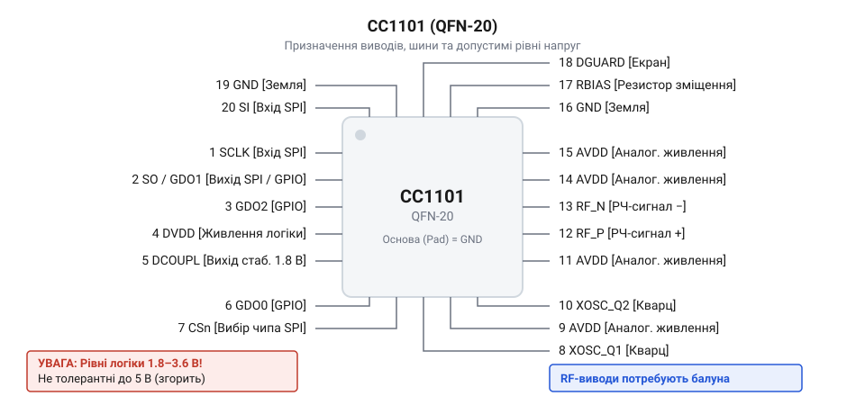
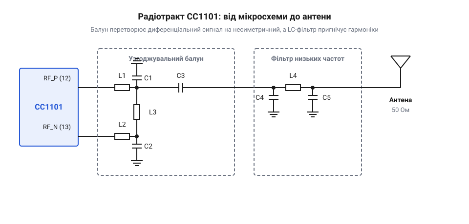

# Апаратний інтерфейс CC1101

## Призначення і допустимі рівні виводів

Щоб трансивер працював стабільно і не згорів під час першого ж увімкнення, його потрібно живити правильною напругою, а на його сигнальні виводи не можна подавати надмірний потенціал. Мікросхема CC1101 розрахована на живлення від 1.8 до 3.6 В. Найчастіше її живлять від джерела 3.3 В, яке є стандартом для сучасних мікроконтролерів.

*Мікросхема CC1101 має роздільне живлення для цифрової та аналогової частин, і жоден з її виводів не є толерантним до 5 вольт.*

Абсолютно всі цифрові входи трансивера, включно з лініями шини SPI та конфігурованими виводами, не мають толерантності до 5 В (@@en|5V tolerant@@). Якщо підключити модуль безпосередньо до 5-вольтової плати Arduino, логічна одиниця з мікроконтролера проб'є захисні діоди на входах чипа і знищить його. Тому для роботи з 5-вольтовими контролерами необхідно використовувати узгоджувачі логічних рівнів, які перетворюватимуть 5 В у 3.3 В і навпаки. Прості резистивні дільники напруги для цього не підходять: на високих частотах шини SPI дільник разом із паразитними ємностями утворює фільтр, що завалює фронти імпульсів, і чип починає пропускати біти. Щоб зберегти круті прямокутні фронти сигналу, слід використовувати активні перетворювачі на польових транзисторах або спеціалізованих буферних мікросхемах.

Щоб зменшити вплив шумів цифрової частини на чутливий радіотракт, чип має кілька окремих виводів живлення: `AVDD` для аналогових кіл та синтезатора частот, і `DVDD` для цифрового ядра. На платі радіомодуля їх рідко живлять від різних джерел — зазвичай виводи підключають до спільної шини, але розділяють феритовою намистиною (@@en|ferrite bead@@) або високочастотним дроселем. Цей бар'єр безперешкодно пропускає постійний струм живлення, але чинить високий опір пульсаціям цифрового ядра, не пускаючи їх до аналогових кіл. Якщо на дроселі зекономили, як на дешевих модулях, `AVDD` і `DVDD` з'єднують напряму, і тоді захист від перехресних завад лягає виключно на розв'язувальні керамічні конденсатори. Їх ставлять якнайближче до кожного виводу живлення — стандартні на 100 нФ та менші на 10 пФ або 100 пФ для кращого придушення радіочастотних завад. Причому конденсатор меншого номіналу розміщують ближче до ніжки, оскільки довга доріжка працює як індуктивність і зводить його дію нанівець. Протилежний кінець конденсатора виводять найкоротшим шляхом на суцільний полігон землі (@@en|ground plane@@), щоб надійно замкнути високочастотні струми й не дати їм розійтися платою.

## Підключення шини керування SPI

Мікроконтролер налаштовує трансивер, задає частоту, потужність та передає йому дані через синхронну послідовну шину SPI. Це чотирипровідний інтерфейс, який вимагає з'єднання виводів `SCLK`, `MOSI` та `MISO` модуля з відповідними апаратними лініями SPI на контролері.

Вибір пристрою на шині відбувається за допомогою сигналу `CSn` (Chip Select, де "n" означає інверсію — активний низький рівень). Щоб почати обмін з CC1101, мікроконтролер притягує лінію `CSn` до землі. Тільки тоді трансивер починає слухати тактовий сигнал на лінії `SCLK` і приймати дані з `MOSI`. Поки на `CSn` високий рівень, модуль ігнорує шину, а його вихід `MISO` перебуває у високоімпедансному стані, не заважаючи іншим пристроям на тій самій шині спілкуватися з контролером.

Сигнал `MISO` в цьому трансивері виконує додаткову роль. Коли контролер опускає `CSn`, лінія `MISO` може не одразу перейти в низький рівень. Її високий стан означає, що кварцовий генератор мікросхеми ще запускається або стабілізується. Мікроконтролер має дочекатися, поки `MISO` впаде в нуль, і лише після цього починати тактувати шину і передавати команду. Цей механізм гарантує, що чип повністю прокинувся і готовий до роботи, однак якщо генератор не запуститься через проблеми з живленням або відсутність контакту, лінія залишиться у високому рівні назавжди. Тому контролер не повинен чекати наосліп: очікування нуля слід обмежити таймаутом. Оскільки час запуску кварцового генератора вимірюється сотнями мікросекунд, таймаут задають порядку кількох мілісекунд, чого з запасом вистачає для штатного старту. Якщо таймаут вичерпався, мікроконтролер має підняти лінію `CSn` назад у високий рівень, щоб звільнити шину SPI для інших пристроїв, скасувати поточну транзакцію та зафіксувати апаратну помилку трансивера замість того, щоб намертво зависнути в циклі, після чого може спробувати переініціалізувати модуль апаратним або програмним скиданням.

## Виводи загального призначення GDO

Щоб мікроконтролер не мусив постійно опитувати трансивер через SPI, перевіряючи, чи прийшов новий пакет, CC1101 має конфігуровані виводи загального призначення — GDO0, GDO1 та GDO2. Їхню поведінку задають через регістри, призначаючи на них різні внутрішні сигнали.

Найчастіше ці виводи використовують як лінії переривань для мікроконтролера. Наприклад, вивід GDO0 можна налаштувати так, щоб він переходив у логічну одиницю в момент, коли трансивер розпізнав синхрослово (початок пакета) в ефірі, і повертався в нуль, коли прийом пакета завершено або сталася помилка контрольної суми. Для цього в конфігураційний регістр `IOCFG0` записують значення `0x06`, яке напряму підключає до ніжки вихід внутрішнього детектора синхрослова. Це дозволяє контролеру спати і прокидатися лише тоді, коли дані вже чекають у буфері мікросхеми.

Крім індикації прийому чи передачі, на виводи GDO можна вивести сигнал тактування для іншої мікросхеми, поділений вихід внутрішнього генератора або навіть напряму отримувати сирі демодульовані дані з ефіру, якщо трансивер працює в асинхронному режимі без вбудованого обробника пакетів. Вивід GDO1 часто мультиплексують із лінією `MISO`, щоб зекономити одну ногу мікроконтролера, хоча це дещо ускладнює програмну обробку. Роль цієї лінії залежить від стану `CSn`: коли він низький, вона передає дані по SPI, а коли високий — працює як вихід GDO1. Через це мікроконтролеру доводиться динамічно перемикати режим свого виводу до і після кожної транзакції, почергово віддаючи його то апаратному контролеру SPI, то обробнику зовнішніх переривань.

## Обв'язка радіочастотного тракту і балун

Радіочастотний вихід трансивера не можна підключити до антени напряму дротом. Мікросхема формує високочастотний сигнал у диференціальному вигляді на двох виводах, `RF_P` та `RF_N`, тоді як більшість антен є несиметричними (однополярними) з хвильовим опором 50 Ом. Щоб передати енергію з мікросхеми в антену без втрат, сигнал треба перетворити і узгодити.

*Між диференціальним виходом чипа та несиметричною антеною розташований балун для перетворення сигналу та фільтр для придушення гармонік.*

Це завдання вирішує балун (@@en|balun@@, від balanced-to-unbalanced) — схема з індуктивностей і конденсаторів. Фізично на платі її паяють як розсип окремих SMD-котушок і конденсаторів, розміщених максимально щільно до мікросхеми для зменшення впливу доріжок, або замінюють одним готовим керамічним чипом, у якому вся ця обв'язка вже схована всередині. Вона бере два протифазні сигнали з виводів чипа і складає їх в один несиметричний сигнал, відносно землі. Одночасно балун узгоджує внутрішній опір мікросхеми з 50-омним трактом. Якщо хвильовий опір не узгодити, частина потужності відіб'ється від антени назад у чип, що різко зменшить дальність зв'язку.

Одразу після балуна ставлять LC-фільтр низьких частот. Внутрішній підсилювач трансивера під час роботи генерує не лише основну частоту, а й паразитні гармоніки. Фільтр зрізає ці вищі частоти, щоб модуль не засмічував ефір перешкодами і відповідав нормам радіовипромінювання. Оскільки трансивер підтримує різні діапазони, як-от 433 МГц чи 868 МГц, номінали компонентів для балуна й фільтра на кожній частоті відрізняються. Ці індуктивності та місткості не розраховують самостійно, а беруть готовими з таблиць у типовій схемі від виробника — @@en|reference design@@, де вони вже вивірені для відповідного діапазону. Лише після фільтра сигнал потрапляє на роз'єм для підключення антени або безпосередньо на доріжку друкованої антени.
