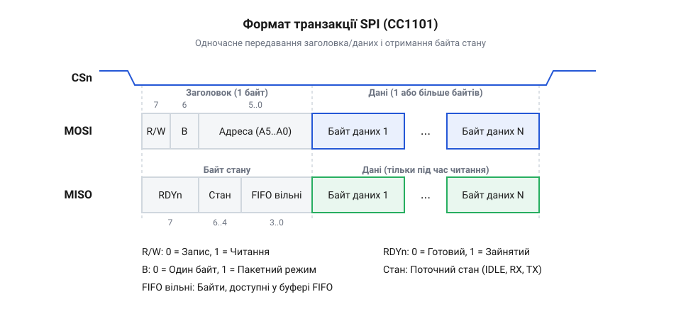
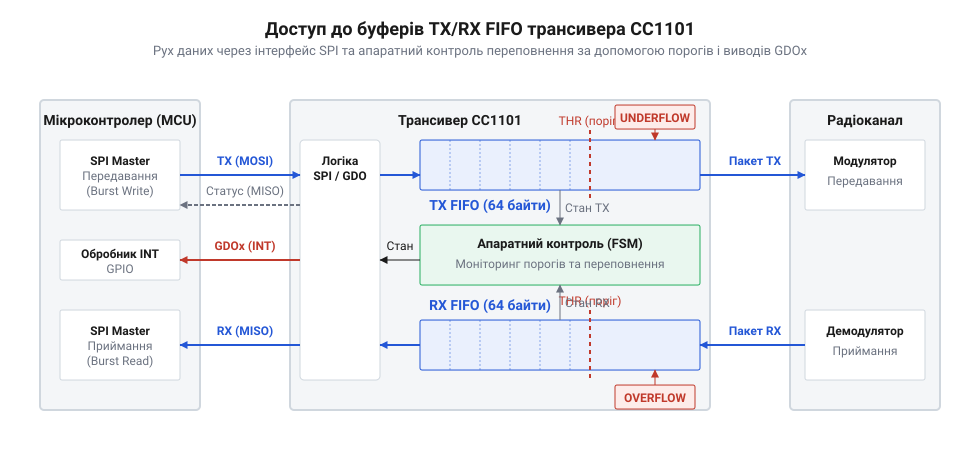

# Карта регістрів та SPI-команди

## Механізм взаємодії через SPI

Для керування трансивером і передачі даних використовується послідовний інтерфейс @@en|SPI@@. Мікроконтролер виступає майстром і завжди ініціює обмін, опускаючи лінію вибору кристала в низький рівень. Щоб звернутися до трансивера, майстер надсилає байт заголовка, який визначає, яка саме операція відбуватиметься. Цей байт містить адресу регістра, до якого йде звернення, та два керівні біти: один вказує напрямок (читання чи запис), а другий — тип доступу (одиничний або пакетний).

Поки майстер передає байт заголовка по своїй лінії передачі @@en|MOSI@@, трансивер по зустрічній лінії @@en|MISO@@ одночасно повертає байт статусу. Такий обмін можливий завдяки повнодуплексній природі шини: кожен імпульс тактового сигналу зсуває біт в один бік і синхронно забирає з іншого. Отриманий байт статусу містить глобальну інформацію про поточний стан автомата трансивера та кількість вільних байтів у буфері. Це дозволяє мікроконтролеру відразу прийняти рішення: наприклад, якщо буфер передачі переповнений, майстер може скасувати подальше надсилання даних ще до початку самої передачі, не витрачаючи час шини на окрему команду перевірки статусу. Щоб перервати розпочату транзакцію, майстру достатньо зупинити тактування шини й повернути лінію вибору кристала у високий рівень. Оскільки трансивер сприймає потік бітів як єдину операцію лише доки ця лінія опущена, передчасне її підняття змушує чип відкинути щойно прийнятий заголовок і повернутися до очікування, залишаючи вміст регістрів і буферів незмінним. Якщо ж перешкод немає, після передачі заголовка майстер або надсилає дані для запису, або видає фіктивні байти, щоб тактувати лінію і вичитати відповідь чипа. Якщо в заголовку встановлено біт пакетного доступу, мікроконтролер може записувати або читати кілька байтів поспіль: внутрішній лічильник адреси трансивера автоматично збільшуватиметься після кожного байта.

## Командні строби керування станом

Крім звичайних регістрів, чип має особливий набір адрес, що використовуються для командних стробів. Строб — це однобайтова команда, яка не потребує передачі додаткових даних, а лише миттєво перемикає трансивер в інший стан. Коли мікроконтролер надсилає адресу стробу як байт заголовка, чип відразу виконує відповідну дію.

За допомогою стробів мікроконтролер керує внутрішнім автоматом станів трансивера. Наприклад, один строб переводить чип у режим приймання (@@en|RX@@), інший — у режим передавання (@@en|TX@@), ще один запускає калібрування синтезатора частот або відправляє модуль у режим глибокого сну для економії енергії. На рівні протоколу @@en|SPI@@ чип відрізняє строб від запиту на читання чи запис звичайного регістра за самою адресою: для стробів виділено окремий діапазон. Коли дешифратор трансивера бачить у байті заголовка адресу з цього діапазону, він розпізнає команду і не чекає на наступний байт даних. Оскільки строб складається лише з одного байта, на який трансивер одразу ж повертає байт статусу, мікроконтролер може надзвичайно швидко реагувати на події та змінювати режим роботи радіомодуля в реальному часі. Проте ця миттєвість означає, що строб виконується безумовно: якщо трансивер у цей момент зайнятий іншою дією, наприклад уже передає пакет в ефір, нова команда грубо перерве поточний процес і примусово перемкне автомат у новий стан. Через це ефірна передача обірветься, тому перед зміною режиму мікроконтролер зазвичай має дочекатися завершення попередньої операції або перевести чип у базовий стан очікування.

## Регістри конфігурації трансивера

Усі параметри, які визначають поведінку радіоканалу, зберігаються в банку конфігураційних регістрів. Це пам'ять, доступна для читання та запису, у якій кожен регістр відповідає за певне налаштування. Перед тим як трансивер зможе передавати або приймати дані, мікроконтролер повинен записати в ці регістри правильні значення.

Конфігураційні регістри містять налаштування базової частоти, швидкості передавання даних у повітрі, типу модуляції та девіації частоти. Інші регістри керують вихідною потужністю передавача, налаштуваннями фільтрів приймача та параметрами пакетного рушія, такими як адресація вузлів, довжина преамбули та перевірка контрольної суми. Значення в цих регістрах можна змінювати лише тоді, коли трансивер перебуває в режимі простою. Щоб забезпечити це, мікроконтролер спершу читає байт статусу, і якщо трансивер активний, надсилає командний строб `SIDLE`, після чого циклічно опитує статус, аж поки чип не підтвердить зупинку. Якщо ж знехтувати цим і спробувати змінити параметри на льоту, коли модуль уже веде передавання або слухає ефір, внутрішні автомати не підхоплять нових налаштувань одночасно: зміна дільників миттєво зірве захоплення частоти синтезатором, а оновлення налаштувань пакетного рушія зруйнує межі поточних бітів. Через це сигнал перетвориться на шум, поточний пакет буде втрачено, а сам чип може опинитися в нестабільному стані, вимагаючи примусового скидання.

## Регістри стану та діагностики

Щоб мікроконтролер міг контролювати роботу радіоканалу, трансивер має набір регістрів стану, які доступні лише для читання. У них чип відображає поточну ситуацію в ефірі та всередині свого автомата. Мікроконтролер регулярно опитує ці регістри, щоб розуміти, що відбувається, і приймати рішення.

У регістрах стану зберігається інформація про рівень прийнятого сигналу (@@en|RSSI@@), якість зв'язку та індикатор виявлення несної частоти, що дозволяє оцінити, чи вільний ефір перед початком передавання. Також тут містяться прапорці, які вказують на те, чи успішно захопив частоту синтезатор, чи збіглася адреса в отриманому пакеті та чи правильно зійшлася контрольна сума. Читання цих регістрів дає змогу швидко виявляти помилки передавання і повторно запитувати дані в разі спотворень. Щоб регулярно опитувати чип, не пропускати подій і не навантажувати шину @@en|SPI@@ повним читанням, трансивер автоматично повертає стислий байт стану на лінії @@en|MISO@@ щоразу, коли отримує будь-яку команду. Мікроконтролеру достатньо надіслати порожній командний строб, щоб за передавання одного байта дізнатися поточну фазу автомата й наповненість буферів, а детальні регістри діагностики читати лише за потреби. На практиці такий порожній строб — це спеціальна однобайтова команда без дії, як-от `SNOP` (@@en|strobe no operation@@). Отримавши її, трансивер не змінює свого налаштування чи фази, але за правилами інтерфейсу все одно виштовхує поточний байт статусу, дозволяючи опитувати автомат із мінімальними витратами часу.

## Робота з буферами FIFO

Трансивер не передає дані побайтово відразу з інтерфейсу SPI в радіоканал. Замість цього він використовує апаратні буфери FIFO (First In, First Out) — окремо для передавання (TX FIFO) і приймання (RX FIFO). Це дозволяє розвантажити мікроконтролер, оскільки швидкості роботи SPI та радіоефіру різняться. 

Для відправлення повідомлення мікроконтролер спочатку записує пакет даних у буфер TX FIFO, використовуючи пакетний доступ через SPI, а потім надсилає командний строб для переходу в режим передавання. Трансивер самостійно вичитує байти з буфера, додає необхідні заголовки та випромінює їх в ефір. Під час приймання процес відбувається у зворотному порядку: чип складає отримані байти в буфер RX FIFO, а мікроконтролер має вчасно вичитати їх. Важливо контролювати стан буферів, оскільки запис у повний TX FIFO призведе до переповнення, а читання з порожнього RX FIFO — до спустошення, що зламає структуру пакетів. Якщо така помилка сталася, просто скинути зіпсований буфер окремим стробом недостатньо: програма має примусово перевести трансивер у стан очікування, щоб скасувати поточну транзакцію та скинути внутрішні автомати, очистити прапорці переривань і лише після цього відновлювати роботу — формувати весь пакет для відправлення наново або знову переходити в режим приймання. Щоб мікроконтролер міг вчасно запобігти цьому, трансивер сигналізує про стан буферів через апаратні переривання на зовнішніх виводах або прапорці в регістрах стану: налаштувавши поріг заповнення, можна змусити чип видавати сигнал, щойно кількість байтів у FIFO сягне критичної межі, що дозволяє програмі миттєво відреагувати й вичитати чи дозаписати дані, не витрачаючи ресурсів на постійне опитування через SPI.
