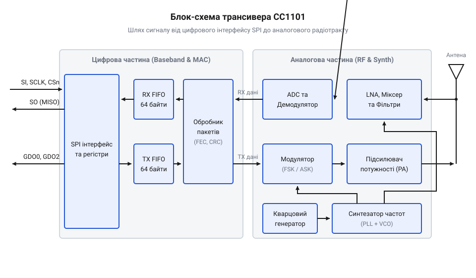
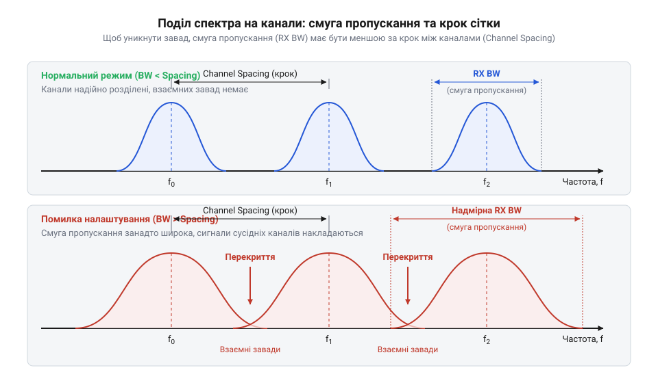
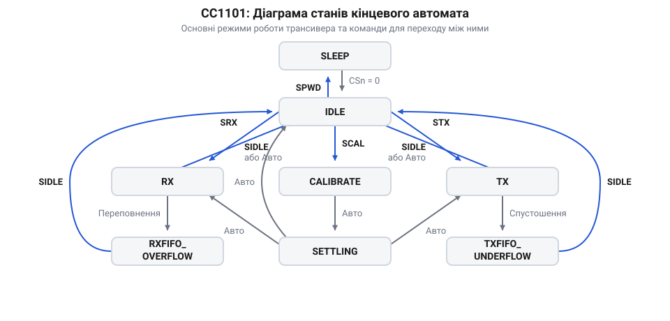

# CC1101 — субгігагерцовий трансивер (433 МГц)

<preknowlist>
- [Радіомодуль nRF24](root:cat-hw-connect/nrf24-radio) — розуміння загального принципу пакетної передачі даних на частоті 2.4 ГГц і концепції FIFO-буферів.
</preknowlist>

## Чому субгігагерцовий діапазон і CC1101

Побудова надійного бездротового зв'язку часто впирається у фізичні перешкоди. Популярні модулі, які працюють на частоті 2.4 ГГц, наприклад [радіомодулі nRF24](root:cat-hw-connect/nrf24-radio), чудово справляються з передаванням даних на короткі відстані в межах кімнати. Але варто сигналу зустріти на своєму шляху бетонну стіну, густу рослинність чи перекриття між поверхами, як він стрімко згасає. Хвилі довжиною близько 12 сантиметрів добре поглинаються матеріалами й погано огинають перешкоди, тому для збільшення дальності потрібен перехід на нижчі частоти.

[Субгігагерцовий радіозв'язок](root:com-medium/subghz-radio) у діапазонах 433 МГц або 868 МГц використовує довші хвилі (близько 70 та 35 сантиметрів відповідно). Такий сигнал значно легше проникає крізь будівельні конструкції та має менші втрати під час поширення у вільному просторі. За однакової потужності передавача субгігагерцовий модуль здатен пробити кілька стін там, де 2.4 ГГц втратить зв'язок на першій. Це робить його базовим вибором для систем розумного дому, бездротових сигналізацій та телеметрії, де стабільність каналу важливіша за високу пропускну здатність. 

Норвезька компанія Chipcon свого часу розробила лінійку напрочуд вдалих радіотрансиверів для цих завдань, серед яких яскраво виділявся чип CC1100. Згодом, після поглинання розробника гігантом Texas Instruments, на світ з'явився вдосконалений чип CC1101, у якому виправили дрібні апаратні вади та покращили радіочастотні характеристики. Завдяки вдалому балансу між ціною, енергоефективністю та гнучкістю налаштувань, архітектура цього трансивера дуже швидко стала індустріальним стандартом де-факто для субгігагерцових систем.

На відміну від сучасних [LoRa-модулів](root:cat-hw-connect/lora-module), які використовують складну шумоподібну модуляцію для досягнення кілометрових відстаней за рахунок мізерної швидкості, CC1101 спирається на класичне [пакетне радіопередавання](root:com-transport/packet-radio) з частотною або амплітудною модуляцією (@@en|FSK@@, @@en|ASK@@). У цьому підході логічні нулі та одиниці кодуються прямою зміною частоти чи розмаху носійної хвилі, тому трансивер передає біти один за одним без довгого накопичення, зберігаючи достатню швидкість для передавання команд та даних без помітних затримок. Проте на фізичному рівні класичне радіо програє LoRa в дальності: щоб демодулятор CC1101 міг розпізнати ці швидкі зміни стану, він мусить безперервно відстежувати миттєве значення частоти або амплітуди. Якщо обрано частотну модуляцію, приймач оцифровує вхідний ефір і щомиті вимірює зміну фази хвилі — оскільки частота є швидкістю зміни фази, трансивер фіксує, куди саме відхиляється сигнал від центру каналу. Щоб не переплутати корисний частотний зсув із шумом, який хаотично смикає фазу в різні боки, демодулятор багаторазово вимірює це відхилення і усереднює його протягом часу, відведеного на один біт, порівнюючи отриманий стабільний результат з очікуваними порогами для нуля та одиниці. Цей механізм працює лише тоді, коли потужність корисного сигналу гарантовано перевищує фоновий шум ефіру: якщо хвиля занадто слабшає від перешкод, її частотні зміщення губляться серед хаотичних фазових коливань теплових та радіочастотних завад, приймач перестає їх розрізняти й починає видавати випадкове сміття. Натомість LoRa розтягує енергію кожного біта в довгий частотний імпульс і математично витягує її навіть з-під рівня шуму, складаючи сигнал докупи протягом тривалого часу. Це робить CC1101 проміжним, але дуже потужним варіантом: він забезпечує суттєво більшу дальність, ніж Bluetooth чи Wi-Fi, не змушуючи при цьому жертвувати миттєвою реакцією системи на кожну надіслану команду.

## Архітектура та внутрішня будова трансивера

Щоб усвідомлено налаштовувати радіоканал і розуміти, звідки беруться ті чи інші обмеження, треба бачити, який шлях проходить сигнал від мікроконтролера до антени. CC1101 — це не просто підсилювач із модулятором, а складна цифрово-аналогова система, у якій обробка даних розділена на кілька логічних блоків.

*Схема внутрішньої будови CC1101. Дані від мікроконтролера проходять через цифрові буфери, потрапляють у блок модема, де керують частотним синтезатором, після чого підсилений сигнал випромінюється в ефір.*

Мікроконтролер спілкується з трансивером через послідовну шину SPI, відправляючи команди, читаючи стан та записуючи дані для передачі. Деталі підключення виводів шини та додаткових сигнальних ліній GDO описані у вставці про [апаратний інтерфейс CC1101](root:cat-hw-connect/cc1101-radio/api-hardware.md). Для зберігання корисного навантаження чип має два незалежних апаратних буфери @@en|FIFO@@ — один для передавання (TX), інший для приймання (RX), кожен об'ємом по 64 байти. Завдяки буферам мікроконтролеру не потрібно побітово супроводжувати процес виходу сигналу в ефір; достатньо завантажити пакет цілком і дати команду на старт.

Під час передавання (режим TX) дані з буфера надходять до цифрового модулятора. Залежно від вибраного типу модуляції, модем змінює налаштування частотного синтезатора (@@en|Frequency Synthesizer@@). Синтезатор генерує несучу частоту за допомогою системи фазового автопідлаштування частоти (@@en|PLL@@). Ця система утворює петлю зворотного зв'язку: фазовий детектор постійно порівнює частоту внутрішнього генератора з еталоном від кварцового резонатора, жорстко утримуючи її стабільною. Модем втручається просто в цю петлю, на льоту змінюючи її коефіцієнт ділення, що змушує генератор миттєво стрибати між різними частотами — саме так цифрові нулі та одиниці перетворюються на фізичні частотні зсуви. Згенерований синтезатором сигнал є універсальною основою трансивера: під час приймання він слугує опорою для змішувача, де апаратно перемножується з уловленим ефірним сигналом; оскільки множення хвиль тригонометрично породжує нову хвилю на їхній різниці, змішувач у такий спосіб ефективно понижує частоту із сотень мегагерц до зручних кілогерців. А під час передавання цей згенерований аналоговий сигнал подається на підсилювач потужності (@@en|Power Amplifier, PA@@), рівень якого також налаштовується програмно. Після підсилювача сигнал іде на антену, випромінюючись у навколишній простір.

У режимі приймання (RX) процес іде у зворотному напрямку, але радіотракт влаштований дещо складніше. Слабкий сигнал з антени спершу потрапляє на малошумлячий підсилювач (@@en|Low Noise Amplifier, LNA@@). Оскільки оцифрувати сигнал безпосередньо на вихідній частоті (наприклад, 433 МГц) украй складно — це вимагало б надзвичайно швидкого, дорогого та енергожерливого АЦП, який миттєво висадив би батарею, — трансивер використовує змішувач для пониження частоти. Змішувач апаратно перемножує прийнятий високочастотний сигнал із чистою частотою від внутрішнього генератора. Оскільки тригонометрично множення двох хвиль утворює нові коливання на їхній сумі та різниці, високочастотна сума одразу відсікається апаратним фільтром, і на виході залишається лише математична різниця частот. Так спектр сигналу, зберігши всі модульовані дані, зсувається вниз, на зручну для обробки проміжну частоту (@@en|Intermediate Frequency, IF@@) у кілька сотень кілогерц. Цей знижений за частотою аналоговий сигнал уже без проблем оцифровується вбудованим аналого-цифровим перетворювачем (@@en|ADC@@). Оцифровування саме на етапі проміжної частоти дозволяє віддати всю подальшу демодуляцію цифровій логіці замість традиційних аналогових кіл. Цифровий демодулятор кращий за аналоговий тим, що математичні фільтри, на відміну від фізичних котушок і конденсаторів, не пливуть від зміни температури й не старіють. До того ж він робить трансивер універсальним: для переходу на іншу швидкість, зміни ширини каналу чи типу модуляції достатньо записати нові значення в конфігураційні регістри, тоді як аналоговий приймач довелося б щоразу перепаювати.

Після оцифрування в роботу вступає цифровий демодулятор. Він фільтрує сигнал, відсікаючи шуми сусідніх каналів, розпізнає частотні зсуви та відновлює початкову послідовність бітів. У цей же час трансивер може виміряти потужність прийнятого сигналу; як це зробити правильно — дивіться у вставці про [розрахунок рівня сигналу RSSI](root:cat-hw-connect/cc1101-radio/math-rssi.md). Відновлені дані перевіряються на цілісність, і якщо пакет коректний, він складається в приймальний FIFO-буфер, звідки його згодом вичитує мікроконтролер.

Керування всіма цими блоками здійснюється через набір внутрішніх регістрів. Змінюючи їхні значення, ми визначаємо частоту, потужність, швидкість потоку та поведінку буферів. Повний список налаштувань міститься у [карті регістрів та SPI-команд](root:cat-hw-connect/cc1101-radio/api-registers.md), а логіка їхніх обчислень — у [розрахунку частот і швидкостей CC1101](root:cat-hw-connect/cc1101-radio/math-rf-registers.md). Сама логіка трансивера побудована як кінцевий автомат: він перебуває в певному стані (очікування, приймання, передавання) і переходить між ними або за командами по SPI, або автоматично після завершення поточного завдання.

## Формування пакета та модуляція сигналу

Сирі дані, які мікроконтролер записує у FIFO-буфер трансивера, не можна просто так випромінювати в ефір. Щоб приймач зміг виділити корисний сигнал із шуму, налаштуватися на його частоту та зрозуміти, де починаються дані, CC1101 автоматично загортає їх у радіопакет. Радіопакет — це структурована послідовність байтів, яка має чіткий початок, кінець і механізм перевірки на помилки. 

*Пакет складається з преамбули, синхроворда, байта довжини, самого корисного навантаження і контрольної суми.*

Щойно мікроконтролер дає команду на передавання через [карту регістрів та SPI-команди](root:cat-hw-connect/cc1101-radio/api-registers.md), трансивер формує пакет. Спершу він генерує преамбулу — послідовність бітів `10101010`, яка допомагає приймачу підлаштувати свій підсилювач і систему відновлення тактової частоти. Оскільки кварцові генератори на різних платах мають різний температурний дрейф, приймач заздалегідь не знає точних меж вхідних бітів. Безперервне чергування рівнів у преамбулі дає його схемі фазового автопідлаштування чіткі маркери переходів. Завдяки цим маркерам приймач вираховує справжню тривалість біта і плавно зсуває свій внутрішній годинник так, щоб момент зчитування припадав рівно на середину кожного біта, де сигнал найстабільніший. Якщо преамбула буде надто короткою, схема не встигне захопити фазу, і приймач зчитає наступні дані з помилками. Після преамбули йде @@en|синхроворд|sync word@@ — унікальна комбінація байтів (зазвичай двох), яка слугує паролем. Приймач ігнорує весь шум, доки не побачить саме цей синхроворд. Щойно синхроворд знайдено, CC1101 розуміє, що почалися корисні дані. Далі трансивер передає байт довжини, якщо пакет має змінну довжину, і самі дані з FIFO-буфера. Завершується пакет двома байтами контрольної суми @@en|CRC|Cyclic Redundancy Check@@. Якщо при прийманні контрольна сума не зійдеться, CC1101 автоматично відкине пакет як пошкоджений.

Після формування пакета біти перетворюються на радіохвилі за допомогою модуляції. Модуляція визначає, як саме змінюється носійна частота для передавання одиниць і нулів. Під час частотного зсуву цифровий блок трансивера на льоту підміняє коефіцієнт ділення в петлі зворотного зв'язку синтезатора частот `PLL`. Керований генератор відпрацьовує цю зміну й плавно зсуває частоту випромінювання вгору для одиниці або вниз для нуля. Оскільки генератор працює безперервно, зміна відбувається без розриву фази. Водночас швидкість передавання в цьому разі обмежена інерцією самої петлі `PLL`. Петля містить аналоговий фільтр низьких частот, який згладжує керуючу напругу генератора, щоб уникнути різких стрибків частоти і розширення спектра. Через цей фільтр генератор не може миттєво перестрибнути на нову частоту — йому потрібен час на перехідний процес. Якщо перемикати біти надто швидко, синтезатор не встигатиме стабілізуватися на цільових частотах нуля чи одиниці: замість двох чітких піків в ефір піде розмитий спектр, і приймач не зможе надійно розпізнати передані дані. CC1101 підтримує кілька видів модуляції. Найпростіша — @@en|ASK|Amplitude Shift Keying@@ (амплітудна) або @@en|OOK|On-Off Keying@@ (ввімкнено-вимкнено). Тут трансивер фіксує частоту `PLL`, а замість її зсуву просто вмикає підсилювач випромінювання для передавання одиниці й вимикає для нуля. Це енергоефективно, але дуже чутливо до завад.

Для надійнішого зв'язку використовують частотну модуляцію @@en|FSK|Frequency Shift Keying@@, де нуль і одиниця передаються незначним зміщенням частоти вгору або вниз від базової. Ще ефективнішою є @@en|GFSK|Gaussian FSK@@. У ній перемикання між частотами на боці передавача згладжується гауссовим фільтром, що робить спектр вужчим і зменшує завади сусіднім каналам. При цьому приймачу не потрібен якийсь особливий алгоритм, щоб відрізнити GFSK від звичайної FSK: його демодулятор працює так само і просто стежить за відхиленням частоти від базової. Завдяки гауссовому фільтру він бачить ці відхилення не як різкі сходинки, а як плавні переходи, що повністю влаштовує його схему розпізнавання й дає змогу виділяти біти навіть із зашумленого ефіру. Якщо потрібна максимальна дальність за мінімальної швидкості, обирають @@en|MSK|Minimum Shift Keying@@. Вибір модуляції та швидкості передавання безпосередньо впливає на розрахунки частотних параметрів, які описані у [розрахунку частот і швидкостей CC1101](root:cat-hw-connect/cc1101-radio/math-rf-registers.md). Найпростіший спосіб побачити, як ці параметри взаємодіють на практиці — зібрати [радіоміст Ping-Pong](root:cat-hw-connect/cc1101-radio/proj-ping-pong.md).

## Налаштування радіоканалу та фільтрація

Ефір у субгігагерцовому діапазоні заповнений багатьма пристроями. Щоб кілька модулів могли працювати поруч, не заважаючи один одному, загальний діапазон частот ділять на окремі канали. Канал — це вузька смуга частот, у межах якої трансивер передає або очікує сигнал. 

*Спектр ділиться на рівні канали, відстань між якими має бути достатньою, щоб сигнали не перекривалися.*

CC1101 дозволяє гнучко налаштувати базову частоту і крок сітки каналів. Коли мікроконтролер змінює номер каналу у відповідному регістрі, трансивер автоматично зсуває свою робочу частоту на заданий крок. Відстань між сусідніми каналами, або @@en|channel spacing@@, повинна бути ширшою за спектр самого сигналу. Спектр сигналу залежить від того, наскільки сильно відхиляється частота під час модуляції — це називається девіацією, — а також від швидкості передавання даних. Що вища швидкість, то частіше трансивер перемикається між частотами нуля та одиниці. Будь-яка різка зміна сигналу в часі діє як короткий імпульс: щоб сформувати крутий перехід між двома станами, до основної хвилі домішується багато вищих частот. Що частіше відбуваються ці стрибки, то більше такої додаткової енергії вихлюпується назовні, породжуючи побічні частотні складові. Через це радіосигнал розповзається вшир. Щоб цей розширений спектр не наліз на сусідні канали і не створив завад, крок сітки доводиться збільшувати.

Під час приймання антена ловить усе, що є в ефірі, тому сигнал проходить через приймальний тракт, де його потрібно відфільтрувати. Якщо цікавлять деталі розведення плати для цього тракту, вони описані в [апаратному інтерфейсі CC1101](root:cat-hw-connect/cc1101-radio/api-hardware.md). CC1101 має вбудований цифровий фільтр каналу, ширину якого (смугу пропускання приймача, або @@en|RX bandwidth@@) можна налаштовувати. Якщо смуга пропускання широка, трансивер може приймати дані на високій швидкості, але в неї потрапить багато стороннього шуму. Це знижує чутливість і зменшує дальність зв'язку. 

Якщо ж швидкість передавання зробити низькою, девіацію — малою, а смугу пропускання фільтра звузити, приймач відсіче більшість завад. Радіошум завжди присутній і розмазаний по всьому частотному спектру: що ширше відкрито вікно приймача, то більше сторонньої енергії набивається всередину, перекриваючи корисний сигнал. Звужуючи смугу пропускання, фільтр фізично зрізає ті частоти, що лежать за її межами, різко знижуючи сумарну потужність завад, які доходять до демодулятора. Чутливість трансивера різко зросте, дозволяючи приймати дуже слабкі сигнали на великій відстані. Однак вузькосмуговий прийом вимагає високої точності: якщо частоти передавача і приймача розійдуться через температурний дрейф кварцових резонаторів, сигнал просто не потрапить у вузьке вікно фільтра. Цей дрейф виникає тому, що під час нагрівання чи охолодження плати кристал кварцу зазнає теплового розширення або стискання. Його фізичні розміри мікроскопічно змінюються, що зсуває його власну резонансну частоту. Оскільки робоча частота трансивера утворюється множенням базової частоти кварцу, навіть мізерне відхилення бази, помножене синтезатором частот PLL, призводить до зсуву носійної частоти на кілька кілогерців. Щоб оцінити, наскільки сильний сигнал насправді дістався приймача і чи не час змінити налаштування, використовують [розрахунок рівня сигналу RSSI](root:cat-hw-connect/cc1101-radio/math-rssi.md).

## Керування станами та енергоспоживання

Трансивер не може одночасно передавати й приймати дані, і для більшості застосувань він також не повинен постійно працювати, виснажуючи батарею. Тому всередині CC1101 працює кінцевий автомат (@@en|state machine@@), який жорстко контролює, в якому режимі перебуває чип у даний момент. Головних станів чотири: сон (SLEEP), очікування (IDLE), приймання (RX) та передавання (TX).

Командами через шину SPI мікроконтролер може перемикати ці стани. Повний перелік конфігураційних регістрів, регістрів стану, а також командних стробів для керування станами трансивера можна знайти у вставці [Карта регістрів та SPI-команди](root:cat-hw-connect/cc1101-radio/api-registers.md).

*Кінцевий автомат CC1101 показує, що переходи між прийманням і передаванням часто проходять через стан очікування, а вихід зі сну потребує часу на запуск стабілізатора.*

Щоб економити енергію, трансивер найчастіше тримають у стані SLEEP, де споживання падає до десятих часток мікроампера. Однак мікроконтролеру щоразу доводиться будити модуль, чекати запуску синтезатора частоти й переводити його в RX, щоб перевірити, чи не з'явився пакет в ефірі. Це вимагає активності самого контролера. Щоб розвантажити процесор, CC1101 має функцію @@en|Wake-on-Radio@@ (WoR).

Вона працює завдяки окремому малоспоживальному таймеру всередині трансивера, який тактується від внутрішнього RC-генератора. Чип сам періодично прокидається зі сну, переходить у режим RX, слухає ефір на наявність правильної преамбули або заданого рівня сигналу (RSSI), і якщо ефір порожній — знову засинає. Проте в ефірі часто бувають сторонні завади з високим рівнем RSSI. Якби приймач залишався увімкненим щоразу, коли чує потужний шум, чип швидко виснажив би батарею. Тому таймер має запобіжний механізм: якщо сигнал сильний, але впродовж заданого часу трансивер не виявляє правильного синхроворда, він примусово обриває прослуховування і повертається до сну. Утім, у постійно зашумленому середовищі ця особливість стає слабким місцем функції Wake-on-Radio: щоразу прокидаючись, чип бачить високий рівень сигналу, марно чекає до кінця таймауту і лише потім засинає, що зводить економію енергії нанівець. Щоб гарантовано не пропустити корисний пакет, інтервал сну приймача мусить бути меншим за тривалість преамбули, яку видає передавач. Мікроконтролер розраховує й задає цей час через регістри дільників таймера: інтервал підбирається так, аби після пробудження чипу залишок преамбули в ефірі був довшим за час, необхідний для стабілізації частоти й захоплення синхроворда. Тому що рідше прокидається приймач заради економії енергії, то довшу преамбулу доводиться ставити передавачеві, інакше сигнал почнеться і закінчиться, поки приймач ще спав. Водночас надто довгий сон приймача означає, що передавачу доведеться невиправдано довго тримати ефір зайнятим, виснажуючи вже свою батарею. Лише якщо модуль почує корисний сигнал, він розбудить головний мікроконтролер: трансивер змінює логічний рівень на одному зі своїх налаштовуваних виводів (зазвичай GDO0 або GDO2), який фізично підключено до ніжки зовнішнього апаратного переривання процесора. Мікроконтролер, що весь цей час перебував у глибокому сні з вимкненим тактуванням, прокидається від зміни напруги на цьому вході, запускає свої генератори та вичитує отриманий пакет через шину SPI. Це дозволяє будувати автономні пристрої, які роками працюють від батарейки, залишаючись завжди на зв'язку.

## Типові проблеми та обмеження експлуатації

Попри надійність, під час роботи з CC1101 виникають ситуації, коли дані губляться або радіотракт поводиться непередбачувано. Найчастіша причина — це переповнення буферів пам'яті. Трансивер має два FIFO-буфери на 64 байти: один для приймання, інший для передавання. Якщо мікроконтролер не встигає вичитувати отримані дані під час довгого пакету, буфер приймання переповнюється (RX FIFO overflow), автомат зупиняє прийом і скидає залишок пакету. Так само, якщо контролер не постачає дані вчасно, буфер передачі порожніє (TX FIFO underflow), і трансивер випльовує в ефір сміття. У таких випадках трансивер застряє у стані помилки, з якого його треба виводити спеціальною командою очищення буфера.

Інша проблема стосується фізичного ефіру. Якщо кілька пристроїв спробують передавати одночасно, пакети накладуться і зіпсуються. Щоб уникнути колізій, CC1101 вміє автоматично оцінювати вільність каналу перед тим, як вийти в ефір. Цей механізм називається оцінкою вільного каналу (@@en|Clear Channel Assessment@@, CCA). Якщо рівень шуму чи чужого сигналу в каналі перевищує заданий поріг, трансивер не чекатиме звільнення ефіру, а миттєво скасує передавання й повідомить контролер про зайнятість. Оскільки сам радіомодуль не має вбудованого таймера для повторних спроб, розв'язувати цю проблему має мікроконтролер. Отримавши відмову, він повинен зачекати випадковий проміжок часу перед тим, як знову надіслати команду. Випадковість затримки є критичною: якщо два пристрої почекають однаковий час, їхні пакети знову накладуться.

Ще один підводний камінь — це вплив навколишнього середовища. Трансивер використовує зовнішній кварцовий резонатор, частота якого трохи плаває від зміни температури. Цей температурний дрейф означає, що при сильному нагріванні чи охолодженні частота передавача і приймача можуть розійтися настільки, що сигнал випаде за межі RX bandwidth. На практиці мікроконтролер помічає це, коли зв'язок погіршується: пакети губляться або приходять із помилками CRC. Щоб відрізнити дрейф від шуму в ефірі, контролер вичитує регістр оцінки зсуву частоти (FREQEST), куди CC1101 автоматично записує відхилення останнього прийнятого сигналу від центру смуги. Алгоритм підлаштування працює так: щойно трансивер розпізнав синхроворд, він фіксує зміщення частоти в регістрі FREQEST як 8-бітне число в доповняльному коді. Щоб перевести його у герци, мікроконтролер зчитує це значення як знакове від -128 до 127 і множить на частоту кварцового резонатора `f_XOSC`, поділену на 2¹⁴; для типового кварца на 26 МГц одна одиниця FREQEST дорівнює зсуву приблизно на 1,58 кГц. Далі мікроконтролер приводить зчитане число до спільного масштабу регістрів частоти (множить на чотири) і додає отриману похибку до поточного 24-бітного значення базової частоти, розбитого по регістрах FREQ2, FREQ1 та FREQ0. У такий спосіб приймач посуває свій центр смуги рівно на ту відстань, на яку відхилився сигнал передавача. Якщо ж зв'язок уже розірвався і пакети не доходять зовсім, контролеру доводиться тимчасово розширювати смугу пропускання приймача, щоб упіймати хоч один пакет на краю смуги, виміряти його зсув і відкалібрувати частоту заново.
