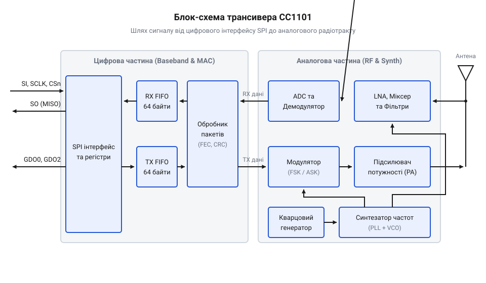

# CC1101 — субгігагерцовий трансивер (433 МГц)

<preknowlist>
- [Радіомодуль nRF24](root:cat-hw-connect/nrf24-radio) — розуміння загального принципу пакетної передачі даних на частоті 2.4 ГГц і концепції FIFO-буферів.
</preknowlist>

## Пробивання стін і вибір частоти

Короткі радіохвилі, які використовує [радіомодуль nRF24](root:cat-hw-connect/nrf24-radio), добре відбиваються від перешкод, але швидко втрачають енергію під час проходження крізь стіни чи перекриття. Чим нижча частота, тим довша хвиля, і тим легше вона огинає перешкоди та проникає крізь будівельні конструкції. Саме тому для стабільного зв’язку в будівлях або на великих відстанях використовують діапазон 433 МГц. Модулі, які працюють на частотах нижче 1 ГГц, називають @@en|субгігагерцовими трансиверами@@. Базовим представником цього класу є чип CC1101, який забезпечує надійний канал передавання там, де модулі на 2.4 ГГц втрачають сигнал.

## Внутрішня будова та шлях сигналу

Мікроконтролеру важко напряму формувати радіохвилю потрібної частоти. Щоб передати дані, він записує їх через інтерфейс SPI у внутрішню пам'ять трансивера — @@en|FIFO-буфер@@. Коли буфер наповнюється, CC1101 бере керування на себе.

*Схема внутрішньої будови CC1101: дані від мікроконтролера проходять через цифрові буфери й перетворюються на високочастотний сигнал у радіотракті.*

Модулятор чипа перетворює логічні нулі та одиниці на частотні зсуви, змінюючи частоту опорного генератора. Цей аналоговий сигнал посилюється і виводиться на антену. Під час приймання процес іде у зворотному напрямку: слабкий сигнал з антени посилюється, його частота знижується до проміжної і лише тоді оцифровується. Демодулятор витягує з нього початкові нулі та одиниці й складає їх у буфер приймання, звідки мікроконтролер може забрати їх у зручний для себе час.

## Формування радіопакета в ефірі

Радіоефір наповнений шумом і сигналами від інших пристроїв. Якщо трансивер просто почне слухати частоту, він не зможе виділити корисні дані з цього хаосу. Тому дані упаковуються в стандартизований радіопакет.

*Формат радіопакета: спеціальні стартові послідовності готують приймач до зчитування основного блоку даних, який захищений контрольною сумою.*

Передавання завжди починається з @@en|преамбули@@ — чергування нулів та одиниць, яке допомагає приймачу розпізнати сигнал і підлаштувати під нього свій внутрішній годинник. Одразу за преамбулою йде @@en|слово синхронізації@@ (@@en|sync word@@). Це унікальна послідовність бітів, яка повідомляє: «починається корисне навантаження». Тільки якщо приймач побачить правильне слово синхронізації, він почне складати наступні біти в буфер. Наприкінці пакета додається контрольна сума, щоб приймач міг відкинути пакет, якщо в ефірі спотворився хоча б один біт.

## Розділення ефіру та сон трансивера

Щоб кілька пар пристроїв могли працювати поруч і не заважати один одному, загальний діапазон частот ділять на вузькі канали. CC1101 має вбудований фільтр, який відсікає всі сигнали поза межами обраного каналу. Перед виходом в ефір трансивер може автоматично виміряти рівень енергії на частоті, щоб зробити оцінку вільного каналу. Якщо канал зайнятий, модуль зачекає, запобігаючи колізіям.

Постійне слухання ефіру швидко виснажує батарею. Для економії CC1101 вміє автоматично переходити в стан сну і періодично прокидатися на дуже короткий час. Він перевіряє, чи є в ефірі преамбула. Якщо ефір порожній, трансивер одразу засинає знову, не турбуючи мікроконтролер. Це дозволяє пристрою працювати місяцями без заміни джерела живлення.
