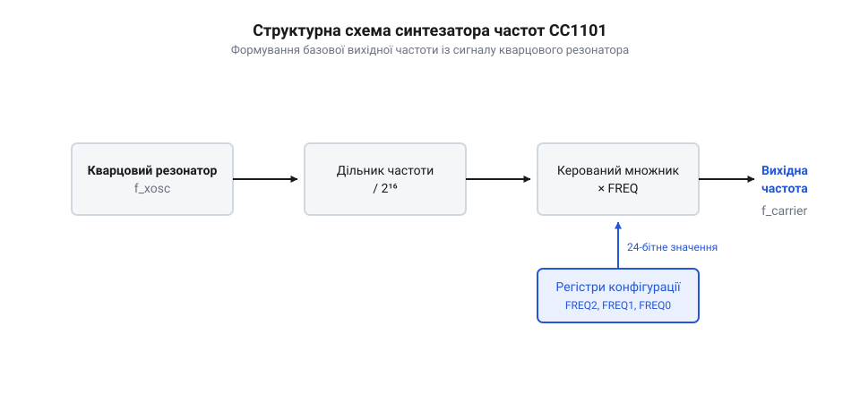
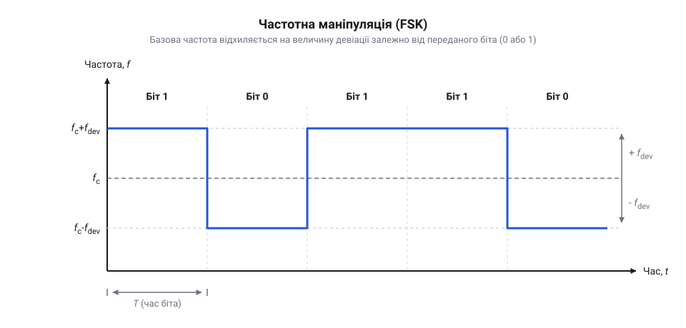

# Розрахунок частот і швидкостей CC1101

## Звідки береться потрібна частота

Радіомодуль не може мати окремого генератора для кожної можливої частоти. Замість цього він використовує один спільний еталон — кварцовий резонатор. Цей кварц видає стабільну опорну частоту, а всі інші робочі частоти створюються з неї за допомогою @@en|синтезатора частот@@.

Синтезатор працює як керований математичний перетворювач. Він бере опорну частоту від кварцу і множить її на дробовий коефіцієнт. Цей коефіцієнт не є постійним: ми самі задаємо його, записуючи числа у відповідні конфігураційні регістри трансивера. Таким чином, зміна робочого каналу чи перемикання між прийомом і передачею — це лише запис нового числа, яке вказує синтезатору, у скільки разів змінити опорну частоту.


*Спрощена структурна схема синтезатора частот @@en|CC1101@@ показує, як опорна частота від кварцу проходить через математичне перетворення з коефіцієнтом, заданим регістрами.*

Завдяки цьому ми отримуємо можливість програмно налаштовувати трансивер на будь-яку частоту в межах його апаратного діапазону. Фізично цей дробовий коефіцієнт реалізується як дріб, у якому записане в регістри число стає чисельником, а знаменник є апаратною константою. Ця константа є повною ємністю цифрового накопичувача всередині синтезатора, жорстко заданою розрядністю його лічильника. Механізм керування працює так: на кожен такт опорного кварцу накопичувач додає до свого поточного стану значення чисельника. Поки сума лишається в межах ємності, основний дільник синтезатора ділить вихідну частоту на своє базове ціле число. Щойно стається переповнення цієї фіксованої ємності знаменника, накопичувач зберігає лише залишок від переповнення і видає сигнал перенесення; цей сигнал змушує дільник на один цикл змінити свій коефіцієнт — поділити частоту на число, більше на одиницю. Наприклад, якщо заданий чисельник становить чверть від ємності знаменника, накопичувач переповнюватиметься кожен четвертий такт: тоді дільник тричі поділить на базове число, а один раз — на збільшене. У середньому за тисячі тактів ця пропорція безпосередньо керує дільником і вказує йому, скільки вихідних коливань синтезатора має припасти на один такт опорного кварцу. Сама математика перетворення жорстко закладена в логіку чипа, і нам потрібно лише розрахувати правильні значення, щоб синтезатор видав саме ту частоту несучої, яка нам потрібна.

## Розрахунок базової частоти каналу

Щоб налаштувати трансивер на потрібну несучу частоту, нам потрібно обчислити 24-бітне значення для регістра `FREQ`. Цей регістр фізично розбитий на три 8-бітні регістри: `FREQ2`, `FREQ1` та `FREQ0`. Разом вони утворюють число, яке є чисельником у формулі синтезатора.

Формула, за якою трансивер перетворює значення з регістра на реальну фізичну частоту, виглядає так:

    f_carrier
    = f_xosc · (FREQ / 2¹⁶)      [базова формула з документації]

Тут `f_carrier` — це бажана частота несучої в герцах, `f_xosc` — частота кварцу, а `FREQ` — те саме 24-бітне ціле число, яке ми маємо знайти. Знаменник `2¹⁶` є константою синтезатора, яка визначає крок налаштування.

Оскільки нам відома бажана частота, ми маємо виразити `FREQ` з цієї формули:

    FREQ
    = f_carrier · 2¹⁶ / f_xosc   [переносимо відомі величини]

Наприклад, ми хочемо налаштувати модуль на частоту 433.92 МГц (433920000 Гц) із кварцом на 26 МГц (26000000 Гц):

**Розрахунок регістра FREQ для 433.92 МГц**

    FREQ
    = 433920000 · 65536 / 26000000      [підставляємо значення в герцах]
    = 28437731735552 / 26000000         [множимо чисельник]
    ≈ 1093758.9                         [ділимо на частоту кварцу]
    = 1093759                           [округлюємо до найближчого цілого]

Отримане десяткове число 1093759 нам потрібно перевести в шістнадцяткову систему, оскільки в регістри записуються байти:

    1093759
    = 0x10B07F               [переведення в шістнадцятковий формат]

Тепер це число розбивається на три байти: старший байт `0x10` йде у регістр `FREQ2`, середній `0xB0` — у `FREQ1`, а молодший `0x7F` — у `FREQ0`.


*Графік відхилення частоти при модуляції показує, що розрахована базова частота стає центром, навколо якого сигнал відхиляється для передачі нулів та одиниць.*

Округлення до цілого числа дає невеличку похибку налаштування частоти. Через дискретність дільника ми не можемо отримати ідеальну точність до сотих часток герца. Крок зміни частоти дорівнює `26000000 / 65536 ≈ 396.7` Гц. Це означає, що реальна частота завжди буде кратна цьому значенню. У нашому прикладі через округлення розрахункового 1093758.9 до 1093759 ми змістили значення на 0.1 кроку, що створило похибку близько 40 Гц: після зворотного перерахунку реальна частота складе `1093759 · (26000000 / 65536) ≈ 433925391` Гц. Для широкої смуги пропускання у сотні кілогерців така розбіжність некритична, і зсув несучої на лічені герци ніяк не завадить успішно прийняти сигнал. Але якщо ми налаштовуємо лінію зв'язку на максимальну дальність і радикально звужуємо смугу приймача, щоб відсікти шум, кожне зміщення базової частоти наближає сигнал до межі глухого фільтра. До цієї постійної математичної похибки від округлення завжди додається фізичний температурний дрейф кварцу. Нагрівання чи охолодження плати змушує кварц коливатися трохи швидше або повільніше. Оскільки синтезатор формує кінцевий сигнал множенням опорної частоти, температурна нестабільність кварцу пропорційно зсуває й саму несучу. Ці два зсуви мають різну природу і в найгіршому випадку складаються в один бік: округлення вже посунуло частоту вище цільової, а зміна температури додатково потягнула її туди ж. Якщо загальна сума похибок виявиться завеликою, то при відхиленні частоти для передачі одиниці чи нуля частина сигналу опиниться поза смугою пропускання, і приймач почне втрачати пакети.

## Налаштування швидкості передачі даних

Радіомодуль не може просто передавати дані з будь-якою довільною швидкістю, яку ми йому надішлемо. Синтезатору потрібен чіткий тактовий сигнал, щоб знати, скільки часу триває кожен переданий біт. У CC1101 швидкість передачі даних задається за допомогою двох компонентів: мантиси (`DRATE_M`) та експоненти (`DRATE_E`). 

Ці два параметри дозволяють покрити величезний діапазон швидкостей, використовуючи лише кілька бітів у конфігураційних регістрах. Якби чип використовував звичайний дільник тактової частоти, для підтримки всього діапазону від 1,2 до 500 кілободів із високою точністю знадобився б багаторозрядний лічильник, який фізично займав би більше транзисторів на кристалі. Поділ значення на складові економить місце: експонента працює як перемикач масштабу, відтинаючи зайві нулі, а мантиса зберігає лише значущі цифри, завдяки чому гнучке налаштування вміщується в мінімум пам'яті. Експонента зберігається в регістрі `MDMCFG4`, а мантиса — в `MDMCFG3`. Сама формула для розрахунку швидкості передачі даних `R_DATA` у бодах (або бітах на секунду) має такий вигляд:

```
R_DATA
= ((256 + DRATE_M) · 2^DRATE_E) ÷ 2²⁸ · f_XOSC      [формула з документації CC1101]
```

Тут `f_XOSC` — це частота вашого кварцового резонатора (зазвичай 26 МГц). 

Щоб знайти значення для мантиси та експоненти під час налаштування потрібної швидкості, нам потрібно розв'язати цю формулу відносно `DRATE_E` та `DRATE_M`. На практиці зручно спочатку знайти експоненту, оскільки вона визначає грубий діапазон (порядок), а потім підібрати мантису для точного налаштування в межах цього діапазону.

```
DRATE_E
= ⌊log₂ (R_DATA · 2²⁰ ÷ f_XOSC)⌋                    [груба оцінка експоненти]
```

Знаючи експоненту, мантису обчислюємо так. Щоб побачити перехід від логарифма до регістрів, налаштуймо швидкість 9600 бод для резонатора на 26 МГц (26 000 000 Гц). Оцінка експоненти дасть `DRATE_E = ⌊log₂ (9600 · 2²⁰ ÷ 26000000)⌋ = ⌊log₂ 387.16⌋ = 8`. Цю вісімку ми підставляємо у виведену з базового рівняння формулу мантиси й отримуємо `DRATE_M ≈ 131.17`. Отже, у регістр `MDMCFG4` піде експонента 8, а в `MDMCFG3` — округлена до цілого мантиса 131. Загальний вигляд формули мантиси такий:

```
DRATE_M
= R_DATA · 2²⁸ ÷ (f_XOSC · 2^DRATE_E) - 256         [точне значення мантиси]
```

Після розрахунку результат для `DRATE_M` потрібно округлити до найближчого цілого числа, оскільки регістр приймає лише цілі значення від 0 до 255. Це і є причиною, чому не кожну швидкість можна встановити абсолютно точно.

## Девіація для частотної модуляції

При передачі даних за допомогою частотної модуляції (наприклад, 2-FSK) логічний нуль і логічна одиниця кодуються різними частотами. Відстань від базової несучої частоти до цих двох точок називається @@en|девіацією частоти@@. Чим більша швидкість передачі даних, тим ширшим має бути канал, і відповідно більшою має бути девіація, щоб приймач міг надійно розрізняти стани.

У CC1101 девіація налаштовується в регістрі `DEVIATN` і, подібно до швидкості, складається з експоненти (`DEVIATION_E`) та мантиси (`DEVIATION_M`). Але на відміну від швидкості передачі, де для мантиси відведено цілих вісім бітів, мантиса девіації займає лише три. Ця різниця випливає з фізики процесу: якщо швидкість вимагає ідеально точного налаштування, щоб приймач не втратив синхронізацію під час читання довгого потоку бітів через накопичену похибку часу, то девіація — це просто відстань між двома частотами в ефірі. Демодулятору байдуже, чи рознесені частоти логічного нуля та одиниці рівно на 40 кГц, чи на 41.2 кГц; головне — щоб вони були достатньо далеко одна від одної для впевненого розпізнавання, але при цьому гарантовано вкладалися у смугу пропускання фільтрів приймача. Тому трьох бітів цілком достатньо, щоб задати прийнятний розмах частот, заощадивши місце в апаратних регістрах мікросхеми.

Формула розрахунку девіації `f_dev` має такий вигляд:

```
f_dev
= (8 + DEVIATION_M) · 2^DEVIATION_E ÷ 2¹⁷ · f_XOSC    [залежність девіації від параметрів]
```

Як і зі швидкістю, спочатку ми визначаємо експоненту, а потім обчислюємо мантису для точного підлаштування. Експонента може приймати значення від 0 до 7, а мантиса — від 0 до 7, що дає доволі грубий крок налаштування. 

Щоб знайти регістрові значення для бажаної девіації `f_dev`, спочатку підбираємо експоненту так, щоб мантиса вклалася в діапазон від 0 до 7:

```
DEVIATION_E
= ⌊log₂ (f_dev · 2¹⁴ ÷ f_XOSC)⌋                       [визначаємо діапазон]
```

І мантиса:

```
DEVIATION_M
= f_dev · 2¹⁷ ÷ (f_XOSC · 2^DEVIATION_E) - 8          [точне значення]
```

Отримане значення `DEVIATION_M` округлюється. Через те, що для мантиси виділено лише 3 біти, фактична девіація в ефірі може помітно відрізнятися від розрахункової. Наприклад, якщо для кварцу 26 МГц бажана девіація становить 39.7 кГц, формули дадуть експоненту 4 і мантису 4.5. Округливши мантису до 5, зворотною підстановкою дістанемо справжнє значення:

```
f_dev
= (8 + 5) · 2⁴ ÷ 2¹⁷ · 26 000 000       [перерахунок з округленою мантисою]
≈ 41 260                                [Гц]
```

Найближчий нижній крок із мантисою 4 дасть 38 086 Гц, тож бажані 39.7 кГц апаратно недосяжні. Через такий великий стрибок — понад 3 кГц між сусідніми значеннями регістра — після кожного розрахунку варто робити зворотну перевірку, щоб переконатися, що похибка не виведе сигнал за межі смуги пропускання приймача.

## Апаратні обмеження та похибки

Синтезатор частот і дільники тактового сигналу в CC1101 — це цифрові блоки, які оперують цілими числами. Це створює фундаментальне обмеження: нескінченний простір можливих частот і швидкостей накладається на дискретну сітку доступних значень.

По-перше, роздільна здатність базової частоти обмежена кроком синтезатора, який для кварцу 26 МГц становить близько 396 Гц. Ви не можете налаштувати частоту точніше за цей крок. 

По-друге, розрахунки швидкості та девіації покладаються на мантису та експоненту. Якщо швидкість ще можна налаштувати доволі точно завдяки 8-бітній мантисі (256 кроків), то девіація має лише 3 біти для мантиси (8 кроків). Це означає, що при розрахунку девіації похибка округлення буде значною. 

Наприклад, якщо розрахункова мантиса для девіації виходить рівною 3.5, її доведеться округлити до 3 або 4. Це призведе до того, що реальна девіація стрибне на значну величину порівняно з ідеальною. Щоб уникнути цього, розробник автоматизує підбір: він пише скрипт, який з дрібним кроком зсуває початкові вимоги до швидкості й девіації в межах допустимого для проєкту діапазону. Скрипт перебирає ці сусідні значення і шукає таку їхню комбінацію, для якої розрахункова мантиса виявляється найближчою до цілого числа, мінімізуючи похибку апаратного округлення.

На практиці це виглядає так: розробник задає цільову швидкість 100 кбод і девіацію 47 кГц, для якої ідеальна мантиса становить 6.81. Якщо під час обчислень просто округлити її до 7, трансивер фізично видасть 47.6 кГц, що порушить налаштований індекс модуляції. Тоді скрипт починає перебирати сусідні параметри, обчислюючи мантиси для кожного варіанта. Критерієм відбору стає модуль різниці між розрахунковим значенням і найближчим цілим числом: що менша ця відстань, то точніше апаратні дільники відтворять бажаний сигнал. Скрипт знаходить, що для пропорційно зсунутої комбінації у 101.3 кбод і 47.6 кГц обидві мантиси лягають на цілі числа з похибкою менш як 0.01; розробник закладає в прошивку саме ці відкалібровані значення, усуваючи апаратні спотворення радіоканалу ще на етапі математики.

Тому після розрахунку регістрових значень завжди потрібно виконати зворотний перерахунок: підставити знайдені цілі `M` та `E` у прямі формули і дізнатися, які саме параметри реально будуть застосовані в чипі. Якщо різниця між бажаною та реальною швидкістю або девіацією завелика, радіоканал може працювати нестабільно. У таких випадках доводиться трохи зсувати бажані параметри (наприклад, змінювати швидкість передачі даних у всьому проєкті), щоб вони краще потрапляли в апаратну сітку трансивера.
