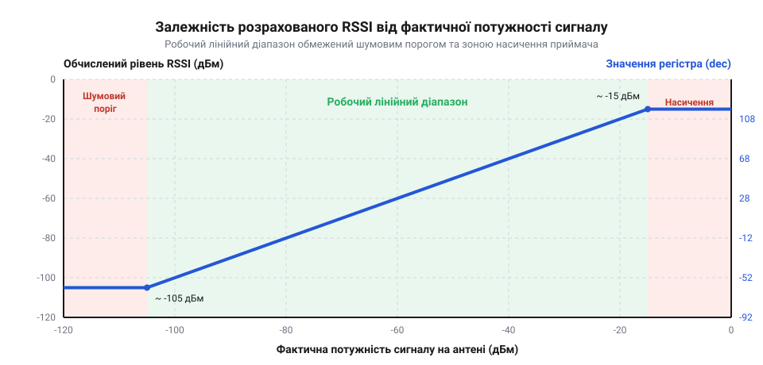

# Розрахунок рівня сигналу RSSI

## Раптові обриви бездротового зв'язку

Під час передачі даних на відстань сигнал із часом слабшає, поки не загубиться в шумах. Якщо пристрій оцінює зв'язок лише за фактом отримання пакетів, втрата з'єднання завжди настає раптово. Щойно рівень сигналу падає нижче межі чутливості приймача, пакети перестають доходити, і система миттєво втрачає контроль над лінією. Без числового показника якості зв'язку мікроконтролер не може передбачити обрив, щоб вчасно знизити швидкість передачі, змінити канал або сповістити користувача про вихід із зони покриття. 

Щоб програмно реагувати на погіршення умов до того, як почнуться втрати пакетів, потрібна метрика сили прийнятого сигналу. Такою метрикою є @@en|Received Signal Strength Indicator@@ (RSSI) — числове значення, яке радіомодуль вимірює для кожного прийнятого пакета. Апаратна частина оцінює рівень сигналу не впродовж усього часу прийому, а лише на самому початку: приймач робить кілька вибірок під час проходження преамбули та синхрослова, усереднює їх і фіксує результат. Час усереднення часто можна налаштувати в регістрах модуля: що довший період вимірювання, то точнішою буде оцінка завдяки згладжуванню випадкових сплесків. Проте якщо передавач надішле надто коротку преамбулу, приймач не встигне зібрати достатньо вибірок, і розрахований рівень сигналу сильно «стрибатиме» або виявиться хибним. Через те, що показник фіксується лише на старті, він відображає якість зв'язку тільки на момент захоплення пакета, і раптова перешкода посеред корисних даних на RSSI вже не вплине. Розуміючи математичну природу цього показника, можна розрахувати реальний запас надійності лінії зв'язку.

## Логарифмічна шкала потужності дБм

Потужність радіосигналу на вході приймача зазвичай вимірюється в частках мілівата. Різниця між потужним сигналом поблизу передавача та слабким сигналом на межі покриття може сягати мільйонів разів. Працювати з такими малими й водночас розмашистими лінійними величинами незручно. Тому в радіозв'язку використовують логарифмічну шкалу — децибели відносно одного мілівата, або дБм.

Ця шкала перетворює зміну потужності в рази на зручне додавання чи віднімання. Значення 0 дБм відповідає потужності рівно в 1 міліват. Щоб знайти рівень сигналу `P_дБм` у децибелах, беруть лінійну потужність `P` у міліватах, ділять її на опорний 1 міліват і обчислюють десятковий логарифм, помножений на десять:

    P_дБм
    = 10 · log₁₀(P / 1 мВт)      [означення рівня у дБм]

Оскільки прийнятий сигнал майже завжди слабший за 1 міліват, під логарифмом опиняється значення, менше за одиницю, тому значення дБм стають від'ємними. Зменшення потужності вдвічі означає падіння приблизно на 3 дБм, а вдесятеро — на 10 дБм. Наприклад, сигнал із рівнем −70 дБм у десять разів потужніший за сигнал −80 дБм. Завдяки логарифмічній природі шкали дБм легко оцінювати втрати на трасі поширення простою арифметикою.

## Перетворення сирих даних регістра

Радіомодуль не видає готове значення в дБм напряму. Після прийому пакета він записує в спеціальний регістр сире цілочисельне значення, пропорційне виміряній напрузі на детекторі. Щоб отримати фізичну величину, це сире значення `RSSI_raw` потрібно підставити в лінійне рівняння, яке надає виробник чипа.

Математична модель перетворення зазвичай має такий вигляд:

    RSSI_dBm
    = RSSI_raw ÷ A - B      [застосовано формулу виробника]

Тут `A` — це масштабний множник, який переводить кроки АЦП у децибели (наприклад, 2 для кроку 0.5 дБм), а `B` — фабричне зміщення (@@en|offset@@), яке залежить від конструкції приймача і часто задається як константа, наприклад 74. Ці числа не потрібно підбирати чи калібрувати для кожної плати: програміст бере їхні точні значення з технічної документації (@@en|datasheet@@) на конкретний чип. Однак перед підстановкою у формулу сире значення треба правильно зчитати: зазвичай воно лежить у регістрі як 8-бітне число зі знаком у доповнювальному коді. Якщо скопіювати його в беззнакову змінну, від'ємні значення перетворяться на хибні великі додатні числа, і математика зламається, тому `RSSI_raw` завжди спочатку приводять до знакового типу, наприклад `int8_t`. Лише після цього можна рахувати: відчитавши з регістра коректне число 20, ми ділимо його навпіл і віднімаємо 74, отримуючи −64 дБм.

*Лінійна залежність розрахованого рівня в дБм від сирих значень регістра. Видно лінійну ділянку, де виміри точні, а також зону шумового порогу знизу і насичення приймача зверху, де формула перестає працювати.*

## Сигнал, шум та запас

Абсолютне значення RSSI саме по собі не гарантує надійної передачі. Приймач завжди ловить фоновий тепловий шум ефіру та перешкоди від інших пристроїв. Щоб пакет був успішно декодований, рівень корисного сигналу має перевищувати цей шумовий поріг на певну величину. Ця різниця називається відношенням сигнал/шум (SNR).

Якщо фоновий шум становить −100 дБм, а RSSI прийнятого пакета дорівнює −90 дБм, то сигнал вищий за шум лише на 10 дБ. Щоб дізнатися цей шумовий поріг на практиці, програма має зчитати регістр RSSI тоді, коли модуль слухає ефір, але жоден вузол не веде передачі; це дасть поточний рівень фонових перешкод. Проте просто зчитувати регістр навмання небезпечно: якщо в цей момент почнеться передача, мікроконтролер сприйме слабкий корисний сигнал за раптовий сплеск шуму і хибно занизить оцінку якості каналу. Щоб надійно відрізнити чистий ефір, вимірювати шумовий поріг слід виключно тоді, коли апаратний прапорець виявлення несучої (@@en|Carrier Sense@@) скинутий — це гарантує, що радіотракт не зловив жодної преамбули. У радіоканалі умови постійно змінюються через рух об'єктів і відбиття хвиль, що викликає завмирання. Щоб зв'язок не обривався при найменшому погіршенні умов, закладають запас на завмирання (@@en|fade margin@@) — додаткові 15–25 дБ над мінімально необхідним SNR. Розрахувавши цей запас програмно як різницю між рівнем прийнятого пакета та останнім коректно виміряним шумом, мікроконтролер може попередити про наближення до критичної межі ще до втрати перших пакетів.

## Похибки та нелінійність вимірювань

Математична модель перетворення `RSSI_raw` у дБм є ідеалізованою і працює добре лише в середній, лінійній частині робочого діапазону приймача. Коли сигнал стає занадто потужним (наприклад, пристрої лежать впритул), тракт приймача входить у насичення, і значення в регістрі перестає зростати. Натомість, коли сигнал слабшає і наближається до шумового порогу, покази стають хаотичними через вплив теплового шуму.

Крім того, вимірювальні кола радіомодуля чутливі до температури. При нагріванні чи охолодженні чипа фабричне зміщення зміщується, додаючи похибку до розрахованих дБм. Щоб компенсувати цей дрейф на практиці, розробники не спираються на жорсткі пороги, а закладають додатковий запас у кілька децибел або ж періодично калібрують зміщення за вбудованим термодатчиком. Тому RSSI є чудовим інструментом для відносної оцінки якості лінку та запасу потужності, але він вкрай погано підходить для точного обчислення фізичної відстані між пристроями за формулами вільного простору.
