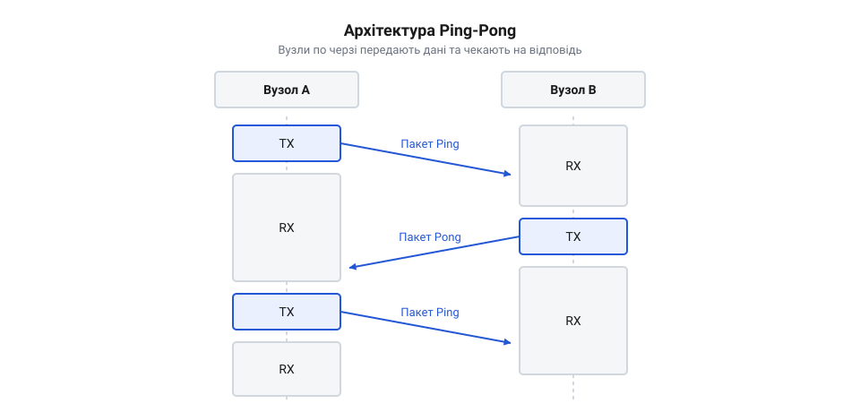
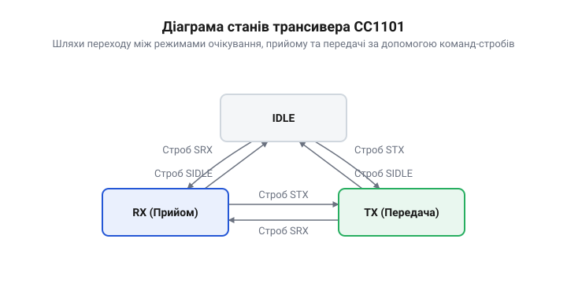

# Радіоміст Ping-Pong

## Відсутність двостороннього зв'язку

Коли пристрій лише відправляє дані, він не знає, чи отримав їх адресат. Завади в радіоефірі, перешкоди на шляху сигналу або просто вимкнений приймач призводять до того, що пакети губляться безслідно. Щоб гарантувати доставку, приймач мусить підтвердити отримання, а отже, сам стати передавачем і надіслати відповідь.


*Архітектура Ping-Pong розв'язує проблему втрати даних: перший вузол надсилає пакет і чекає, поки другий прийме його й надішле підтвердження.*

У такій схемі пристрої працюють по черзі. Вузол-ініціатор (Ping) формує повідомлення, перемикається в режим передачі, надсилає дані, а потім одразу переходить у режим прийому і чекає. Вузол-відповідач (Pong) постійно слухає ефір; отримавши пакет, він аналізує його, перемикається на передачу і відсилає своє підтвердження або корисне навантаження. Після цього відповідач знову повертається до слухання. Якщо ж обидва вузли спробують стати ініціаторами одночасно, вони вийдуть в ефір разом: їхні пакети накладуться, перетворившись на шум, і жоден не отримає відповіді. Для розв'язання такої колізії вузли мусять вичекати випадковий час перед повторною спробою, щоб розминутися. Цю паузу вираховують як випадкову кількість фіксованих часових інтервалів. Щоб гарантувати, що пристрої не виберуть однакову затримку і не зіткнуться знову, генератори випадкових чисел на кожному вузлі ініціалізують різними унікальними значеннями — наприклад, апаратним ідентифікатором мікроконтролера або шумом з аналогового входу. Завдяки цьому один вузол завершує паузу раніше і починає передачу, а другий, перед тим як увімкнути свій передавач, апаратно перевіряє рівень сигналу в каналі (@@en|Clear Channel Assessment, CCA@@); побачивши зайнятий ефір, він скасовує власну спробу і переходить до прийому. Такий двосторонній обмін дозволяє не лише контролювати цілісність каналу, а й обмінюватися даними в обох напрямках на одній частоті.

## Базова ініціалізація CC1101

Перш ніж трансивер зможе щось випромінювати чи приймати, його треба налаштувати. Мікроконтролер спілкується з радіомодулем через інтерфейс `SPI`. Будь-яка взаємодія починається з вибору мікросхеми та відправки команди або адреси регістра.

Щоб гарантувати коректний старт, насамперед модулю надсилають команду скидання. Вона повертає скінченний автомат трансивера в початковий стан. Одразу після скидання мікросхема ще не готова спілкуватися: їй потрібен час на стабілізацію кварцового генератора та ініціалізацію внутрішніх кіл. Якщо почати запис зарано, трансивер просто проігнорує дані, тому мікроконтролер має вичекати апаратний сигнал готовності. Фізично цей механізм виглядає так: мікроконтролер притискає до землі лінію вибору мікросхеми й чекає, поки трансивер сам не опустить лінію `MISO`. Лише тоді надсилається команда скидання, після якої модуль тимчасово підіймає `MISO` в одиницю. Мікроконтролер продовжує опитувати лінію, і коли трансивер знову опускає `MISO` до нуля, це засвідчує його повну готовність приймати подальші команди. Лише після цього в конфігураційні регістри записують параметри радіоканалу: базову частоту (наприклад, 433 МГц), швидкість передачі, девіацію частоти та налаштування модуляції.


*Трансивер змінює свою поведінку залежно від поточного стану: для налаштування він має бути в IDLE, для прийому — в RX, а для відправки — переходити в TX.*

:::tabs
```c|generic
:::code proj-ping-pong/c/cc1101.c 98-102
```
```cpp|generic
:::code proj-ping-pong/c/cpp/cc1101.cpp 36-42
```
:::

## Робота з FIFO-буферами

Трансивер не може передавати байти в ефір миттєво в міру їх надходження від мікроконтролера, бо швидкість `SPI` та швидкість радіоканалу різняться. Тому CC1101 має вбудовані апаратні буфери (@@en|FIFO@@) на 64 байти — окремо для передачі (TX) та прийому (RX).

Щоб надіслати пакет, мікроконтролер спершу переводить радіомодуль у стан очікування (strobe-команда `SIDLE`) і про всяк випадок очищає передавальний буфер командою `SFLUSHTX`. Далі він записує через `SPI` дані у регістр `FIFO`. Довжина пакета при цьому не задається окремим налаштуванням: вона фізично записується в буфер як найперший байт, після якого одразу йдуть байти корисного навантаження. Після цього подається команда `STX`, яка запускає фізичне випромінювання байтів з буфера в антену. Коли передача завершується, модуль сигналізує мікроконтролеру через апаратний вивід `GDO`, що ефір вільний і можна перемикатися на прийом (команда `SRX`).

Для прийому мікроконтролер реагує на те ж переривання від `GDO`, яке в режимі RX означає, що трансивер зловив синхро-слово і успішно заповнив приймальний буфер даними. Тоді програма зчитує кількість прийнятих байтів, вичитує їх з `FIFO` і, якщо необхідно, відкидає пошкоджені або застарілі пакети, очищаючи буфер командою `SFLUSHRX`.

Якщо перший вичитаний байт довжини вказує на розмір, більший за місткість буфера, або якщо мікроконтролер не встигає забрати дані й `FIFO` переповнюється, нормальний прийом зупиняється. Радіомодуль уважає такий пакет пошкодженим і не може самостійно вийти з цього стану. Щоб відновити зв'язок, програма має примусово перевести трансивер у режим очікування командою `SIDLE` і повністю очистити приймальний буфер стробом `SFLUSHRX` — інакше наступні повідомлення не прийматимуться.

:::tabs
```c|generic
:::code proj-ping-pong/c/cc1101.c
```
```cpp|generic
:::code proj-ping-pong/c/cpp/cc1101.cpp 56-96
```
:::

## Керування станами трансивера

Щоб трансивер відправив дані в ефір або почав слухати частоту, його потрібно перевести у відповідний режим. У @@en|CC1101@@ це робиться за допомогою командних стробів — однобайтових інструкцій, які записуються по шині SPI так само, як і в звичайні регістри, але не мають параметра-значення. Строб діє миттєво, запускаючи внутрішній скінченний автомат мікросхеми. 

Основні робочі стани — це очікування (`IDLE`), прийом (`RX`) та передача (`TX`). Перехід між ними не є довільним. Щоб безпечно змінити режим, наприклад, перейти з прийому в передачу, трансивер спочатку переводять у проміжний стан очікування за допомогою строба `SIDLE`. Після цього мікроконтролер повинен дочекатися, поки автомат дійсно перейде в `IDLE`, циклічно читаючи статусний регістр `MARCSTATE`, доки той не поверне значення `0x01`. Це гарантує, що попередні операції завершені, а внутрішній синтезатор частоти готовий до нових команд.

Коли трансивер перебуває в `IDLE`, можна надсилати команду переходу в прийом — строб `SRX`. У цьому стані чип вмикає радіотракт і починає безперервно шукати в ефірі преамбулу та синхро-слово. 

:::tabs
:::code proj-ping-pong/c/cc1101.c 91-100
:::code proj-ping-pong/c/cpp/cc1101.cpp 44-54
:::

Для передачі пакету порядок дій дещо довший. Спочатку трансивер також переводять у `IDLE`. Потім обов'язково очищують буфер передачі стробом `SFLUSHTX`, щоб видалити залишки попередніх чи скасованих відправлень. Далі мікроконтролер записує довжину та самі дані корисного навантаження в регістр FIFO. Лише після того, як пакет повністю лежить у пам'яті трансивера, подається строб `STX`. Чип випромінює дані в ефір і, за замовчуванням, автоматично повертається в стан очікування. Однак якщо через завади чи неправильно задану довжину пакету автомат мікросхеми зависає в режимі `TX`, апаратного переривання про завершення передачі не відбувається. Щоб мікроконтролер не заблокувався в нескінченному очікуванні, програма спирається на таймаут: якщо за відведений час чип не повернувся в `IDLE` самостійно, мікроконтролер примусово надсилає строб `SIDLE`, щоб вийти із завислого стану, і знову виконує `SFLUSHTX` для очищення буфера від невідправлених даних.

## Переривання від виводів GDO

Мікроконтролер може постійно опитувати регістри трансивера, щоб дізнатися, чи прийнято новий пакет, але це марно витрачає процесорний час і збільшує затримку реакції. Набагато ефективніше доручити трансиверу самому сигналізувати про важливі події в ефірі. Для цього CC1101 має програмовані цифрові виводи GDO.

Виводи GDO можна налаштувати так, щоб їхній логічний рівень змінювався за певних умов. Найчастіше один із виводів, наприклад GDO0, конфігурують на видачу сигналу успішної передачі або прийому повного пакета. Для такої поведінки в конфігураційний регістр цього виводу (наприклад, `IOCFG0`) записують значення `0x06`. Завдяки цьому, коли трансивер у режимі `RX` успішно ловить синхро-слово, напруга на GDO0 піднімається до високого рівня, а після перевірки контрольної суми та збереження всього пакета у @@en|FIFO@@ — падає до низького. Під час передачі `TX` вивід так само переходить у низький рівень, щойно останній біт даних залишить антену. Проте спад сигналу `0x06` означає лише завершення прийому, незалежно від того, зійшлася контрольна сума чи ні. Щоб мікроконтролер розрізняв успішний прийом і помилку без жодного звернення по SPI, сусідній вивід (наприклад, GDO2) конфігурують на значення `0x07` (@@en|CRC_OK@@). Тоді в обробнику переривання за спадом GDO0 програма просто зчитує логічний стан GDO2: якщо напруга висока — пакет цілий і його можна забирати, якщо низька — дані пошкоджені й приймальний буфер потрібно очистити.

Цей перепад напруги заводиться на вивід мікроконтролера, який налаштований як вхід із генерацією зовнішнього переривання. У функції-обробнику переривання програма лише встановлює атомарний прапорець-індикатор. Завдяки цьому основний цикл може спокійно спати або виконувати інші задачі, і миттєво прокинеться лише тоді, коли апаратна частина підтвердить, що в ефірі щось сталося.

:::tabs
:::code proj-ping-pong/c/main.c 11-17
:::code proj-ping-pong/c/cpp/main.cpp 23-29
:::

## Основний цикл Ping-Pong

Тепер ми можемо звести керування станами та обробку переривань у єдиний алгоритм. В архітектурі Ping-Pong один пристрій виступає ініціатором обміну (Ping), а інший — відповідачем (Pong). 

Ініціатор формує пакет із повідомленням, записує його у FIFO і запускає передачу. Щойно переривання від GDO сигналізує, що відправлення завершено, він скидає прапорець події і негайно переводить трансивер у режим прийому. Далі мікроконтролер переходить в енергоощадне очікування, чекаючи на нове переривання, яке означатиме прихід відповіді. Оскільки пакет-відповідь може загубитися в ефірі через завади, паралельно запускається апаратний таймер: якщо час очікування вичерпано, його переривання примусово виводить мікроконтролер зі сну для обробки втрати зв'язку. Щоб не обірвати сеанс достроково, тривалість цього таймера розраховують як суму всіх неминучих затримок: часу на обробку запиту відповідачем, тривалості апаратного калібрування трансивера під час перемикання з прийому на передачу та часу перебування самого зворотного пакета в ефірі. Останній показник залежить від розміру пакета та налаштованої швидкості радіоканалу, і до сумарного значення завжди додають невеликий гарантійний запас. Отримавши ж пакет успішно, ініціатор вичитує та обробляє його, витримує паузу, після чого цикл повторюється.

:::tabs
:::code proj-ping-pong/c/main.c 36-60
:::code proj-ping-pong/c/cpp/main.cpp 44-67
:::

Відповідач працює симетрично, але дзеркально. Його початковий стан — прийом. Коли приходить пакет від ініціатора, спрацьовує переривання. Мікроконтролер вичитує дані з буфера і перевіряє їх. Якщо це очікуваний запит, він швидко формує пакет із відповіддю, відправляє його в ефір і, дочекавшись підтвердження передачі, знову переходить у режим прийому. Таким чином обидва вузли не тримають ефір постійно зайнятим і швидко передають одне одному керування лінією зв'язку.
