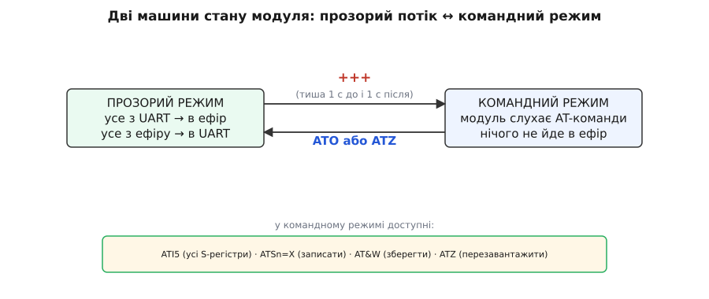

# 📋 Інтерфейс наземного модуля: COM-порт, командний режим, S-регістри, кадр MAVLink

Наземний модуль для операційної системи — це звичайний COM-порт, але за цим портом ховається цілий контракт: на якій швидкості його відкривати, як перемкнути його з передавання даних у приймання команд, які в нього регістри налаштувань і в якому форматі з нього тече телеметрія. Тут зібрано весь цей інтерфейс — усе, що треба знати, щоб говорити з модулем із власного коду, а не лише мишею у графічній вкладці станції.

Інтерфейс складається з трьох частин, і кожну ми доведемо до робочого прикладу. **Перша** — відкрити послідовний порт на правильній швидкості (57600, 8N1) і гнати крізь нього байти туди й назад, бо в прозорому режимі модуль поводиться як проста двобічна труба. **Друга** — коли треба налаштувати **сам модуль** (NetID, потужність, швидкість ефіру), ввести його в командний режим послідовністю `+++` і читати-писати S-регістри AT-командами. **Третя** — знати **формат кадру MAVLink**, що тече з порту, щоб потім із нього виловити осмислені числа. Як на цьому інтерфейсі побудувати цілу наземну станцію — розібрати потік і друкувати позицію та напругу батареї — показано окремо: [власна наземна станція в коді](root:cat-hw-connect/fpv-telemetry-ground/proj-read-telemetry.md).

Домовимось про мову коду наперед, бо інтерфейс двобічний. Там, де ми **на ПК** відкриваємо порт, природний інструмент — Python із бібліотекою `pyserial`: саме так пишуть наземні скрипти в реальному житті. Там, де ми говоримо про **сирий UART** — код, що міг би крутитися в самій прошивці модуля чи на мікроконтролері поряд, — доречніша C/C++: вона працює з байтами й регістрами напряму. Тому нижче ті самі задачі йдуть **вкладками** там, де обидві мови лягають однаково добре, і однією мовою там, де задача замкнена на своєму боці.

## Задача перша: відкрити порт і гнати прозорий потік

Почнімо з найфундаментальнішого. Наземний модуль після ввімкнення сидить у **прозорому режимі** (англ. *transparent mode*): усе, що впаде йому в UART, він шле в ефір, а все, що прилетить з ефіру, він виплюне назад у UART. З боку комп'ютера це означає геніально просту річ — **пишеш у порт байти, і вони летять на дрон; читаєш із порту байти, і це те, що дрон прислав**. Жодного протоколу, жодного рукостискання. Порт — це прозора труба.

Уся хитрість тут — у двох числах, які треба задати правильно, інакше труба мовчить. Перше — **ім'я порту**. Наземний модуль з'являється в системі як `COM3`, `COM7` на Windows, як `/dev/ttyUSB0` чи `/dev/ttyACM0` на Linux, як `/dev/tty.usbserial-*` на macOS. Друге — **швидкість**: майже всі готові набори виставлені на **57600 бод** між комп'ютером і модулем. Це не швидкість в ефірі — це швидкість локальної труби USB-UART, і вона мусить точно збігтися з тим, на що налаштований модуль, інакше в порт піде або тиша, або каша з нечитабельних байтів.

> 🔧 **Навіщо це.** Ці два числа — джерело дев'яти з десяти «нічого не читається». Обрав не той COM-порт (а там сидить, скажімо, миша чи інший USB-serial) — тиша. Виставив 9600 замість 57600 — у порт капають байти, але кожен спотворений, бо приймач семплює лінію не в ті моменти. Перш ніж винуватити код чи радіо, переконайся: правильний порт, правильна швидкість. Це буквально перше, що робить будь-яка станція, і перше, що маєш зробити ти.

Ідея коду однакова на будь-якій мові: **відкрити порт → налаштувати швидкість і формат кадру (8 біт даних, без парності, 1 стоп-біт — класичне «8N1») → у циклі читати, що прийшло, і за потреби писати**. Ось той самий мінімальний «читач прозорого потоку» двома мовами.

:::tabs
:::code api-serial-mavlink/py/ground_read.py
:::code api-serial-mavlink/cpp/ground_read.cpp
:::

Прочитаймо, що тут відбувається, бо ця пара рядків — фундамент усього. Ми відкриваємо порт, кажемо йому швидкість і формат **8N1**, і головне — задаємо **тайм-аут читання**. Без тайм-ауту `read()` завис би назавжди, коли на лінії тиша, і програма б «повисла». З тайм-аутом читання повертає те, що встигло прийти за секунду (може, нічого) — і цикл живий, готовий і читати, і слати. Зверніть увагу на симетрію: **щоб послати щось на дрон, ми пишемо в той самий порт** — і байти прозоро йдуть в ефір. Труба двобічна: `read` тягне з дрона, `write` штовхає на дрон, і жодного радіокоду ми не торкаємось — це робота модуля.

Одна тонкість, яку варто мати на думці одразу: у порт падають **не рівні кадри, а суцільний потік байтів**. Модуль не гарантує, що один `read` дасть рівно один пакет MAVLink: може прийти пів-кадру, може півтора, може три склеєних. Тому те, що ми зараз просто друкуємо шістнадцятково, треба буде **зібрати назад у кадри** — і цим ми займемось у третій задачі. Поки що маємо трубу, з якої течуть байти.

## Задача друга: командний режим і S-регістри

Тепер зовсім інша робота. Досі ми **передавали дані** крізь модуль. А що, коли треба налаштувати **сам модуль** — змінити NetID, потужність, швидкість ефіру — з коду, а не мишею у графічній вкладці? Тут криється перемикач режимів, і в ньому — найпідступніша пастка всієї теми.

Модуль не має окремого «командного» дроту. Він живе у прозорому режимі й не відрізняє ваші дані від ваших команд — усе однаково летить в ефір. Щоб він **перестав передавати й почав слухати команди**, його вводять у **командний режим** (англ. *command mode*) магічною послідовністю з трьох плюсів: `+++`. Але просто надіслати `+++` мало — бо що, як три плюси трапляться серед звичайних даних? Модуль би помилково впав у командний режим посеред телеметрії. Щоб цього не сталося, навколо `+++` вимагається **тиша**: **нічого не слати цілу секунду до `+++` і цілу секунду після**. Ця мовчазна пауза (англ. *guard time*, «охоронний час») — і є ознака, за якою модуль розуміє: це справді команда переходу, а не випадкові символи в потоці. Факт про секундну тишу — усталений, він прямо описаний в офіційній документації SiK.


*Модуль живе у двох станах. Ліворуч — прозорий режим: усе з UART іде в ефір, усе з ефіру — в UART. Праворуч — командний режим: модуль слухає AT-команди й нічого не передає. Перехід туди — тільки через `+++`, обрамлений секундною тишею з обох боків (щоб три плюси серед даних не спрацювали випадково). Назад — команда `ATO` (у прозорий) або `ATZ` (перезавантаження). У командному режимі доступні `ATI5` (усі S-регістри), `ATSn=X` (записати), `AT&W` (зберегти), `ATZ` (перезавантажити).*

Опинившись у командному режимі, модуль відповідає рядком `OK` і чекає **AT-команд** — того самого текстового діалекту, що дістався радіомодемам у спадок від старих телефонних модемів. Параметри модуля живуть у нумерованих **S-регістрах**: `S3` — це NetID, `S2` — швидкість ефіру, `S4` — потужність і так далі. Читаєш регістр командою `ATSn?`, пишеш — `ATSn=X`. А ось критичний нюанс: **записаний регістр живе лише в оперативній пам'яті, доки ви не збережете його командою `AT&W`** у постійну пам'ять (EEPROM). Забули `AT&W` — і після найближчого перезавантаження модуль забуде зміну, наче її й не було.

> 🔧 **Навіщо це.** Оце і є класична пастка «змінив, а воно не змінилося». Людина заходить у командний режим, пише `ATS3=42`, бачить `OK`, тішиться — і висмикує модуль. Наступного разу NetID знову старий. Причина: `ATS3=42` лише поклало значення в живу пам'ять; щоб воно пережило перезавантаження, треба `AT&W` (зберегти в EEPROM), а тоді `ATZ` (перезавантажити, щоб нове значення почало діяти). Порядок **завжди** один: `+++` → `ATSn=X` → `AT&W` → `ATZ`. Пропустив `AT&W` — змарнував усю процедуру.

Автоматизуймо цю процедуру кодом. Задача: зайти в командний режим, прочитати всі параметри (`ATI5`), змінити NetID, зберегти й перезавантажити. Оскільки це чистий текстовий обмін по тому самому порту, обидві мови лягають:

:::tabs
:::code api-serial-mavlink/py/ground_config.py
:::code api-serial-mavlink/cpp/ground_config.cpp
:::

Три деталі тут вирішують усе. **Перша** — `+++` шлеться **без** переводу рядка (`\r\n`), самими трьома плюсами, тоді як звичайні AT-команди — **з** переводом рядка: перевід рядка каже модулю «команда скінчилась, виконуй». **Друга** — та сама секундна тиша з обох боків `+++`, реалізована паузами `sleep`; ми ще й чистимо вхідний буфер перед `+++`, щоб недочитані телеметрійні байти не зіпсували момент переходу. **Третя** — священна трійця `ATSn=X` → `AT&W` → `ATZ`, де кожен крок несе свою роль: записати в живу пам'ять, зберегти в EEPROM, перезавантажити. Пропустиш середину — усе намарне.

Ще одна корисна річ, яку варто знати: у пари модулів команди з префіксом `RT` замість `AT` (наприклад, `RTI5`) звертаються до **віддаленого** модуля через ефір — того, що на дроні. Але вони працюють, лише поки радіолінія жива й спарована; варто відрізняти локальне налаштування (`AT`, завжди доступне через USB) від дистанційного (`RT`, залежне від того, чи стоїть міст).

## Формат кадру MAVLink

З порту тече не набір рівних пакетів, а **суцільний потік байтів**, і в ньому — телеметрія дрона. Щоб дістати з неї числа, треба знати, як укладено кадр MAVLink; сам розбір — робочий парсер і готова бібліотека — то вже застосунок, він винесений у [власну наземну станцію в коді](root:cat-hw-connect/fpv-telemetry-ground/proj-read-telemetry.md), а тут — довідка про структуру, яку той застосунок розбирає.

Кожне повідомлення MAVLink — це щільний двійковий згусток зі службовою обгорткою навколо корисних даних. У **версії 1** (стартовий байт `0xFE`) обгортка займає **вісім байтів**: стартовий байт, п'ять байтів заголовка й два байти контрольної суми. Повна анатомія кадру розібрана окремо — [пакет MAVLink](root:sys-dron/mavlink-packet), — а для роботи з наземним модулем досить полів по порядку:

```
Байт(и)   Поле     Що це
──────────────────────────────────────────────────────────
0         STX      стартовий байт: 0xFE (v1) або 0xFD (v2)
1         LEN      довжина корисних даних (скільки байтів payload)
2         SEQ      лічильник пакетів (для виявлення втрат)
3         SYS      ідентифікатор системи-відправника
4         COMP     ідентифікатор компонента-відправника
5         MSG ID   тип повідомлення (v1 — 1 байт; v2 — 3 байти)
6…6+LEN   PAYLOAD  корисні дані, формат яких задає MSG ID
далі      CRC      два байти контрольної суми
```

Довжина цілого кадру v1 = 1 (STX) + 5 (заголовок) + LEN (дані) + 2 (CRC). У **версії 2** (стартовий байт `0xFD`) заголовок довший — дев'ять байтів, `MSG ID` займає три байти, додаються поля сумісності, але ідея та сама: старт-байт, довжина, заголовок, дані, CRC. Синхронізація потоку завжди йде **по старт-байту** — `0xFE` для v1, `0xFD` для v2; немає їх у порту, значить, там не MAVLink.

Контрольна сума — не простий XOR, а **CRC-16/MCRF4XX** із домішком окремого байта `CRC_EXTRA`, різного для кожного типу повідомлення (саме він ловить розбіжність версій визначень). Це важлива деталь для того, хто звіряє CRC руками; готова бібліотека рахує його сама.

**Одиниці полів — масштабовані цілі.** MAVLink шле числа **цілими у дрібних одиницях**, щоб не гнати float по вузькому каналу, тож кожне поле треба поділити на свій масштаб:

```
Позначка   Одиниця          Дільник   Приклад
───────────────────────────────────────────────────────────
degE7      градуси × 10⁷    / 10⁷     lat 523456789 → 52.3456789°
mm         міліметри        / 1000    alt 45000 → 45.0 м
mV         мілівольти       / 1000    voltage 11100 → 11.1 В
cA         сантиампери      / 100     current 1500 → 15.0 А
```

Ці масштаби — усталений факт зі специфікації повідомлень MAVLink. Переплутаєш дільник — і замість «висота 45 метрів» отримаєш «45000»; половина «дивних чисел» у телеметрії — це неподілений масштаб.

## Пастки інтерфейсу

Майже всі пастки цього інтерфейсу об'єднує одна річ: **радіоміст мовчить замість того, щоб скаржитись**. Немає повідомлення про помилку, є тиша, і за нею треба вгадати причину.

**Не той порт або не та швидкість.** Найбанальніша й найчастіша. Відкрив `COM3`, а модуль на `COM7` — тиша. Виставив 9600 замість 57600 — у порт капають байти, але спотворені, бо приймач семплює лінію не в ті моменти, і жоден парсер їх не збере. Лік: перелічити доступні порти (`pyserial` уміє `python -m serial.tools.list_ports`), знайти свій модуль (за описом CP210x/CH340), і **завжди** ставити 57600, поки не переконався, що модуль перенастроєно на інше. Порт зайнятий станцією? Тоді ваш код його не відкриє — Mission Planner тримає порт монопольно, спершу від'єднайтесь у ньому.

**Забутий `AT&W` — зміна відкотилась.** Друга за поширеністю. Записав `ATS3=42`, побачив `OK`, зрадів — але не зберіг. Після `ATZ` (чи просто перевтикання) NetID знову старий, бо `ATSn=X` лягло лише в живу пам'ять. Це не баг модуля — це його логіка: жива пам'ять для проби, EEPROM для постійного. Правило залізне: **після кожної групи змін — `AT&W`, тоді `ATZ`**. У коді це має бути не «на розсуд», а частиною процедури, як у наших прикладах.

**Тиша замість помилки при розбіжності NetID.** Найпідступніша, бо тут винне не ваше з'єднання з модулем, а розбіжність **між двома модулями**. Ваш код чудово відкрив порт, чудово читає — але в порт нічого не тече, бо повітряний модуль на дроні має **інший NetID** (чи іншу швидкість ефіру, чи інше вікно частот), і два модулі просто не чують одне одного. З боку коду це виглядає так, наче дрон мовчить — а насправді мовчить радіоміст. Жодної помилки: труба відкрита, але порожня. Лік — переконатися, що `S2` (швидкість ефіру), `S3` (NetID) і `S8`/`S9` (частоти) **збігаються на обох модулях**; це найлегше звірити тією ж графічною вкладкою станції, що пише в обидва кінці, або командами `RT…` до віддаленого модуля, поки лінія жива.

> 🔧 **Навіщо це.** Ключ до всього налагодження — **розрізняти три «тиші»**. Тиша від «не той порт/швидкість» — це проблема між вашим кодом і модулем (порт не відкрився або дає кашу). Тиша від «забув `AT&W`» — це проблема збереження (працює до першого перезавантаження). Тиша від «різний NetID» — це проблема **між модулями** (ваш бік ідеальний, мовчить ефір). Три різні причини, один симптом — порожній екран. Спитайте по черзі: порт відкрився? байти йдуть? серед байтів є `0xFE`/`0xFD`? — і кожне «ні» вказує на свій шар.

**Плутанина «локальна швидкість ↔ швидкість ефіру».** Концептуальна, але кусюча. `57600` — це швидкість між **комп'ютером і модулем** (по USB-UART); її задаєте у своєму коді при відкритті порту. Швидкість **в ефірі** (S2) — зовсім інше число (типово кілька-кільканадцять кбіт/с), і вона між **двома модулями**. Плутати їх — класика: людина «прискорює» модуль, змінивши S1, і дивується, чому дальність не змінилась (бо дальність від S2), або навпаки ставить у коді швидкість порту, яка не збігається з S1 модуля, — і отримує кашу. Два незалежні числа: одне — локальна труба, друге — радіо.

**Мертвий байт на перезавантаженні.** Дрібна, але збиває. Після `ATZ` модуль на частку секунди зникає (перезавантажується), і перший байт-два після цього можуть бути сміттям або втратитись. Тому після `ATZ` варто зробити паузу (у прикладах — секунда) й лише тоді чекати чистий потік; інакше перший кадр після старту буде недоїдений.

Зведімо нитку. Інтерфейс наземного модуля — це три речі. **Відкрити порт**: правильні ім'я й швидкість (57600, 8N1), із тайм-аутом читання, і пам'ятати, що в порт тече суцільний потік, а не рівні пакети. **Налаштувати модуль**: `+++` з обов'язковою секундною тишею з обох боків, S-регістри через `ATSn?`/`ATSn=X`, і священна трійця `ATSn=X` → `AT&W` → `ATZ`, де забутий `AT&W` знецінює все. **Знати формат кадру**: старт-байт `0xFE`/`0xFD`, довжина, заголовок, дані, CRC, а поля — масштабовані цілі. На цьому інтерфейсі й будується [власна наземна станція в коді](root:cat-hw-connect/fpv-telemetry-ground/proj-read-telemetry.md), що перетворює потік із порту на позицію, висоту й напругу батареї. І над усім — головна риса моста: він **мовчить замість помилок**, тож усе налагодження зводиться до питання «яка з тишей у мене зараз» — між кодом і модулем, у збереженні, чи між двома модулями в ефірі.
