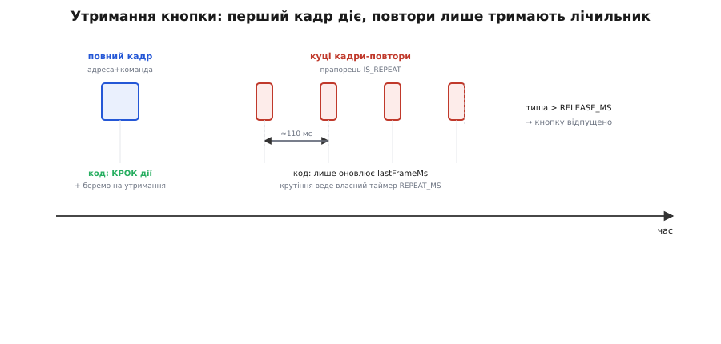

# ⚙️ proj: меню яскравості на кнопках ІЧ-пульта — натиск, утримання, автоповтор

Впіймати код кнопки — це ще не керування. Керування починається тоді, коли пульт робить щось справжнє: короткий натиск перемикає режим, а **утримання** плавно крутить яскравість, поки тримаєш палець. Ось задача, яка відрізняє іграшку «надрукувати код у монітор» від живого пристрою, — і саме на ній новачок спотикається найчастіше. Зберемо тут робоче меню на кнопках звичайного ІЧ-пульта, яке коректно реагує і на короткі натиски, і на утримання.

Від заліза задача просить скрізь те саме: один пін, здатний на переривання, лічильник із мікросекундною роздільністю та жменю стану в пам'яті. Різниця лише в тому, хто розбирає кадр на адресу й команду: на Arduino це робить бібліотека IRremote, на ESP-IDF — периферія RMT з власним розбором NEC, на STM32 — EXTI плюс вільний таймер. Тому кожен приклад нижче йде трьома вкладками, які роблять одне й те саме. Контракт IRremote — виклики `begin`/`decode`/`resume`, поля `decodedIRData`, прапорець повтору, конфлікти таймерів — зібрано в [довіднику API IRremote](root:cat-hw-connect/ky-022-ir-rx/api-irremote-decode.md); тут ми на ньому будуємо застосунок і не переказуємо його.

## Задача: чого хочемо від меню

На вивід S приймача, заведений на будь-який пін, здатний на переривання (у прикладах це D2 на Arduino, GPIO4 на ESP32, PA2 на STM32), прилітають кадри від пульта. Ми хочемо на кожен **новий** натиск виконати дію — переключити режим, збільшити яскравість, увімкнути реле — і при цьому:

- **розпізнавати кнопку незалежно від пульта**: не «сирі мілісекунди», а осмислені число-адресу пристрою й число-команду кнопки (це дає бібліотека або власний розбір кадру);
- **не плутати утримання з повторним натиском**: коли тримаєш кнопку гучності, пульт шле не «кнопку знову і знову», а куций кадр-повтор; для меню це різниця між «збільшити на один» і «плавно крутити вгору»;
- **не реагувати на чужі пульти**: клацнув хтось поряд пультом від іншого пристрою — меню має це відсіяти;
- **лишатися живим**: після кожного кадру приймальний тракт треба явно звільнити під наступний, інакше він застигне на першому — на Arduino це `resume()`, на ESP-IDF повторний `rmt_receive()`, на STM32 скинутий прапорець готовності.

Будуймо шар за шаром.

## Крок 1: зняти коди кнопок свого пульта

Числа-команди **не вгадують і не переписують з чужого туторіалу** — їх знімають зі **свого** пульта. Заливаєш мінімальний скелет, що друкує протокол/адресу/команду (на Arduino — той із [довідника API](root:cat-hw-connect/ky-022-ir-rx/api-irremote-decode.md), на ESP-IDF чи STM32 — розбір із наступного кроку з друком у лог), тиснеш по черзі потрібні кнопки й записуєш, який `command` друкується для кожної. Умовно вийде таке (у тебе будуть свої числа):

```
кнопка «1»      → command = 0x45
кнопка «2»      → command = 0x46
кнопка «►/❚❚»    → command = 0x40   (play/pause)
кнопка «+»       → command = 0x15   (гучність вгору)
кнопка «−»       → command = 0x07   (гучність вниз)
```

Заодно занотуй `address` — вона стала для всього пульта й знадобиться, щоб відсіювати чужі кадри.

## Крок 2: switch-меню й фільтр адреси

Маючи таблицю, меню — це просто `switch` по команді. Щоб код не розповзався магічними числами, винесемо коди кнопок в іменовані константи:

:::tabs
:::code proj-irremote-menu/c/arduino/krok-2-switch-meniu-i.ino
:::code proj-irremote-menu/c/esp-idf/krok-2-switch-meniu-i.c
:::code proj-irremote-menu/c/stm32/krok-2-switch-meniu-i.c
:::

Два місця варті окремої уваги.

**Фільтр адреси.** Наш `switch` дивиться лише на `command`. Якби поряд хтось клацнув пультом від іншого пристрою, що випадково має той самий протокол і команду `0x15`, меню сприйняло б це за «гучність вгору». Перевірка `address != MY_REMOTE` на вході відсіює чужі кадри. Зверни увагу, що приймач звільняється **навіть на викинутому кадрі** — `resume()` перед `return` на Arduino, повторний `rmt_receive()` на ESP-IDF, скинутий `rx_ready` перед перевіркою адреси на STM32: інакше приймач застигне, і це та сама пастка забутого звільнення, лише замаскована раннім виходом.

**ШІМ і таймери.** Яскравість крутить апаратний ШІМ: `analogWrite(9, …)` на Arduino, канал LEDC на ESP32, канал таймера на STM32. На Uno такий `analogWrite` нешкідливий, але на деяких платах пін ШІМ і таймер приймача можуть зіштовхнутися за спільний апаратний ресурс — про цей клас конфліктів див. [довідник API](root:cat-hw-connect/ky-022-ir-rx/api-irremote-decode.md).

Це вже робоче меню — але поки що воно «двоїться» на утриманні: затиснеш «+», і яскравість стрибне не на один крок, а на кілька, бо в `switch` влітають і перший кадр, і кадри-повтори як окремі натиски. Розберімо це.

## Крок 3: утримання проти повторного натиску

Натисни кнопку гучності раз — гучність смикнеться на крок. **Затисни** — очікуєш, що поповзе вгору плавно, поки тримаєш. Як мікроконтролер відрізнить «тримаю три секунди» від «натиснув тридцять разів дуже швидко»?

Через те, як влаштований протокол. У найпоширенішому **NEC** пульт при утриманні шле повний кадр **один раз**, а далі — куций **кадр-повтор**: «та сама кнопка ще тримається», без номера. Впізнати повтор — обов'язок приймального шару: IRremote піднімає на ньому прапорець `IRDATA_FLAGS_IS_REPEAT` і сама відновлює `command`/`address` з першого кадру, тож поля на повторі валідні (деталі в [довіднику API](root:cat-hw-connect/ky-022-ir-rx/api-irremote-decode.md)); власний розбір на RMT чи EXTI впізнає повтор за куцою преамбулою — 9 мс імпульсу й 2.25 мс паузи замість 4.5 мс — і мусить сам пам'ятати останню команду. Звідси три стратегії, і вибір між ними — це і є суть дизайну меню.

**Стратегія А — «лише перший натиск, повтори ігнорувати».** Для кнопок, де утримання не має сенсу: перемикання режиму, «ОК», цифри каналів. Тримаєш — спрацьовує один раз, скільки не тримай.

:::tabs
```arduino
if (IrReceiver.decode()) {
  bool isRepeat = IrReceiver.decodedIRData.flags & IRDATA_FLAGS_IS_REPEAT;
  if (!isRepeat) handleButton(IrReceiver.decodedIRData.command);   // діємо ЛИШЕ на перший
  IrReceiver.resume();
}
```
```esp-idf
if (xQueueReceive(q, &ev, portMAX_DELAY) == pdPASS) {
    uint16_t addr = 0, cmd = 0; bool repeat = false;
    if (nec_parse(ev.received_symbols, ev.num_symbols, &addr, &cmd, &repeat) && !repeat)
        handle_button(cmd);                          // діємо ЛИШЕ на перший
    rmt_receive(rx, syms, sizeof(syms), &rc);        // переозброїти приймач
}
```
```stm32
if (rx_ready) {
    uint16_t cmd = rx_cmd; uint8_t repeat = rx_repeat;
    rx_ready = 0;                                    // звільнили місце під наступний кадр
    if (!repeat) handle_button(cmd);                 // діємо ЛИШЕ на перший
}
```
:::

**Стратегія Б — «повтор = теж дія».** Для гучності/яскравості: тримаєш — значення повзе. Реагуємо і на перший кадр, і на кожен повтор однаково:

:::tabs
```arduino
if (IrReceiver.decode()) {
  uint16_t cmd = IrReceiver.decodedIRData.command;   // на повторі теж валідне
  if (cmd == BTN_UP)   { if (brightness <= 245) brightness += 5; applyBrightness(); }
  if (cmd == BTN_DOWN) { if (brightness >= 5)   brightness -= 5; applyBrightness(); }
  IrReceiver.resume();
}
```
```esp-idf
if (xQueueReceive(q, &ev, portMAX_DELAY) == pdPASS) {
    uint16_t addr = 0, cmd = 0; bool repeat = false;   // на повторі cmd — з першого кадру
    if (nec_parse(ev.received_symbols, ev.num_symbols, &addr, &cmd, &repeat)) {
        if (cmd == BTN_UP)   { if (brightness <= 245) brightness += 5; apply_brightness(); }
        if (cmd == BTN_DOWN) { if (brightness >= 5)   brightness -= 5; apply_brightness(); }
    }
    rmt_receive(rx, syms, sizeof(syms), &rc);
}
```
```stm32
if (rx_ready) {
    uint16_t cmd = rx_cmd;                 // на повторі лишається з першого кадру
    rx_ready = 0;
    if (cmd == BTN_UP)   { if (brightness <= 245) brightness += 5; apply_brightness(); }
    if (cmd == BTN_DOWN) { if (brightness >= 5)   brightness -= 5; apply_brightness(); }
}
```
:::

Але тут причаїлася підступність: **темп повторів диктує протокол, а не ти**. У NEC перший повтор приходить приблизно через **40 мс** після кінця першого кадру, а далі повтори йдуть із періодом близько **110 мс**. Це жорсткі ~9 кроків на секунду, хоч крути темп у коді, хоч ні: значення повзе рівно так, як зволить протокол. Для грубої гучності терпимо, для плавного чи, навпаки, повільнішого регулювання — ні. Тому часто беруть третю стратегію, де темп задаєш сам.

**Стратегія В — «власне автоповторення, від бібліотеки беремо лише факт утримання».** Ти сам вирішуєш темп повторення й не залежиш від капризної першої паузи протоколу. Ідея: запам'ятати, яку кнопку тримають, і поки летять повтори — крутити значення зі своїм інтервалом.

:::tabs
:::code proj-irremote-menu/c/arduino/krok-3-utrymannia-proty.ino
:::code proj-irremote-menu/c/esp-idf/krok-3-utrymannia-proty.c
:::code proj-irremote-menu/c/stm32/krok-3-utrymannia-proty.c
:::

Логіка трьох частин `loop()` варта одного погляду цілком. Частина (1) слухає пульт: на **новий** натиск одразу робить крок і запам'ятовує кнопку в `heldCommand`; будь-який наш кадр — і перший, і повтор — оновлює `lastFrameMs` (мітку «кнопка ще жива»). Частина (2) не залежить від пульта зовсім: поки `heldCommand` не нуль, вона крутить значення рівно зі **своїм** темпом `REPEAT_MS`, ігноруючи капризну першу паузу протоколу. Частина (3) ловить відпущення — і тут ключова тонкість: **пульт не шле «кнопку відпустили»**, він просто перестає слати повтори. Тож «відпущено» визначаємо **за тишею**: якщо довше за `RELEASE_MS` (трохи більше за інтервал між повторами) не прилетіло ні кадру, ні повтору — вважаємо кнопку відпущеною, скидаємо `heldCommand`, і рух спиняється.



*Що прилітає від пульта при утриманні (верхня стрічка) і що з цим робить код (нижня). Перший — повний кадр із адресою й командою; далі йдуть куці кадри-повтори з прапорцем `IS_REPEAT`, приблизно кожні 110 мс. Код реагує дією лише на перший, а повтори тільки оновлюють мітку часу «кнопку ще тримають»; саме крутіння веде окремий власний лічильник `REPEAT_MS`. Коли повтори зникають надовше за `RELEASE_MS` — кнопку відпущено.*

Тепер поведінка та, якої й хотіли: коротке натискання дає один крок; утримання — рівний рух зі **своїм** темпом `REPEAT_MS`, а не з нав'язаними протоколом ~110 мс; відпустив — рух одразу спинився.

> 🔧 **Навіщо це.** Може здатися, що Стратегія В — надмір заради дрібниці. Але саме вона розв'язує тобі руки з темпом. Протокол шле повтори зі своїм фіксованим періодом (у NEC — близько 110 мс), і якщо чіпляти дію просто на кожен повтор, швидкість регулювання буде рівно такою, якою її задав інженер пульта десятиліття тому, — ні швидшою, ні повільнішою. А в реальному пристрої одне значення хочеться крутити жваво (яскравість), інше — обережно (уставка температури). Відв'язавши свій `REPEAT_MS` від протоколу, ти обираєш темп під кожну ручку окремо.

## Пастки меню

Зберемо граблі саме цього застосунку — місця, де скетч компілюється, схема зібрана правильно, а поведінка не та.

- **Забуте звільнення приймача** — він оглухне після першого кадру. На кожен прийнятий кадр — рівно одне звільнення (`resume()` на Arduino, повторний `rmt_receive()` на ESP-IDF, скинутий прапорець на STM32), у тому числі перед раннім `return` на чужому пульті.
- **Плутанина утримання й натиску** — меню «двоїться»: один фізичний натиск дає кілька спрацювань, бо зловив і перший кадр, і повтори як окремі натиски. Ліки: для разової дії — Стратегія А (лише не-повтор); для регулювання — Стратегія В із власним темпом. Ніколи не покладайся, що «повтор не прийде швидко» — прийде.
- **Реакція на чужий пульт** — без фільтра `address` меню смикається від сусідського клацання. Спершу звір адресу, і лише потім заходь у `switch`.
- **Незнайомий пульт** — якщо `protocol == UNKNOWN`, поля `.command`/`.address` не мають сенсу, і `switch (command)` ловитиме шум; як помітити цей стан і розрізняти кнопки за `decodedRawData` — у [довіднику API](root:cat-hw-connect/ky-022-ir-rx/api-irremote-decode.md).

## Що лишається в руках

Меню на пульті — це три кроки контракту (прийняли кадр → прочитали поля → звільнили приймач), обгорнуті сенсом: `switch` по команді дає власне меню; фільтр адреси відсікає чужі пульти; ознака повтору (прапорець `IRDATA_FLAGS_IS_REPEAT` в IRremote, куца преамбула у власному розборі) відрізняє утримання від натиску, а власний лічильник `REPEAT_MS` робить регулювання таким плавним чи повільним, як хочеш ти, а не як зволив інженер пульта десятиліття тому. Ось де ховається різниця між дешевим і дорогим відчуттям пристрою — за ті самі три дроти й той самий приймач.
