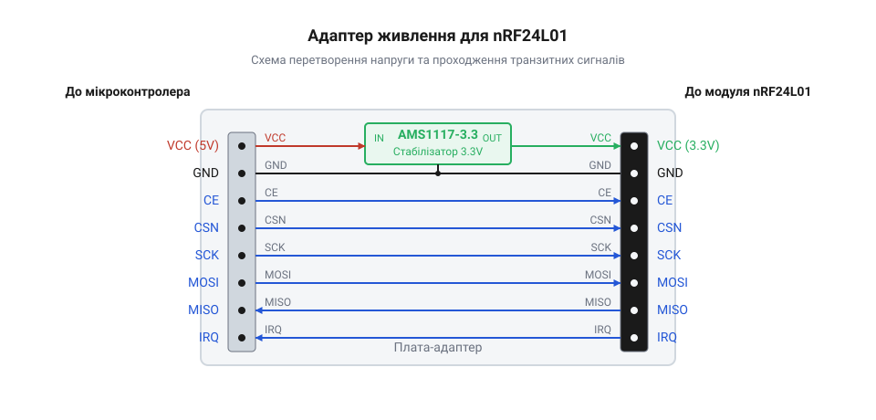

# Апаратний інтерфейс адаптера nRF24L01

<preknowlist>
- [Радіомодуль nRF24](root:cat-hw-connect/nrf24-radio) — призначення ліній SPI, CE та CSN, щоб розуміти, які сигнали проходять через адаптер.
</preknowlist>

## Чому радіомодулю потрібен адаптер

Пряме підключення [радіомодуля nRF24](root:cat-hw-connect/nrf24-radio) до мікроконтролера часто стає причиною нестабільного зв'язку або частих перезавантажень. Радіопередавач під час надсилання чи приймання пакету потребує різкого імпульсного струму, який може сягати сотень міліампер. Лінії живлення 3.3 В на багатьох платах мікроконтролерів часто не розраховані на такі стрибки, що спричиняє просадки напруги. Через просадку радіомодуль скидає налаштування або зависає. Інша типова помилка живлення — підключення модуля до лінії 5 В, від якої його чип миттєво згорає, адже він розрахований суворо на 3.3 В. Крім того, напруга з мікроконтролера часто засмічена шумами від цифрових кіл, а без додаткових фільтрувальних конденсаторів радіомодуль стає вразливим до перешкод на довгих з'єднувальних проводах.

До того ж, стандартний модуль nRF24 має дворядний конектор (вісім ніжок у два ряди), який фізично незручно вставляти в макетну плату: отвори на макетці з'єднані лініями впоперек, тому контакти з сусідніх рядів конектора опиняться на одній струмопровідній смузі й замикатимуться між собою. Адаптер вирішує обидві проблеми: він містить окремий вузол для стабільного живлення та виводить усі сигнальні лінії на зручний однорядний роз'єм для легкого підключення проводами. Щоб безпечно з'єднати їх між собою і не переплутати контакти, у дворядне гніздо адаптера радіомодуль встановлюють за контуром, намальованим на платі навколо гнізда: антена модуля має дивитися в бік намальованого виступу. Якщо вставити плату задом наперед, силові лінії живлення потраплять на сигнальні контакти, і після подачі струму чип радіомодуля миттєво згорить.

## Стабілізатор напруги та живлення

Адаптер оснащений лінійним стабілізатором напруги AMS1117-3.3, який перетворює вхідну напругу на стабільні 3.3 В, необхідні для живлення радіо. Цей стабілізатор розрахований на максимальний вихідний струм до 1 А, чого з надлишком вистачає навіть під час активної передачі даних. Окрім стабілізатора, на платі вже розпаяні фільтрувальні конденсатори, що згладжують шуми живлення та миттєво віддають струм під час різких імпульсних навантажень, повністю усуваючи проблему просадок напруги, тому допаювати їх власноруч більше не доведеться. Щоб стабілізатор працював правильно і не перегрівався, на вхід (піни VCC та GND) потрібно подавати 5 В. Якщо подати менше, наприклад, 3.3 В з мікроконтролера, напруга на виході стабілізатора впаде нижче допустимого рівня для радіомодуля. Це стається через внутрішнє падіння напруги (@@en|dropout voltage@@) на самому стабілізаторі: для AMS1117-3.3 воно становить близько 1.1–1.3 В, тому для отримання стабільних 3.3 В на виході на вхід необхідно подати щонайменше 4.4 В.

З іншого боку, подавати напругу понад 5 В на VCC адаптера не варто. Що вища вхідна напруга, то більше енергії стабілізатор перетворює на тепло, щоб знизити її до 3.3 В. Без додаткового охолодження він може швидко перегрітися і вийти з ладу, якщо вхідна напруга перевищує 9–12 В, особливо під час передачі даних, коли струм максимальний.

## Розпіновка та транзит сигналів

Адаптер слугує зручним перехідником між однорядними пінами, що йдуть до мікроконтролера, та дворядним гніздом, куди вставляється сам модуль. Усі лінії інтерфейсу SPI (SCK, MOSI, MISO), а також керівні сигнали CE та CSN, проходять крізь плату-адаптер без жодних змін чи логічних перетворень.

Сам радіомодуль має виводи, толерантні до 5 В, тому немає потреби ставити додаткові конвертери логічних рівнів між 5-вольтовим мікроконтролером (наприклад, Arduino Uno) та адаптером. Сигнальні дроти підключаються напряму: контакти з відповідними маркуваннями на адаптері з'єднуються з відповідними пінами мікроконтролера.

Однорядний роз'єм адаптера виводить вісім контактів, потрібних для роботи з радіомодулем. Це вхід живлення (`VCC`) та спільна земля (`GND`), за якими йдуть керівні сигнали вибору режиму (`CE`) і вибору пристрою на шині (`CSN`), що підключаються до довільних цифрових пінів мікроконтролера. Наступні три контакти — це лінії апаратної шини SPI: тактування (`SCK`), передача даних (`MOSI`) та їх прийом (`MISO`). Останнім виведено сигнал апаратного переривання (`IRQ`), який з'єднують із входом переривання мікроконтролера, щоб опрацьовувати події модуля асинхронно.

Однорядний роз'єм адаптера містить вісім контактів, розташованих послідовно: вхід живлення (`VCC`) та спільна земля (`GND`); керівні сигнали вибору режиму (`CE`) і мікросхеми на шині (`CSN`), які підключаються до довільних цифрових пінів; три лінії апаратної шини SPI (`SCK` для тактування, `MOSI` для передачі та `MISO` для прийому даних); а також вивід апаратного переривання (`IRQ`), який з'єднують із перериванням мікроконтролера, якщо програма реагує на події асинхронно.

Вхідна колодка адаптера складається з восьми підписаних контактів: входу живлення («VCC») та спільної землі («GND»), трьох ліній шини SPI («SCK», «MOSI», «MISO»), керівних сигналів вибору («CE» і «CSN»), а також виводу апаратного переривання («IRQ»). Вихідне дворядне гніздо формату 2×4 розведене точно під ніжки самого радіомодуля: усі шість сигнальних ліній та земля проходять на нього від вхідної колодки безпосередньо, і лише на контакт живлення гнізда подається знижена напруга 3.3 В від стабілізатора замість вхідних 5 В.
