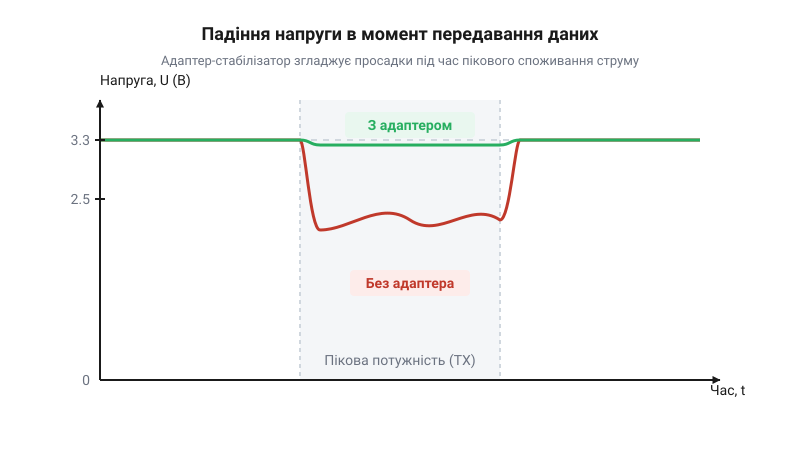
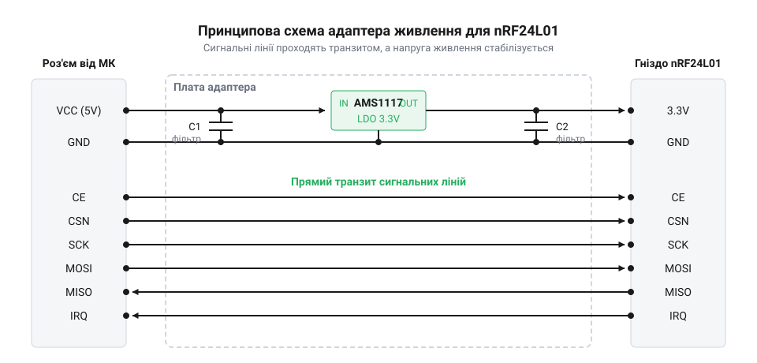

# Адаптер-стабілізатор живлення для nRF24L01

<preknowlist>
- [Радіомодуль nRF24](root:cat-hw-connect/nrf24-radio) — загальне призначення модуля, його вимоги до струму під час передачі та використання інтерфейсу SPI.
</preknowlist>

## Проблема просадок живлення модуля

Радіомодуль [nRF24L01](root:com-transport/nrf24l01-module) у режимі передавання даних може споживати значний струм, який виникає імпульсно. Стандартні виводи живлення мікроконтролера, наприклад, 3.3 В на платі Arduino, розраховані на живлення самої плати та слабких датчиків, але не на різкі стрибки струму. Коли модуль намагається видати радіосигнал максимальної потужності, він витягує з джерела живлення більше струму, ніж те здатне миттєво віддати. Через це лінія живлення втрачає стабільність, і напруга на ній різко падає нижче допустимого для радіомодуля рівня.

*Без адаптера напруга просідає нижче робочої норми в момент передачі, тоді як адаптер утримує її стабільною.*

Унаслідок такої просадки напруги вбудована логіка nRF24L01 дає збій: модуль може зависнути, перезавантажитись або просто не передати пакет даних. Це стається, коли напруга падає нижче критичної межі в 1,9 В, за якої спрацьовує внутрішня схема скидання модуля і він втрачає всі свої налаштування. Під час цього процесу контролер продовжує працювати і надсилати команди, але радіозв'язок розривається без очевидних причин. Виявити цю просадку на практиці буває складно: звичайний мультиметр усереднює виміри й покаже нормальну напругу, оскільки падіння триває лише частки мілісекунди і прилад просто не встигає його зафіксувати. Побачити такий короткий імпульсний спад можна лише за допомогою осцилографа. Стандартне джерело живлення мікроконтролера не здатне покрити ці стрибки: його штатний стабілізатор розрахований лише на малі струми, а довгі з'єднувальні проводи мають власну індуктивність. Навіть якщо на платі контролера встановлені власні конденсатори, здатні віддати імпульс струму, вони не вирішують проблему через свою віддаленість від модуля. Будь-який провід працює як слабка котушка, що опирається різким змінам струму. Коли передавач миттєво вимагає великої порції енергії, індуктивність проводів між контролером і радіомодулем не дозволяє струму від віддалених конденсаторів зрости одразу — вона затримує його віддачу, створюючи електричну інерцію. Поки струм у проводах лише наростає до потрібного рівня, напруга на самому радіомодулі вже встигає критично впасти. Щоб радіомодуль міг стабільно працювати і забезпечувати надійний зв'язок, йому потрібне окреме джерело з буфером, який стоїть упритул до нього і здатен миттєво віддати достатньо струму в момент передавання. Цю задачу вирішує спеціальний адаптер живлення.

## Будова і принцип дії адаптера

Адаптер живлення працює як проміжний перетворювач і накопичувач енергії між джерелом живлення та самим радіомодулем. На вході адаптер може приймати вищу напругу, наприклад, стандартні 5 В від USB або блоку живлення мікроконтролера, яка є набагато потужнішою і менш схильною до просадок.

*Лінійний стабілізатор перетворює 5 В на 3.3 В, а пара конденсаторів на виході бере на себе різкі стрибки споживання.*

Основним компонентом плати є [лінійний стабілізатор AMS1117](root:sf-devices/ams1117), який знижує вхідні 5 В до стабільних 3.3 В, потрібних для роботи nRF24L01. Щоб подолати різкі стрибки струму під час передавання, на виході стабілізатора розміщені електролітичний та керамічний конденсатори, які ділять між собою роботу з імпульсами різних частот. Електролітичний конденсатор, зазвичай номіналом 10 мкФ, працює як місткий резервуар для відносно низькочастотних коливань: він віддає велику кількість накопиченої енергії під час тривалих імпульсів споживання, тим самим утримуючи напругу від просідання. Цієї ємності достатньо для базового радіомодуля, під який і проєктувалася плата. Виробник не встановлює із заводу місткіші конденсатори, оскільки ємність у 100–470 мкФ вимагає габаритного вивідного компонента замість компактної SMD-деталі, що невиправдано збільшило б розміри і вартість адаптера, тоді як більшості користувачів такі ємності не потрібні. Але для версії з підсилювачем (PA+LNA) штатного резервуара часто бракує, тому для її стабільної роботи доводиться паралельно допаювати додатковий конденсатор на 100–470 мкФ самостійно. Його припаюють безпосередньо до контактів дворядного роз'єму на платі адаптера, у який вставляється радіомодуль: плюсову ніжку до контакту VCC, а мінусову — до GND. Керамічний конденсатор ємністю 0.1 мкФ, своєю чергою, фільтрує високочастотні завади. Завдяки низькій внутрішній індуктивності він здатен миттєво реагувати на надшвидкі стрибки струму, які більший, але інерційніший електролітичний конденсатор просто не встигає відпрацювати. Ці завади проникають по лінії живлення від імпульсних перетворювачів та цифрових компонентів схеми. Якщо вони потраплять до чутливого радіочастотного тракту модуля, то спотворять сигнал, що призведе до зменшення дальності зв'язку та втрати пакетів.

Окрім живлення, плата має транзитні виводи для інтерфейсу SPI. Детальну розпіновку вхідного і вихідного роз'ємів адаптера містить [Апаратний інтерфейс адаптера nRF24L01](root:cat-hw-connect/nrf24-power-adapter/api-nrf24-adapter-hardware.md). Завдяки такій конструкції модуль не лише отримує якісне стабільне живлення, але й зручно підключається до схеми. Практичну схему з'єднання адаптера з мікроконтролером розглядає [Підключення адаптера nRF24L01 до мікроконтролера](root:cat-hw-connect/nrf24-power-adapter/proj-nrf24-adapter-connection.md).

## Особливості підключення ліній даних

Адаптер-стабілізатор розв'язує проблему живлення, але сам радіомодуль для обміну даними використовує інтерфейс SPI. Важливо розуміти, що адаптер обробляє лише живлення: вхідна напруга проходить через стабілізатор і знижується до потрібного рівня. Проте всі сигнальні лінії (SCK, MISO, MOSI, CSN, CE, IRQ) проходять через плату адаптера транзитом, тобто з'єднують мікроконтролер із модулем напряму.

Це означає, що логічні рівні сигналів на платі адаптера не перетворюються. Оскільки сам модуль nRF24L01 толерантний до 5-вольтової логіки, його сигнальні виводи можна безпосередньо підключати до 5-вольтових мікроконтролерів без ризику пошкодження. У зворотному напрямку перетворювач також не потрібен: модуль передає дані по лінії MISO з напругою 3,3 В, але входи 5-вольтових мікроконтролерів зазвичай сприймають будь-яку напругу вище 2,5–3 В як логічну одиницю, тому успішно зчитують сигнал. Так само пряме підключення ліній даних через адаптер працює і для мікроконтролерів із логікою 3,3 В, оскільки транзитні лінії просто передають їхні сигнали на модуль без змін. Сенс пропускати лінії даних через адаптер, а не підключати їх напряму до модуля, суто механічний: адаптер має готову контактну колодку 2×4, яка точно відповідає роз'єму самого модуля. Завдяки цьому радіомодуль просто вставляється в адаптер як у гніздо, а вже до штирків адаптера підключаються всі дроти від мікроконтролера. Адаптер у цьому ланцюгу виконує роль зручного фізичного перехідника, не втручаючись у передачу даних. Докладно про [розпіновку роз'ємів](root:cat-hw-connect/nrf24-power-adapter/api-nrf24-adapter-hardware.md) адаптера йдеться в окремій довідці.

Коли адаптер живиться від того ж джерела, що й мікроконтролер, їхня земля спільна від початку. Проте часто адаптер доводиться живити від окремого акумулятора чи потужнішого блоку живлення, і в такому разі дані не підуть, поки ви додатково не з'єднаєте їхні виводи GND. Логічні нулі та одиниці на лініях SPI — це напруга, яка завжди вимірюється відносно нуля. Якщо мікроконтролер і адаптер не мають спільного проводу землі, у кожного з них буде свій електричний «нуль», і сигнал від одного пристрою може означати для іншого що завгодно. Лише фізичне з'єднання земель обох плат створює єдину точку відліку, завдяки якій радіомодуль зможе безпомилково розпізнавати транзитні рівні напруги на лініях даних. Найзручніше підключити дріт спільної землі від мікроконтролера до контакту GND на восьмиконтактній сигнальній колодці адаптера: так усі інформаційні з'єднання зберуться в один логічний шлейф, а мінусова клема силового входу залишиться вільною виключно для підключення мінуса від зовнішнього джерела живлення.

## Інтеграція адаптера в схему

Щоб гарантувати стабільну роботу радіомодуля, адаптер потрібно правильно заживити. Убудований [лінійний стабілізатор](root:sf-devices/ams1117) вимагає на вході напруги від 4,8 В до 12 В. Це обмеження знизу зумовлене тим, що будь-який лінійний стабілізатор має внутрішнє падіння напруги (@@en|drop-out@@). Щоб видати стабільні 3,3 В, мікросхемі потрібен запас на вході — для серії AMS1117 він становить близько 1,5 В, що в сумі й дає мінімальні 4,8 В. Найчастіше адаптер живлять від контакту 5 В мікроконтролера або від зовнішнього 5-вольтового джерела. Якщо подати на вхід менше 4,8 В, стабілізатору забракне запасу на власне падіння напруги, він не зможе підтримувати вихід на рівні 3,3 В, і радіомодуль відключиться. Якщо ж підвести більше 12 В, мікросхема почне перегріватися через надмірну різницю напруг, яку їй доведеться розсіювати у вигляді тепла.

Найпоширеніша помилка при складанні схеми — підключення адаптера до виводу 3,3 В мікроконтролера. Адаптер створений саме для того, щоб перетворювати 5 В на стабільні 3,3 В для радіомодуля. Якщо на його вхід VCC подати вже готові 3,3 В, після проходження через стабілізатор напруга просяде ще нижче, і модуль не зможе запуститися. Тому контакт VCC адаптера необхідно з'єднувати виключно з лінією 5 В або вище. Проте буває й так, що саме 5-вольтове джерело виявляється нестабільним і зашумленим — наприклад, якщо це дешевий імпульсний перетворювач або від тієї ж лінії живляться мотори. Убудований лінійний стабілізатор добре впорається з повільними коливаннями, але різкі високочастотні завади можуть пройти крізь нього до радіомодуля і спричинити втрату пакетів. У такому разі лінію 5 В перед входом адаптера додатково очищують: ставлять LC-фільтр із дроселя та конденсатора або принаймні ще один місткий електролітичний конденсатор, який поглине високочастотний шум. Підводячи живлення, слід бути вкрай уважним із полярністю: на платі адаптера немає захисного діода чи іншого механізму від переполюсовки, тому якщо випадково переплутати плюс і мінус, мікросхема стабілізатора і сам радіомодуль миттєво згорять. Якщо ж у пристрої є лише стабільна лінія на 3,3 В, адаптер стає непотрібним, але спершу варто перевірити, чи здатна вона віддати достатній струм. Для цього в документації на плату мікроконтролера знаходять максимальний струм її стабілізатора 3,3 В, віднімають від нього струм, який споживає сам мікроконтролер та інші підключені компоненти, і порівнюють залишок із піковим апетитом радіомодуля — близько 15 мА для базової версії та до 150 мА для версії з підсилювачем. Якщо запас є, намагатися модифікувати адаптер, закорочуючи вхід і вихід стабілізатора перемичкою, щоб напруга йшла транзитом, не має сенсу — це лише додає зайвих контактів та ускладнює конструкцію без жодної користі. Замість цього адаптер слід вилучити зі схеми, зажививши радіомодуль безпосередньо від 3,3 В та самостійно додавши паралельно живленню конденсатор для згладжування пікового споживання. Практичну [схему з'єднання](root:cat-hw-connect/nrf24-power-adapter/proj-nrf24-adapter-connection.md) компонентів можна побачити у відповідному проєкті.

## Межі застосування і альтернативи

Адаптер живлення добре вирішує проблему короткочасних просадок і є найпростішим способом забезпечити надійну роботу модуля, але його можливості не безмежні. Серцем плати є лінійний стабілізатор [AMS1117](root:sf-devices/ams1117), який знижує вхідну напругу до потрібних 3,3 В. Головний недолік лінійних стабілізаторів полягає в тому, що надлишок напруги вони перетворюють на тепло.

Якщо на адаптер подати 12 В, а [радіомодуль nRF24](root:cat-hw-connect/nrf24-radio) у режимі передачі споживатиме близько 115 мА (як це буває у версіях із підсилювачем), стабілізатору доведеться розсіяти майже 1 Вт потужності. Ця величина виникає через те, що лінійний стабілізатор перетворює надлишок напруги на тепло: різниця між вхідними 12 В і потрібними 3,3 В (тобто 8,7 В), помножена на струм споживання 0,115 А, якраз і дає 1 Вт. На платі адаптера відведення тепла відбувається через металеву підкладку мікросхеми, припаяну до мідного полігона на текстоліті, який працює як радіатор. Але площа цього полігона на мініатюрній платі надто мала, щоб розсіяти таку кількість тепла, адже для віддачі 1 Вт у повітря потрібно кілька квадратних сантиметрів вільної міді. Передача одного пакета триває частки мілісекунди, і теплова інерція корпусу мікросхеми дозволяє їй поглинути цей короткий сплеск тепла — модуль точно встигне відправити принаймні один пакет до того, як температура досягне критичної межі. Проте якщо пакети йдуть часто один за одним, без додаткового охолодження стабілізатор швидко перегріється і піде в захист, вимкнувши живлення модуля. Тому для інтенсивної роботи з високою вхідною напругою (понад 7–9 В) та потужними модулями цей адаптер підходить погано.

Крім того, адаптер залишається додатковою ланкою, що займає місце. Якщо пристрій розробляється на власній платі, ставити окремий модуль-адаптер недоцільно — простіше одразу закласти правильне живлення з потрібними конденсаторами.

Коли можливостей адаптера бракує, є кілька надійних альтернатив. Перша — імпульсні перетворювачі напруги. Вони працюють значно ефективніше за лінійні, майже не гріються при великій різниці між вхідною та вихідною напругою і здатні віддати набагато більший струм. Однак через постійне перемикання транзисторів вони генерують високочастотні завади, які можуть суттєво погіршити чутливість приймача радіомодуля. Щоб цього уникнути, напругу після імпульсного перетворювача додатково фільтрують LC-ланкою: послідовно підключеним дроселем та паралельним керамічним конденсатором, що згладжують пульсації. Друга альтернатива — використання загального джерела живлення системи, яке від самого початку видає стабільні 3,3 В із достатнім запасом за струмом (від 200 мА і більше). У цьому разі радіомодуль підключають напряму, додавши безпосередньо біля пінів живлення буферні конденсатори: електролітичний або танталовий номіналом від 10 до 100 мкФ для покриття різких стрибків струму під час передачі та керамічний на 0,1 мкФ для фільтрації високочастотних завад.

Детальну схему з'єднання можна подивитися у вставці [Підключення адаптера nRF24L01 до мікроконтролера](root:cat-hw-connect/nrf24-power-adapter/proj-nrf24-adapter-connection.md), а призначення виводів описано в довідці [Апаратний інтерфейс адаптера nRF24L01](root:cat-hw-connect/nrf24-power-adapter/api-nrf24-adapter-hardware.md).
