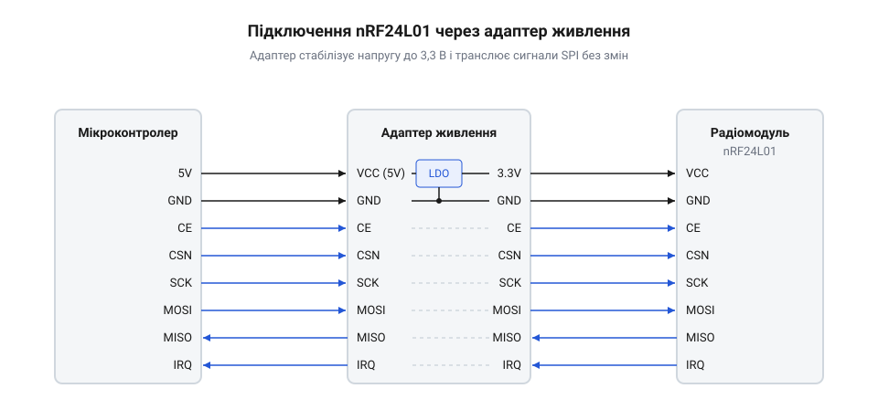

# Підключення адаптера nRF24L01 до мікроконтролера

<preknowlist>
- [Радіомодуль nRF24](root:cat-hw-connect/nrf24-radio) — Загальне призначення радіомодуля, розташування його виводів та принципи роботи інтерфейсу SPI
</preknowlist>

## Чому модулю бракує звичайного живлення

Мікроконтролер зазвичай має вивід живлення на 3.3 В, розрахований на живлення невеликих периферійних пристроїв, і зазвичай здатний віддати не більше 50 мА струму. Радіомодуль [nRF24L01](root:cat-hw-connect/nrf24-radio) у режимі очікування або прийому споживає мізерні 12–15 мА, але під час передачі даних ситуація різко змінюється. У момент випромінювання радіосигналу модулю потрібен імпульс струму, який у версіях із підсилювачем сягає понад 115 мА, що більш ніж удвічі перевищує можливості вбудованого лінійного стабілізатора мікроконтролера.

Коли струму не вистачає, напруга на виводі 3.3 В різко просідає. У радіомодулі працює вбудована схема скидання при увімкненні (@@en|Power-On Reset@@, POR), яка постійно стежить за рівнем живлення. Щойно напруга падає нижче критичного порогу, ця схема спрацьовує як захист і примусово перезавантажує мікросхему, щоб уберегти стан цифрової логіки від хаотичних збоїв. Через це всі регістри модуля миттєво втрачають конфігурацію й повертаються до початкових значень просто під час випромінювання. Для коду на мікроконтролері це виглядає як раптова втрата пакетів, неможливість доставити повідомлення або зависання зв'язку, адже скинутий радіомодуль перестає правильно відповідати на команди по шині SPI. Спроба згладити просадки припаюванням електролітичного конденсатора безпосередньо до виводу 3.3 В мікроконтролера не вирішує проблему надійно: такий конденсатор стоїть далеко від радіомодуля, а довгі з'єднувальні дроти мають власний опір та індуктивність, через які під час різкого стрибка струму напруга падає на самих дротах, і мікросхема все одно отримує просадку. Щоб уникнути цього, мікросхемі потрібне надійне джерело живлення, здатне без просідань віддати достатній струм у момент передачі, наприклад, окремий стабілізатор або спеціальний адаптер живлення.

## Будова адаптера живлення

Щоб не паяти окремі стабілізатори й конденсатори навісним монтажем, використовують готову плату-адаптер живлення. Вона розв'язує єдину задачу: бере стандартні 5 В від мікроконтролера чи зовнішнього блоку живлення і робить з них стабільні 3.3 В з достатнім запасом струму для радіомодуля.

На платі адаптера встановлено лінійний стабілізатор напруги — зазвичай AMS1117-3.3 — та згладжувальні конденсатори, які беруть на себе різкі стрибки споживання струму під час роботи передавача. Цей стабілізатор розрахований на вхідну напругу до 12 В, але через лінійний принцип роботи весь надлишок напруги він розсіює як тепло. Тому живити адаптер від 5 В безпечно, тоді як підключення до 9 В чи 12 В, особливо під час передачі даних потужними модулями з підсилювачем, швидко перегріє мікросхему і змусить її вимкнутися від теплового захисту. Для самого радіомодуля на адаптері розпаяно зручний дворядний роз'єм на 8 контактів, куди nRF24L01 вставляється без жодних проводів. Усі цифрові сигнальні лінії інтерфейсу SPI (MOSI, MISO, SCK, CE, CSN) проходять крізь плату транзитом, без жодних перетворень рівня, і виводяться на штирові контакти для підключення до мікроконтролера.

Щоб фізично не переплутати контакти під час збирання, слід орієнтуватися на антену радіомодуля: вона має дивитися назовні, у протилежний бік від штирових контактів адаптера. На текстоліті самого адаптера зазвичай намальовано білий контур, який повторює обриси nRF24L01, тож достатньо просто сумістити їхню форму. Якщо вставити модуль задом наперед, живлення піде на сигнальні лінії замість призначених пінів, через що трансивер не запрацює, а його мікросхема може згоріти.

Пін переривань `IRQ`, яким радіомодуль сигналізує про нові дані або завершення передачі, також проходить крізь адаптер транзитом і має власне місце на штировій колодці поруч із лініями SPI. Для простого опитування стану цей вивід можна залишити непідключеним, однак його наявність дозволяє задіяти апаратні переривання мікроконтролера, щоб не витрачати час на постійні перевірки трансивера і реагувати на події миттєво.

## Підключення контактів до мікроконтролера

Адаптер живлення має шість сигнальних пінів та два піни живлення. Контакти VCC та GND адаптера підключаються до джерела 5 В та землі мікроконтролера відповідно. Піни інтерфейсу SPI підключаються безпосередньо до відповідних цифрових виводів мікроконтролера: MOSI до MOSI, MISO до MISO, SCK до SCK. Виводи керування CE та CSN можна підключити до будь-яких вільних цифрових пінів. Під час первинної перевірки зв'язку лінію CE слід утримувати в низькому стані. Оскільки на цьому етапі ми лише перевіряємо відгук по шині SPI, логічний нуль на виводі CE надійно тримає радіомодуль у режимі очікування і не дає йому випадково вмикати енергоємні кола приймача чи передавача.

Радіомодуль nRF24L01 толерантний до 5-вольтової логіки на цифрових входах. Це означає, що хоча сам модуль живиться від 3.3 В (завдяки адаптеру), його сигнальні лінії можна безпосередньо з'єднувати з 5-вольтовими виводами мікроконтролера (наприклад, плат сімейства Arduino) без додаткових перетворювачів логічних рівнів. 

*Мікроконтролер живить адаптер напругою 5 В, адаптер понижує її до 3.3 В для модуля, а лінії зв'язку SPI йдуть до мікроконтролера без змін.*

Щоб переконатися, що живлення стабільне і модуль відповідає, достатньо прочитати один з його базових регістрів, наприклад `STATUS`. Протокол обміну nRF24L01 влаштований так, що значення цього регістра завжди автоматично повертається на лінії MISO під час передавання першого байта будь-якої команди по MOSI. Тому найшвидший покроковий алгоритм читання виглядає так: опустити лінію CSN до низького рівня, щоб активувати модуль, передати один байт «порожньої» команди NOP (`0xFF`) і одночасно прочитати байт-відповідь, після чого повернути CSN у високий стан. Саме такий підхід реалізовано у прикладах коду для Arduino та Raspberry Pi Pico. У більш універсальних абстракціях, як у прикладах під HAL, статус можна отримати під час повноцінного читання будь-якого регістра двома байтами: спершу передається команда читання з адресою, а другим байтом — NOP для зчитування даних. Якщо живлення немає або дроти підключено неправильно, на лінії MISO буде постійний нуль (`0x00`) або постійна одиниця (`0xFF`). Будь-яке інше значення, наприклад `0x0E` за замовчуванням після скидання, підтверджує надійний контакт.

:::tabs
== C++ | Arduino
:::code proj-nrf24-adapter-connection/cpp/arduino/main.cpp
== C++ | Raspberry Pi Pico
:::code proj-nrf24-adapter-connection/cpp/pico/main.cpp
== C | Raspberry Pi Pico
:::code proj-nrf24-adapter-connection/cpp/c/pico/main.c
== C++ | HAL
:::code proj-nrf24-adapter-connection/c/cpp/Nrf24l01.hpp
:::code proj-nrf24-adapter-connection/c/cpp/Nrf24l01.cpp
:::code proj-nrf24-adapter-connection/c/cpp/main.cpp
== C | HAL
:::code proj-nrf24-adapter-connection/c/nrf24_regs.h
:::code proj-nrf24-adapter-connection/c/main.c
:::

У кожному з наведених прикладів перед надсиланням тестового байта `0xFF` шину SPI необхідно правильно налаштувати, оскільки радіомодуль вимагає передавання старшим бітом уперед та фіксації даних на передньому фронті тактового імпульсу. В середовищі Arduino ця конфігурація виконується безпосередньо перед транзакцією викликом `SPI.beginTransaction`, де явно задається частота 1 МГц, порядок бітів `MSBFIRST` та режим `SPI_MODE0`. На платформі Raspberry Pi Pico налаштування відбувається один раз під час запуску: функція `spi_init` встановлює базову швидкість 1 МГц, після чого виводи мікроконтролера переводяться в режим апаратного керування шиною. У абстракціях рівня HAL (наприклад, для STM32) конфігурація дільника частоти, полярності та фази тактового сигналу прихована в зовнішній функції апаратної ініціалізації, тому перед викликом `HAL_SPI_TransmitReceive` код відповідає лише за програмне опускання лінії `CSN`. Лише після узгодження цих параметрів мікроконтролер зможе коректно зафіксувати синхронну відповідь радіомодуля.
