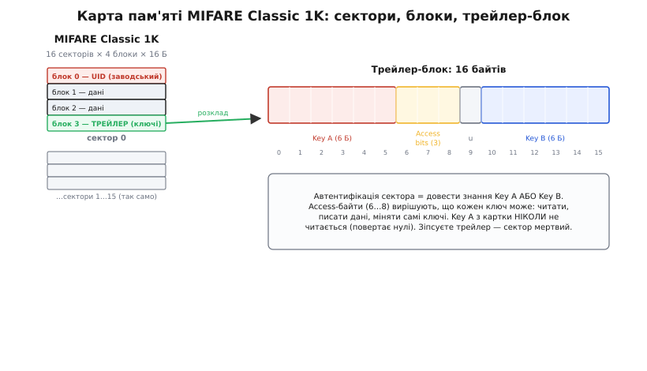

# ⚙️ API RC522: читаємо UID і блоки пам'яті

Тримати картку в руках і бачити в терміналі `UID: DE AD BE EF` — приємно, але це лише поверхня. Справжня робота починається, коли треба **прочитати чи записати байти всередині мітки**: покласти в неї число «залишок на балансі», ім'я власника, лічильник входів — і перечитати це потім. Ось тут виявляється, що мітка — не просто «номер», а маленька файлова система за замком, і замок цей влаштований дивно: у нього два ключі на кожну шухляду, а самі ключі лежать у тій-таки шухляді. Розберімо, як цим керувати з коду — крок за кроком, від голого UID до впевненого читання й запису, і де на цьому шляху розставлені міни.

Найкоротший шлях до цього — бібліотека **MFRC522** Мігеля Балболи (Miguel Balboa), де-факто стандарт для RC522 в екосистемі Arduino (зокрема на ESP32 з Arduino-core; у чистому ESP-IDF чи в STM32 її нема — там ті самі кроки роблять напряму через регістри чипа). Її історія показова: Балбоа зібрав її ще в січні 2012 року на основі коду доктора Леонга (Dr. Leong) для набору «Arduino RFID module Kit 13.56 MHz». Розвиток бібліотеки нині **заморожено** — автор оголосив «повне замороження функцій, без змін API»; це не занедбаність, а зрілість: базовий протокол ISO 14443A і MIFARE Classic не міняється роками, тож бібліотека просто робить своє. Одну її межу треба знати одразу: **вона вміє тільки Crypto-1** — той самий зламаний шифр MIFARE Classic. Тобто для «класики» вона повна, а сучасніші захищені мітки (DESFire, MIFARE Plus у захищеному режимі) їй не по зубах.

> 🔧 **Навіщо весь цей код.** Замок «свій/чужий» за UID пишеться в п'ять рядків — і саме тому його всюди й ліплять. Але UID **клонується** копійчаним обладнанням за секунди: це відкритий, нічим не захищений номер, який мітка сама викрикує в ефір ще до будь-якої автентифікації. Щойно ваш пристрій вирішує щось важливіше за «увімкнути світло», доводиться лізти в пам'ять — читати секрет, схований за ключем, звіряти вміст, вести захищений лічильник. Тому вміти працювати з блоками — не забаганка, а межа між іграшкою й пристроєм, який не зламає перший стрічний зі смартфоном.

Мова тут не обговорюється — сам домен (регістри, SPI, тайминги протоколу) прибитий до C/C++; Python чи Go на мікроконтролері тут нема куди подіти. А от **платформа** — вибір ваш, і код це відображає. Для будь-якого хоста RC522 — це звичайний **SPI-підлеглий із картою регістрів**: пишеш байт у регістр, кладеш дані у FIFO, даєш чипу команду, чекаєш прапорець готовності. Протокольні кроки теж однакові скрізь — «озватися» (REQA), «вибрати» (антиколізія + SELECT), «автентифікуватися», «прочитати/записати», «відпустити» (HLTA); різниться лише те, чим ви смикаєте SPI й ніжку CS. На Arduino цей шар уже загорнула бібліотека Балболи, тож приклад найкоротший — з нього й починаємо. На ESP-IDF і STM32 бібліотеки нема, тож ті самі кроки видно на регістрах: платформозалежні там **тільки** `pcd_write()`/`pcd_read()` (два байти по SPI), а тонкий протокольний шар над ними — `picc_request()`, `picc_select()`, `picc_transceive_crc()`, `picc_halta()` — пишеться раз і однаковий. Тому кожен приклад нижче дано трьома вкладками.

## Задача перша: надійно дістати UID

Почнімо з того, що вже майже вміємо, але зробімо це **чесно** — з розбором того, чому кожен рядок саме такий.

**Ідея.** У кожному оберті головного циклу питаємо чип: «є нова мітка в полі?». Якщо є — просимо його провести процедуру антиколізії й вибору, після чого UID лежить у структурі `reader.uid`. Друкуємо його, після чого **обов'язково відпускаємо мітку**, щоб не читати ту саму картку сотні разів на секунду.

:::tabs
:::code api-rc522/c/arduino/zadacha-persha-nadiino.ino
:::code api-rc522/c/esp-idf/zadacha-persha-nadiino.c
:::code api-rc522/c/stm32/zadacha-persha-nadiino.c
:::

Три речі тут варті окремого слова, бо на них будується все далі.

Перше — назви функцій кодують, **хто з ким говорить**. Префікс `PCD_` — це *Proximity Coupling Device*, тобто сам зчитувач (наш чип). Префікс `PICC_` — *Proximity Integrated Circuit Card*, тобто мітка. Тож `PCD_Init()` — «ініціалізуй зчитувач», а `PICC_ReadCardSerial()` — «дістань серійник із картки». Це не бібліотечна примха, а термінологія самого стандарту ISO/IEC 14443: PCD і PICC так само називаються в даташиті чипа — тому й регістровий код на будь-якій платформі природно ділиться на ті самі два префікси.

Друге — `reader.uid`. Це структура, і в неї є `size` (4 або 7 — довжина UID у байтах), масив `uidByte[10]` (сам номер) і `sak` (*Select Acknowledge* — байт-відповідь мітки на вибір, за яким визначається її сімейство). Саме `sak` згодовується у `PICC_GetType()`, і той повертає одне зі значень на кшталт `PICC_TYPE_MIFARE_1K`, `PICC_TYPE_MIFARE_UL`, `PICC_TYPE_ISO_14443_4`. Знати тип критично: **Classic і Ultralight/NTAG читаються геть по-різному**, і плутати їх — гарантована помилка.

Третє й найважливіше — `PICC_HaltA()` у кінці. Без нього мітка лишається «активною» в полі, і наступний оберт циклу знову бачить її як присутню. Результат — сотні спрацювань за секунду з тієї самої картки: лічильник, який мав збільшитися на 1, стрибає на 300; двері, які мали клацнути раз, деренчать. `HaltA` каже мітці «замри, більше не відповідай, поки тебе не піднімуть із поля й не піднесуть заново». Це не косметика — це умова коректної логіки.

> 🔧 **Навіщо тип мітки.** Новачок пише код під свій брелок, усе працює, він роздає проєкт друзям — і в половини «нічого не читається». Причина: у нього був MIFARE Classic, а в друзів — NTAG215 (той самий формат, що в іграшкових фігурках amiibo). Це різні мітки з різною моделлю пам'яті, і код під одну мовчки не працює з іншою. Перевіряйте `PICC_GetType()` **перш ніж** лізти в пам'ять і розгалужуйте логіку — інакше ваш проєкт «працює в мене» й ніде більше.

## Задача друга: прочитати блок пам'яті MIFARE Classic

Тепер — головне. Хочемо дістати не номер картки, а **вміст її пам'яті**: конкретні 16 байтів із конкретного місця. Щоб це зробити свідомо, спершу треба вкласти в голову, **як та пам'ять улаштована**, — бо саме її дивна структура диктує кожен наступний виклик.

### Як лежить пам'ять: сектори, блоки, трейлер

Найпоширеніша мітка — **MIFARE Classic 1K** — має рівно 1024 байти, і поділені вони так: **16 секторів, у кожному 4 блоки, у кожному блоці 16 байтів** (16 · 4 · 16 = 1024). Блоки нумеруються наскрізно від 0 до 63: сектор 0 — це блоки 0…3, сектор 1 — блоки 4…7, і так далі. Проста арифметика: `перший блок сектора = сектор · 4`.

Але не всі блоки рівноправні, і в цьому вся сіль.


*Пам'ять розбита на 16 секторів по 4 блоки. Блок 0 сектора 0 — заводський, у ньому UID (на звичайній картці його не переписати). Останній блок КОЖНОГО сектора — трейлер: перші 6 байтів — Key A, три байти — біти доступу, останні 6 — Key B. Автентифікація сектора = довести знання одного з ключів; біти доступу вирішують, що цей ключ дозволяє. Зіпсуєте трейлер — увесь сектор стане недоступним назавжди.*

Два блоки — особливі.

**Блок 0 (найперший, у секторі 0)** — заводський, «манбуфактурний». У ньому лежить UID разом із контрольним байтом (BCC) і даними виробника. На звичайній картці він **тільки для читання**: саме незмінність цього блока колись мала завадити клонуванню — вміст решти пам'яті можна змінити, а UID ні. (На «магічних» картках — спеціальних клонах — блок 0 таки переписуваний; це окрема історія, і саме на ній тримається копіювання карток.) Практичний висновок: у блок 0 писати не пробуйте — на добрій картці отримаєте помилку, на кепській «магічній» ризикуєте зіпсувати BCC й перетворити картку на цеглину.

**Останній блок кожного сектора (блок 3, 7, 11, …)** — це **трейлер-блок** (*sector trailer*), і він не для ваших даних. Його 16 байтів розкладені жорстко:

```
Байти трейлер-блоку (16 Б):
  [0..5]   Key A          — 6 байтів, ключ A цього сектора
  [6..8]   біти доступу   — 3 байти, ХТО й ЩО може з блоками сектора
  [9]      користувацький — 1 вільний байт
  [10..15] Key B          — 6 байтів, ключ B (або дані, якщо B не потрібен)
```

Оце й є замок. Щоб дістатися будь-якого блока сектора — навіть просто прочитати, — треба спершу **автентифікуватися**: довести чипу, що ви знаєте Key A **або** Key B цього сектора. Далі біти доступу (ті три байти) вирішують, що конкретно дозволено: читати, писати дані, міняти самі ключі. І найпідступніше: **Key A ніколи не читається з картки** — спроба прочитати трейлер поверне на місці Key A самі нулі. Це навмисне: ключ можна тільки *використати* для автентифікації, а не *підглянути*.

> 🔧 **Навіщо два ключі й біти доступу.** Ця схема дає рольовий доступ на копійчаній мітці. Типовий приклад — транспортний квиток: Key A знає турнікет і вміє тільки *читати* залишок поїздок; Key B знає лише каса й уміє *записувати* поповнення. Вкрадений турнікет не дасть злодію нарахувати собі поїздки — у нього тільки «читальний» ключ. Уся ця машинерія — саме заради того, щоб різні сторони мали різні права до однієї картки. (На жаль, Crypto-1 зламано, тож на реальному захисті це не тримається, — але модель доступу лишається, і код усе одно мусить її поважати.)

### Ключ за замовчуванням і структура MIFARE_Key

Свіжа картка «з коробки» має **всі ключі рівні `FF FF FF FF FF FF`** (шість байтів `0xFF`) — і Key A, і Key B в усіх секторах. Це фабричне значення, і саме з ним ви автентифікуєтесь на новій мітці. У бібліотеці ключ — це структура з масиву шести байтів:

:::tabs
```arduino
MFRC522::MIFARE_Key key;
for (byte i = 0; i < 6; i++) key.keyByte[i] = 0xFF;  // дефолтний FF..FF
```
```esp-idf
uint8_t key[6];                   // без бібліотеки ключ — просто шість байтів
memset(key, 0xFF, sizeof(key));   // дефолтний FF..FF
```
:::

### Тепер — власне читання

Склавши все докупи, читання одного блока — це строго **три кроки**: автентифікуйся → прочитай → прибери за собою. Пропустиш будь-який — або отримаєш помилку, або залишиш чип у поганому стані для наступної мітки.

:::tabs
:::code api-rc522/c/arduino/teper-vlasne-chytannia.ino
:::code api-rc522/c/esp-idf/teper-vlasne-chytannia.c
:::code api-rc522/c/stm32/teper-vlasne-chytannia.c
:::

Три деталі, на яких спотикаються всі.

**Буфер — 18, не 16.** Це не примха бібліотеки, а те, що справді летить в ефірі: у відповідь на READ мітка надсилає 16 байтів даних **плюс 2 байти CRC**, тож місце під усі 18 потрібне будь-якому драйверу — і бібліотечному, і власному. Дасте `byte buffer[16]` — отримаєте `STATUS_NO_ROOM` або, гірше, тихе псування сусідньої пам'яті на стеку. І `size` перед викликом теж має дорівнювати 18: функція звіряє, чи влізе відповідь.

**`PCD_Authenticate` бере адресу блока, а автентифікує весь сектор.** Ви передаєте `blockAddr` (наприклад 4), і чип автентифікує **весь сектор**, до якого цей блок належить (сектор 1). Тобто після однієї авторизації можна читати всі блоки цього сектора без повторної — але для сусіднього сектора треба авторизуватись заново.

**`StatusCode` — завжди перевіряйте.** Кожна функція повертає `MFRC522::StatusCode`; `STATUS_OK` — успіх, решта (`STATUS_TIMEOUT`, `STATUS_MIFARE_NACK`, `STATUS_CRC_WRONG`…) — біда. Ігнорувати повернене значення — прямий шлях до «читає сміття й не розумію чому». `GetStatusCodeName()` дає людський рядок помилки — безцінна річ при налагодженні.

## Задача третя: записати блок і прибрати за собою

Запис — дзеркало читання, з одним доданим правилом і одним обов'язковим ритуалом наприкінці.

**Ідея.** Автентифікуйся (як для читання) → віддай 16 байтів у `MIFARE_Write` → **закрий сесію** двома викликами. Ось повний, самодостатній приклад, який записує рядок у блок і одразу перечитує його для перевірки.

:::tabs
:::code api-rc522/c/arduino/zadacha-tretia-zapysaty.ino
:::code api-rc522/c/esp-idf/zadacha-tretia-zapysaty.c
:::code api-rc522/c/stm32/zadacha-tretia-zapysaty.c
:::

Тут два нові моменти, і другий — та сама «непомітна» пастка, що з'їдає найбільше вечорів.

**Пишемо 16 байтів, читаємо 18.** Асиметрія збиває з пантелику, але логіка є: при читанні мітка **надсилає** дані з CRC, і місце під CRC потрібне у вашому буфері; при записі ви даєте лише 16 корисних байтів, а CRC **дописується вже після вас** — на Arduino про це просить бібліотека, у власному драйвері ви самі кажете чипу порахувати й додати CRC перед відправкою. Тож `MIFARE_Write(blockAddr, data16, 16)` — рівно 16.

**`PICC_HaltA()` + `PCD_StopCrypto1()` — парний ритуал закриття.** Це найпідступніше місце всього API. Після автентифікації **зчитувач переходить у зашифрований режим** (Crypto-1 увімкнено), і сам чип лишається в ньому, доки ви явно не скажете «стоп». Фізично це один біт — `MFCrypto1On` у регістрі `Status2Reg`: `PCD_StopCrypto1()` не робить нічого хитрішого, ніж скидає його, і в регістровому коді ви скидаєте той самий біт власноруч. Якщо забути `PCD_StopCrypto1()`, чип залишиться «зашифрованим», і **наступна мітка не проавтентифікується** — ви отримаєте загадкове «перша картка читається, друга ні, потім треба перезавантажити». Тому запам'ятайте як одне ціле: **скінчив із міткою — виклич `PICC_HaltA()`, потім `PCD_StopCrypto1()`**. Обидва. Завжди. `HaltA` відпускає мітку, `StopCrypto1` повертає зчитувач у чистий стан для наступної.

> 🔧 **Навіщо StopCrypto1 окремо від HaltA.** Це наслідок того, що шифрування — стан **зчитувача**, а не мітки. `HaltA` — команда мітці («замри»); `StopCrypto1` — команда своєму ж чипу («забудь ключ, вимкни крипто»). Дві різні сторони, дві різні дії. Забути другу — класична причина «залежань через одну картку», і симптом настільки типовий, що досвідчений одразу питає: «а StopCrypto1 викликаєш?».

## Окремий випадок: NTAG і Ultralight читаються інакше

Якщо `PICC_GetType()` повернув `PICC_TYPE_MIFARE_UL` — перед вами **MIFARE Ultralight або NTAG** (NTAG213/215/216). Це поширені, дешеві NFC-мітки: саме такі клеять у смарт-наліпки, вшивають у фігурки, роздають на конференціях. Модель пам'яті в них геть інша, простіша й воднораз інша настільки, що код від Classic до них не підходить.

Ключові відмінності:

- **Пам'ять — це сторінки по 4 байти**, а не блоки по 16. NTAG213 має 45 сторінок (144 байти користувацької пам'яті), NTAG215 — 135 сторінок (504 байти; це «amiibo-розмір»), NTAG216 — 231 сторінку (888 байтів).
- **Автентифікації ключем немає** — принаймні тієї, що в Classic. Базове читання відкрите: жодних Key A/B, жодного `PCD_Authenticate`, жодного `StopCrypto1`. (У NTAG є власний, простіший захист паролем на запис, але це вже опція, а не обов'язковий бар'єр.)
- **`MIFARE_Read` повертає одразу 4 сторінки.** Дасте адресу сторінки 4 — отримаєте сторінки 4, 5, 6, 7, тобто ті самі 16 байтів (4 · 4) у 18-байтовий буфер. Це зручно: одним читанням забираєте чотири сторінки.

Читання NTAG виходить помітно коротшим — саме через відсутність замка:

:::tabs
:::code api-rc522/c/arduino/okremyi-vypadok-ntag-i.ino
:::code api-rc522/c/esp-idf/okremyi-vypadok-ntag-i.c
:::code api-rc522/c/stm32/okremyi-vypadok-ntag-i.c
:::

Запис у NTAG — теж посторінковий і теж по 4 байти, і на рівні ефіру це **інша команда**: `WRITE` (0xA2) з чотирма байтами одним прийомом, а не двоступеневий `0xA0` з шістнадцятьма, як у Classic. У бібліотеці це окрема функція `MIFARE_Ultralight_Write(page, buffer, 4)` (рівно 4 байти на сторінку, не 16), у власному драйвері — інший код команди. Плутати `MIFARE_Write` (Classic, 16 Б) і `MIFARE_Ultralight_Write` (NTAG, 4 Б) — ще одна типова помилка: перша на NTAG просто не спрацює.

> 🔧 **Навіщо розрізняти в коді.** На практиці зчитувач той самий, а мітки в руках користувачів — різні. Робочий пристрій майже завжди має **розгалуження за типом**: `PICC_GetType()` повернув `..._1K`/`..._4K` → гілка з автентифікацією й 16-байтовими блоками; повернув `..._UL` → гілка зі сторінками без ключів. Один код на всі мітки не напишеш — надто різні моделі пам'яті. Хто цього не зробив, у того проєкт «дружить» лише з тими картками, що випадково лежали в нього на столі.

## Складність і пастки — зведення

Зберімо докупи все, на чому спотикаються, від найдорожчого до дрібниць.

**1. Замок за UID — це не замок.** Найважливіше й найчастіше. UID мітка викрикує **до** будь-якої автентифікації, він ніяк не захищений і **клонується за секунди** дешевим обладнанням (Proxmark, Flipper Zero чи навіть телефоном із «магічною» карткою). Тому:

```
Замок «if (uid == дозволений) відчинити»  →  годиться:
  іграшка, ящик, «увімкнути світло своєю карткою», локальне зручне
Той самий замок на дверях/сейфі/платежі   →  НЕ годиться:
  UID підробляється тривіально; це не автентифікація, а зручність
```

Хочете хоч якогось захисту — читайте секрет із пам'яті за ключем і звіряйте його; хочете **справжнього** — беріть мітки з сучасною криптографією (DESFire), яких MFRC522-бібліотека, до речі, і не підтримує. Для чогось цінного RC522 із «класикою» — просто не той інструмент.

**2. Забутий `PCD_StopCrypto1()` — «перша картка читається, друга ні».** Після кожної роботи з Classic-міткою закривайте сесію парою `PICC_HaltA()` + `PCD_StopCrypto1()`. Зчитувач тримає шифр увімкненим, доки ви явно не вимкнете; без цього наступна автентифікація мовчки провалюється. Якщо бачите «одна картка ок, далі затик до перезавантаження» — на 90% це воно.

**3. Буфер читання — 18 байтів, запис — 16.** `MIFARE_Read` хоче 16 даних + 2 CRC = 18-байтовий буфер (і `size = 18`). `MIFARE_Write` хоче рівно 16 (CRC допише сама). Плутанина дає `STATUS_NO_ROOM` при читанні або псування стека при короткому буфері.

**4. Дефолтний ключ `FF FF FF FF FF FF`.** Свіжа картка — усі ключі `0xFF`×6. Якщо картку вже хтось «форматував» (наприклад, транспортна система чи попередній власник), її ключі змінені, і дефолтним ви не проавтентифікуєтесь — отримаєте `STATUS_TIMEOUT`/`NACK` на `PCD_Authenticate`. Тоді або мітка не ваша для запису, або ключ треба знати (чи, для «класики», відновлювати відомими атаками — але це вже далеко за межі «просто зберегти байти»).

**5. Не пишіть у блок 0 і в трейлер-блоки.** Блок 0 — заводський UID, на добрій картці незмінний (спроба — помилка), на «магічній» — ризик зіпсувати BCC й убити картку. Трейлер-блоки (3, 7, 11, …) містять **ключі й біти доступу**: неправильний запис туди міняє ключ на невідомий або виставляє біти доступу так, що сектор більше **ніколи** не відкриється — це незворотна цегла. Пишіть тільки в **блоки даних** (1, 2, 4, 5, 6, 8, …), тримаючись подалі від блока 0 і кожного четвертого (трейлера).

**6. Блокуючий цикл проти IRQ.** Усі приклади вище — **блокуючий опитувальний цикл**: головний цикл (`loop()` у скетчі, задача FreeRTOS в ESP-IDF, `while(1)` у STM32) крутиться й раз за разом питає мітку, чи вона тут. Для більшості проєктів це нормально й найпростіше. Але поки чип нічого не знайшов, процесор марно молотить це опитування — погано для пристрою на батарейці, який мав би спати. Альтернатива — задіяти вивід **IRQ**: налаштувати чип так, щоб він **сам** смикнув лінію переривання, коли в полі з'явиться мітка, і будити процесор лише тоді. Це помітно складніше в налаштуванні (треба гратися з регістрами переривань чипа вручну — бібліотека тут майже не допомагає), тож беруться за це лише коли енергія справді критична. Для настільного пристрою з USB-живленням блокуючий цикл — правильний вибір за замовчуванням; не ускладнюйте без потреби.

Зведімо ці граблі в одну таблицю, щоб було куди зазирнути під час налагодження:

```
Симптом                              Причина / ліки
──────────────────────────────────────────────────────────────────────
Auth провалюється (TIMEOUT/NACK)     не той ключ (картку вже форматнули);
                                     або не MIFARE Classic — перевір тип
Перша картка ок, друга — ні          забув PCD_StopCrypto1() після сесії
Read повертає сміття / NO_ROOM       буфер < 18 байтів або size != 18
Write «не спрацьовує» на NTAG        треба MIFARE_Ultralight_Write (4 Б),
                                     а не MIFARE_Write (16 Б)
Картка стала «цеглою» після запису    писав у трейлер (блок 3/7/11…) або
                                     у блок 0 «магічної» картки (BCC)
Лічильник стрибає на сотні           немає PICC_HaltA() — мітка читається
                                     заново щооберту циклу
Читається в мене, не в друзів        у них інший тип мітки; додай гілку
                                     за PICC_GetType()
```

Уся ця машинерія зводиться до кількох залізних звичок: перевіряй **тип** мітки й розгалужуйся; для Classic — **три кроки** (auth → read/write → закрити сесію) і **ніколи** не забувай пару `HaltA` + `StopCrypto1`; читай у **18** байтів, пиши **16**; тримайся подалі від блока 0 і трейлерів; а головне — пам'ятай, що UID незахищений, тож усе серйозніше за іграшку будуй на **вмісті пам'яті за ключем**, а не на самому номері. Дотримаєшся цих правил — і копійчаний RC522 із бібліотекою Балболи перетворює мітку з простого «номера» на маленьке сховище, яким можна свідомо й надійно керувати.
