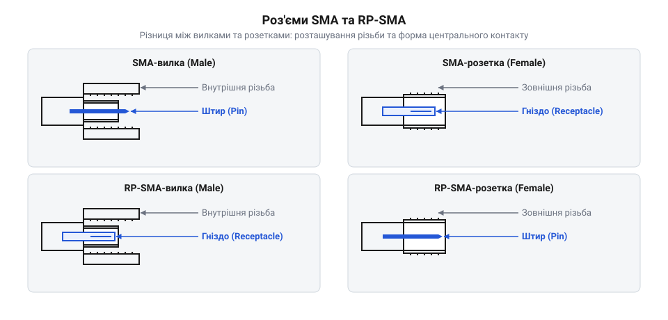

# Фізичний інтерфейс SMA та RP-SMA

## Ризик руйнування контактів

Коли ми підключаємо антену до радіочастотного модуля, ми маємо фізично з'єднати їхні високочастотні конектори. Якщо спробувати скрутити докупи несумісні половинки роз'ємів — наприклад, дві частини, кожна з яких має центральний штир замість гнізда, — штирі впруться один в одного. Проблема в тому, що зовнішня гайка вилки виступає вперед за площину контактів. Вона встигає зчепитися з різьбою розетки на кілька обертів ще до того, як штирі зустрінуться всередині. Коли вони врешті стикаються, різьба вже працює як механічний важіль: вона перетворює легке обертання пальцями на величезний прямий тиск. Це зусилля набагато більше за міцність м'якого латунного контакту, тому штир зминається чи загинається вбік ще до того, як рука відчує помітний опір. Вирівняти його назад без втрати якості неможливо: деформація руйнує цілісність позолоти та залишає мікротріщини в металі. Навіть якщо штир вдасться випрямити візуально, порушена геометрія неминуче створить відбиття сигналу на високих частотах, тому зіпсований роз'єм на модулі або саму антену доведеться викидати й перепаювати. Щоб уникнути цього, важливо розпізнавати типи конекторів і розуміти їхню будову ще до того, як застосовувати силу під час з'єднання.

## Будова стандартного SMA

Класичний конектор стандарту @@en|SubMiniature version A@@ (SMA) складається з двох різних частин: вилки та розетки. Вилка встановлюється на кабелі або антені, має внутрішню різьбу і містить усередині центральний контакт у вигляді штиря. Цей штир оточений шаром цупкого білого діелектрика — тефлону, який надійно ізолює контакт від зовнішнього металевого корпусу та жорстко фіксує його рівно по центру. Розміри центрального контакту, корпусу і діелектрична проникність самого тефлону разом визначають хвильовий опір роз'єму, необхідний для передавання радіосигналу без відбиття. Зовні вилка має вигляд гайки під шестигранний ключ, яка вільно обертається на кінці кабелю; зазирнувши всередину, можна побачити нарізану різьбу. Розетка монтується на платі пристрою, має зовнішню різьбу, а в центрі неї, так само в тефлоновій ізоляції, розташоване гніздо для прийому штиря. Вона жорстко зафіксована й візуально нагадує трубку з нарізкою зовні, витки якої легко відчути, провівши пальцем по корпусу. З'єднання відбувається накручуванням гайки вилки на різьбу розетки, при цьому штир вилки рівно входить у гніздо розетки. Така будова гарантує щільний контакт і стабільне передавання високочастотного сигналу.

## Зворотна полярність RP-SMA

Для того, щоб користувачі не могли легко прикрутити потужну професійну антену до побутового маршрутизатора, був створений стандарт із зворотною полярністю — @@en|Reverse Polarity SMA@@ (RP-SMA). У ньому тип різьби залишається таким самим, але центральні контакти міняються місцями. Вилка RP-SMA має внутрішню різьбу, але замість штиря містить гніздо. Розетка RP-SMA, що монтується на пристрої, має зовнішню різьбу, але в її центрі тепер розташований штир. Щоб не доводилося щоразу заглядати всередину роз'єму, на кабель або корпус пристрою наносять маркування: класичні конектори позначають написом SMA, а варіанти зі зворотною полярністю підписують як RP-SMA.

*Зображення чотирьох конекторів: SMA-вилка, SMA-розетка, RP-SMA-вилка та RP-SMA-розетка.*

Спроба накрутити вилку RP-SMA на класичну розетку SMA не дасть електричного контакту, бо обидві частини мають гнізда. А спроба з'єднати вилку SMA з розеткою RP-SMA призведе до зіткнення і зминання обох штирів.

## Правила надійного з'єднання

Щоб радіосигнал передавався без втрат, лінія зв'язку має підтримувати заданий хвильовий опір, який для систем SMA становить 50 Ом. Це забезпечується лише за умови поєднання сумісних конекторів. Під час з'єднання гайку слід накручувати акуратно, не допускаючи перекосів і не застосовуючи надмірної сили, щоб не зірвати різьбу. Фізично момент достатнього закручування визначається просто: гайку завжди затягують лише пальцями, без використання плоскогубців чи ключів. Як тільки вона перестає йти вільно і пальці відчувають різкий упор, з'єднання є надійним. Спроба дотягнути її інструментом не покращить сигнал, а лише зімне м'яку серцевину роз'єму й безповоротно зіпсує його. Якісне ручне закручування гарантує щільне прилягання контактних поверхонь і цілісність з'єднання. Іноді для монтажу на плату використовують [перехідники SMA ↔ U.FL і SMA під пайку](root:cat-hw-connect/sma-ufl-adapters), які дозволяють гнучко вивести роз'єм на корпус пристрою.
