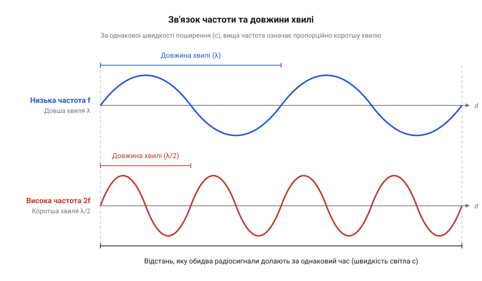

# Розрахунок довжини хвилі та антени

## Потреба в розмірі антени

Люди часто стикаються з проблемою: довільний шматок дроту працює як антена дуже погано. Здавалося б, можна припаяти до радіомодуля будь-який відрізок провідника (наприклад, використовуючи [перехідники SMA під пайку](root:cat-hw-connect/sma-ufl-adapters)), і сигнал полетить в ефір. Проте на практиці дальність зв'язку виявляється жалюгідною, а різні модулі мають різні габарити антен.

Щоб антена ефективно випромінювала та вловлювала електромагнітні коливання, її геометричний розмір має відповідати параметрам самого радіосигналу. Антена — це не просто провідник, а резонатор. Коли струм від радіомодуля потрапляє в дріт, хвиля біжить до його кінця і відбивається назад. На вільному кінці провідника електронам просто нікуди текти: вони скупчуються на краю, створюючи різкий стрибок напруги, який відштовхує заряд у зворотному напрямку. Якщо довжина провідника підібрана правильно, відбита хвиля рівно накладається на наступні зустрічні коливання. Вони синхронно підсилюють одне одного, енергія розгойдується в металі й виштовхується в ефір. Як струна гітари певної довжини звучить на конкретній ноті, так і антена має геометрично пасувати до радіосигналу, щоб увійти з ним у @@fr|резонанс (resonance)@@. Якщо ж дріт випадкової довжини, хвилі відбиваються врізнобій і гасять одна одну. Звідси випливає потреба знайти точний математичний зв'язок між фізичним розміром антени та характеристиками сигналу, щоб забезпечити якісний зв'язок.

## Довжина хвилі та частота

Радіосигнал — це електромагнітна хвиля, що поширюється в просторі зі швидкістю світла. Швидкість світла у вакуумі й наближено в повітрі є сталою величиною, яку позначають літерою `c` і яка дорівнює приблизно 300 000 000 метрів за секунду.

Кількість повних коливань, які хвиля здійснює за одну секунду, називають @@la|частотою (frequentia)@@ `f`. Її вимірюють у герцах (Гц). Наприклад, частота 433 МГц означає, що за секунду відбувається 433 мільйони коливань. Оскільки хвиля рухається з постійною швидкістю, кожне коливання розтягується в просторі на певну відстань. Ця просторова відстань, яку хвиля проходить за час одного повного коливання, є @@uk|довжиною хвилі@@ `λ`.

*Високочастотний сигнал здійснює більше коливань за той самий час, тому його хвиля в просторі виявляється коротшою.*

Зв'язок між швидкістю світла, частотою та просторовою довжиною хвилі задається базовою формулою. Розмір одного коливання в просторі дістаємо, поділивши швидкість поширення на кількість коливань за секунду:

        λ
        = c ÷ f      [довжина хвилі дорівнює швидкості світла, поділеній на частоту]

З формули видно, що чим вища частота, тим менша довжина хвилі. Знаючи частоту радіомодуля, ми вираховуємо повну теоретичну довжину хвилі для нього. Цей просторовий розмір стає основою для конструювання антени, оскільки електромагнітна хвиля безпосередньо проєктується на фізичний провідник. Коли електричне поле поширюється вздовж дроту, воно розгортає своє коливання в струм, штовхаючи електрони; просторовий розмах від максимуму до мінімуму охоплює лише половину хвилі, тоді як повний цикл вимагає ще й зворотного переходу до початкового стану. Щоб метал міг повністю вмістити весь цей цикл і ефективно віддати або прийняти енергію, механічна довжина дроту має відповідати повній довжині самої хвилі.

## Розрахунок чвертьхвильового штиря

Перехід від абстрактної хвилі до практичної антени найпростіше побачити на прикладі @@uk|чвертьхвильового штиря@@. Це звичайний прямий шматок дроту, довжина якого дорівнює точно одній чверті від повної довжини хвилі. Чому саме чверть? Радіосигнал добігає до відкритого кінця дроту й відбивається назад, накладаючись на зустрічну хвилю. Оскільки з вільного кінця струму текти нікуди, він там дорівнює нулю, а напруга натомість сягає максимуму. Відстань від цього піку до найближчого вузла, де напруга мінімальна, а струм розганяється до найвищого значення, становить рівно чверть довжини хвилі. Оскільки джерело сигналу підключається до основи антени, йому для ефективної віддачі енергії потрібен низький опір, тобто точка з максимальним струмом. Якби штир мав довжину у півхвилі або цілу хвилю, біля основи струм знову падав би до нуля, створюючи величезний опір, який блокував би сигнал без складних додаткових схем. Тому в антені довжиною саме чверть хвилі на кінці утворюється максимум напруги, а біля основи — природний максимум струму, що забезпечує ідеальні умови для прямого випромінювання енергії.

Знайдемо ідеальну довжину чвертьхвильового вібратора для частоти 433 МГц.

**Розрахунок антени для 433 МГц**
        λ
        = c ÷ f                                  [базова формула довжини хвилі]
        = 300 000 000 ÷ 433 000 000              [підставляємо швидкість світла та частоту в герцах]
        ≈ 0.6928                                 [повна довжина хвилі в метрах]
        L
        = λ ÷ 4                                  [довжина штиря становить чверть хвилі]
        = 0.6928 ÷ 4                             [ділимо отриману довжину на чотири]
        = 0.1732                                 [ідеальна довжина антени в метрах, тобто 17,3 см]

Тепер порівняємо це з розрахунком для Wi-Fi, що працює на частоті 2,4 ГГц (2 400 000 000 Гц).

**Розрахунок антени для 2,4 ГГц**
        λ
        = c ÷ f                                  [базова формула довжини хвилі]
        = 300 000 000 ÷ 2 400 000 000            [підставляємо швидкість світла та частоту в герцах]
        = 0.125                                  [повна довжина хвилі в метрах]
        L
        = λ ÷ 4                                  [довжина штиря становить чверть хвилі]
        = 0.125 ÷ 4                              [ділимо отриману довжину на чотири]
        = 0.03125                                [ідеальна довжина антени в метрах, тобто 3,1 см]

Різниця в розмірах разюча: для 433 МГц потрібен штир завдовжки понад 17 сантиметрів, тоді як для 2,4 ГГц достатньо шматка дроту трохи більшого за 3 сантиметри. Завдяки цьому розрахунку ви здатні самостійно визначити потрібну довжину прямого дроту для свого пристрою.

## Наслідки неточного розміру

Порушення розрахованої довжини відводить антену від резонансу. Якщо відрізати дріт «на око», він виявиться задовгим або закоротким.

Фізичний зміст цього відхилення полягає в тому, що електромагнітна хвиля більше не вкладається у фізичні розміри антени ідеально. Коли сигнал добігає до кінця дроту, його енергія не може просто зникнути чи стати слабшою. Щоб хвиля відірвалася від металу, вона має дійти до краю саме в правильній фазі. Якщо антена задовга або закоротка, хвиля натрапляє на обрив провідника в невідповідний момент, коли навколишній простір не може її перейняти. Замість того, щоб повністю випромінюватися в простір, частина енергії відбивається від кінця невідповідної антени й повертається назад. Оскільки відбита хвиля не збігається за фазою з новими коливаннями, які продовжує подавати передавач, зустрічні потоки енергії починають гасити одне одного. У результаті замість рівного потоку в антені утворюються стоячі хвилі, які замикають енергію всередині провідника. Це явище не просто знижує потужність випромінювання й призводить до втрати дальності зв'язку. Енергія, що повернулася й не знайшла виходу, перетворюється на тепло й може спалити вихідний каскад радіомодуля. Отже, якість роботи пристрою жорстко прив'язана до точності геометрії антени.
