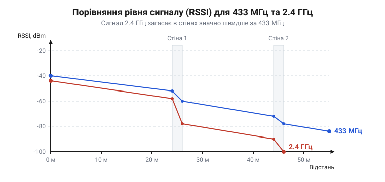

# Порівняння дальності зв'язку

<preknowlist>
- [Перехідники SMA ↔ U.FL і SMA під пайку](root:cat-hw-connect/sma-ufl-adapters) — як правильно підключити зовнішню SMA-антену до модуля, щоб не втратити сигнал на з'єднанні.
</preknowlist>

## Завдання: обрати частоту й антену

Радіозв'язок між пристроями часто обривається або працює нестабільно, якщо антена та частота обрані без розуміння умов. Сигнал, який чудово передається на відкритому полі, може повністю згаснути за двома бетонними стінами. Щоб зв'язок не переривався, необхідно знати, як радіохвилі поводяться в реальному середовищі. 

Ми порівняємо два популярні діапазони: 433 МГц та 2.4 ГГц. Обидва широко застосовуються в електроніці, але мають різні фізичні властивості. Низькі частоти краще огинають перешкоди: довга хвиля 433 МГц розміром близько 69 сантиметрів проникає крізь матеріали майже без поглинання. Високі частоти дозволяють передавати більше даних, проте швидше втрачають енергію: коротка хвиля 2.4 ГГц завдовжки 12.5 сантиметрів інтенсивно відбивається і поглинається стінами. Щоб не обирати навмання, ми зберемо тестовий стенд і виміряємо рівень сигналу в різних умовах: на відкритому просторі на відстані до 100 метрів прямої видимості та в будівлі через дві-три бетонні чи цегляні стіни. Це дасть розуміння масштабу згасання і покаже, як дальність та стабільність зв'язку залежать від частоти.

## Обладнання для тестового стенда

Для тестування ми використовуємо два ідентичні за логікою радіомодулі, але налаштовані на різні частотні діапазони. До кожного модуля підключається зовнішня антена через конектор типу @@en|SMA@@ (SubMiniature version A). Якщо на платі є лише мініатюрний роз'єм, використовують [перехідники SMA ↔ U.FL і SMA під пайку](root:cat-hw-connect/sma-ufl-adapters). 

Ми зчитуватимемо рівень отриманого сигналу — @@en|RSSI@@ (Received Signal Strength Indicator), який вимірюється в децибел-міліватах (дБм). Шкала дБм відраховує потужність від одного мілівата: 0 дБм означає рівно 1 мВт. До приймача долітає лише мізерна частка випроміненої енергії, набагато менша за цей еталон. Оскільки шкала логарифмічна, будь-яка потужність, менша за 1 мВт, виражається від'ємним числом, тому всі реальні показники йдуть у мінус. Чим ближче значення до нуля, тим більше енергії вловила антена і тим сильніший сигнал.

Нижче наведено код для зчитування показників з модулів. Він демонструє ініціалізацію пристроїв та циклічне опитування їхнього стану. Під капотом мікроконтролер спілкується з радіочипами (наприклад, CC1101 або nRF24L01) через шину SPI. Спочатку програма відкриває файловий дескриптор пристрою та налаштовує параметри шини. Щоб виміряти RSSI, формується SPI-транзакція: мікроконтролер надсилає команду читання з адресою специфічного регістра (яка залежить від моделі чипа), а натомість отримує від приймача оцінку рівня поточного сигналу. Хоча для наочності цей код повертає імітовані значення, логіка викликів і двобайтовий обмін повністю відображають реальну апаратну взаємодію.

:::tabs
:::code proj-range-comparison/c/src/c/main.c
:::code proj-range-comparison/c/src/c/radio_rssi.c
:::code proj-range-comparison/c/src/c/radio_rssi.h
:::code proj-range-comparison/c/src/cpp/main.cpp
:::code proj-range-comparison/c/src/cpp/RadioRssi.cpp
:::code proj-range-comparison/c/src/cpp/RadioRssi.hpp
:::

Ця програма ініціалізує обидва модулі та виводить їхні поточні показники RSSI, оцінюючи якість зв'язку.

## Вимірювання в зоні прямої видимості

У зоні прямої видимості радіохвилі поширюються без перешкод, і сигнал згасає лише через розсіювання в просторі. На відкритій місцевості і 433 МГц, і 2.4 ГГц показують відмінні результати на коротких та середніх дистанціях. 

*Графік залежності рівня сигналу від перешкод для 433 МГц і 2.4 ГГц. Сигнал 2.4 ГГц згасає швидше, тоді як 433 МГц краще долає перешкоди.*

Зі збільшенням відстані рівень сигналу для 2.4 ГГц спадає швидше. Наприклад, якщо поблизу приймача обидва діапазони дають впевнений сигнал (близько −65 дБм для 433 МГц і −75 дБм для 2.4 ГГц), то на відстані 100 метрів показник 2.4 ГГц просідає до критичних −90 дБм, де пакети починають губитися. Це пов'язано з тим, що хвилі вищої частоти мають меншу довжину: фізичний розмір антени пропорційний довжини хвилі, тому приймальна антена на 2.4 ГГц виходить значно меншою і захоплює меншу частину радіоенергії з простору. Крім того, короткі хвилі сильніше розсіюються на дрібних неоднорідностях, пилу та волозі в повітрі, швидше втрачаючи потужність під час поширення. Для 433 МГц на тій самій дистанції запас за рівнем сигналу залишається більшим, тримаючись на цілком робочих −80 дБм, що дозволяє досягти більшої дальності передачі на відкритому просторі за однакової потужності передавача.

## Тест на пробивання стін

Реальні умови експлуатації часто включають стіни, дерева або інші перешкоди. При проходженні крізь матеріал радіохвиля поглинається та відбивається. Що вища частота, то сильніше перешкода поглинає сигнал. 

Тестування всередині будівлі показує суттєву різницю між діапазонами. Сигнал 2.4 ГГц різко втрачає потужність вже після першої бетонної стіни. Дві-три стіни можуть повністю обірвати зв'язок. Натомість сигнал 433 МГц значно краще проникає крізь будівельні конструкції. Коли радіохвиля проходить крізь твердий матеріал, її електромагнітне поле змушує частинки перешкоди коливатися, через що частина енергії сигналу перетворюється на тепло. Що вища частота хвилі, то частіше поле змінює напрямок за секунду і тим більше енергії хвиля втрачає на це швидке розгойдування матеріалу. Сигнал 433 МГц має нижчу частоту і більшу довжину хвилі: він змінює напрямок поля рідше, тому поглинається стіною значно слабше і проходить наскрізь із меншими втратами. Разом із тим більша довжина хвилі дозволяє ефективніше огинати предмети, що робить 433 МГц надійнішим вибором для роботи в приміщеннях зі складною геометрією.

Щоб кількісно оцінити проходження перешкод, контролер надсилає по шині SPI команду читання відповідного регістра радіомодуля, звідки отримує поточне значення @@en|RSSI@@. Під час тестування через одну бетонну стіну сигнал 433 МГц зберігав рівень близько -65 дБм, тоді як 2.4 ГГц просідав до -75 дБм. За двома-трьома стінами 2.4 ГГц опускався нижче -85 дБм і втрачав зв'язок, натомість 433 МГц усе ще стабільно приймав пакети. Ось базовий приклад зчитування цих показників на рівні SPI для мікроконтролера чи мікрокомп'ютера:

:::tabs
:::code proj-range-comparison/cpp/c/main.c
:::code proj-range-comparison/cpp/c/radio.c
:::code proj-range-comparison/cpp/c/radio.h
:::code proj-range-comparison/cpp/cpp/main.cpp
:::code proj-range-comparison/cpp/cpp/Radio.cpp
:::code proj-range-comparison/cpp/cpp/Radio.hpp
:::

## Підсумки: що і коли обирати

Вибір між 433 МГц та 2.4 ГГц залежить від умов середовища та вимог до пропускної здатності. 

Діапазон 433 МГц є оптимальним для пристроїв, які потребують стабільного зв'язку через перешкоди або на великих відстанях. Його варто обирати для датчиків розумного будинку, пультів управління або систем моніторингу, де обсяг даних невеликий, але надійність доставки критична.

Діапазон 2.4 ГГц краще підходить для передачі великого обсягу даних, наприклад, аудіо або відео, але на менших дистанціях. Його слід використовувати в зоні прямої видимості або в межах однієї кімнати, де швидке згасання сигналу за перешкодами не стане на заваді. Правильно підібрана SMA-антена разом із відповідною частотою гарантують, що пристрій працюватиме стабільно в заданих умовах.

Крім частоти, на рівень сигналу критично впливає взаємне розташування антен, оскільки воно задає площину коливань радіохвиль — @@en|поляризацію@@. Якщо передавальна SMA-антена стоїть вертикально, а приймальна лежить горизонтально, ці площини перехрещуються: приймач фізично не може вловити більшу частину енергії, і зв'язок різко слабшає навіть за прямої видимості. Щоб сигнал доходив із мінімальними втратами, штирі обох антен завжди мають бути спрямовані паралельно один одному — наприклад, обидва стояти вертикально.

Площина коливань жорстко прив'язана до металевого штиря антени через фізику струму. Під час передачі сигнал змушує електрони бігати туди-сюди вздовж штиря по прямій лінії. Цей спрямований рух створює електромагнітне поле, яке коливається рівно в тій самій площині. Вертикальна антена випромінює вертикальну хвилю, бо її електрони не можуть рухатися вбік. Коли ця хвиля досягає приймача, вона штовхає його електрони лише за своїм напрямком. Якщо приймальна антена стоїть поперек хвилі, електронам нікуди рухатися, струм не виникає, і сигнал втрачається.
