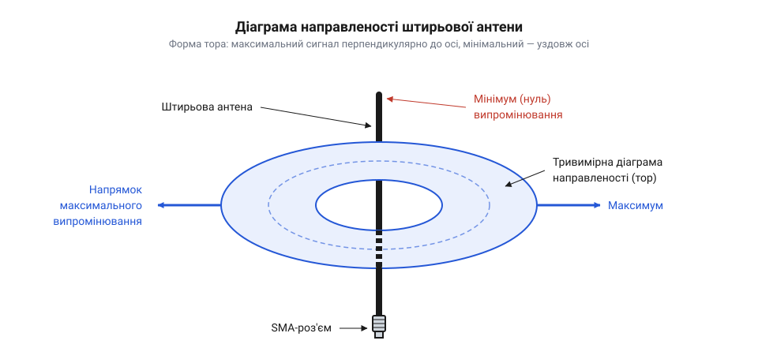
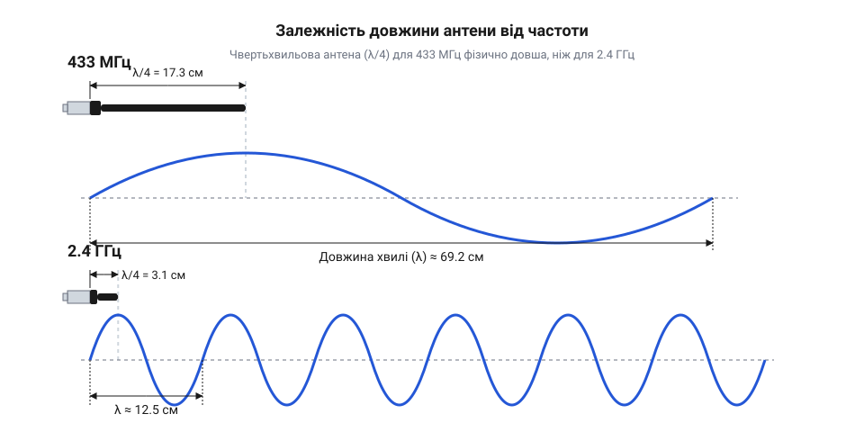
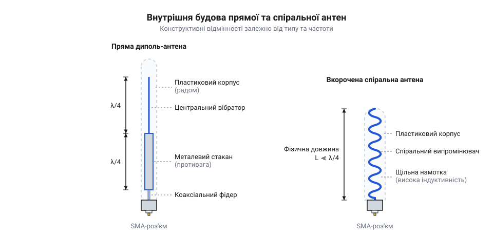
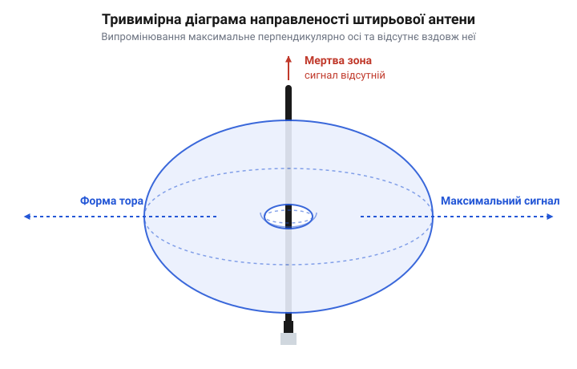

# Антени SMA (433 МГц і 2.4 ГГц)

## Завдання та роль антени у зв'язку

Будь-який радіопередавач генерує високочастотний електричний струм, але сам по собі цей струм не здатен подолати відстань по повітрю. Щоб передати інформацію, змінний струм потрібно перетворити на електромагнітну хвилю. Саме цю роботу виконує антена: вона працює як міст між електричним колом пристрою та відкритим простором.

Коли змінний струм потрапляє в провідник антени, він створює навколо нього змінне магнітне поле, яке, у свою чергу, породжує електричне поле. Поки струм зростає, ці поля розширюються від антени зі швидкістю світла. Коли струм досягає піку й починає спадати, ближня частина поля повертається назад у провідник, але зовнішня, що встигла віддалитися, не може миттєво зникнути. Тим часом струм різко змінює свій напрямок на протилежний, і навколо антени починає формуватися нове поле зворотної полярності. Воно швидко розширюється і зіштовхується із залишками попереднього поля, яке ще не встигло повернутися. Оскільки магнітні поля протилежного напрямку відштовхуються, нове поле діє як бар'єр і фізично відрізає старе від провідника. Силові лінії старого поля, втративши зв'язок із джерелом, змушені замкнутися самі на себе у вигляді петель. У цей момент магнітне поле, що залишилося без джерела, починає спадати, і ця зміна миттєво породжує замкнене вихрове електричне поле. Зміна електричного поля, у свою чергу, знову створює магнітне. Обидва поля починають безперервно генерувати одне одного вже без участі струму в провіднику, перетворюючись на самостійну електромагнітну хвилю, яка відривається від антени й поширюється далі в просторі. На приймальному кінці відбувається зворотний процес: ця хвиля наводить у приймальній антені слабкий змінний струм, який далі розшифровується приймачем.

Якщо антена підібрана неправильно або відсутня, цей міст руйнується. Високочастотний струм доходить до кінця виходу, але, не маючи змоги перетворитися на просторову хвилю, відбивається і йде у зворотному напрямку. Цей відбитий струм зустрічається з новим, який передавач продовжує невпинно генерувати. Їх накладання створює всередині тракту так звану стоячу хвилю з аномально високими піками напруги та струму. Оскільки цій запертій енергії нікуди дітися, вона повністю розсіюється на кристалах транзисторів вихідного підсилювача, миттєво перетворюючись на тепло. Транзистори не розраховані на таке теплове навантаження, і в поєднанні з надвисокою напругою, яка пробиває їхні напівпровідникові переходи, підсилювач швидко й незворотно згоряє. Тому важливо, щоб антена була точно узгоджена з передавачем, а її фізичний інтерфейс відповідав стандарту. Для надійного з'єднання в таких пристроях часто використовують різьбові роз'єми, і вибір правильного конектора між [SMA та RP-SMA](root:cat-hw-connect/sma-antennas/api-sma-rpsma.md) визначає, чи взагалі вдасться підключити антену.

Форма антени визначає, куди саме спрямовується енергія. Проста штирьова антена випромінює хвилі не рівномірно в усі боки, а формує поле, схоже на бублик.

*Діаграма направленості штирьової антени показує, що найсильніше випромінювання йде перпендикулярно до її осі, а вздовж самого штиря енергія майже не випромінюється.*

Щоб антена ефективно випромінювала хвилі, її фізична довжина має точно відповідати робочій частоті передавача. Якщо розмір не збігається, антена гірше резонує, і частина енергії знову ж таки втрачається.

## Залежність розміру антени від частоти

Частота радіосигналу визначає, скільки разів на секунду змінюється напрямок струму. Оскільки радіохвиля поширюється зі швидкістю світла, за один період коливання вона встигає пройти певну відстань — це і є довжина хвилі. Чим вища частота, тим швидше змінюється струм, і тим коротшою стає сама хвиля.

На частоті 433 МГц довжина хвилі становить приблизно 69 сантиметрів, тоді як для 2.4 ГГц хвиля значно коротша — близько 12.5 сантиметрів. Щоб антена працювала найефективніше, її фізичний розмір зазвичай роблять рівним чверті або половині довжини хвилі. За довжини рівно в чверть хвилі струму потрібна чверть періоду, щоб дійти до вільного кінця провідника, і ще чверть — щоб повернутися. Поки струм долає цей шлях, минає рівно половина циклу коливання, протягом якої генератор передавача плавно проходить половину своєї синусоїди і змінює напругу на протилежну. Оскільки на вільному кінці антени струму нікуди текти, він відбивається з розворотом напрямку і летить назад. Він прибуває до точки живлення рівно тієї миті, коли перевернутий генератор починає штовхати нову порцію струму в тому самому зворотному напрямку. Завдяки цьому відбитий рух ідеально збігається по фазі з новим імпульсом від передавача, і вони підсилюють одне одного. Вони накладаються і утворюють стоячу хвилю — стан резонансу, коли енергія перестає відбиватися назад у передавач і максимально випромінюється в простір; за іншої довжини пряма й відбита хвилі розсинхронізовуються і гасять одна одну. Точний [розрахунок довжини антени](root:cat-hw-connect/sma-antennas/math-antenna-wavelength.md) дозволяє дізнатися ідеальний габарит для конкретної частоти.

Через цю фізичну закономірність антени для 433 МГц і 2.4 ГГц кардинально відрізняються за розмірами. Антена для діапазону 433 МГц виходить досить довгою — її чвертьхвильовий штир має довжину понад 17 сантиметрів. Антена для 2.4 ГГц набагато компактніша, адже її чверть хвилі — це трохи більше 3 сантиметрів.

*Різниця в довжині хвилі між 433 МГц та 2.4 ГГц зумовлює пропорційну різницю у фізичній довжині антен, необхідних для ефективного резонансу.*

Велика довжина антени для 433 МГц не завжди зручна в портативних пристроях. Тому інженери часто скручують довгий провідник у спіраль, ховаючи його в короткий гумовий чи пластиковий корпус. Оскільки струм тече вздовж усього дроту, незалежно від його форми, це дозволяє зберегти електричну довжину провідника, але зменшити габарити самої антени. Водночас сусідні витки починають взаємодіяти між собою як котушка, створюючи додаткову індуктивність, а стиснута в просторі конструкція перекриває меншу площу радіохвилі, через що загальна ефективність випромінювання падає.

*Спіральна антена має таку ж електричну довжину, як і пряма, але завдяки скручуванню займає менше місця, хоча її ефективність випромінювання трохи знижується.*

Вибір між цими двома діапазонами та розмірами прямо впливає на те, наскільки далеко дістане сигнал. У практичному [порівнянні дальності зв'язку](root:cat-hw-connect/sma-antennas/proj-range-comparison.md) нижча частота 433 МГц із довшою антеною зазвичай показує кращу здатність огинати перешкоди, тоді як компактна 2.4 ГГц виграє у швидкості передавання даних, але швидше загасає за стінами.

## Типи антен: штирьові та спіральні

Форма антени безпосередньо впливає на її розмір та ефективність випромінювання сигналу. Найпростіша та найефективніша конструкція — це пряма штирьова антена, яка є просто рівним відрізком провідника. Щоби працювати найкраще, такий провідник повинен мати довжину, суворо прив'язану до довжини хвилі робочого сигналу. Про те, як саме фізичний розмір антени залежить від частоти, читайте у [вставці «Розрахунок довжини хвилі та антени»](root:cat-hw-connect/sma-antennas/math-antenna-wavelength.md).

Через зворотну пропорційність частоти й довжини хвилі, для діапазону 2.4 ГГц пряма @@uk|штирьова антена@@ виходить цілком компактною — близько трьох сантиметрів. Такий розмір легко розмістити на корпусі портативного пристрою. Однак для діапазону 433 МГц ефективна штирьова антена мусить мати довжину близько 17 сантиметрів. Для багатьох компактних датчиків, пультів чи брелоків такий довгий штир стає незручним.

Щоб зменшити фізичні габарити антени для низьких частот, розробники скручують прямий провідник у пружину. Так утворюється @@uk|спіральна антена@@. Загальна довжина дроту в ній залишається правильною для узгодження з частотою, але сам габарит антени стає в кілька разів меншим — її можна сховати навіть усередину невеликого корпусу. 

Проте це зменшення має свою ціну. Спіральна антена завжди є компромісом: вона компактніша, але випромінює слабше за повноцінну пряму штирьову антену того ж діапазону. Коли провідник скручують у пружину, його сусідні витки опиняються близько один до одного, створюючи паразитну ємність, а сама форма пружини додає антені властивостей котушки індуктивності. У прямій антені високочастотний струм біжить уздовж дроту, розгортаючи навколо нього електромагнітне поле, яке вільно відривається в простір. Але в спіральній антені поле, що народжується на одному витку, одразу ж натрапляє на сусідній. Замість того, щоб летіти назовні, значна частина енергії починає перетікати від витка до витка: магнітним полем через індуктивність та електричним полем через паразитну ємність зазору. Енергія ніби замикається сама на собі, утримуючись усередині цієї структури, що сильно знижує загальну ефективність випромінювання. Водночас таке накопичення енергії перетворює антену на виражений коливальний контур. Оскільки енергія не випромінюється миттєво, а довго перетікає між індуктивністю та ємністю, сигнал в антені складається з багатьох накладених одне на одного коливань. Щоб вони посилювали, а не гасили одне одного, частота струму від передавача має ідеально збігатися з власною частотою цього перетікання. Якщо частота хоча б трохи відрізняється, нові порції енергії приходять не в такт із тими, що вже циркулюють у витках, і хвилі починають знищувати одна одну. Саме ця фізична вимога до ідеальної синхронності багатьох циклів робить резонанс гострим, а смугу пропускання — вузькою. Через цю гостроту найменша зміна оточення, як-от наближення руки чи пластикового корпусу, стає згубною: зовнішні об'єкти додають свою ємність, що одразу змінює частоту перетікання енергії, вибиває антену із синхронності з передавачем і розлагоджує зв'язок. Тому, якщо для вашого пристрою на 433 МГц габарити не є критичними, пряма штирьова антена завжди дасть кращий зв'язок на більші відстані. Результати практичного вимірювання дальності для різних конструкцій наведено у [вставці «Порівняння дальності зв'язку»](root:cat-hw-connect/sma-antennas/proj-range-comparison.md).

## Інтерфейс підключення: SMA та узгодження

Енергія від передавача до антени має дійти з мінімальними втратами. Якщо просто прикрутити дріт антени до виходу мікросхеми як-небудь, виникне перепад @@uk|хвильового опору@@. Хвильовий опір визначає співвідношення напруги й струму, з яким лінія передає сигнал; високочастотна хвиля несе енергію як жорстко задану пропорцію цих двох величин. Коли хвиля натрапляє на межу, де опір раптово змінюється, нове середовище вимагає іншої пропорції. Наприклад, якщо опір антени вищий за опір лінії, вона не може пропустити весь струм, що прийшов. Але струм не може зникнути на стику, тому його надлишок розвертається і тече назад. Цей зворотний струм створює додатковий тиск — сплеск напруги на межі, який і дозволяє проштовхнути в антену ту частину енергії, що змогла пройти. Якщо ж опір антени менший, вона вільно пропускає більше струму; лінія не встигає його постачати, напруга на стику падає, і ця нестача у вигляді зворотної хвилі зниженого тиску теж біжить назад. У результаті будь-якого перепаду частина енергії, яка не узгоджується з новим середовищем, відбивається від цієї межі у вигляді зворотного струму й напруги, немов механічна хвиля від стіни. Цей відбитий сигнал повертається в передавач, де розсіюється у вигляді тепла, так і не перетворившись на радіохвилю, і навіть може спалити вихідний каскад. Щоб енергія передавалася цілком, уся лінія зв'язку — від виходу передавача, через кабелі й роз'єми до самої антени — повинна мати однаковий хвильовий опір. Таким загальним стандартом стало значення 50 Ом, яке виникло як інженерний компроміс: геометрія коаксіальної лінії найкраще витримує високу потужність при 30 Ом, а найменше загасання сигналу дає при 77 Ом, тому для універсальних систем обрали золоту середину. Детальніше механізм цього явища розглядає тема [«Узгодження антен і хвильовий опір»](root:hw-analog/impedance-matching).

У сучасній споживчій радіоелектроніці загальноприйнятим стандартом для передачі ВЧ-сигналів є хвильовий опір 50 Ом. Відповідно, щоб надійно та без втрат приєднати зовнішню антену, потрібен конектор, який зберігає цей опір. Саме таким є коаксіальний роз'єм @@en|SMA@@ (SubMiniature version A). Його конструкція з центральним контактом та різьбовим зовнішнім корпусом гарантує щільне екрановане з'єднання. Наслідки поганого контакту або неправильно підібраного роз'єму — це зміна опору в точці з'єднання, різке зростання відбиття сигналу та падіння дальності зв'язку в рази.

Роз'єм SMA з'явився ще в 1960-х роках як надійний інтерфейс для мікрохвильових військових та вимірювальних систем. Тоді інженери потребували конектора, який міг би передавати частоти до 18 ГГц, зберігаючи суворі 50 Ом, і при цьому витримував би вібрації завдяки міцній різьбі. Згодом, коли радіомодулі стали масовими й компактними, цей військовий стандарт перекочував у побутові пристрої. Сьогодні його різьбове з'єднання є найдешевшим і найнадійнішим способом прикрутити антену до Wi-Fi роутера чи модуля на 433 МГц так, щоб вона не відпала і працювала на повну потужність.

Завдяки своїй популярності інтерфейс SMA породив багато варіантів і супутніх компонентів. Зокрема, існують модифікації з інвертованим центральним контактом, механічну будову яких описує [вставка «Фізичний інтерфейс SMA та RP-SMA»](root:cat-hw-connect/sma-antennas/api-sma-rpsma.md). А якщо на самій платі пристрою встановлено ще менший конектор, застосовуються [перехідники SMA ↔ U.FL](root:cat-hw-connect/sma-ufl-adapters), які дозволяють підключити повноцінну SMA-антену до крихітного радіомодуля. Більше інформації про різноманіття та застосування інших стандартів конекторів ви знайдете в огляді про [високочастотні роз'єми](root:cat-hw-connect/hw-rf-connectors).

## Просторове орієнтування і діаграма направленості

Будь-яка антена випромінює радіохвилі нерівномірно. Як ми вже з'ясували, енергія поширюється переважно перпендикулярно до осі антени, а не з її кінця. Якщо уявити це в просторі, діаграма направленості матиме форму тора або звичайного бублика, надягнутого на антену. Вісь антени проходить крізь дірку цього бублика, де енергії майже немає.

*Тривимірна модель випромінювання штирьової антени: максимум енергії йде в боки, мінімум — уздовж осі.*

Струм в антені — це електрони, що коливаються туди-сюди вздовж металевого штиря. Змінюючи напрямок руху, вони постійно прискорюються і гальмують, і саме ця зміна швидкості породжує електромагнітну хвилю. Оскільки радіохвиля є поперечною — її електричне та магнітне поля розгойдуються під прямим кутом до лінії, по якій біжить заряд, — уся створена енергія виштовхується в боки, перпендикулярно до осі штиря. У напрямку самої осі, куди рухаються електрони, жодних поперечних коливань поля не виникає, адже заряд не може випромінювати поперечну хвилю «вперед себе» чи «назад». З торців антени електрони не вилітають, тому прямо вздовж осі випромінювання просто не формується. Водночас лінія, по якій бігають електрони, жорстко задає площину, у якій розгойдується електричне поле утвореної хвилі. Ця просторова орієнтація електричного поля називається @@uk|поляризація@@. З такої форми й природи випливає головне правило просторового орієнтування: антени передавача і приймача мають бути паралельними одна одній. Коли ви ставите антену вертикально, її випромінювання має вертикальну поляризацію і розтікається горизонтально на всі боки, покриваючи максимальну площу навколо. Електричне поле такої хвилі, досягнувши приймача, штовхає його електрони в тій самій вертикальній площині. Щоб навести максимальний струм, цей поштовх має діяти рівно вздовж провідника. Якщо приймальну антену нахилити, напрямок поля розійдеться з напрямком дроту, і лише частина енергії штовхатиме електрони вздовж осі антени; решта сили марно тиснутиме на них убік, б'ючи у стінки металу. Що більший кут нахилу, то менша корисна частка, яка здатна породити струм. Якщо ж нахилити антену приймача на 90 градусів відносно передавача, то вона не лише опиниться в «мертвій зоні» — у тій самій дірці від бублика, — а й електричне поле хвилі битиме суто поперек приймального штиря. Електрони зміщуватимуться впоперек тонкого дроту, де їм нікуди бігти, корисний струм уздовж антени не потече, і зв'язок зникне. Тому правильний нахил антени та збіг поляризацій безпосередньо впливають на рівень сигналу.

Саме для того, щоб ви могли завжди зберігати паралельність, більшість штирьових антен із роз'ємом SMA мають поворотний шарнір біля основи. Незалежно від того, як гніздо впаяне в плату вашого пристрою — стирчить угору чи вбік, — ви можете зігнути антену так, щоб її вісь стояла вертикально. Однак якщо пристрій постійно змінює нахил, як-от радіокерований дрон у польоті, антена неминуче відхилятиметься, і сигнал почне згасати. Щоб обійти це обмеження, на приймачі часто встановлюють дві антени, розведені під кутом 90 градусів одна до одної: коли передавач потрапляє в «мертву зону» першої антени, його випромінювання гарантовано перетинає другу, забезпечуючи стабільний зв'язок за будь-яких маневрів.

## Типові помилки монтажу та експлуатації

Зібравши пристрій, його часто хочеться заховати в надійний корпус. Але якщо цей корпус металевий, антена всередині опиняється в електромагнітній пастці. Метал відбиває радіохвилі, працюючи як екран, і сигнал просто не виходить назовні. Тому антену завжди виносять поза металеві оболонки.

Навіть якщо корпус пластиковий, радіочастотний тракт залишається чутливим до того, що знаходиться поруч. Будь-який провідник або щільний діелектрик, наприклад, плата, акумулятор чи навіть рука людини, опинившись у ближньому полі антени, взаємодіє з її електричним полем. Це поле найсильніше в межах чверті довжини хвилі: для 2.4 ГГц предмети починають критично впливати на відстані ближче 3 см, а для 433 МГц ця вразлива зона розширюється майже до 17 см. У діелектрику з вищою, ніж у повітря, проникністю молекули вишиковуються вздовж силових ліній і частково гасять поле, через що антена накопичує більше заряду за тієї ж напруги — її електрична ємність зростає. Оскільки на перезаряджання більшої ємності потрібно більше часу, електричні коливання сповільнюються. Через це резонансна частота зсувається вниз: антена поводиться так, ніби вона фізично довша. Коли ви обхоплюєте антену рукою або впритул монтуєте акумулятор, вона розстроюється. Оскільки передавач продовжує посилати сигнал на незмінній робочій частоті, для нього така антена випадає з резонансу. Її хвильовий опір перестає дорівнювати 50 Ом, бо через зсув резонансу струм і напруга починають коливатися несинхронно, і виникає додатковий реактивний опір. Хвиля, що йде від передавача, зіштовхується з цією різницею опорів, і значна частина енергії відбивається назад замість того, щоб випромінюватись. Це відчутно погіршує зв'язок, що особливо помітно під час [порівняння дальності зв'язку](root:cat-hw-connect/sma-antennas/proj-range-comparison.md) у реальних умовах.

Ще одна часта помилка — механічне згинання штирьових або спіральних антен під гострим кутом, якщо вони не мають спеціального шарніра. Це ламає внутрішній провідник або деформує крок спіралі, що безповоротно псує антену. Монтувати антену слід так, щоб у робочому положенні вона залишалася прямою, вільною від сторонніх предметів на відстані хоча б кількох сантиметрів і стояла паралельно до антени співрозмовника.
