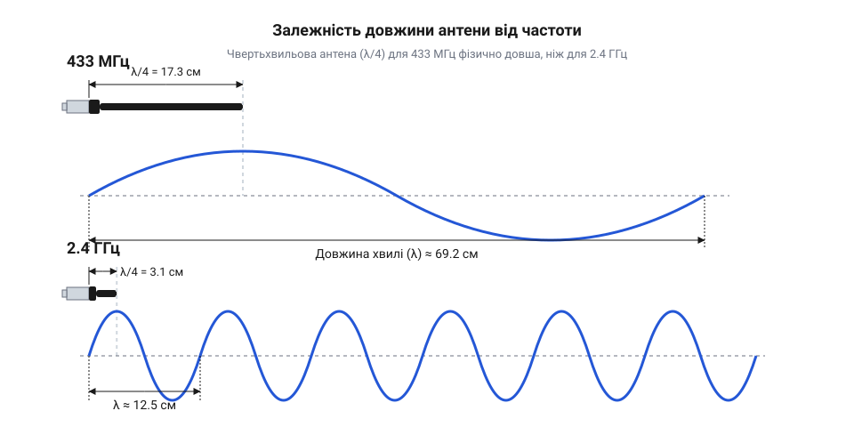
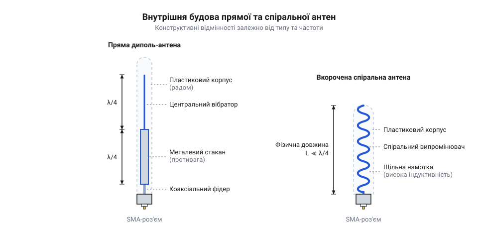
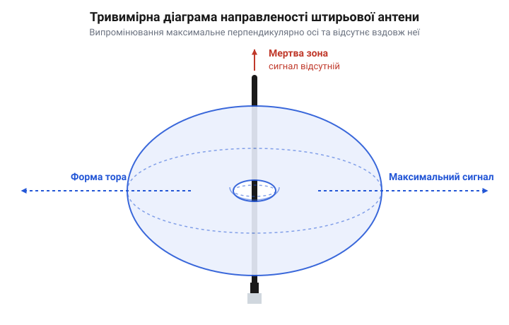

# Антени SMA (433 МГц і 2.4 ГГц)

## Навіщо пристрою потрібна антена

Передавач пристрою генерує високочастотний змінний струм, який несе корисний сигнал, але сам по собі цей струм не може поширюватися в просторі. Щоб сигнал долетів до іншого пристрою, його потрібно перетворити на радіохвилю. Саме це робить антена: вона працює як міст між електронною схемою і навколишнім ефіром, перетворюючи електричну енергію на електромагнітне випромінювання. Без цього мосту енергія, яку видає передавач, не знаходить виходу. Вона відбивається від кінця провідника і повертається назад у пристрій, де перетворюється на тепло. Якщо потужність передавача достатня, це тепло може його просто спалити. Тому включати передавач без антени — прямий шлях до поломки.

## Залежність розміру антени від частоти

Радіохвиля має свою довжину, яка залежить від частоти: що вища частота, то коротша хвиля. Щоб антена ефективно випромінювала сигнал, її фізичний розмір має чітко відповідати цій довжині. Найчастіше використовують антени, довжина яких дорівнює чверті довжини хвилі.

Для частоти 2.4 ГГц, на якій працює Wi-Fi або Bluetooth, хвиля коротка, тому чвертьхвильова антена виходить дуже компактною — близько 3 сантиметрів. А от для частоти 433 МГц хвиля значно довша, і правильна антена для неї має довжину близько 17 сантиметрів. Цей жорсткий зв'язок розміру і частоти не можна обманути: неможливо зробити антену довільного розміру, щоб вона при цьому добре працювала.

## Прямі та вкорочені спіральні антени

Пряма антена у вигляді рівного шматка дроту — найпростіший і найефективніший варіант, оскільки вся її довжина бере участь у випромінюванні. Проте для низьких частот, як-от 433 МГц, 17-сантиметровий штир часто занадто великий для компактного пристрою. Щоб зменшити габарити, дріт тієї ж загальної довжини скручують у пружину.

Така спіральна антена стає значно коротшою, але це завжди компроміс. Через те, що витки розташовані близько один до одного, частина енергії втрачається всередині самої конструкції, тому спіральна антена випромінює слабше за пряму. Крім того, вона дуже чутлива до всього, що знаходиться поруч: металеві деталі або навіть рука користувача, піднесені надто близько, можуть розладнати її роботу.

## Роз'єм SMA і правильне орієнтування

Щоб антена не втратила сигнал ще до того, як випромінить його, її підключають через спеціальний високочастотний роз'єм — @@en|SMA@@ (SubMiniature version A). Він накручується на різьбу, завдяки чому контакт виходить надійним, а втрати енергії зводяться до мінімуму. За потреби [перехідники SMA ↔ U.FL і SMA під пайку](root:cat-hw-connect/sma-ufl-adapters) дозволяють з'єднати цей роз'єм із крихітними контактами на самій платі.

Випромінюючи сигнал, штир антени не світить ним у всі боки однаково. Енергія поширюється перпендикулярно до антени, утворюючи форму, схожу на бублик.

Тому вздовж самої осі антени сигналу майже немає. З цього випливає правило: щоб два пристрої чули один одного найкраще, їхні антени слід розташовувати паралельно одна одній. Також важливо дати антені «дихати»: не ховати її в глухий металевий корпус, який працюватиме як екран, не згинати сам штир і тримати його подалі від інших предметів, які можуть поглинати чи відбивати хвилі.
