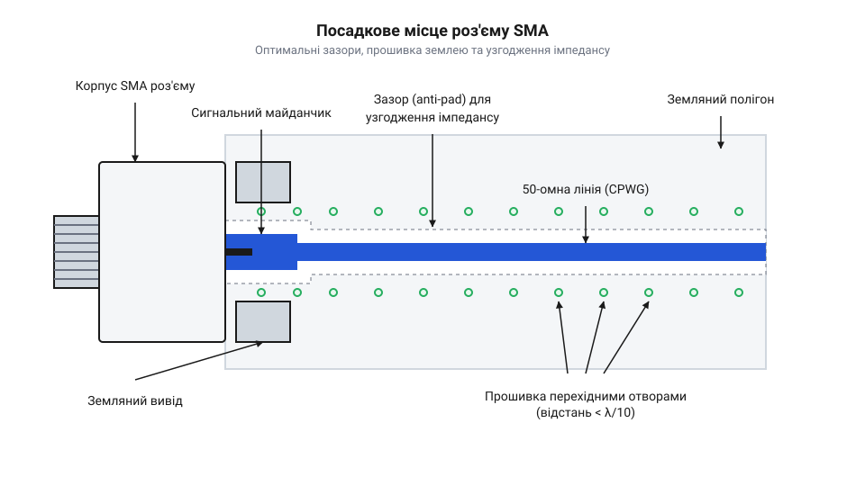

# Залізний інтерфейс SMA під пайку

<preknowlist>
- [Антени SMA (433 МГц і 2.4 ГГц)](root:cat-hw-connect/sma-antennas) — знати, що таке SMA роз'єм, для яких частот він призначений і що його хвильовий опір становить 50 Ом.
</preknowlist>

## Проблема узгодження на стику

Високочастотний сигнал у мідній доріжці — це хвиля, яка рухається лінією передавання з певним хвильовим опором. Коли сигнал виходить із роз'єму на друковану плату, контактний майданчик і припій стають частиною цієї лінії. Її хвильовий опір визначається відношенням ширини провідника до відстані до земляного полігона: чим ширший провідник, тим більша його ємність і нижчий опір, а чим далі розташована земля, тим опір вищий. Будь-яка зміна геометрії або ємності на стику змінює опір. Якщо опір лінії на платі та контакту відрізняється від 50 Ом, частина енергії відбивається назад до джерела. Чим вища частота, тим сильніше це відбиття спотворює сигнал, зменшуючи його потужність на антені. Тому точний розрахунок геометрії контактного майданчика та зазорів до земляного полігона є необхідним для збереження хвильового опору на всьому шляху сигналу. Детальніше про розрахунок хвильового опору залежно від геометрії та діелектрика розповідає матеріал про [мікросмужкові та копланарні лінії](root:com-medium/transmission-lines).

## Будова edge-mount та through-hole

На плату ВЧ-роз'єми монтують двома основними способами: торцевим (@@en|edge-mount@@) і наскрізним (@@en|through-hole@@). Торцевий роз'єм насувається на край плати: його центральний вивід лягає безпосередньо на сигнальну доріжку, а масивні земляні ніжки охоплюють плату згори й зісподу. Така конструкція зберігає лінійність переходу сигналу, мінімізуючи втрати та відбиття на високих частотах. Роз'єм наскрізного монтажу має виводи, які вставляються в металізовані отвори плати. Коли центральний провідник проходить крізь товщу текстоліту перпендикулярно до шарів, він працює як шматок дроту, додаючи в лінію послідовну паразитну індуктивність. Водночас металеві стінки самого отвору утворюють із земляними полігонами внутрішніх шарів обкладки конденсатора, де текстоліт виступає діелектриком, — так виникає шунтувальна паразитна ємність. Ця неконтрольована індуктивність і ємність локально змінюють хвильовий опір лінії, що викликає відбиття сигналу і різко погіршує узгодження на частотах вище 1 ГГц. Через це торцевий монтаж є стандартом для високочастотних пристроїв, тоді як наскрізний підходить лише для нижчих частот або прототипування, де механічна міцність переважає вимоги до сигналу.

## Формування 50-омних майданчиків

Щоб центральний вивід роз'єму не зламав хвильовий опір, його майданчик має утворювати 50-омну мікросмужкову лінію або копланарний хвилевод із нижнім і бічними земляними полігонами. Ширина цього майданчика часто більша за ширину самої лінії передавання через товщину виводу. Більша площа металу над землею діє як збільшена обкладка конденсатора: ємність ділянки зростає, і хвильовий опір падає нижче 50 Ом. Щоб компенсувати цю зайву ємність, під широким контактом у земляному полігоні внутрішніх шарів або на звороті плати роблять виріз. Фізичне віддалення землі збільшує відстань між провідником і найближчим полігоном, що зменшує паразитну ємність і повертає опір переходу до розрахункових 50 Ом.

*Футпринт роз'єму показує, як центральний контакт переходить у мікросмужкову лінію з розрахованим зазором до земляного полігона.*

Точний зазор між сигнальним майданчиком і землею на верхньому шарі також визначає ємність. Зменшення ширини лінії або збільшення вирізу під контактом дозволяє тонко налаштувати опір переходу, повертаючи його до 50 Ом.

## Екранування перехідними отворами

Високочастотний сигнал випромінює частину енергії в простір, а зовнішні поля можуть наводити завади в лінії. Щоб замкнути електромагнітне поле всередині діелектрика, земляні полігони на верхньому й нижньому шарах зшивають перехідними отворами (@@en|vias@@) вздовж усієї лінії передавання та навколо роз'єму. Ці отвори утворюють своєрідний паркан, який екранує сигнал. Щоб паркан не пропускав радіохвилю, відстань між сусідніми отворами має бути меншою за одну двадцяту довжини хвилі найвищої робочої частоти. Якщо отвори розставити надто рідко, між ними виникатимуть резонанси, і енергія витікатиме назовні, порушуючи ізоляцію ВЧ-тракту.

## Термічні правила паяння

Корпус SMA — це масивний шматок латуні з позолотою або нікелюванням. Під час паяння він працює як радіатор, миттєво відводячи тепло від паяльника. Якщо прогріти роз'єм недостатньо, припій не змочить метал, і утвориться холодна пайка з крихким механічним і поганим електричним контактом. Щоб цього уникнути, плату й роз'єм варто попередньо підігріти термофеном, а для паяння використовувати жало з великою теплоємністю та флюс. Водночас важливо не перегріти роз'єм тривалим контактом, оскільки всередині нього знаходиться тефлоновий ізолятор. За надмірної температури тефлон плавиться й деформується, зміщуючи центральний контакт і назавжди руйнуючи 50-омне узгодження роз'єму.
