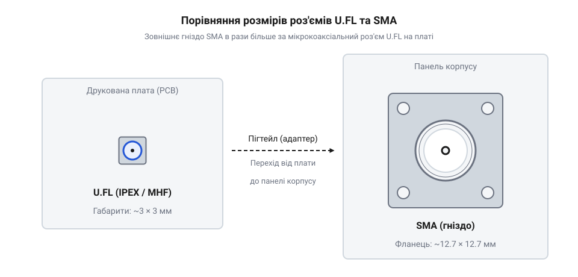
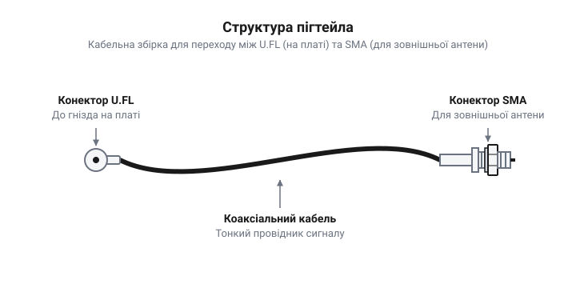
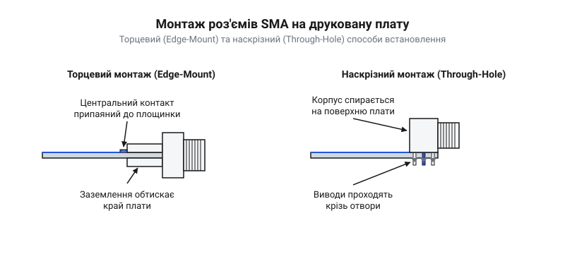
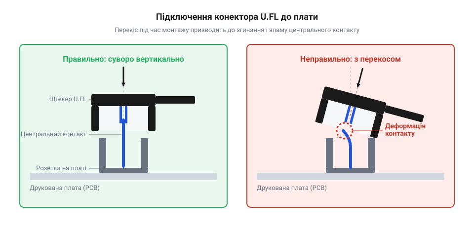

# Перехідники SMA ↔ U.FL і SMA під пайку

<preknowlist>
- [Антени SMA (433 МГц і 2.4 ГГц)](root:cat-hw-connect/sma-antennas) — базове розуміння того, що таке антена і навіщо їй потрібен міцний зовнішній роз'єм.
</preknowlist>

## Чому антену виносять назовні

Будь-який радіопередавач, захований усередині металевого корпусу або за щільними елементами конструкції, стрімко втрачає здатність зв'язуватися зі світом. Метал працює як екран: він відбиває і поглинає електромагнітні хвилі, не даючи їм вийти назовні. Навіть пластикові корпуси, якщо всередині тісно і багато радіодеталей чи масивних батарей, неминуче псують сигнал. Такі щільні елементи працюють як дзеркала: вони відбивають радіохвилі всередині корпусу, змушуючи прямий і відбитий сигнали накладатися та гасити одне одного. Крім того, активна електроніка генерує власне поле, і антена збирає електромагнітні наводки від роботи процесорів чи ліній живлення. Через ці відбиття та зайвий шум форма хвилі спотворюється, і якість зв'язку стрімко погіршується.

Щоб пристрій мав стабільний сигнал і максимальну дальність дії, антену доводиться виносити за межі корпусу, у відкритий простір. Проблему екранування не вирішують простим збільшенням потужності передавача: по-перше, потужний сигнал у металевому корпусі породить іще більше відбиттів, які заважатимуть роботі мікросхем і швидко виснажуватимуть батарею, а по-друге, приймач усе одно залишиться відрізаним від слабких сигналів ззовні. Але сам радіомодуль — мікросхема, що генерує або приймає сигнал, — завжди залишається всередині, на друкованій платі. Тому виникає потреба надійно передати високочастотний сигнал від плати до зовнішньої антени крізь стінку корпусу. Цей зв'язок має бути захищений від перешкод, а сам роз'єм на корпусі повинен витримувати механічні навантаження, коли користувач прикручує або відкручує антену. Крім того, під час монтажу на металевий корпус важливо правильно повестися з радіочастотною землею, яку несе зовнішня оболонка роз'єму. Коаксіальний кабель передає сигнал замкненим контуром: центральна жила несе прямий високочастотний струм до антени, а металеве обплетення повертає такий самий за величиною зворотний струм назад до джерела на платі. Неконтрольований контакт металевої стінки з оболонкою роз'єму пропонує цьому зворотному струму альтернативний шлях. Замість того, щоб іти виключно обплетенням, струм розгалужується і частково витікає на шасі. Оскільки шасі має випадкові розміри й форму, відмінні від розрахованого хвильового опору кабелю, високочастотний струм починає резонувати на краях і щілинах металу. Замість повернення в мікросхему енергія випромінюється самим корпусом у простір або всередину на сусідні деталі. Це перетворює шасі на неконтрольовану антену, яка відбирає корисну потужність, ловить навколишні завади та руйнує узгодження. Щоб цього уникнути, роз'єм електрично розв'язують із металевою стінкою за допомогою діелектричних шайб. Шайби перекривають струму шлях на шасі, змушуючи весь високочастотний зворотний струм текти строго обплетенням кабелю й зберігати цілісність сигналу. Якщо ж конструкція вимагає використання самого корпусу як частини антенної системи, забезпечують щільний контрольований контакт без ізоляції. Для таких завдань використовують міцні зовнішні роз'єми, про які можна дізнатися більше в темі [Антени SMA](root:cat-hw-connect/sma-antennas).

## Мініатюрний U.FL проти міцного SMA

Коли ми виводимо антену назовні, ми стикаємося з несумісністю двох світів: мікроелектроніки на платі та суворої механіки зовнішнього корпусу.

Радіомодуль на друкованій платі має бути компактним. Для підключення антени на ньому встановлюють мікрокоаксіальний роз'єм, найпопулярнішим з яких є @@en|U.FL@@ (або його аналоги, такі як IPEX чи MHF). Він крихітний — його висота часто не перевищує кількох міліметрів, і він займає мінімум місця. Використовувати замість нього міцний зовнішній роз'єм зазвичай неможливо не лише через габарити, а й з технологічних та електричних причин. Масивний металевий конектор має велику теплоємність і під час автоматизованого паяння в печі працює як тепловідвід, забираючи тепло на себе. Через це припій під самим роз'ємом та на сусідніх деталях не встигає розплавитися, утворюючи неповні, або так звані холодні, контакти. Спроба скомпенсувати це тривалішим перебуванням плати в печі не розв'язує проблему, а руйнує сам пристрій. Тривалий вплив високої температури викликає термічну деградацію склотекстоліту (FR-4): його внутрішні шари починають розшаровуватися, а мідні доріжки відриваються від основи. Водночас чутливі мікросхеми зазнають незворотних теплових пошкоджень, а через нерівномірне прогрівання поверхневий натяг припою діє на дрібні SMD-компоненти неодночасно, через що вони можуть перекошуватися або ставати дибки (ефект «надгробка»). Крім того, великий роз'єм має ширший центральний контакт, що змушує робити підвідну доріжку значно ширшою для збереження хвильового опору 50 Ом, а також він заважає накрити радіотракт суцільним металевим екраном від перешкод. Але за мініатюрність U.FL доводиться платити механічною крихкістю. Цей мікрокоаксіальний роз'єм має жорсткі правила підключення: кабель притискається під прямим кутом із відчутним зусиллям замикання, а кількість безпечних циклів з'єднання зазвичай обмежена тридцятьма. Такий малий ресурс зумовлений тим, що під час кожного замикання й розмикання стирається тонке покриття контактів, а зовнішнє кільце штекера поступово деформується, втрачає свою пружність і перестає міцно триматися за гніздо на платі. Для безпечного від'єднання цього роз'єму потрібен спеціальний інструмент, щоб не відірвати гніздо від плати. U.FL зовсім не призначений для того, щоб за нього тягнули кабель.

З іншого боку, на корпусі пристрою нам потрібен роз'єм, який витримає зовнішні навантаження: удари, вібрації та зусилля користувача, який закручує антену рукою. Стандартом для цього став роз'єм @@en|SMA@@ (SubMiniature version A). Він має різьбове з'єднання, металевий корпус і надійно фіксує антену.

*Мініатюрний роз'єм U.FL на платі та масивний SMA-роз'єм для корпусу поруч.*

Безпосередньо з'єднати U.FL на платі та антену з SMA-роз'ємом неможливо через різницю їхніх розмірів і типів з'єднання. Нам потрібен місток, який поєднає ці два різні світи: ніжний контакт на платі та міцний роз'єм на стінці корпусу. Цим містком виступає спеціальний короткий перехідний кабель, який називають @@en|пігтейлом@@ (від англ. pigtail — поросячий хвостик).

*Пігтейл має конектор U.FL для підключення до плати, тонкий коаксіальний кабель та роз'єм SMA для кріплення на корпус.*

Пігтейл бере на себе механічну розв'язку: він дозволяє акуратно приєднатися до плати й вивести міцний SMA-роз'єм назовні корпусу, фіксуючи його там гайкою. Завдяки цьому жодні механічні навантаження від зовнішньої антени не передаються на крихкий роз'єм друкованої плати. Іноді, якщо архітектура пристрою дозволяє, SMA-роз'єм можна запаяти безпосередньо на край або крізь отвори самої плати, вивівши його назовні, як розглядається у вставці [Залізний інтерфейс SMA під пайку](root:cat-hw-connect/sma-ufl-adapters/api-sma-board-mount.md).

Різьбове з'єднання для SMA вибрано саме тому, що воно створює постійний механічний притиск контактних поверхонь. Під час затягування гайки контакти міцно втискаються один в одного. В умовах вібрацій, наприклад на рухомих механізмах чи дронах, роз'єми із простою засувкою можуть злегка зміщуватися, викликаючи мікроскопічні відриви. Для високочастотного сигналу такий брязкіт контактів є катастрофою: найменший проміжок миттєво порушує хвильовий опір і відбиває сигнал. Різьба ж перетворює обертальний рух на сильне лінійне стягування, а тертя між витками не дає гайці самовільно розкрутитися від тряски. Завдяки цьому механічне з'єднання залишається жорстким, а електричний контакт — безперервним.

*Різні типи SMA-роз'ємів, змонтовані безпосередньо на друковану плату.*

## Перехідні кабелі та пігтейли

Мініатюрний роз'єм @@en|U.FL@@ на друкованій платі надто тендітний, щоб підключати до нього важкі зовнішні антени, а масивний зовнішній роз'єм @@en|SMA@@ забирає надто багато місця, щоб ставити його прямо на компактну плату. Тому їх з'єднують гнучким перехідним кабелем — @@en|пігтейлом@@. Він перетворює крихкий внутрішній інтерфейс плати на надійне різьбове з'єднання на корпусі пристрою.

Такий кабель забирає на себе всі механічні навантаження. Якщо зовнішню [антену SMA](root:cat-hw-connect/sma-antennas) випадково смикнуть або притиснуть, зусилля припаде на міцний роз'єм на корпусі, а гнучкий дріт усередині просто зігнеться, залишаючи контакт @@en|U.FL@@ на платі неушкодженим.

Водночас будь-який кабель поглинає частину високочастотного сигналу. Високочастотний струм не заповнює весь переріз провідника, а витісняється на його поверхню — це явище називають скін-ефектом (@@en|skin effect@@). Чим тонший кабель, тим менша площа поверхні центральної жили та екрана, якою може текти струм, і тим більший електричний опір вони чинять. Енергія сигналу неминуче витрачається на нагрівання металу, а частина її поглинається діелектриком між провідниками. Через це що менший діаметр кабелю і що більша його довжина, то більше енергії втрачається, не доходячи до антени. Оскільки @@en|пігтейли@@ змушено виготовляють із дуже тонких коаксіальних проводів із типовим зовнішнім діаметром 1.13 мм або 1.8 мм (як-от марка RG178), зважаючи на [типи коаксіальних кабелів для радіозв'язку](root:com-medium/coaxial-cables-types), головне правило для них — кабель має бути максимально коротким. Прокладати його всередині корпусу слід обережно, залишаючи безпечний радіус згину — зазвичай не менше 5–10 мм, та уникаючи заломів і натягу. При різкому згині м'який шар діелектрика стискається, і фізична відстань між центральною жилою та зовнішньою опліткою зменшується. Кожна ділянка коаксіального кабелю працює як конденсатор, де заряди на центральній жилі притягуються до протилежних зарядів на екрані крізь діелектрик. Що ближче провідники один до одного, то сильніше їхнє електричне поле взаємодіє і то більше заряду вони здатні втримати при тій самій напрузі. Оскільки електрична ємність обернено пропорційна цій відстані, стискання ізолятора різко збільшує локальну ємність кабелю. А оскільки хвильовий опір пропорційний кореню з відношення індуктивності до ємності, зростання ємності в знаменнику провалює імпеданс у місці згину нижче номінальних 50 Ом. Така зміна порушує [узгодження імпедансу високочастотних ліній](root:com-medium/rf-impedance-matching), і радіочастотна хвиля відбивається від місця деформації назад, замість того щоб іти далі.

Якщо габарити пристрою дозволяють не використовувати кабель, зовнішній конектор монтують безпосередньо. Ці правила розводки та монтажу розкриває [залізний інтерфейс SMA під пайку](root:cat-hw-connect/sma-ufl-adapters/api-sma-board-mount.md).

## Особливості підключення конекторів U.FL

Мікрокоаксіальний інтерфейс @@en|U.FL@@ розроблений для максимальної економії місця на платі, але розплатою за це є його механічна вразливість. Роз'єм складається з крихітного центрального штирка на платі та пружної зовнішньої оболонки на кабелі. З'єднання тримається виключно за рахунок тертя та форми цих контактів, без жодної додаткової фіксації.

Залізні властивості мікрокоаксіального роз'єму @@en|U.FL@@ вимагають обережності: кабель слід підключати суворо під прямим кутом до плати, щоб не погнути центральний контакт. Правильне замикання супроводжується легким тактильним клацанням. Це клацання — результат роботи механізму пружної фіксації: під час натискання зовнішнє кільце кабельного конектора деформується, насуваючись на стопорний обідок гнізда, а потім різко стискається і заскакує у фіксувальний паз під ним. Саме ця пружна деформація створює зусилля, яке надійно утримує роз'єм закритим, і дає тактильний зворотний зв'язок під рукою. Однак через постійне розтягування металу під час зняття і встановлення інтерфейс має вкрай малий ресурс — він витримує до 30 циклів з'єднання, після чого пружність кільця падає і механічний притиск слабшає. Крім того, кожне тертя деталей стирає мікронний шар золотого або срібного напилення на контактах. Коли під ним оголюється базовий метал — нікель чи мідь, — він швидко окислюється, утворюючи плівку з високим електричним опором. Для високочастотного сигналу така межа стає перешкодою: на ній зростають активні втрати енергії та виникає відбиття хвилі назад у кабель, що різко погіршує якість передачі. Щоб не вирвати роз'єм із плати, від'єднувати його треба спеціальним інструментом-екстрактором, тягнучи рівно вгору, а не смикаючи за кабель. Екстрактор має вилкоподібний кінець, який щільно заходить під металевий обідок кабельного конектора. Завдяки такій формі інструмент захоплює роз'єм симетрично і розподіляє тягове зусилля рівномірно по всьому контуру. Це виключає бічний перекіс, що неминуче виникає під час смикання за відведений убік провід, і забезпечує рух суворо по вертикалі, рятуючи центральний штирок від згинання, а гніздо — від виривання з друкованої плати разом із контактним майданчиком.

\n*Правильний суворо вертикальний та помилковий похилий кути підключення U.FL: перекіс неминуче згинає крихкий центральний контакт.](img/ufl-connector-mating.svg)
*\n*Правильний суворо вертикальний та помилковий похилий кути підключення U.FL: перекіс неминуче згинає крихкий центральний контакт.*

Будь-яке бічне навантаження на підключений кабель @@en|U.FL@@ діє як важіль, що виламує роз'єм із друкованої плати. Тому після підключення @@en|пігтейл@@ часто фіксують поблизу конектора краплею клею або компаунда, щоб унеможливити будь-які рухи кабелю відносно плати під час вібрацій. Оскільки фіксатор огортає місце з'єднання, для цього годяться лише діелектрики з низькими радіочастотними втратами — термоклей, нейтральний силікон або спеціалізовані електронні компаунди. Побутові ціанакрилатні клеї чи кислотні герметики використовувати не можна: їхні складові викликають хімічну корозію контактів, а сам матеріал працює як паразитний конденсатор, що змінює хвильовий опір лінії і призводить до втрати або відбиття високочастотного сигналу.

Якщо закріплений @@en|пігтейл@@ потрібно замінити, фіксатор необхідно знімати вкрай обережно, щоб не відірвати крихкий контактний майданчик @@en|U.FL@@ від плати. Для безпечного видалення термоклею використовують ізопропіловий спирт: він проникає під край клейової краплі та руйнує її зчеплення з поверхнею, дозволяючи зняти масу цілим шматком без механічного зусилля. Силіконові герметики та компаунди на спирт не реагують — їх обережно прогрівають термофеном до розм'якшення і поступово підрізають чи зчищають пластиковим інструментом. Лише після повного звільнення роз'єму від залишків фіксатора конектор можна безпечно від'єднати екстрактором.

## Монтаж роз'ємів SMA на плату

Використовувати пігтейл і роз'єм U.FL обов'язково лише тоді, коли плата захована глибоко в корпусі. Якщо ж габарити і конструкція пристрою дозволяють розмістити край друкованої плати впритул до стінки корпусу, антену можна підключити напряму. Для цього роз'єм SMA припаюють безпосередньо до плати, обходячись без додаткових кабелів. 

Таке рішення робить конструкцію механічно монолітною. Оскільки масивний SMA-роз'єм жорстко зафіксований на текстоліті, плата сама бере на себе навантаження від антени. Відпадає ризик, що тонкий кабель пігтейла перетреться або від'єднається від вібрацій. Проте ця жорсткість створює нову небезпеку: якщо пристрій упаде або хтось випадково зачепить довгу зовнішню антену, вона спрацює як важіль. Уся сила удару передасться через роз'єм безпосередньо на плату, і замість відірваного кабелю є ризик вирвати мідні доріжки або виламати шматок самого текстоліту.

Залежно від того, як саме плата розташована відносно корпусу, використовують різні види монтажу роз'єму, і цей вибір прямо впливає на якість високочастотного тракту. Торцевий монтаж (@@en|edge-mount@@) передбачає, що роз'єм «надівається» на край плати: центральний контакт лягає на сигнальну доріжку, а масивні бічні ніжки припаюються до площин заземлення з обох боків текстоліту. Такий плавний компланарний перехід зберігає хвильовий опір 50 Ом без значних спотворень. Ширина сигнальної доріжки `w`, її відстань до нижнього шару заземлення через товщину діелектрика `h` та проміжок до бічних полігонів землі `s` жорстко задають баланс між магнітним і електричним полями. Ця геометрія фіксує погонну індуктивність `L` та погонну ємність `C`, з яких складається хвильовий опір лінії `Z₀`:

    Z₀
    = √(L / C)

Правильний підбір розмірів доріжки та зазорів утримує співвідношення `L` до `C` таким, щоб опір дорівнював рівно 50 Ом. Оскільки електромагнітне поле з коаксіального роз'єму плавно перетікає в узгоджену структуру без різких розривів у провідниках, сигнал не відбивається, що робить цей варіант найпопулярнішим для плоских пристроїв. Наскрізний монтаж (@@en|through-hole@@) використовують, коли роз'єм має стирчати перпендикулярно до площини плати. У цьому випадку його ніжки проходять крізь отвори в текстоліті і запаюються зі зворотного боку, що дає найбільшу стійкість на виривання. Проте центральний контакт, який вертикально пронизує діелектрик плати, втрачає коаксіальне екранування. Цей відрізок виводу в отворі працює як звичайний неекранований провідник, що вносить приблизно 1 нГн паразитної індуктивності на кожен міліметр своєї довжини. Разом із паразитною ємністю контактних майданчиків це локально порушує 50-омний імпеданс, відбиваючи частину сигналу назад, тому на високих частотах такий перехід працює гірше. Точні вимоги до розводки доріжок та пайки описані у вставці [Залізний інтерфейс SMA під пайку](root:cat-hw-connect/sma-ufl-adapters/api-sma-board-mount.md).

## Втрати сигналу на з'єднаннях

Винесення антени назовні корпусу вирішує проблему екранування, але створює нову: кожен перехідник і кожен сантиметр кабелю неминуче «з'їдає» частину енергії радіосигналу. Будь-який стик між двома різними середовищами — наприклад, перехід від доріжки на платі до роз'єму U.FL, потім до кабелю пігтейла, а з нього до SMA-конектора — викликає мікроскопічні відбиття хвилі. Чим більше таких механічних переходів, тим менше корисного сигналу доходить до антени. 

Сам по собі тонкий мікрокоаксіальний кабель пігтейла має помітне згасання, яке стрімко зростає з підвищенням частоти. Головна причина цього — поверхневий ефект (@@en|skin effect@@): високочастотний струм не йде крізь усю товщу провідника, а витісняється в його зовнішній мікроскопічний шар. Чим вища частота, тим тоншою стає ця робоча оболонка. Глибина проникнення струму залежить лише від частоти, тому на одній і тій самій частоті товщина робочого шару однакова і для товстого кабелю, і для тонкого пігтейла. Площа перерізу, яким фактично тече струм, дорівнює добутку периметра провідника на глибину проникнення. У товстому кабелі струмопровідна плівка огинає великий периметр, утворюючи «трубу» з достатньою площею перерізу. Натомість центральна жила пігтейла має мікроскопічний радіус і, відповідно, крихітний периметр. Коли цей мізерний периметр множиться на ту саму малу глибину проникнення, утворена площа перерізу для струму стає катастрофічно малою. Це жорстко звужує провідний шлях і різко збільшує активний опір металу. У цьому тракті втрати складаються з двох частин: відбиттів на контактах та згасання в самому дроті. Механічний стик мікророз'єму @@en|U.FL@@ забирає на себе в середньому 0.1–0.2 децибела (дБ), перехід на @@en|SMA@@ — ще близько 0.1 дБ, а кожен сантиметр тонкого кабелю втрачає приблизно 0.03–0.05 дБ. Наприклад, на частотах Wi-Fi типовий пігтейл завдовжки десять сантиметрів разом із двома роз'ємами може вносити сумарні втрати понад 1 дБ. Втрата одного децибела означає, що потужність сигналу падає на 20.6%: п'ята частина енергії передавача розсіюється у вигляді тепла ще до того, як потрапить в антену. На практиці це б'є по обох кінцях радіолінії: за законом обернених квадратів така втрата потужності скорочує дальність зв'язку приблизно на 11%, а на боці приймання цей самий втрачений децибел погіршує чутливість і може стати вирішальним, коли треба витягнути слабкий сигнал із шуму.

Тому, плануючи радіотракт, завжди доводиться шукати баланс. Довгий пігтейл дозволяє зручно розмістити зовнішню антену на корпусі, але послаблює сигнал настільки, що користь від хорошої антени може зійти нанівець. Щоб зберегти максимальну ефективність системи, довжина внутрішнього кабелю має бути мінімальною, роз'єми — якісними, а кількість механічних з'єднань — зведеною до необхідного мінімуму. Там, де можна обійтися без пігтейла і припаяти SMA прямо на плату, це завжди дасть кращу якість зв'язку.
