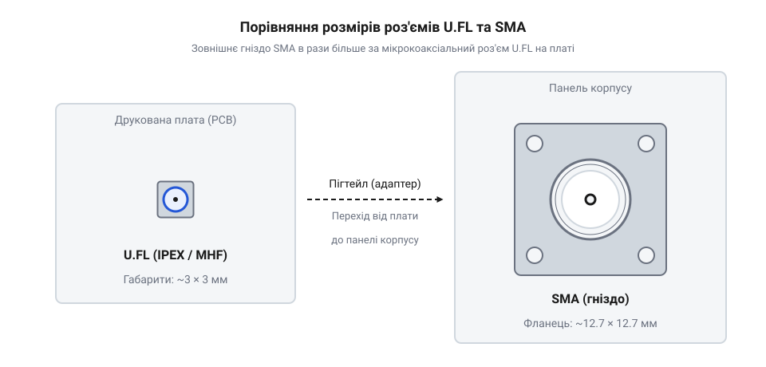
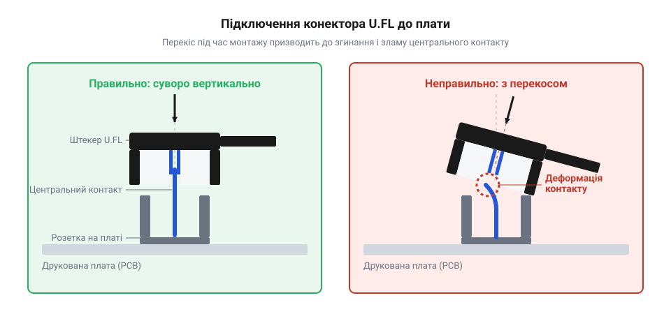
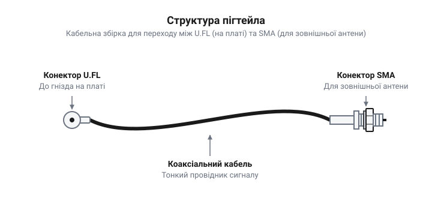
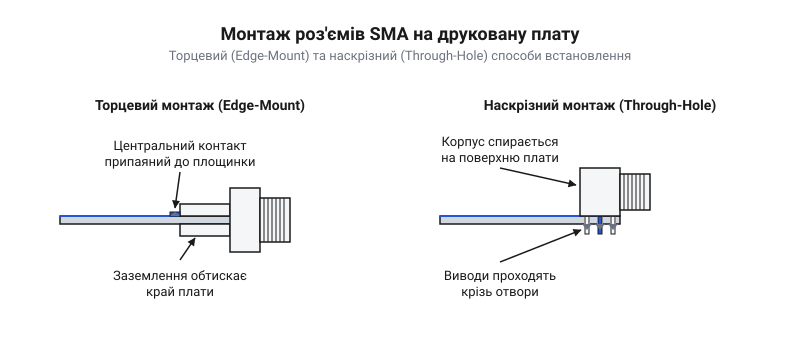

# Перехідники SMA ↔ U.FL і SMA під пайку

<preknowlist>
- [Антени SMA (433 МГц і 2.4 ГГц)](root:cat-hw-connect/sma-antennas) — базове розуміння того, що таке антена і навіщо їй потрібен міцний зовнішній роз'єм
</preknowlist>

## Чому антену виносять назовні

Металевий корпус пристрою або щільне компонування електроніки всередині працюють як екран, що затримує й відбиває радіохвилі. Якщо розмістити антену на самій платі всередині закритого металевого об'єму, сигнал не зможе вийти назовні, і зв'язок зникне на відстані кількох метрів. Навіть у пластикових корпусах близько розташовані компоненти, силові кола та радіатори створюють перешкоди, що глушать корисний сигнал. Щоб забезпечити стабільне покриття та максимальну дальність, антену необхідно виносити за межі пристрою в простір без перешкод. [Антени SMA (433 МГц і 2.4 ГГц)](root:cat-hw-connect/sma-antennas) спеціально створені для зовнішнього використання, але щоб їх підключити, радіомодуль на платі потрібно з'єднати з гніздом на корпусі.

## Мініатюрний U.FL проти міцного SMA

Щоб вивести сигнал із плати, потрібен роз'єм. На сучасних радіомодулях через брак місця використовують мікрокоаксіальний конектор @@en|U.FL@@, який займає площу менше ніж 3×3 міліметри.

*Мініатюрний конектор U.FL на платі значно компактніший за масивний SMA, призначений для корпусу.*

Проте @@en|U.FL@@ є дуже крихким. Він розрахований лише на кілька десятків циклів підключення, і найменший бічний натяг кабелю може відірвати його від плати разом із контактним майданчиком. Його не можна виводити безпосередньо на корпус пристрою, адже зовнішня антена діє як важіль і миттєво зламає таке з'єднання. Натомість на корпусі фіксують міцний різьбовий роз'єм @@en|SMA@@. Він надійно прикручується гайкою до стінки, забираючи на себе будь-які механічні навантаження, і витримує багаторазове накручування зовнішньої антени.

*Конектор U.FL підключається виключно вертикальним натисканням без перекосів, щоб не пошкодити центральний контакт.*

## Пігтейли та прямий монтаж SMA

Щоб з'єднати ніжний @@en|U.FL@@ на радіомодулі з міцним корпусного @@en|SMA@@, використовують перехідник — @@en|пігтейл@@ (від @@en|pigtail@@). Це короткий відрізок тонкого й гнучкого високочастотного кабелю з потрібними роз'ємами на кінцях.

*Пігтейл працює як гнучкий місток: він передає сигнал і гасить механічні напруги між корпусом і платою.*

Пігтейл дозволяє розмістити плату в зручному місці, а зовнішній роз'єм вивести туди, де найкраще встановити антену. Якщо ж конструкція пристрою дозволяє прикріпити плату впритул до стінки корпусу, конектор @@en|SMA@@ можна змонтувати безпосередньо на плату, уникнувши використання кабелів.

*Прямий монтаж SMA на край або поверхню друкованої плати забезпечує найкоротший шлях сигналу.*

Прямий монтаж вимагає точного збігу отвору в корпусі з роз'ємом на платі, але усуває потребу в крихких перехідниках.

## Втрати сигналу на з'єднаннях

Високочастотний сигнал поступово згасає, проходячи через тонкі провідники, і втрачає частину потужності на кожному механічному з'єднанні. Чим довший @@en|пігтейл@@, тим більший опір він чинить радіохвилі, перетворюючи її енергію на тепло. Кожен перехід від конектора до гнізда також викликає невелике відбиття сигналу назад до джерела. Хоча ці втрати здаються незначними, у сумі довгий кабель і кілька адаптерів можуть забрати половину потужності передавача ще до того, як сигнал досягне антени. Тому головне правило побудови радіотракту — мінімізувати довжину кабелів та уникати зайвих перехідників, прокладаючи сигнал найкоротшим можливим шляхом.
