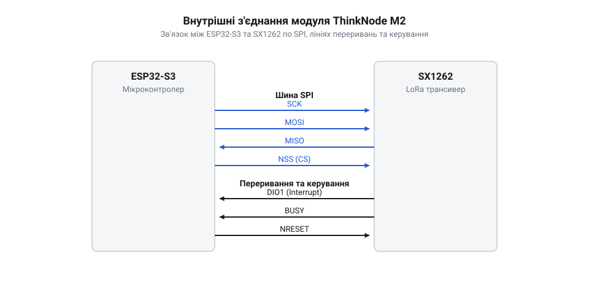
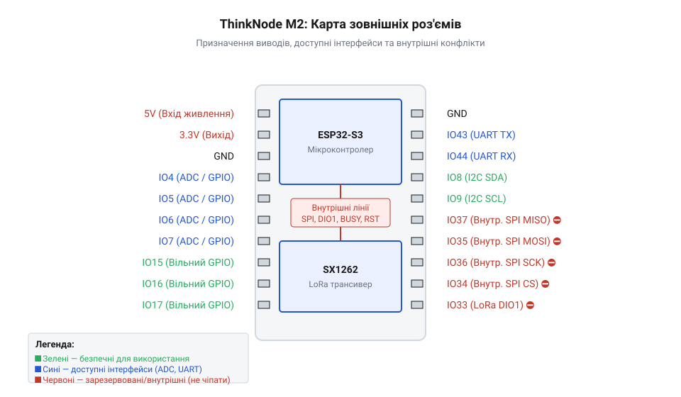

# Апаратний інтерфейс ThinkNode M2

<preknowlist>
- [LoRa-модуль](root:cat-hw-connect/lora-module) — розуміння загального призначення радіочіпа та принципу обміну даними через нього.
</preknowlist>

## Для чого знати апаратну розводку

Коли ви підключаєте власний датчик або екран до готового радіомодуля, завжди є спокуса використати перші-ліпші вільні контакти. Але плата ThinkNode M2 — це не просто мікроконтролер, а зв'язка з потужним трансивером на одній платі. Частина виводів мікроконтролера вже жорстко підключена до радіочіпа, керує його живленням або антеною. Якщо випадково підключити свою периферію до цих самих ліній, у найкращому разі пристрій просто не працюватиме через конфлікт сигналів на шині. У найгіршому — ви можете пошкодити плату, подавши напругу туди, де її не має бути. Наприклад, типовий конфлікт рівнів виникає, коли до 3.3-вольтової логіки ESP32-S3 напряму підключають 5-вольтовий компонент: надлишкова напруга пробиває захисні кола порту. Інша причина вигорання — з'єднання двох виходів: якщо мікроконтролер видасть на лінію логічну одиницю, а ваш компонент у цей же момент притягне її до землі, між живленням і землею утвориться коротке замикання просто через мікроскопічні транзистори всередині чипів. У обох випадках струм миттєво перевищить допустимі міліампери, і порт назавжди вигорить. Щоб не вгадувати, які контакти справді вільні, розробник має щоразу звірятися з мапою виводів та принциповою схемою плати, де явно розділено внутрішні з'єднання й доступні користувачеві порти. Знання цих електричних з'єднань дозволяє розробляти безпечні схеми, розуміти обмеження за струмом і правильно використовувати доступні інтерфейси без ризику спалити модуль.

## Внутрішня шина та трансивер SX1262

Основою модуля є мікроконтролер ESP32-S3, який керує радіотрансивером SX1262. Спілкування між ними відбувається через високошвидкісну шину SPI. Оскільки мікроконтролер і трансивер розпаяні на одній платі, лінії цієї шини — тактовий сигнал, передавання та приймання даних — з'єднані фізично. Вони не виведені на зовнішні роз'єми для загального користування.

*Схема внутрішньої комутації показує, які виводи ESP32-S3 залучені для керування радіочіпом і тому недоступні для зовнішньої периферії.*

Окрім шини SPI, мікроконтролер використовує кілька ліній для апаратних переривань від SX1262. Коли радіочіп отримує новий пакет даних або завершує передавання, він сигналізує про це мікроконтролеру через спеціальний вивід, щоб той міг миттєво відреагувати. Також є виводи для апаратного скидання трансивера та перевірки його зайнятості. Ці контакти мікроконтролера також зарезервовані виключно для внутрішніх потреб модуля. Якщо спробувати переналаштувати їх у коді для інших цілей, мікроконтролер втратить зв'язок із радіочіпом.

Зокрема, під шину SPI жорстко відведено контакти `IO12` (MISO), `IO11` (MOSI), `IO10` (SCK) та `IO9` (NSS). Сигнали стану й керування заведено на `IO14` (лінія переривань DIO1), `IO13` (перевірка зайнятості BUSY) та `IO15` (апаратне скидання RST). Усі ці сім виводів з'єднують мікроконтролер із трансивером фізичними доріжками на самій платі, тому вони повністю виключені із загального користування. Хоча стандарт SPI дозволяє підключати кілька пристроїв до спільних ліній MISO, MOSI та SCK, мультиплексувати цю внутрішню шину не вийде: її контакти не виведено на зовнішні роз'єми модуля, тому фізично приєднати до них додаткову периферію неможливо. Спроба ж призначити їх у коді для зовнішніх датчиків або використати як звичайні порти вводу-виводу неминуче призведе до конфлікту сигналів і втрати радіозв'язку. Щоб підключити власну SPI-периферію, слід задіяти інший апаратний контролер SPI мікроконтролера. Завдяки вбудованій матриці виводів (@@en|GPIO matrix@@) його лінії можна програмно скерувати на будь-які доступні контакти модуля. Це створює повністю незалежну шину, яка працюватиме паралельно і не заважатиме обміну даними з радіочіпом.

## Керування живленням і радіотрактом

Для стабільної роботи радіомодуля важливо правильно забезпечувати його енергією. Плата має вбудовану підсистему живлення, яка знижує вхідну напругу до потрібних рівнів для мікроконтролера та радіочіпа. Мікроконтролер може керувати живленням трансивера програмно через керуючий вхід окремого стабілізатора, який підведено до піна `IO7`. Він вмикає радіочіп високим логічним рівнем (одиницею) лише тоді, коли потрібно передати або прийняти дані, і повністю знеструмлює його переведенням цього піна в нуль. Це дозволяє суттєво економити заряд батареї, коли пристрій перебуває в режимі сну.

Окрім живлення, ESP32-S3 керує радіотрактом — шляхом проходження високочастотного сигналу. Оскільки антена одна, а трансивер може як приймати, так і передавати сигнал, на платі встановлено антенний перемикач. Мікроконтролер керує ним через дві виділені лінії: дозвіл приймання (пін `IO21`) та дозвіл передавання (пін `IO22`). Щоб відкрити шлях від антени до приймача, на лінію приймання подається високий рівень (напруга живлення, логічна одиниця), а лінія передавання притискається до землі (логічний нуль); для передачі сигналу рівні змінюються на протилежні. Тому при розробці власного коду або підключенні пристроїв потрібно пам'ятати, що логіка роботи радіотракту залежить від правильних електричних рівнів на цих лініях керування: якщо обидві опиняться в нулі або обидві в одиниці, антенний перемикач закриється, і радіочіп стане глухим.

## Призначення зовнішніх роз'ємів плати

Щоб ви могли розширювати можливості модуля, частина виводів ESP32-S3 виведена на зовнішні контакти плати. Ці контакти поділені на групи залежно від їхнього призначення.

*На карті видно, які контакти безпечно використовувати для I2C, UART та аналогових датчиків, а які відповідають за живлення.*

Ви можете використовувати ці контакти для підключення власних датчиків, дисплеїв або інших модулів. Для цього доступні інтерфейси I2C та UART, а також виводи аналогово-цифрового перетворювача для зчитування аналогових сигналів. Завдяки внутрішній матриці виводів (@@en|GPIO matrix@@) мікроконтролера ESP32-S3 ви не прив'язані жорстко до контактів, які позначені для цифрових інтерфейсів. Матриця дозволяє програмно перепризначити сигнали I2C чи UART на будь-які інші доступні на роз'ємах цифрові контакти, що дає змогу розводити власну плату розширення так, як зручніше для трасування доріжок. Водночас це перепризначення не стосується виводів аналогово-цифрового перетворювача — вони підключені апаратно і змінити їх не можна. Проектуючи власну схему, важливо завжди звірятися з цією картою, щоб підключати пристрої лише до дозволених контактів. Окрему увагу треба звертати на контакти, стан яких мікроконтролер зчитує в перші миті після подачі живлення, щоб визначити свій режим роботи — наприклад, вантажити основну програму чи чекати на прошивку. Це виводи конфігурації завантаження (@@en|strapping pins@@). Якщо зовнішня схема притягне такий контакт до неправильного логічного рівня під час старту, плата просто не завантажиться. Тому периферія на цих лініях не повинна заважати їм тримати правильний стартовий рівень. Якщо ви живите свою периферію від виводів живлення плати, зважайте на загальне споживання струму. Вбудований стабілізатор напруги 3.3 В має паспортне обмеження у 800 мА. Під час радіопередачі трансивер і мікроконтролер разом забирають до 400 мА у пікових навантаженнях, тому на зовнішню периферію залишається безпечний запас не більше 300–400 мА. Якщо підключені пристрої вимагатимуть більше, напруга на шині просяде, мікроконтролер почне раптово перезавантажуватися, а тривале перевантаження перегріє стабілізатор і назавжди виведе його з ладу.
