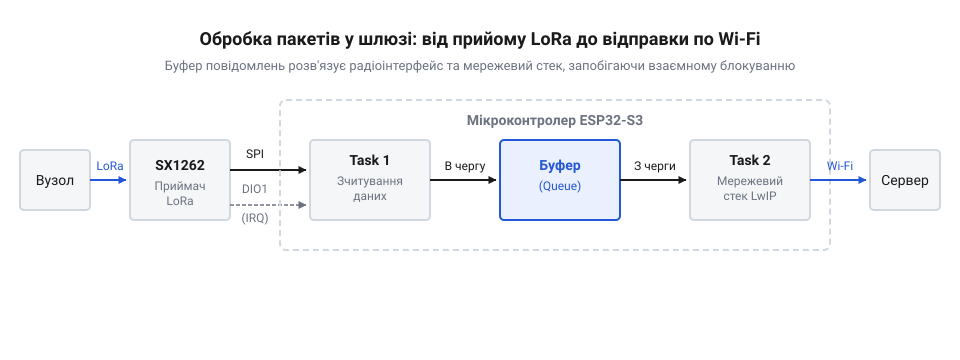

# Простий LoRa-шлюз на ThinkNode M2

<preknowlist>
- [LoRa-модуль](root:cat-hw-connect/lora-module) — принципи роботи трансивера, розуміння модуляції та базові навички роботи з ним по SPI.
</preknowlist>

## Збір даних за межами мережі

Датчики часто працюють там, де немає підключення до інтернету чи стабільної локальної мережі. У полі, на великому складі чи у віддаленому цеху пристрої можуть вимірювати температуру чи вологість, але не мають способу передати ці дані безпосередньо на сервер. Якщо вузол лише збирає дані, але не може їх віддати, інформація стає ізольованою. Без проміжної ланки, яка збере ці повідомлення і перенаправить їх у глобальну мережу, система не працює.

Для розв'язання цієї проблеми створюють шлюз — пристрій, який слухає ефір, приймає радіопакети від розподілених датчиків і пересилає їх через наявний канал зв'язку, наприклад, Wi-Fi. Шлюз виступає мостом між локальною радіомережею датчиків та інтернетом. Використання [LoRa-модуля](root:cat-hw-connect/lora-module) дозволяє збирати дані з пристроїв на відстані кількох кілометрів, що недосяжно для класичного Wi-Fi. Мікроконтролер на платі шлюзу постійно тримає радіомодуль у режимі прийому на одній обраній частоті. Така одноканальність жорстко обмежує всю мережу: абсолютно всі датчики мусять передавати дані саме на цій частоті й мати ідентичні параметри модуляції. Якщо вузол працюватиме на сусідньому каналі або з іншою швидкістю, трансивер шлюзу його не почує, бо апаратно налаштований слухати лише одну комбінацію параметрів. На рівні самого радіотракту такий шлюз не відрізняє датчики один від одного: трансивер захоплює будь-який сигнал, що збігається за частотою та налаштуваннями модуляції, і віддає мікроконтролеру масив сирих байтів. Оскільки всі вузли змушені ділити один канал і не координують свій вихід в ефір, їхні передачі можуть збігтися в часі, через що виникне @@en|колізія@@. Під час накладання сигналів на одній частоті трансивер або захопить лише один, найсильніший сигнал, або не зможе декодувати жодного й відхилить обидва через помилку контрольної суми, і ці дані будуть втрачені на рівні радіоканалу. Упізнавати конкретний вузол доведеться вже за вмістом повідомлення на сервері, тому шлюз працює наосліп — щойно надходить новий успішно прийнятий пакет, мікроконтролер зчитує його з буфера і відразу формує повідомлення для відправки в глобальну мережу.

*Шлях даних від радіоефіру до інтернет-сервера через проміжний шлюз на мікроконтролері.*

## Підключення трансивера до ThinkNode M2

Щоб мікроконтролер міг керувати радіомодулем і отримувати від нього дані, їх потрібно апаратно поєднати. LoRa-трансивери зазвичай спілкуються з основним контролером через шину SPI. Це синхронний інтерфейс, який дозволяє швидко передавати налаштування в регістри модуля та вичитувати отримані радіопакети з його внутрішнього буфера.

Окрім ліній SPI (MISO, MOSI, SCK) та вибору пристрою (CS), критично важливим є підключення лінії переривання. Коли трансивер успішно приймає пакет з ефіру, він змінює стан цього виводу — зазвичай піднімає рівень до логічної одиниці. Цей сигнал треба зловити миттєво, тому лінію заводять на той контакт контролера, який має апаратну підтримку зовнішніх переривань; на платі ThinkNode M2 для цього можна використати майже будь-який вільний вивід загального призначення (@@en|GPIO@@). Обраний контакт налаштовується як цифровий вхід, а його внутрішня периферія конфігурується так, щоб генерувати переривання по передньому фронту — у мить переходу напруги від низького рівня до високого. Це дозволяє не опитувати радіомодуль постійно, витрачаючи процесорний час, а реагувати лише тоді, коли дані справді надійшли. Сам трансивер не опускає цю лінію автоматично: вона триматиметься у високому рівні, блокуючи генерацію нових переривань від наступних пакетів, аж доки мікроконтролер не відреагує на подію та явно не запише команду скидання прапорця у відповідний регістр через шину SPI. Щойно апаратне підключення готове, мікроконтролер може ініціалізувати трансивер, задати йому частоту та перевести в режим безперервного слухання.

## Програмний прийом LoRa-пакетів

Процес прийому починається з налаштування трансивера. Мікроконтролер записує в регістри модуля параметри радіоканалу: частоту, ширину смуги та коефіцієнт розширення спектра. Ці параметри мають точно збігатися з тими, які використовують вузли-передавачі, інакше шлюз просто не побачить їхніх сигналів. Після налаштування модуль переводиться в режим безперервного прийому.

Коли пакет потрапляє в антену, трансивер демодулює його і складає у внутрішній буфер. Разом із даними трансивер обчислює контрольну суму (@@en|CRC@@) і звіряє її з тією, яку вузол прикріпив у кінці посилки. Якщо суми не збігаються, пакет побився в ефірі: модуль не стирає його сам, а виставляє прапорець помилки в регістрі статусу і лише тоді генерує сигнал на лінії переривання. Програма мікроконтролера обробляє це переривання: вона звертається до модуля по SPI і спершу перевіряє статус. Якщо є помилка @@en|CRC@@, програма ігнорує сміття і скидає прапорці, звільняючи буфер. Якщо ж пакет цілий, вона вичитує його довжину з окремого регістра трансивера, у якому модуль фіксує точну кількість щойно прийнятих байтів, а потім за цим значенням зчитує самі дані з буфера байт за байтом у власний масив у пам'яті. Отримавши сирий пакет, шлюз може розібрати його структуру, витягти корисне навантаження і відправити його далі — наприклад, сформувати повідомлення для відправки через Wi-Fi з'єднання. Оскільки радіоефір і Wi-Fi обробляються паралельно, важливо швидко вичитувати буфер радіомодуля. Якщо новий пакет з ефіру почне надходити в момент, коли мікроконтролер ще тягне попередній по SPI, трансивер не чекатиме: він продовжить писати свіжі байти в той самий апаратний кільцевий буфер. Якщо покажчик запису наздожене покажчик зчитування, нові дані затруть недочитаний хвіст старого пакета просто під час його вичитування, і програма витягне биту мішанину з двох повідомлень. Тому мікроконтролер мусить вихопити пакет у власну оперативну пам'ять швидше, ніж надійде наступна посилка, і вже звідти спокійно передавати його по мережі.

## Пересилка даних на сервер

Прийнятий радіопакет — це просто набір байтів у пам'яті мікроконтролера. Щоб ці дані потрапили в інтернет, їх потрібно загорнути в мережевий протокол і відправити через Wi-Fi. Без цього кроку шлюз залишається лише приймачем, ізольованим від решти системи.

Перш ніж передавати дані, мікроконтролер має підключитися до локальної бездротової мережі та отримати IP-адресу. Після цього ми створюємо мережевий клієнт. Найпростіший спосіб доставити дані — використати HTTP POST-запит, який відправить корисне навантаження на сервер.

Механізм перепакування полягає в тому, що ми зчитуємо сирий масив байтів із трансивера, формуємо з нього тіло HTTP-запиту й передаємо мережевому стеку. Тут ми покладаємося на те, що сервер готовий прийняти дані в тому ж вигляді, у якому їх випустив вузол. Ми відправляємо саме сирі байти, а не перетворюємо їх на зручний текстовий формат на кшталт @@en|JSON@@, щоб зберегти ресурси мікроконтролера й відв'язати шлюз від логіки датчиків. Розбір бінарного навантаження, виділення пам'яті під рядки та формування тексту споживають багато процесорного часу, і через такі затримки шлюз може пропустити швидкі пакети з радіоефіру. Шлюз виступає прозорим мостом: він не розбирає вміст пакета, а лише переносить його з радіоефіру в TCP/IP-з'єднання. Завдяки такій сліпій передачі зміна формату даних на кінцевому вузлі не вимагатиме перепрошивки проміжного пристрою, оскільки вся логіка розшифровки залишається на потужному сервері.

:::tabs
:::code proj-thinknode-m2-gateway/c/esp-idf/send-to-server.c
:::code proj-thinknode-m2-gateway/cpp/arduino/sendtoserver.cpp
:::

Щоб доставити пакет, мікроконтролер ініціалізує HTTP-з'єднання із заданою адресою, встановлює метод відправки й прикріплює вичитаний масив до тіла запиту. Оскільки шлюз передає сирі байти без жодної внутрішньої структури, він додає заголовок `application/octet-stream`: це вказує серверу, що навантаження є суцільним бінарним потоком і його не треба намагатися розшифрувати як текст. Сама передача виконується блокувальним викликом, проте базова реалізація не перевіряє, чим вона завершилася. Якщо бездротова мережа зникла або сервер не відповів, функція просто завершить роботу; оскільки трансивер уже спорожнив свій апаратний буфер, без перевірки HTTP-статусу та черги на повторну відправку ці дані будуть назавжди втрачені. Шлюз свідомо ігнорує втрату пакета, не намагаючись зберегти його локально чи перевідправити пізніше. Накопичення недоставлених даних у пам'яті швидко призведе до її переповнення під час тривалого розриву мережі, а запис на енергонезалежний носій ускладнює програму й зношує мікросхему. До того ж шлюз є прозорим мостом і не знає вмісту навантаження: для періодичної телеметрії перевідправка застарілих значень часто гірша за їхню втрату. Тому пристрій просто скидає пакет, залишаючи відповідальність за гарантовану доставку та повторні спроби кінцевому вузлу й серверу, які розуміють контекст своїх даних.

## Одночасна робота радіо та Wi-Fi

Відправка даних через Wi-Fi — це повільний процес. Встановлення HTTP-з'єднання та очікування відповіді від сервера може тривати від десятків до сотень мілісекунд. Якщо шлюз оброблятиме мережевий запит у тому ж місці, де чекає на радіопакети, він неминуче пропустить дані, які надійдуть у цей час.

Радіомодуль і мережевий стек живуть у різних темпах. Трансивер сигналізує про новий пакет апаратним перериванням. Якщо мікроконтролер у цей момент заблокований очікуванням мережі, він може не відреагувати на переривання вчасно, або радіомодуль перепише свій внутрішній буфер наступним пакетом.

Щоб уникнути втрат, роботу цих двох інтерфейсів потрібно розв'язати. Апаратне переривання від радіомодуля має бути максимально коротким: воно лише фіксує факт приходу пакета. Основний цикл швидко зчитує дані з трансивера в локальну пам'ять мікроконтролера, організовану як черга.

:::tabs
:::code proj-thinknode-m2-gateway/c/esp-idf/on-dio0-interrupt.c
:::code proj-thinknode-m2-gateway/cpp/arduino/ondio0interrupt.cpp
:::

Нульовий час очікування під час роботи з чергою означає, що мікроконтролер не завмирає, якщо даних ще немає або буфер уже повний, а миттєво перевіряє стан і йде далі. Навіть коли цикл надовго зупиняється у тривалому блокувальному виклику `send_to_server`, апаратне переривання від радіомодуля відпрацьовує на тлі: воно має вищий пріоритет за звичайний потік, тому миттєво призупиняє очікування мережі, встановлює прапорець приходу нового пакета і повертає керування назад, надійно фіксуючи подію. Замість жорсткого блокування на самій черзі процесорний час звільняється викликом `vTaskDelay`: він примусово призупиняє наш нескінченний цикл на десять мілісекунд і передає керування планувальнику операційної системи. Саме під час цієї паузи система отримує ресурси для виконання фонових задач — зокрема, для підтримки підключення Wi-Fi та обробки мережевих пакетів, які без такого звільнення процесора просто не встигли б виконатися і призвели б до розриву зв'язку.

Така архітектура гарантує, що шлюз завжди готовий приймати нові пакети. Поки Wi-Fi стек зайнятий пересилкою одного пакета, радіотракт може вільно приймати наступні, складаючи їх у чергу. Блокування мережі більше не зупиняє прийом.

Проте ця буферна місткість має жорстку фізичну межу. Якщо зв'язок зникає надовго або сервер завмирає, виділена під чергу пам'ять вичерпується. Запис у повну чергу відхиляється, тому кожен наступний пакет від трансивера просто відкидається і втрачається назавжди. Шлюз здатен згладжувати лише короткочасні мережеві стрибки, а тривала відсутність інтернету неминуче призводить до втрати нових даних.
