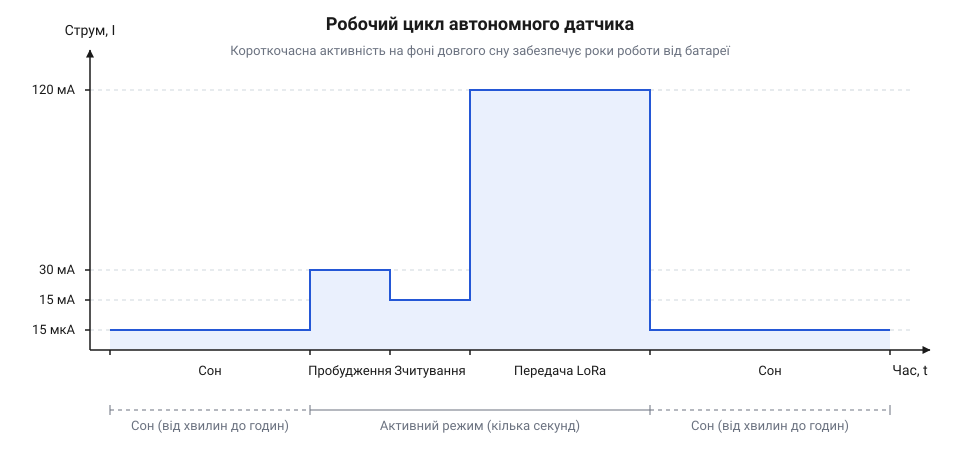
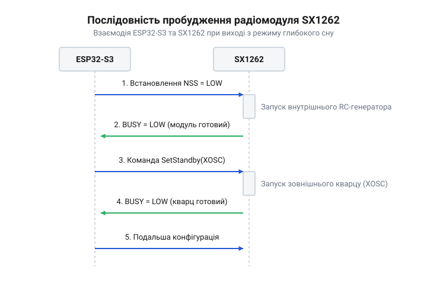

# Автономний датчик на ThinkNode M2

<preknowlist>
- [LoRa-модуль](root:cat-hw-connect/lora-module) — базові принципи модуляції LoRa, поняття частоти та потужності передачі
</preknowlist>

## Навіщо автономному датчику сон

Автономний датчик збирає дані й відправляє їх по радіоканалу, працюючи від батареї роками без обслуговування. Якщо мікроконтролер та радіомодуль залишатимуться постійно увімкненими, вони споживатимуть десятки міліампер, і навіть ємної батареї вистачить лише на кілька тижнів. Щоб розтягнути заряд на роки, пристрій більшість часу проводить у режимі глибокого сну.

У режимі глибокого сну мікроконтролер відключає майже всю периферію, процесорне ядро та радіомодуль. Разом із ними знеструмлюється й основна оперативна пам'ять, тому всі змінні та поточний стан програми втрачаються. Звичайні виводи мікроконтролера за замовчуванням також відключаються і переходять у стан високого опору, перестаючи утримувати задані логічні рівні. Це критично важливо для керування живленням зовнішньої периферії: якщо напруга на радіомодуль подається через транзисторний ключ, під час сну керувальний сигнал зникне, і без апаратної підтяжки ключ змінить свій стан. Енергію продовжує споживати лише незалежний домен живлення — окрема частина мікросхеми, яка живиться від власного малопотужного стабілізатора й фізично ізольована від решти кристала, що знижує загальний струм до одиниць мікроампер. У цьому домені працює таймер пробудження, який тактується від свого низькочастотного генератора замість головного високочастотного. Перед тим як знеструмити ядро, програма передає таймеру потрібну тривалість сну в мікросекундах та віддає команду на перехід у режим низького споживання. Це апаратний лічильник: він безупинно рахує такти, і щойно дораховує до заданого значення, схема генерує апаратний сигнал, який знову подає живлення на вимкнені блоки. Оскільки після сну мікроконтролер прокидається без пам'яті про минулі кроки, робота автономного датчика перетворюється на цикл: прокинутися, наново все ініціалізувати, швидко зчитати дані, відправити їх і знову заснути. Такий підхід називається @@en|duty cycle@@, або робочим циклом, і дозволяє зберігати 99% енергії.


*Періоди глибокого сну чергуються з короткими фазами активності, що визначає загальну енергоефективність.*

Чим довше пристрій спить і чим швидше він виконує роботу під час активної фази, тим довше проживе батарея. Загальне споживання вузла визначається усередненням мізерного струму сну та пікового струму активності з урахуванням часу перебування в кожному зі станів. Відповідно, головне завдання при розробці датчика — мінімізувати час неспання та знайти баланс між частотою збирання даних і розрахунковим ресурсом батареї. Щоб знайти середній струм `I_avg`, сумарний заряд за цикл ділять на його повну тривалість. **Розрахунок часу автономної роботи для вузла з батареєю `C = 2000` мА·год, струмом активної фази `I_act = 100` мА тривалістю `t_act = 0.5` с та струмом сну `I_slp = 0.01` мА (10 мкА) при надсиланні раз на хвилину `T = 60` с:**

```text
I_avg = (I_act × t_act + I_slp × (T - t_act)) ÷ T
      = (100 × 0.5 + 0.01 × 59.5) ÷ 60       [підстановка значень]
      = (50 + 0.595) ÷ 60                    [заряди за активність і сон у мА·с]
      = 0.843                                [середній струм у мА]
Час   = C ÷ I_avg
      = 2000 ÷ 0.843                         [підстановка ємності й струму]
      = 2372                                 [час роботи в годинах, що дорівнює 98 дням]
```

З розрахунку видно, що якщо будити мікроконтролер щохвилини, енергія витрачатиметься здебільшого на часті активні фази (50 мА·с проти пів міліампер-секунди уві сні), і ємності вистачить хіба на три місяці. Якщо ж надсилати показники раз на годину (`T = 3600` с), заряд на сон зросте до 36 мА·с і зрівняється з витратами на передачу. Середнє споживання наблизиться до мікроамперних значень глибокого сну (близько 0.024 мА), дозволяючи пристроєві працювати від одного заряду понад дев'ять років.

## Пробудження ESP32-S3 та збір даних

Коли спрацьовує таймер глибокого сну, мікроконтролер ESP32-S3 прокидається і починає виконання програми з самого початку. Оскільки оперативна пам'ять була знеструмлена, жодних даних із попередніх циклів не зберігається, тому всю периферію, датчики та радіомодуль потрібно ініціалізувати заново. 

Після ініціалізації мікроконтролера код переходить до роботи з підключеними сенсорами. Якщо залишати зовнішні датчики під напругою під час глибокого сну, вони вичерпуватимуть батарею вхолосту, тому перед засинанням контролер апаратно знеструмлює їхню лінію живлення через транзисторний ключ. Під час пробудження він першим ділом знову подає живлення на цю лінію, проте зчитувати показники відразу не можна. Будь-якому вимірювальному приладу після відновлення живлення потрібен час на стабілізацію внутрішніх кіл, інакше перші отримані дані будуть хибними через перехідні процеси. Вбудований датчик температури ініціалізується майже миттєво, тому код бере його показники одразу, але для більшості зовнішніх сенсорів тут довелося б поставити паузу, вказану в їхній документації. Оскільки звичайна оперативна пам'ять під час сну стирається, зберігати в ній накопичену статистику чи проміжні змінні між циклами неможливо. Щоб ці дані пережили глибокий сон, їх розміщують у спеціальній RTC-пам'яті, яка залишається під напругою. Для цього змінну оголошують глобально і додають до неї спеціальний атрибут `RTC_DATA_ATTR`. Під час першого холодного старту вона отримує початкове значення, а після виходу з глибокого сну контролер не перезаписує її, тому код може спокійно прочитати збережені дані, оновити їх і заснути знову. Далі контролер налаштовує [LoRa-модуль](root:cat-hw-connect/lora-module) для передачі зібраних даних. Радіомодуль теж перебував у сплячому режимі і потребує окремого пробудження та завантаження параметрів, таких як частота й потужність.


*Контролер ініціалізує шину SPI та будить радіомодуль лише перед самою передачею.*

Логіка пробудження, збирання даних та їх відправки повністю реалізована у стартовій функції вузла — `setup` або `app_main`. Оскільки вихід із глибокого сну знеструмлює оперативну пам'ять і перезапускає мікроконтролер, програма щоразу виконується від самого початку. У наведеному нижче прикладі код не перевіряє причину пробудження, щоб відрізнити спрацювання таймера сну від першого ввімкнення живлення, а відразу береться до роботи. Він ініціалізує вбудований датчик температури ESP32-S3, зчитує його поточні показники і готує текстовий пакет. Далі контролер будить і налаштовує радіомодуль, відправляє зібрані дані через LoRa, планує наступне пробудження і знову засинає.

:::tabs
```cpp|arduino
:::code proj-thinknode-m2-sensor/cpp/src/config.h
:::code proj-thinknode-m2-sensor/cpp/src/main.cpp
```
```cpp|esp-idf
:::code proj-thinknode-m2-sensor/c/cpp/CMakeLists.txt
:::code proj-thinknode-m2-sensor/c/cpp/main/CMakeLists.txt
:::code proj-thinknode-m2-sensor/c/cpp/main/main.cpp
:::code proj-thinknode-m2-sensor/c/cpp/main/sx1262.cpp
:::code proj-thinknode-m2-sensor/c/cpp/main/sx1262.hpp
```
```c|esp-idf
:::code proj-thinknode-m2-sensor/c/CMakeLists.txt
:::code proj-thinknode-m2-sensor/c/main/CMakeLists.txt
:::code proj-thinknode-m2-sensor/c/main/main.c
:::code proj-thinknode-m2-sensor/c/main/sx1262.c
:::code proj-thinknode-m2-sensor/c/main/sx1262.h
```
:::

## Підготовка трансивера SX1262

Коли мікроконтролер виходить із режиму глибокого сну, його периферія та зовнішні модулі втрачають попередній стан. Радіомодуль SX1262 після зняття живлення або апаратного скидання не пам'ятає жодних налаштувань. Щоб він зміг працювати, його потрібно налаштувати наново.

Процес підготовки починається з апаратного пробудження: перш ніж надсилати конфігураційні команди через шину SPI, мікроконтролер має розбудити радіомодуль, подавши низький рівень на лінію `NSS` (Chip Select) або апаратний імпульс низького рівня на лінію `Reset`. Цей імпульс має тривати не менше 100 мікросекунд, щоб чип гарантовано скинув свій стан і почав запуск внутрішнього осцилятора. Прокинувшись, трансивер підтверджує готовність приймати дані, опускаючи лінію `BUSY` в логічний нуль. Оскільки запуск і виконання кожної внутрішньої операції займають час, мікроконтролер зупиняється в циклі та опитує стан `BUSY` з мілісекундною затримкою — доки на цій лінії високий рівень, трансивер зайнятий і команди ігноруватимуться. Щойно лінія падає, трансивер спершу переводять у режим очікування командою `0x80` (SetStandby), щоб він зупинив приймання чи передачу і був готовий до налаштувань. Оскільки кожна відправлена команда знову підіймає `BUSY` на час її обробки, програма змушена чекати готовності перед кожним наступним зверненням по SPI. Далі командою `0x8A` (SetPacketType) йому вказують тип пакета — у нашому випадку LoRa, оскільки чип підтримує й інші види модуляції. Після цього встановлюють робочу частоту командою `0x86` (SetRfFrequency), передаючи її значення блоком із чотирьох байтів. Наступним кроком обов'язково задають налаштування самої LoRa-модуляції: фактор розширення спектра (@@en|Spreading Factor@@), ширину смуги пропускання (@@en|Bandwidth@@) та швидкість кодування (@@en|Coding Rate@@). Фактор розширення спектра визначає кількість базових імпульсів, якими кодується кожен біт: що вищий цей показник, то довше триває передача, проте приймачеві стає легше витягти корисний сигнал із шуму на великій відстані. Ширина смуги пропускання задає діапазон частот, у якому розмазується сигнал: ширша смуга пришвидшує відправку даних, але пропорційно знижує чутливість приймача. Швидкість кодування відповідає за додавання надлишкових бітів для прямої корекції помилок: більша надлишковість робить зв'язок стійкішим до імпульсних завад, але роздуває загальний розмір радіопакета. Ці три параметри підбирають як компроміс: для максимальної дальності звужують смугу й підвищують фактор розширення, втрачаючи швидкість, а для швидкого обміну й економії батареї — навпаки. Без цих налаштувань трансивер працюватиме зі значеннями за замовчуванням і сформує радіосигнал, який інші пристрої мережі просто не розшифрують. Усі ці кроки виконуються при кожному пробудженні перед тим, як намагатися щось передати, інакше радіомодуль не знатиме, як саме формувати радіохвилю.

:::tabs
```c|esp-idf
:::code proj-thinknode-m2-sensor/c/main/sx1262.c 50-90
```
```cpp|esp-idf
:::code proj-thinknode-m2-sensor/c/cpp/main/sx1262.cpp 73-82
```
```cpp|arduino
:::code proj-thinknode-m2-sensor/cpp/src/main.cpp 35-45
```
:::

Після виконання цієї послідовності трансивер готовий до роботи. Наступний крок — сформувати корисне навантаження і передати його в ефір.

## Відправка пакета і засинання

Готові дані потрібно записати у внутрішній буфер радіомодуля, після чого дати команду на відправку. Для цього мікроконтролер вказує базову адресу буфера, передає самі дані і переводить SX1262 у режим передачі (TX).

Відправка відбувається апаратно і потребує часу. Мікроконтролер має дочекатися завершення цього процесу, інакше він засне раніше, ніж пакет піде в ефір, і передача обірветься. Аби дізнатися про закінчення, процесор може періодично опитувати статус радіомодуля або чекати на апаратне переривання від виводу `DIO1`. Цей вивід є прямою сигнальною лінією: радіомодуль змінює на ньому логічний рівень саме тієї миті, коли останній байт залишає антену. Очікування переривання є найнадійнішим механізмом, оскільки дозволяє мікроконтролеру миттєво відреагувати на завершення трансляції і не марнувати час. Щоб його задіяти, пін мікроконтролера, з'єднаний із `DIO1`, конфігурують як вхід і вмикають для нього генерацію переривання за зміною логічного рівня. До цього піна прив'язують коротку функцію-обробник, а в операційній системі створюють примітив синхронізації — бінарний семафор або пряме сповіщення задачі. Після запуску передачі основний потік програми не крутить порожній цикл, а викликає функцію очікування цього семафора, тимчасово призупиняючи своє виконання. Щойно рівень на `DIO1` зміниться, апаратне переривання зупинить систему, викличе обробник, який розблокує семафор, і тим самим миттєво поверне потік до роботи для переходу в глибокий сон. Бібліотека @@en|RadioLib@@ у прикладі під @@en|Arduino@@ бере цей контроль на себе, блокуючи виконання до фактичного закінчення трансляції. Натомість у нашому базовому коді під @@en|ESP-IDF@@ замість обробки переривань поки що застосовано фіксовану затримку на пів секунди. Але фіксована затримка небезпечна: якщо зміниться довжина повідомлення чи параметри радіоканалу, швидкість передачі впаде, затримки забракне, і мікроконтролер обірве пакет своїм сном; з іншого боку, будь-який надмірний запас часу марнує енергію батареї на холосте чекання. Щоб на практиці замінити затримку на переривання під @@en|ESP-IDF@@, для піна `DIO1` реєструють системну службу обробки переривань і встановлюють обробник, який викликатиметься на зміну рівня сигналу. В обробнику замість важких операцій викликають функцію `vTaskNotifyGiveFromISR`, щоб прямим сповіщенням розбудити основну задачу. Сама ж задача одразу після команди на відправку викликає `ulTaskNotifyTake` і блокується, доки обробник її не розбудить. Це дозволяє повернути мікроконтролер до глибокого сну рівно в ту мить, коли відправка завершилася, не згаявши жодної зайвої мілісекунди.

:::tabs
```c|esp-idf
:::code proj-thinknode-m2-sensor/c/main/sx1262.c 92-114
```
```cpp|esp-idf
:::code proj-thinknode-m2-sensor/c/cpp/main/sx1262.cpp 84-105
```
```cpp|arduino
:::code proj-thinknode-m2-sensor/cpp/src/main.cpp 55-59
```
:::

Щойно радіомодуль завершив передачу, його можна вимкнути, а мікроконтролер перевести назад у режим глибокого сну. Для ESP32-S3 таймер сну налаштовується на потрібний інтервал, після чого викликається функція засинання. Увесь цикл повториться після спрацьовування таймера.

:::tabs
```c|esp-idf
:::code proj-thinknode-m2-sensor/c/main/main.c 36-39
```
```cpp|esp-idf
:::code proj-thinknode-m2-sensor/c/cpp/main/main.cpp 48-51
```
```cpp|arduino
:::code proj-thinknode-m2-sensor/cpp/src/main.cpp 91-95
```
:::
