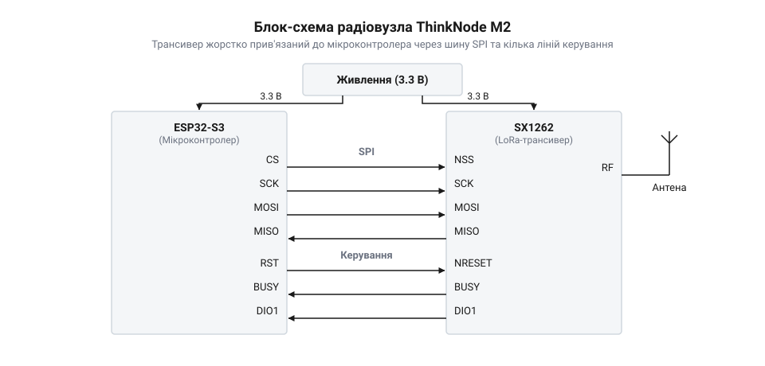

# ThinkNode M2 — LoRa-вузол (ESP32-S3 + SX1262)

<preknowlist>
- [LoRa-модуль](root:cat-hw-connect/lora-module) — принципи модуляції LoRa, поняття дальності зв'язку та базові параметри трансивера.
</preknowlist>

## Чому виникає потреба в ThinkNode M2

Щоб побудувати автономний пристрій, який передає дані на кілометри, вам потрібні дві речі: мікроконтролер, який збирає інформацію, та радіомодуль, який її відсилає. Зазвичай це означає, що ви берете окрему плату з мікроконтролером, окремий [LoRa-модуль](root:cat-hw-connect/lora-module) і з'єднуєте їх купою дротів.

Здавалося б, нічого складного, але на практиці такий підхід швидко створює проблеми. По-перше, радіотрансивери під час передавання сигналу потребують значного струму, який стандартні стабілізатори на платі мікроконтролера часто не витягують. Напруга просідає, і мікроконтролер перезавантажується. По-друге, що більше дротів на макетній платі, то вищий ризик, що десь відійде контакт або наводки зіпсують сигнал на швидкій шині обміну даними. По-третє, якщо пристрій має працювати від батареї місяцями, вам доведеться боротися з витоками струму. Кожна готова плата несе на собі зайві для автономної роботи компоненти: світлодіоди індикації живлення, що світяться постійно, дублюючі стабілізатори напруги з їхнім власним струмом спокою та зовнішні підтягувальні резистори на лініях зв'язку між двома платами. Навіть якщо ви переводите мікроконтролер і радіомодуль у сплячий режим, ця допоміжна обв'язка продовжує тягнути 10–20 міліампер, марно виснажуючи батарею за лічені дні. Для порівняння, оптимізований цільовий пристрій у режимі сну споживає лише кілька мікроамперів — у тисячі разів менше, що дає йому змогу працювати від того самого акумулятора роками.

ThinkNode M2 розв'язує цю проблему тим, що об'єднує потужний [мікроконтролер ESP32-S3](root:cat-hw-boards/esp32s3-microcontroller) та далекобійний [радіотрансивер SX1262](root:cat-hw-connect/sx1262-radio) на одній друкованій платі. Проблема зайвих струмів витоку тут вирішена завдяки єдиному оптимізованому @@en|LDO-регулятору@@ (від low dropout — низьке падіння напруги). Ця мікросхема знижує напругу батареї до стабільних 3.3 В, розсіюючи надлишок як тепло, і здатна працювати навіть тоді, коли батарея сідає і її напруга впритул наближається до робочої. Такий регулятор забезпечує стабільне живлення для обох чипів навіть під час пікових навантажень передавача і при цьому має мізерний власний струм спокою. Вам більше не треба думати про узгодження логічних рівнів, стабільність живлення під час роботи радіо чи цілісність ліній зв'язку: замість довгих макетних дротів, які працюють як антени і ловлять радіоперешкоди від потужного передавача, чипи з'єднані короткими мідними доріжками. Ці доріжки прокладені над суцільним полігоном землі — шаром міді всередині друкованої плати, який поглинає електромагнітне випромінювання і не дає наводкам спотворити цифрові дані на шині обміну. Плата відразу готова до роботи, незалежно від того, чи ви будуєте автономний вузол, чи центральну точку збору даних. Наприклад, ви можете створити [автономний датчик на ThinkNode M2](root:cat-hw-connect/thinknode-m2/proj-thinknode-m2-sensor.md), який періодично прокидається, зчитує показники та відправляє їх, споживаючи лише мікроампери в режимі сну, адже енергія не марнується на дублюючу обв'язку. Або ж, використавши вбудований у мікроконтролер модуль Wi-Fi, зробити [простий LoRa-шлюз на ThinkNode M2](root:cat-hw-connect/thinknode-m2/proj-thinknode-m2-gateway.md), який прийматиме пакети від таких датчиків і пересилатиме їх на сервер.

## Внутрішня будова та взаємодія компонентів

Щоб зрозуміти, як ESP32-S3 керує трансивером SX1262, уявіть плату як два окремі блоки, з'єднані високошвидкісною магістраллю. Головний мозок тут — мікроконтролер, який виконує вашу програму, а SX1262 — це спеціалізований радіомодем, що отримує від нього пакети даних і перетворює їх на радіохвилі.

*Головний контролер спілкується з радіомодулем через швидкісну шину, а окремі лінії переривань і керування дозволяють ефективно будити модем і реагувати на прийняті пакети.*

Зв'язок між ними відбувається через апаратну шину @@en|SPI@@. ESP32-S3 виступає майстром, а SX1262 — підлеглим пристроєм. Через цю шину мікроконтролер надсилає команди на налаштування частоти, потужності передавання чи параметрів модуляції, а також пересилає самі дані для відправки. Щоб мікроконтролеру не доводилося постійно опитувати модем і марнувати енергію, передбачено окремі апаратні лінії переривань та керування. Головною з них для пробудження системи є `DIO1` — цифровий вивід трансивера, жорстко підведений до мікроконтролера. Коли SX1262 успішно приймає пакет із радіоефіру, він виставляє на цій лінії сигнал; цей перепад напруги працює як апаратне переривання, від якого мікроконтролер миттєво прокидається, забирає дані по SPI та знову може заснути. Додатково залучено лінію `BUSY`, яка оберігає трансивер від збоїв: вона показує, що модем іще зайнятий перемиканням режимів чи обробкою команд. Хоча фізично ця лінія не блокує шину, вона діє як обов'язковий апаратний прапор стану: перед кожним зверненням до радіомодуля код мікроконтролера мусить перевірити рівень на цьому виводі й зачекати його спаду, бо інакше трансивер проігнорує дані або його внутрішня логіка порушиться. На рівні коду це реалізується як цикл очікування, у якому мікроконтролер постійно перевіряє стан `BUSY`. Проте якщо через перепад напруги чи вплив радіозавад трансивер зависає, він може залишити цю лінію високою назавжди. Щоб ESP32-S3 не застряг у нескінченному циклі й не заблокував усю програму, очікування обов'язково обмежують у часі; якщо ліміт вичерпано (@@en|timeout@@), а модем не звільнився, код фіксує помилку і примусово перезавантажує SX1262 через окрему лінію скидання. Усі точні номери ніжок, схему підтяжок та роз'ємів можна подивитися у вставці [апаратний інтерфейс ThinkNode M2](root:cat-hw-connect/thinknode-m2/api-thinknode-m2-hardware.md).

Окрема увага на платі приділена системі живлення. Трансивер SX1262 має власні жорсткі вимоги до стабільності напруги, особливо в момент передачі пакета на максимальній потужності. Тому живлення від батареї чи USB проходить через спільний @@en|LDO@@-регулятор, але лінії до мікроконтролера та модема розв'язані конденсаторами достатньої ємності, щоб згладжувати раптові стрибки струму. Крім того, ESP32-S3 має можливість апаратно вимикати живлення периферії: один із його цифрових виводів керує піном дозволу (Enable) стабілізатора або окремим транзисторним ключем, через який живиться трансивер. Завдяки цьому мікроконтролер може не просто переводити радіомодуль у програмний режим найглибшого сну, а фізично знеструмлювати його, зводячи струми витоку до нуля, що критично важливо для автономної роботи.

Після того як SX1262 сформував радіосигнал, він потрапляє в антенний тракт. На платі реалізовано узгоджувальне коло, яке гарантує, що максимум енергії піде в антену, а не відіб'ється назад і не перетвориться на тепло. Відбиття виникає тоді, коли хвильовий опір (@@en|impedance@@) виходу трансивера не збігається з опором антени: на межі цього перепаду сигнал повертається назад у мікросхему, знижуючи дальність зв'язку та перегріваючи вихідний підсилювач. Узгоджувальне коло — це набір конденсаторів та котушок індуктивності, які плавно трансформують опір, усуваючи цю межу й дозволяючи енергії безперешкодно випроменитись в ефір. Щоб не писати з нуля код для ініціалізації цих апаратних особливостей, зручно використовувати [програмний інтерфейс ThinkNode M2](root:cat-hw-connect/thinknode-m2/api-thinknode-m2-software.md), де вже задані всі макроси пінів та готові функції для роботи зі зв'язкою ESP32-S3 і SX1262.

## Живлення та глибокий сон вузла

Щоб пристрій міг роками працювати від одного акумулятора, він не може постійно бути увімкненим. І мікроконтролер, і радіомодуль у робочому режимі споживають десятки міліампер, тому батарея вичерпається за кілька днів. Щоб цього уникнути, систему потрібно переводити в режим глибокого сну (@@en|deep sleep@@), коли більшість внутрішніх блоків вимикається, а споживання падає до мікроампер.

На платі ThinkNode M2 живлення організовано так, щоб мінімізувати втрати у стані спокою. Батарейна напруга проходить через лінійний регулятор (LDO), який забезпечує стабільні 3.3 В для ESP32-S3 та SX1262. Вибір регулятора тут критичний: він повинен мати наднизький струм власного споживання. Звичайний стабілізатор постійно витрачає близько 5 міліампер лише на роботу своєї схеми керування, що повністю виснажить стандартний акумулятор на 2500 міліампер-годин менш ніж за місяць простою. Натомість наднизькоспоживаючий LDO обмежує струм своїх внутрішніх підсилювачів до 1–2 мікроампер, тобто у тисячі разів менше, майже не розряджаючи акумулятор під час сну. Це збереження енергії коштує швидкодії: коли мікроконтролер раптово прокидається і починає споживати десятки міліампер, внутрішня схема регулятора не має сил миттєво відреагувати на стрибок навантаження, і вихідна напруга просідає. Щоб вузол не перезавантажився від цієї просадки, після регулятора ставлять конденсатори великої ємності, зазвичай від 10 до 22 мікрофарад. У момент різкого зростання струму, поки повільна схема керування LDO ще тільки розпізнає падіння і сильніше відкриває свій транзистор, ці конденсатори миттєво віддають накопичений заряд. Вони працюють як локальні резервуари енергії, які утримують напругу на лінії в перші критичні мікросекунди пробудження, доки стабілізатор не візьме навантаження на себе. Як саме розподіляється напруга по платі, показує [апаратний інтерфейс ThinkNode M2](root:cat-hw-connect/thinknode-m2/api-thinknode-m2-hardware.md).

Коли пристрій засинає, першим у режим найнижчого споживання переходить трансивер SX1262, зберігаючи лише конфігурацію, щоб швидко прокинутися для прийому чи передачі. Після цього засинає сам [мікроконтролер ESP32-S3](root:cat-hw-boards/esp32s3-microcontroller). У такому стані плата чекає або на таймер, який розбудить її для чергового зчитування даних, або на зовнішнє переривання від датчика чи радіомодуля. Пробудження системи відбувається у зворотній послідовності. Спочатку з глибокого сну виходить мікроконтролер і має розбудити радіомодуль. Оскільки SX1262 задля максимальної економії знеструмив свої головні цифрові блоки, зокрема й інтерфейс SPI, він фізично не може прийняти звичайну команду. Тому мікроконтролер будить його апаратним поштовхом: просто притискає до землі лінію вибору кристала (NSS) на шині SPI. Цей перепад напруги активує схему пробудження трансивера, яка піднімає лінію зайнятості (BUSY) і запускає відновлення живлення решти блоків. Оскільки SX1262 під час сну утримував свою конфігурацію в окремій малопотужній пам'яті, він автоматично відновлює робочий стан із неї. Щойно трансивер готовий, він опускає сигнал зайнятості, і лише тоді мікроконтролер може обмінюватися з ним даними через SPI. Завдяки цьому мікроконтролеру не потрібно витрачати час на повторне налаштування частоти чи параметрів трансивера, що помітно скорочує тривалість активного споживання струму. Відразу після підняття радіомодуля контролер подає живлення на зовнішні датчики, зчитує показники та відправляє їх. Приклад такої роботи з таймером демонструє [автономний датчик на ThinkNode M2](root:cat-hw-connect/thinknode-m2/proj-thinknode-m2-sensor.md), який прокидається лише раз на годину. Важливо також відключати живлення зовнішніх датчиків перед сном за допомогою керованого виводу плати, інакше вони витягнуть усю енергію, поки контролер спить.

## Сценарії використання та обмеження

Завдяки наявності і Wi-Fi, і LoRa на одній платі, ThinkNode M2 ідеально підходить для ролі моста між двома радіомережами. Найчастіше плату використовують як кінцевий вузол, що збирає дані десь у полі й відправляє їх на кілометри через LoRa. Але вона також здатна виступати базовою станцією. Наприклад, можна розгорнути [простий LoRa-шлюз на ThinkNode M2](root:cat-hw-connect/thinknode-m2/proj-thinknode-m2-gateway.md), який слухатиме ефір, прийматиме пакети від інших сенсорів і миттєво пересилатиме їх на сервер через Wi-Fi. Налаштувати це допомагає готовий [програмний інтерфейс ThinkNode M2](root:cat-hw-connect/thinknode-m2/api-thinknode-m2-software.md), де вже є потрібні функції ініціалізації обох радіоканалів.

Проте таке поєднання має свої підводні камені. Головне обмеження — це пікове енергоспоживання під час одночасної роботи обох передавачів, а також засліплення приймача. Якщо мікроконтролер почне передавати дані по Wi-Fi саме тієї миті, коли [радіотрансивер SX1262](root:cat-hw-connect/sx1262-radio) випромінює LoRa-пакет на максимальній потужності, сумарний струм легко перетинає позначку в 500 мА. Такий стрибок спричиняє просідання напруги на LDO-регуляторі нижче критичного рівня, що призводить до апаратного перезавантаження плати. З іншого боку, якщо Wi-Fi почне передавати дані тоді, коли LoRa-модуль намагається прийняти сигнал, потужне випромінювання за кілька сантиметрів від антени перевантажить вхідний підсилювач SX1262. Трансивер тимчасово втратить чутливість і пропустить слабкий вхідний LoRa-пакет. Тому програмно слід розносити їхню активність у часі: як передавання, так і прийом. Практично це реалізується через взаємне блокування (@@en|mutex@@) на рівні операційної системи мікроконтролера. Перед початком довгого LoRa-сеансу чи відкриттям вікна прийому програма захоплює блокування, що тимчасово призупиняє всі задачі, які намагаються працювати з Wi-Fi. Під час такої паузи мережевий стек мікроконтролера продовжує складати вхідні та вихідні дані в буфери оперативної пам'яті. Оскільки швидкість у LoRa низька, сеанс зв'язку може тривати кілька секунд, через що пам'ять швидко вичерпується: щойно буфер переповнюється, нові мережеві пакети відкидаються, а відкриті з'єднання можуть розірватися через таймаут. Коли SX1262 завершує випромінювання або очікування пакету, він генерує переривання, за яким мікроконтролер знімає блокування, дозволяючи Wi-Fi-тракту відправити збережені в буфері дані. Якщо ж просто викликати функції роботи з мережею в різних потоках без синхронізації, радіомодулі спрацюють одночасно: збіг циклів передавання знеструмить пристрій, а невчасно надісланий Wi-Fi-пакет заглушить вхідний сигнал.

Ще одне обмеження стосується роботи в режимі шлюзу. Трансивер SX1262 є одноканальним, тобто він може слухати лише одну частоту та одне значення фактора розширення (@@en|Spreading Factor@@) одночасно. Цей фактор визначає, наскільки сигнал розтягується в часі для передавання одного біта: вище значення збільшує дальність зв'язку, але робить пакет довшим. Радіосигнали з різними факторами розширення є ортогональними, тому вони не заважають один одному, і для приймача пакет з іншим фактором виглядає просто як фоновий шум. Оскільки всередині SX1262 працює лише один апаратний демодулятор, він фізично здатен розшифрувати тільки той сигнал, на який зараз налаштований. Щоб шлюз гарантовано почув відправника, параметри ефіру в такій мережі доводиться фіксувати жорстко: усі кінцеві вузли мають бути заздалегідь запрограмовані на ту саму частоту та фактор розширення, які постійно слухає приймач. Якщо вузол спробує змінити параметри зв'язку — наприклад, зменшити фактор розширення для швидшого передавання або змінити частоту через завади — його пакет буде пропущено. Це відрізняє плату від повноцінних багатоканальних базових станцій мережі, які використовують [протокол LoRaWAN](root:com-transport/lorawan) і завдяки масиву паралельних демодуляторів здатні приймати десятки пакетів на різних частотах і з різними факторами одночасно. Тому ThinkNode M2 підходить лише для невеликих приватних мереж із малим навантаженням на ефір і незмінними налаштуваннями радіоканалу.

## Програмна та апаратна підтримка

Інтегрована плата ThinkNode M2 значно спрощує розробку, адже інженерові не потрібно самостійно поєднувати мікроконтролер із радіомодулем. Усе необхідне для роботи вже закладено на рівні плати. Детальну [принципову схему та розводку контактів](root:cat-hw-connect/thinknode-m2/api-thinknode-m2-hardware.md) можна знайти в апаратному довіднику, який описує підключення зовнішньої периферії та керування живленням.

З погляду коду, робота з платою — незалежно від того, пишете ви прошивку під нативний фреймворк ESP-IDF чи використовуєте бібліотеки середовища Arduino IDE, — спирається на пакет підтримки плати (@@en|Board Support Package@@, BSP), що бере на себе низькорівневі налаштування апаратної частини. Щоб він запрацював, розробнику достатньо додати BSP як залежність до проєкту — через менеджер бібліотек в Arduino або як компонент у конфігурації ESP-IDF — і викликати на старті програми єдину функцію ініціалізації. Фізично цей виклик конфігурує потрібні виводи мікроконтролера під шину SPI для зв'язку з модемом, бере під контроль службові лінії — зокрема керування LDO-регулятором живлення радіотракту — та налаштовує обробку переривань від трансивера. Замість того, щоб змушувати розробника писати власні низькорівневі обробники й боротися з жорсткими обмеженнями часу виконання, BSP пропонує механізм зворотних викликів. Користувацький код просто реєструє свою функцію, і коли SX1262 сигналізує через вивід DIO1, наприклад, про успішний прийом пакета, внутрішній обробник BSP перехоплює цей апаратний сигнал, самостійно скидає прапорці стану в регістрах модема і вже після цього безпечно передає подію користувацькій функції. Перемикання антенного комутатора між режимами передачі та прийому при цьому перекладається на сам трансивер: замість того, щоб змушувати ESP32-S3 керувати комутатором через окремі GPIO-виводи, BSP під час ініціалізації дає модему команду використовувати для цього його власний апаратний вивід DIO2. Завдяки цьому SX1262 самостійно й без затримок скеровує сигнал у потрібний тракт, звільняючи мікроконтролер від жорстких вимог до таймінгів. Готові макроси для пінів та функції ініціалізації зібрані у [програмному інтерфейсі ThinkNode M2](root:cat-hw-connect/thinknode-m2/api-thinknode-m2-software.md), що дозволяє швидко запустити радіотракт без потреби перечитувати специфікації кожного компонента й самостійно узгоджувати їхню взаємодію.

Завдяки такій базі плату легко використовувати у типових сценаріях. Наприклад, ви можете побудувати [автономний датчик](root:cat-hw-connect/thinknode-m2/proj-thinknode-m2-sensor.md), який періодично зчитує показники та відправляє їх через радіоканал, переходячи в глибокий сон між циклами. Інший популярний варіант — [простий LoRa-шлюз](root:cat-hw-connect/thinknode-m2/proj-thinknode-m2-gateway.md), який приймає дані від вузлів і пересилає їх на сервер мережею Wi-Fi. Наявні бібліотеки та приклади дають надійний фундамент для швидкого старту.
