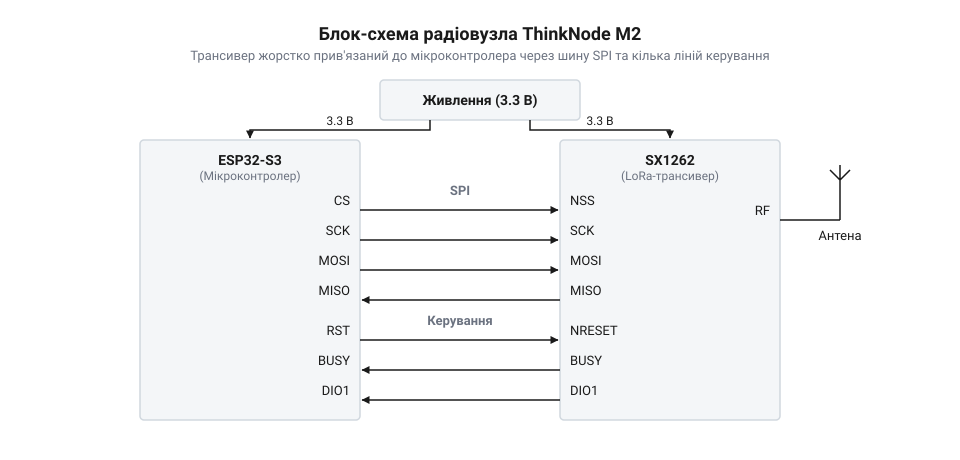

# ThinkNode M2 — LoRa-вузол (ESP32-S3 + SX1262)

<preknowlist>
- [LoRa-модуль](root:cat-hw-connect/lora-module) — принципи модуляції LoRa, поняття дальності зв'язку та базові параметри трансивера
</preknowlist>

## Проблеми збірок з окремих модулів

Коли потрібно зібрати автономний пристрій з передачею даних на великі відстані, часто беруть окремий мікроконтролер і підключають до нього [LoRa-модуль](root:cat-hw-connect/lora-module) за допомогою дротів. Така конструкція має кілька прихованих проблем. Під час передачі сигналу трансивер споживає значний струм. Дроти мають власний опір, тому на них відбувається падіння напруги: мікроконтролер може відчути нестачу живлення і несподівано перезавантажитися. Крім того, довгі з'єднання працюють як антени і ловлять електромагнітні перешкоди. Інша проблема — зайва обв'язка. Кожна плата має свої стабілізатори напруги, індикатори чи підтягувальні резистори. Усе це неперервно споживає струм навіть тоді, коли пристрій перебуває в режимі сну, що швидко виснажує батарею. Щоб усунути ці недоліки, мікроконтролер @@en|ESP32-S3@@ та трансивер @@en|SX1262@@ інтегрують на спільній платі з єдиною оптимізованою підсистемою живлення. Готовим утіленням такого рішення є апаратна платформа ThinkNode M2, яка позбавляє потреби з'єднувати окремі модулі власноруч і мінімізує струми витоку для надійної роботи від батареї.

## Взаємодія чипів та режим сну

На єдиній платі мікроконтролер і радіомодуль спілкуються через шину @@en|SPI@@ (Serial Peripheral Interface), використовуючи короткі друковані провідники замість дротів. Для тривалої автономної роботи обидва чипи більшість часу проводять у режимі глибокого сну. Коли трансивер отримує очікуваний радіосигнал, він генерує апаратне переривання — подає сигнал на окрему ніжку мікроконтролера, змушуючи його прокинутися, обробити пакет і знову заснути. Уся ця низькорівнева взаємодія чипів уже узгоджена в готових програмних інтерфейсах, тому розробнику не треба писати код для неї власноруч.

*Блок-схема показує, як єдиний стабілізатор живить мікроконтролер та трансивер, а обмін даними йде внутрішніми лініями без зовнішніх втрат.*

Живлення плати забезпечує спільний оптимізований стабілізатор. Він має мікроамперний струм спокою у фоновому режимі, а вбудовані конденсатори згладжують різкі стрибки споживання під час передачі радіосигналу. Це усуває струми витоку і дозволяє вузлу місяцями працювати від звичайної батареї.

## Обмеження сумісної роботи радіоканалів

Мікроконтролер має вбудований Wi-Fi, але одночасне використання двох радіоканалів неможливе. Якщо Wi-Fi та LoRa увімкнуться на передачу в один момент, загальний струм споживання різко перевищить можливості стабілізатора або джерела живлення. Це призведе до глибокого просідання напруги та апаратного збою. Також потужне випромінювання близько розташованих антен здатне «засліпити» приймачі одне одного, роблячи прийом неможливим.

Тому активність цих радіоінтерфейсів необхідно жорстко розносити в часі на рівні програми. Пристрій має працювати послідовно: наприклад, прокинутися, отримати дані через LoRa, вимкнути трансивер, потім увімкнути Wi-Fi для пересилання інформації на сервер, і знову перейти до сну. За такого підходу плата стає ідеальним рішенням для кінцевого датчика або простого одноканального шлюзу — вузла, який слухає лише одну частоту. Оскільки під час пересилання даних через Wi-Fi трансивер вимикається, шлюз у ці проміжки залишається глухим і пропустить будь-який вхідний пакет. Через це подібна схема працює лише в невеликих мережах, де датчики відправляють дані рідко або повторюють повідомлення, компенсуючи вікна нечутливості шлюзу.
