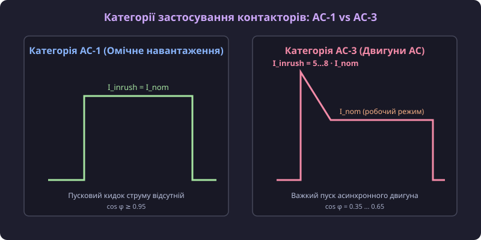
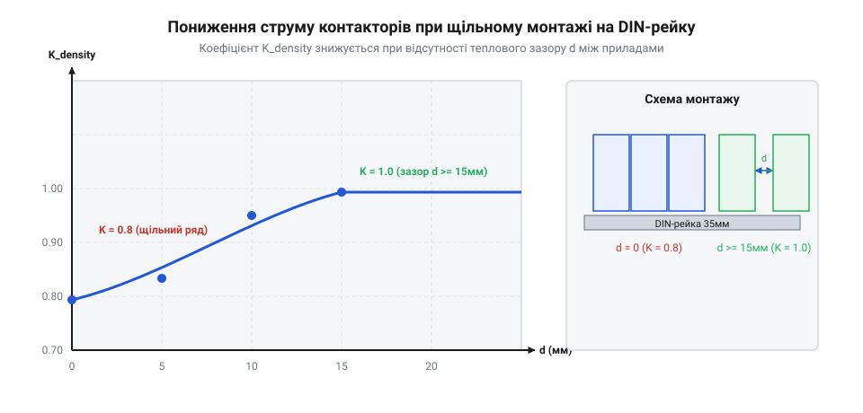

# Категорії застосування контакторів AC-1, AC-3, AC-31A

## Небезпека зварювання контактів та специфіка навантажень

У промислових системах електропостачання та автоматизації комутація електричних кіл супроводжується важкими фізичними процесами у контактній групі. Під час замкнення та розмкнення силових контактів під навантаженням виникає електрична дуга (від англ. @@en|electric arc@@), викликана високою напруженістю електричного поля та термоелектронною емісією при мінімальному зазорі, а виділення теплової енергії на контактному опорі може досягати точок плавлення металу. Якщо розраховувати комутаційний апарат лише за номінальним робочим струмом споживача, при ввімкненні виникає ризик залипання або зварювання контактів (від англ. @@en|contact welding@@), а при розмиканні — стійкого дугового перекриття та дугового спалаху (від англ. @@en|arc flash@@). Подібні аварійні ситуації виникають при роботі таких пристроїв, як [перемикачі фаз та резервного живлення](root:cat-hw-controls/phase-selector-switches), де недопустиме виникнення міжфазних коротких замикань. Детальний фізичний механізм згасання дуги визначається зсувом фаз між струмом і напругою: при високій індуктивності (cos φ < 0.5) момент розмикання контакту при переході струму через нуль супроводжується максимумом синусоїди напруги, що викликає високу швидкість відновлення напруги dV/dt і подовжує час горіння дуги t_arc, призводячи до підвищеного розпилення срібла з накладок. Крім того, при притягуванні якоря електромагніта з масою m під дією зростаючої тягової сили F_m кінетична енергія удару перед замкненням обчислюється як E_k = 0.5 · m · v_impact² = ∫ F_m dδ, де v_impact — кінцева швидкість якоря в момент вибору повітряного зазору δ; ця надлишкова енергія перетворюється на механічний відскок контактів (@@en|contact chatter@@), що викликає серію короткочасних повторних мікродуг та підвищує дуговий знос.

Фізична природа навантаження визначає поведінку струму й напруги в моменти комутації. Активне омічне навантаження (наприклад, ТЕНи або лампи розжарювання) не має фазового зсуву (cos φ = 1.0), тому пусковий струм дорівнює номінальному I_inrush = I_nom, а напруга на контактах у момент розмикання близька до нуля, що робить комутацію легкою. Натомість трифазні асинхронні двигуни в момент прямого пуску мають нерухомий ротор і діють як короткозамкнений трансформатор: пусковий струм сягає кратників I_inrush = 5...8 · I_nom при низькому коефіцієнті потужності cos φ = 0.35 ... 0.50. Індуктивна енергія обмоток E_ind = (1/2) · L · I² при розмиканні під навантаженням перетворюється на високовольтний сплеск ЕРС самоіндукції, який утримує дуговий стовп і руйнує геометрію контактної поверхні.

Фізична природа навантаження визначає поведінку струму й напруги в моменти комутації. Активне омічне навантаження (наприклад, ТЕНи або лампи розжарювання) не має фазового зсуву (cos φ = 1.0), тому пусковий струм дорівнює номінальному I_inrush = I_nom, а напруга на контактах у момент розмикання близька до нуля, що робить комутацію легкою. Натомість трифазні асинхронні двигуни в момент прямого пуску мають нерухомий ротор і діють як короткозамкнений трансформатор: пусковий струм сягає кратників I_inrush = 5...8 · I_nom при низькому коефіцієнті потужності cos φ = 0.35 ... 0.50. Індуктивна енергія обмоток E_ind = (1/2) · L · I² при розмиканні під навантаженням перетворюється на високовольтний сплеск ЕРС самоіндукції, який утримує дуговий стовп і руйнує геометрію контактної поверхні. Для захисту контактів при дуговому розплавленні матеріал накладок підбирають за термодинамікою стійкості: оксид кадмію CdO розкладається при T ≈ 900 °C з виділенням токсичної пари, тоді як оксид олова SnO2 зберігає термічну стабільність до T ≈ 1630 °C, запобігаючи зварюванню та підвищуючи ресурс клем при важких розривах дуги.

Для захисту контактних накладок при екстремальному дуговому випаровуванні сплаву матеріал композиту добирають із урахуванням термодинаміки розкладу та термічної стійкості оксидів: доданий у срібну матрицю оксид кадмію (AgCdO) розкладається при температурі T ≈ 900 °C із поглинанням суттєвої частки енергії дуги та виділенням газуватої пари кадмію, що сприяє швидкому деіонізаційному згасанню дуги, однак токсичність пари кадмію обмежує його застосування в сучасних екологічних стандартах. Натомість тугоплавкий оксид олова (AgSnO2) демонструє вищу термічну стабільність (температура розкладу перевищує 1600 °C) та створює на поверхні контакта рівномірно розподілену нанопористу керамічну матрицю, яка запобігає глибокому локальному розплавленню рідкої фази срібла, суттєво знижує мікрозварювання контактних містків та гарантує стабільний комутаційний ресурс при важких режимах AC-3 та AC-4.

## Стандартизована класифікація категорій AC-1, AC-3, AC-31A та AC-4

Для уніфікації вимог до комутаційної здатності та забезпечення гарантованого ресурсу обладнання Міжнародна електротехнічна комісія впровадила стандарт IEC 60947-4-1, який класифікує режими роботи контакторів за категоріями застосування. Кожна категорія регламентує допустимі випробувальні значення струму вмикання I_make, струму вимикання I_break, напруги U та коефіцієнта потужності cos φ. Історія виникнення таких рішень та еволюція стандартизації комутаційних режимів описана в статті [еволюція категорій застосування контакторів та дугогасіння](root:cat-hw-controls/ac-application-categories/hist-contactor-application-categories-evolution.md). Порівняльні параметри випробувальних режимів для спеціалізованих категорій AC-2 та AC-8a наведено в таблиці:

| Категорія | Застосування | I_make / I_e | I_break / I_e | cos φ |
|---|---|---|---|---|
| AC-2 | Двигуни з фазним ротором (пуск, вимикання) | 2.5 | 2.5 | 0.65 |
| AC-8a | Герметичні компресори холодильних машин з ручним скиданням | 6.0 | 6.0 | 0.45 |

Категорія **AC-1** охоплює неіндуктивні або слабоіндуктивні навантаження, електричні печі та резистивні нагрівачі (cos φ ≥ 0.95), де пускові кидки струму відсутні. Категорія **AC-3** розрахована на прямий пуск та відключення асинхронних двигунів із короткозамкненим ротором під час обертання: контактор витримує пусковий струм I_inrush = 6...8 · I_nom при вмиканні, але вимикає лише номінальний струм двигуна I_nom при cos φ ≈ 0.65. Категорія **AC-31A** стосується побутових та аналогічних неіндуктивних навантажень для модульних контакторів DIN-рейкового виконання. Найважчою є категорія **AC-4**, яка передбачає пуск двигуна, реверсування, роботу в режимі протиструмного гальмування та товчковий режим (від англ. @@en|jogging@@): у цьому випадку контактор вимикає повний пусковий струм 6...8 · I_nom при низькому cos φ = 0.35, що спричиняє прискорену дугову ерозію контактів.


*Діаграма пускових та комутаційних струмів контактора для категорій AC-1 та AC-3 відповідно до стандарту IEC 60947-4-1.*

Для підвищення стійкості до зварювання контактів у разі високих пускових струмів (категорії AC-3 та AC-4) контактні накладки виготовляють із металлокерамічних композитів на основі оксиду срібла та кадмію або оксиду срібла й олова (AgCdO, AgSnO2). Математичний розрахунок пускових струмів та інтеграла Джоуля I²t наведено в статті [розрахунок пускових струмів та дерейтінгу](root:cat-hw-controls/ac-application-categories/math-contactor-inrush-current-and-derating-calculations.md).

Для підвищення стійкості до зварювання контактів у разі високих пускових струмів (категорії AC-3 та AC-4) контактні накладки виготовляють із металлокерамічних композитів на основі оксиду срібла та кадмію або оксиду срібла й олова (AgCdO, AgSnO2). Математичний розрахунок пускових струмів та інтеграла Джоуля I²t наведено в статті [розрахунок пускових струмів та дерейтінгу](root:cat-hw-controls/ac-application-categories/math-contactor-inrush-current-and-derating-calculations.md). Прикладом інженерного розрахунку є оцінка теплового режиму закритої пластикової шафи IP65 (400×300×200 мм, площа A = 0.58 м²), де при сумарному тепловиділенні трьох контакторів та котушок P_total = 25 Вт перегрів повітря ΔT = P_total / (k_th · A) = 25 / (4.5 · 0.58) ≈ 9.58 °C задає робочу внутрішню температуру T_int = 44.58 °C при T_ext = 35 °C.

Прикладом практичного розрахунку теплового режиму є оцінка герметичного пластикового щита IP65 розмірами 400×300×200 мм (площа поверхні A = 0.58 м² та коефіцієнт тепловіддачі пластику k_th ≈ 4.5 Вт/(м²·K)), у якому розміщено три контактори з загальним тепловиділенням котушок і силових переходів P_total = 25 Вт. Перегрів повітря всередині шафи становить ΔT = P_total / (k_th · A) = 25 / (4.5 · 0.58) ≈ 9.58 °C, що при зовнішній температурі 35 °C піднімає внутрішню температуру до T_int = 44.58 °C і вимагає застосування поправкового коефіцієнта K_temp = 0.92 для виключення хибних теплових вимкнень.

## Розрахунок дерейтінгу та вибір контактора

Номінальний струм контактора I_nom, зазначений у паспорті пристрою, розрахований на одиночне встановлення у відкритому повітрі при температурі довкілля до 40 °C. Під час монтажу контакторів у закритому електрощиті тепловідведення погіршується, що вимагає застосування поправкових коефіцієнтів: температурного коефіцієнта K_temp (знижує I_nom на 10–15% при нагріванні повітря всередині шафи до 50–60 °C) та коефіцієнта щільності монтажу K_density (при встановленні 3 і більше пристроїв пліч-о-пліч K_density = 0.8). У високогірних електрощитах (понад 2000 м над рівнем моря) через зниження щільності повітря погіршуються ізоляційні властивості зазору та ефект природної конвекції, що вимагає введення висотного коефіцієнта K_alt = 0.9. Сумарний розрахунковий струм контактора обчислюється як I_op = I_nom · K_temp · K_density · K_alt, а при перевищенні розрахункових температур встановлюють міжмодульні вентиляційні простівки або вентилятор примусового охолодження, розрахований за рівнянням теплового балансу Q_diss. Лабораторна методологія випробувань зносостійкості контактів за IEC 60947-4-1 передбачає проведення N_test комутаційних циклів під навантаженням U_e та I_e з частотою 1200 вмикань на годину, вимірювання перехідного опору R_contact чотирипровідним методом Кельвіна, аналітичне зважування втрати маси срібного композиту Δm_silver для визначення об'ємної ерозії V_erosion = Δm / ρ_AgSnO2 та контроль зусилля відриву якоря F_break > F_weld для запобігання мікрозварюванню. Докладні діаграми розпіновки клем, схеми захисту котушок та графіки дерейтінгу наведено у [залізному довіднику розпіновки клем, схем підключення котушок та графіків дерейтінгу](root:cat-hw-controls/ac-application-categories/api-contactor-terminal-wiring-and-derating-diagrams.md), а приклад практичного щитового розрахунку АВР — у [проєкті 3-фазного автоматичного селектора живлення на контакторах AC-31A з блокуваннями](root:cat-hw-controls/ac-application-categories/proj-automatic-phase-selector-contactor-panel.md).

Номінальний струм контактора I_nom, зазначений у паспорті пристрою, розрахований на одиночне встановлення у відкритому повітрі при температурі довкілля до 40 °C. Під час монтажу контакторів у закритому електрощиті тепловідведення погіршується, що вимагає застосування поправкових коефіцієнтів: температурного коефіцієнта K_temp (знижує I_nom на 10–15% при нагріванні повітря всередині шафи до 50–60 °C) та коефіцієнта щільності монтажу K_density (при встановленні 3 і більше пристроїв пліч-о-пліч K_density = 0.8). У високогірних електрощитах (понад 2000 м над рівнем моря) через зниження щільності повітря погіршуються ізоляційні властивості зазору та ефект природної конвекції, що вимагає введення висотного коефіцієнта K_alt = 0.9. Сумарний розрахунковий струм контактора обчислюється як I_op = I_nom · K_temp · K_density · K_alt, а при перевищенні розрахункових температур встановлюють міжмодульні вентиляційні простівки або вентилятор примусового охолодження, розрахований за рівнянням теплового балансу Q_diss. Гранична частота вмикань на годину обчислюється як N_max = (3600 · P_disp_max) / E_cycle, де E_cycle — енергія комутаційного циклу; для категорії AC-1 допускається N_max ≤ 1200 вмикань/год, тоді як для індуктивних категорій AC-3 та AC-4 через високий дуговий виплеск енергії E_cycle ≈ 6...8 · I_e · U_e · t_arc частоту обмежують значеннями N_max ≤ 300 вмикань/год та N_max ≤ 120 вмикань/год відповідно. Лабораторна методологія випробувань зносостійкості контактів за IEC 60947-4-1 передбачає проведення N_test комутаційних циклів під навантаженням U_e та I_e з частотою 1200 вмикань на годину, вимірювання перехідного опору R_contact чотирипровідним методом Кельвіна, аналітичне зважування втрати маси срібного композиту Δm_silver для визначення об'ємної ерозії V_erosion = Δm / ρ_AgSnO2 та контроль зусилля відриву якоря F_break > F_weld для запобігання мікрозварюванню. Докладні діаграми розпіновки клем, схеми захисту котушок та графіки дерейтінгу наведено у [залізному довіднику розпіновки клем, схем підключення котушок та графіків дерейтінгу](root:cat-hw-controls/ac-application-categories/api-contactor-terminal-wiring-and-derating-diagrams.md), а приклад практичного щитового розрахунку АВР — у [проєкті 3-фазного автоматичного селектора живлення на контакторах AC-31A з блокуваннями](root:cat-hw-controls/ac-application-categories/proj-automatic-phase-selector-contactor-panel.md).


*Залежність допустимого струму контактора від температури навколишнього середовища та зазору між сусідніми модулями на DIN-рейці.*

Підсумковий допустимий робочий струм контактора I_op розраховується за формулою:

Підсумковий допустимий робочий струм контактора I_op розраховується за формулою: I_op = I_nom · K_temp · K_density · K_alt, де враховуються часові параметри спрацьовування котушки (час замкнення t_close = 12–20 мс, розмкнення t_open = 8–15 мс) та зносостійкість електромагнітного приводу до 10–15 мільйонів циклів. Алгоритм вибору перерізу підключувальних провідників за розрахованим струмом I_op базується на співвідношенні S_wire ≥ I_op / (j_allowable · K_bundle), де j_allowable = 6 А/мм² — допустима густина струму для міді в електрощитах, а K_bundle = 0.8 — коефіцієнт пучка провідників у кабель-каналі; наприклад, для I_op = 32 А мінімальний переріз S_wire = 32 / (6 · 0.8) = 6.67 мм² вимагає використання стандартизованого гнучкого мідного кабелю перерізом 10 мм² із обтисканням кінцевими втулковими наконечниками НШВІ для запобігання перегріву клемних затискачів.

Часові параметри динамічного спрацьовування та комутаційна зносостійкість електромагнітної системи розраховуються на основі механічної інерції якоря та постійної часу котушки: повний час притягання якоря t_close становить 12–20 мс, а час розмикання силових контактів t_open дорівнює 8–15 мс. Механічна зносостійкість контактора без навантаження сягає 10–15 мільйонів циклів вмикання-вимикання, тоді як електрична зносостійкість під навантаженням категорії AC-3 обмежується 1–1.5 мільйонами циклів через дугову ерозію срібних накладок. Для запобігання передчасному термічному виходу з ладу обмотки при підвищеній частоті комутацій (понад 1200 вмикань на годину) розраховують допустиме число перемикань N_max = P_loss_max / E_switch, де E_switch — енергія пускового кидка струму котушки у момент замкнення магнітопроводу.

Підсумковий допустимий робочий струм контактора I_op розраховується за формулою: I_op = I_nom · K_temp · K_density · K_alt, де враховуються часові параметри спрацьовування котушки (час замкнення t_close = 12–20 мс, розмкнення t_open = 8–15 мс) та зносостійкість електромагнітного приводу до 10–15 мільйонів циклів.

```
I_op = I_nom · K_temp · K_density · K_alt
```

де K_temp — температурний коефіцієнт (при 50 °C K_temp ≈ 0.9, при 60 °C K_temp ≈ 0.8), K_density — коефіцієнт щільності монтажу (при відсутності зазору між сусідніми контакторами K_density ≈ 0.8, при зазорі понад 15 мм K_density = 1.0), а K_alt — коефіцієнт висоти над рівнем моря (при висоті понад 2000 м розріджене повітря гірше відводить тепло та має нижчу електричну міцність).

Прикладом практичної побудови силового вузла із застосуванням контакторів категорії AC-31A є [проєкт 3-фазного автоматичного селектора живлення на контакторах AC-31A з блокуваннями](root:cat-hw-controls/ac-application-categories/proj-automatic-phase-selector-contactor-panel.md). Також детальні принципові схеми з'єднання клем A1-A2 та додаткових блоків контактів містить [залізний довідник розпіновки клем, схем підключення котушок та графіків дерейтінгу](root:cat-hw-controls/ac-application-categories/api-contactor-terminal-wiring-and-derating-diagrams.md).
